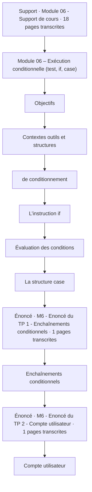
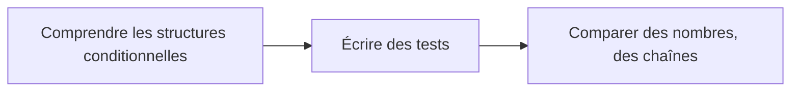
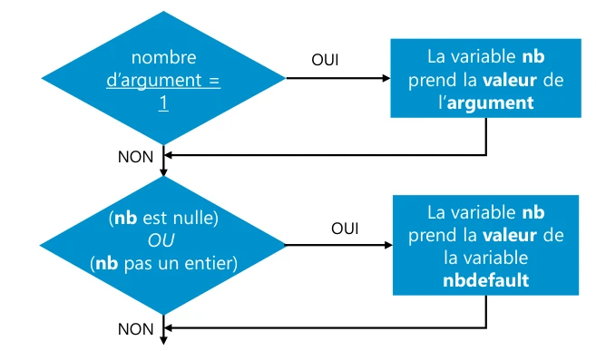
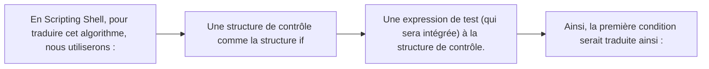
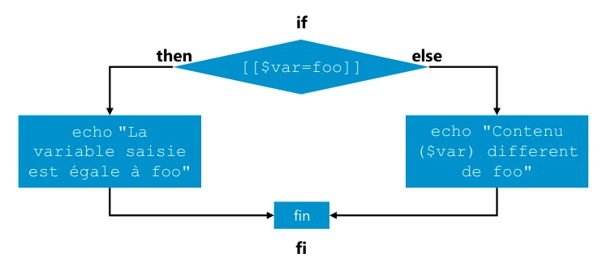
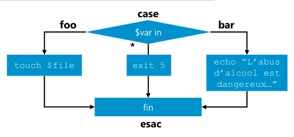

# Module 06 — Exécution conditionnelle

Les parties ci-dessous reprennent le cours original, dans le même ordre. Les encadrés et les schémas répètent ses formulations.

## Parcours de lecture

1. Support · Module 06 - Support de cours · 18 pages transcrites
2. Module 06 – Exécution conditionnelle (test, if, case)
3. Objectifs
4. Contextes outils et structures
5. de conditionnement
6. L’instruction if
7. Évaluation des conditions
8. La structure case
9. Énoncé · M6 - Enoncé du TP 1 - Enchaînements conditionnels · 1 pages transcrites
10. Enchaînements conditionnels
11. Énoncé · M6 - Enoncé du TP 2 - Compte utilisateur · 1 pages transcrites
12. Compte utilisateur
13. Objectifs
14. Énoncé
15. Correction · M6 - Solutions du TP 1 - Enchaînements conditionnels · 2 pages transcrites
16. Enchaînements conditionnels
17. Correction · M6 - Solutions du TP 2 - Compte utilisateur · 2 pages transcrites
18. Compte utilisateur
19. Objectifs
20. Énoncé

**Visuel externe**



SOURCE DRIVE · TRANSCRIPTION DU SUPPORT

Le contenu des documents du dossier TSSR est transcrit ci-dessous, page par page. Les textes et tableaux sont intégrés à la page Web. Aucun fichier PDF, aucune diapositive entière ni aucune reproduction de page n’est affiché. Seuls des croquis ou visuels isolés et vérifiés peuvent accompagner la transcription. Les versions et les consignes restent celles des supports de formation. Les compléments IA sont conservés dans leur onglet distinct.

## Support · Module 06 - Support de cours · 18 pages transcrites

!!! note "À retenir"
    Le texte, les tableaux et le code sont transcrits d’après le PDF de formation.

Le texte, les tableaux et le code sont transcrits d’après le PDF de formation. Les sauts de ligne suivent la présentation du support. Les exemples historiques sont commentés dans le cours optimisé.

## Page 1

## Module 06 – Exécution conditionnelle (test, if, case)

## Objectifs

!!! note "À retenir"
    Comprendre les structures conditionnelles Écrire des tests Comparer des nombres, des chaînes

**Visuel externe**



- Comprendre les structures conditionnelles
- Écrire des tests
- Comparer des nombres, des chaînes

## Page 2

## Contextes outils et structures

## de conditionnement

### Contextes outils et structures de conditionnement

!!! note "À retenir"
    Dans de nombreux cas pratiques, la réalisation d’actions est conditionnée.

!!! example "Exemple"
    Dans cet exemple, la valeur de la variable nb est conditionnée au nombre d’arguments passé au script puis à la présence ou non de contenu dans cette variable.

Dans de nombreux cas pratiques, la réalisation d’actions est conditionnée.



Choix de la valeur de nb selon les arguments et leur contenu.

Dans cet exemple, la valeur de la variable nb est conditionnée au nombre d’arguments passé au script puis à la présence ou non de contenu dans cette variable.

| Condition | OUI | NON |
| --- | --- | --- |
| nombre d’argument = 1 | La variable nb prend la valeur de l’argument. | Vérifier le contenu de nb. |
| (nb est nulle) OU (nb pas un entier) | La variable nb prend la valeur de la variable nbdefault. | Poursuivre. |

## Page 3

### Contextes outils et structures de conditionnement

!!! note "À retenir"
    En Scripting Shell, pour traduire cet algorithme, nous utiliserons : Une structure de contrôle comme la structure if Une expression de test (qui sera intégrée) à la structure de contrôle.

**Visuel externe**



- En Scripting Shell, pour traduire cet algorithme, nous utiliserons :
- Une structure de contrôle comme la structure if
- Une expression de test (qui sera intégrée) à la structure de contrôle.
- Ainsi, la première condition serait traduite ainsi :

| Structure de contrôle if | Test de la condition | Structure complète |
| --- | --- | --- |
| if condition ;then nb=$1 fi | [[ $nbarg –eq 1 ]] | if [[ $nbarg –eq 1 ]] ; then nb=$1 fi |

- Dans ce module seront successivement abordées la structure if puis les expressions de tests.

## L’instruction if

## Page 4

### L’instruction if

!!! note "À retenir"
    L’instruction if est utilisée pour structurer la réalisation conditionnée de commandes.

L’instruction if est utilisée pour structurer la réalisation conditionnée de commandes.



Les deux branches du test if puis leur point de convergence.

Si la condition est remplie, alors je fais telle action, sinon je fais telle action. Fin du si.

```
if [[$var=foo]]
then
    echo "La variable saisie est égale à foo"
else
    echo "Contenu ($var) different de foo"
fi
```

### L’instruction if

**Visuel externe**


- Cette instruction requiert au minimum :
- Un début : if
- L’exécution d’une commande (un test de condition par exemple)
- L’exécution d’au moins une action si la condition est vérifiée : then
- Une fin : fi
- Cette instruction peut être complétée par :
- L’exécution d’autres actions si la condition est vérifiée
- L’exécution d’actions à réaliser si la condition n’est pas vérifiée : else

## Page 5

### L’instruction if

### Convention de structure de la boucle if

!!! note "À retenir"
    Il existe 2 syntaxes pour l’écriture de la structure if : Moderne Classique Dans ce support, la forme moderne de la structure sera prise pour les exemples.

**Visuel externe**


- Il existe 2 syntaxes pour l’écriture de la structure if :

Moderne Classique

```
if condition
```

```
if condition ; then
```

```
then
```

```
Action1
```

```
action1
```

```
else
```

```
else
```

```
Action2
```

```
action2
```

```
fi
```

- Dans ce support, la forme moderne de la structure sera prise pour les exemples.
- Mais vous pouvez choisir la méthode de votre choix.

### L’instruction if

### Utilisation minimale de if

!!! note "À retenir"
    Dans l’exemple ci-dessous, la condition de réalisation de l’action d’affichage est conditionnée par le résultat du test.

- Dans l’exemple ci-dessous, la condition de réalisation de l’action d’affichage est conditionnée par le résultat du test.

```
if [[ "$LOGNAME" = root ]] ; then
   echo "Ne pas se connecter en root"
fi
```

- Autre exemple d’utilisation conditionné par le code retour d’une commande (ls) :

```
if ls /tmp ; then
   echo "/tmp existe"
fi
```

## Page 6

### L’instruction if

### Utilisation de if avec else

if s’utilise souvent avec else pour choisir une action ou une autre

```
if [[ "$LOGNAME" = root ]] ; then
   echo "Ne pas se connecter en root"
else
   echo "Bienvenue sur la machine $HOSTNAME"
fi
```

### L’instruction if

### Utilisation de if avec else

Il est possible de stipuler plusieurs actions dans une structure if :

```
if [[ "$LOGNAME" = root ]] ; then
      echo "Ne pas se connecter en root"
      echo "Le script va quitter"
      exit 1
else
      echo "Bienvenue sur la machine $HOSTNAME"
      echo "Le script continue"
fi
```

## Page 7

### L’instruction if

### Imbrication de structures if

- Il est possible d’imbriquer des structures if entre elles. Dans l’exemple ci-dessous, on fait d’autres tests si le premier n’est pas rempli.
- Dans le cas d’imbrication d’un if dans un else, on peut utiliser la structure imbriquée elif.

Imbrication de structures if

Utilisation du elif

```
                                      if <condition> ; then
         <action>
else
```

```
                             elif <condition> ; then
if <condition> ; then
```

```
         <action>
else
```

```
<action>
                             <action>
```

```
else
         <action>
```

```
fi
```

```
# fin commune des 2 if
```

```
fi
```

```
                 # fin du second if
fi
```

```
# fin du premier if
```

Démo

L'instruction if

## Page 8

## Évaluation des conditions

### Les commandes de tests

- Le conditionnement de commandes s’appuie sur l’évaluation de conditions.
- Afin d’évaluer une ou plusieurs conditions, il est possible d’utiliser les commandes suivantes :

| Syntaxe | Description dans le support |
| --- | --- |
| test condition | Commande externe de test utilisable quel que soit le Shell |
| [ condition ] | Identique à la commande test |
| [[ condition ]] | Commande interne à certains Shells (dont le Bash) qui prend en charge des fonctionnalités supplémentaires |
| (( condition )) | Commande réservée à l’utilisation de tests arithmétiques |

## Page 9

### Les commandes de tests

- Suite à l’exécution de ces commandes, leur code retour peut avoir pour valeur :
- 0 : l’expression est vraie
- 1 : l’expression est fausse
- Dans ce cours, les tests sont réalisés au moyen de [[ ]].
- Certains éléments abordés ne sont pas pris en charge par les autres commandes de tests. [ ] et test

### Critères d’évaluation

- Lors de l’évaluation d’une condition, les critères d’évaluation sont liés au type d’élément à évaluer, celui-ci pouvant être :
- Un entier (chiffre ou nombre)
- Une chaîne (mot ou phrase)
- Une composante du système de fichier (fichier, répertoire, etc.)
- Les principaux opérateurs de tests sont présentés dans ce cours.

## Page 10

### Critères d’évaluation

### Opérateurs de comparaison sur les entiers

- Prendre garde à ce que la variable testée soit déclarée en type entier (typeset –i variable).

### Comparaison sur les entiers

| Élément | Signification dans le support |
| --- | --- |
| -eq | égalité |
| -ne | différence |
| -gt | supérieur |
| -ge | supérieur ou égal |
| -lt | inférieur |
| -le | inférieur ou égal |

```
if [[ $nbre –eq 2 ]] ; then
      echo 'nombre choisi : 2'
fi
```

### Critères d’évaluation

### Opérateurs de comparaison sur les chaînes

```
if [[ $prenom = sofia ]] ; then
```

### Comparaison sur les chaînes

| Élément | Signification dans le support |
| --- | --- |
| = | égalité |
| != | différence |
| -n $nomvar | variable non nulle |
| -z $nomvar | variable nulle |

```
      echo 'Bienvenue Sofia'
fi
if [[ -z $prenom ]] ; then
      echo 'Merci de saisir
votre prénom'
fi
```

## Page 11

### Critères d’évaluation

### Opérateurs de comparaison sur les fichiers

```
if [[ -d $rep ]] ; then
```

### Comparaison sur les fichiers

| Élément | Signification dans le support |
| --- | --- |
| -d nomrep | répertoire |
| -f nomfic | fichier ordinaire |
| -w nomfic | droit d’écriture |
| -r nomfic | droit de lecture |
| -x nomfic | droit d’exécution |
| -s nomfic | taille de nomfich > 0 |

```
      ls -l $rep
fi
if [[ -f $fic ]] ; then
      cat $fic
else
      echo "$fic absent"
fi
```

### Combinaison de critères

- Il est possible de cumuler plusieurs critères au sein d’un même test.
- On utilise alors les options suivantes :

| Opérateur | Combinaison de critères |
| --- | --- |
| && | et logique |
| // | ou logique |
| ! | négation |
| ( ) | regroupement |

```
if [[ -f fic1 && ( -d rep1 || -d rep2 ) ]] ; then
   echo "fic1 est présent, ainsi que rep1 ou rep2"
Fi
```

## Page 12

Les caractères spéciaux dans les chaînes

### Les caractères spéciaux dans les chaînes

### Métacaractères du Shell

- Les expressions de test sont interprétées par le Shell.
- Il est donc possible d’utiliser des caractères spéciaux dans celles-ci.
- Rappel :

| Motif | Signification |
| --- | --- |
| * | 0 à n caractères |
| ? | 1 caractère quelconque |
| […] | 1 caractère parmi ceux entre crochets |
| [^…] | 1 caractère autre que ceux indiqués entre crochets (ou [!...]) |

## Page 13

### Facteurs d’occurrence

### Facteurs d’occurence

| Motif | Facteur d’occurrence |
| --- | --- |
| ?(…) | 0 à 1 fois l’expression |
| *(…) | 0 à n fois l’expression |
| +(…) | 1 à n fois l’expression |
| @(…) | 1 fois l’expression |
| !(…) | 0 fois l’expression |
| *(…/…) | De 0 à n fois l’expression 1 ou l’expression 2. Valable également pour les caractères ? * + @ ! |

```
chaine=+123
if [[ "$chaine" = ?([+-])+([0-9]) ]] ; then
   echo "$chaine est un nombre valide"
fi
```

Pour la prise en compte de facteurs d’occurrences, l’option extglob doit être activée dans le Shell d’interprétation du script.

```
$ shopt
$ shopt -s extglob
```

Illustration d’un cas pratique

## Page 14

### Illustration d’un cas pratique

- Illustration de test valide ou non une expression :

```
[[ -d /data ]] && {
    mkdir /data/perso
    cp -a /home/penthium/documents/* /data/perso
    }
```

- Dans cet exemple, le test [[ -d /data ]] vérifie l’existence ou non du répertoire /data
- Si le répertoire existe, le code retour de test est égal à 0. Le regroupement de commandes qui suit est alors effectué.
- S’il n’existe pas, le code de sortie test diffère de 0. Le regroupement de commandes est ignoré.

### Illustration d’un cas pratique

- Cet exemple pourrait être intégré dans une instruction if :

```
if [[ -d /data ]] ; then
   mkdir /data/perso
   cp -a /home/penthium/documents/* /data/perso
fi
```

## Page 15

### L'instruction if

Démo

Les opérateurs de tests

## La structure case

## Page 16

### La structure case

La structure de contrôle case est adaptée au test d’un contenu (généralement stocké dans une variable) pouvant contenir un ensemble de valeurs et des actions liées à ces valeurs.

### La structure case

### Algorithme d’illustration

La variable var ($var) peut contenir les valeurs : « foo », « bar » ou toute autre chaîne.

| Valeur de $var | Action | Exemple |
| --- | --- | --- |
| foo | Une action de création de fichiers est réalisée | touch $file |
| bar | Une action d’affichage est réalisée | echo “L’abus d’alcool est dangereux…” |
| Toute autre valeur (*) | Sortie du script avec un code d’erreur | exit 5 |

Début du case. On compare la valeur de $var à "foo" ou à "bar" ou à "*". Si la valeur est "foo" je fais une action. Si la valeur est "bar" je fais une autre action. Si la valeur est "*" je fais une troisième action. Fin du case.

`case $var in` → `esac`



Trois branches de l’instruction case pour foo, bar et les autres valeurs.

## Page 17

### La structure case

### Syntaxe d’utilisation

```
case $nomvar in
      expr)
            action1
            action2
            ;;
      expr2)
            action
            ;;
esac
```

### La structure case

### Exemple d’utilisation

```
case $saisie in
         p)
```

La liste de valeurs possibles est

```
echo "la lettre est p"
```

interprétée par le Shell, ce qui autorise

```
;;
```

l’utilisation de métacaractères ou

```
[0-9])
```

d’expressions complexes.

```
echo "un chiffre"
;;
```

Pour le premier des cas verifiés, les

```
a|b)
         echo "a  ou  b"
```

actions qui lui sont associées sont

```
echo "\?"
```

effectuées suivi de la sortie

```
;;
```

immédiate de la structure. Aucun

```
*)
```

autre cas ne sera appliqué.

```
                 echo "n’importe quel autre caractère"
                 ;;
esac
```

## Page 18

### La structure case

Démo

La structure case

Référence du document : 1vBhU461pGTtCLHLiCRKTvUCzXhMkCbQj · SHA-256 e712a8ded12fb87e…

## Énoncé · M6 - Enoncé du TP 1 - Enchaînements conditionnels · 1 pages transcrites

Le texte, les tableaux et le code sont transcrits d’après le PDF de formation. Les sauts de ligne suivent la présentation du support. Les exemples historiques sont commentés dans le cours optimisé.

## Page 1

## Enchaînements conditionnels

### TP1 du Module 06 - Les caractères spéciaux du Shell

Avant de démarrer ce TP, il convient d’avoir suivi les modules 1 à 6.

Objectifs

Créer un script Shell utilisant des enchainements de commandes conditionnels.

Énoncé

- A partir de l’analyse des besoins détaillée ci-dessous, réaliser un script Shell permettant d’y répondre
- Tester le bon fonctionnement de votre script

Analyse des besoins

Il vous est demandé de réaliser un script qui va afficher un message de bienvenue si tout se déroule correctement.

Le message contiendra un nom d’utilisateur qui aura été saisi, ainsi que le nom du système Linux.

Voici les contraintes :

- Le script ne prendra qu’un SEUL nom d’utilisateur en argument (ex : $ ./script_M6TP1.sh paul)

```
o
```

Si aucun argument fourni, il sera demandé de le saisir

```
o
```

Si plusieurs noms sont fournis : sortie du script avec code retour 1

- Si le nom saisi est "root" :

```
o
```

Affiche "Le compte root est interdit" en rouge gras sur fond noir

```
o
```

Quitte le script avec le code retour 2

- Affichage principal du script, seulement si un nom a bien été fourni :

```
Bonjour <nom>, bienvenue sur la machine <nom_de_la_machine>
```

- A la fin du script (si pas de sortie du script) s’affichera en plus :

```
---  Fin du script ---
```

Référence du document : 1YP1cVDq4E-vLxMpUw5I9fI-4wcuDJxiL · SHA-256 6c9d77ddacbd2c56…

## Énoncé · M6 - Enoncé du TP 2 - Compte utilisateur · 1 pages transcrites

Le texte, les tableaux et le code sont transcrits d’après le PDF de formation. Les sauts de ligne suivent la présentation du support. Les exemples historiques sont commentés dans le cours optimisé.

## Page 1

## Compte utilisateur

### TP2 du Module 06 – Exécution conditionnelle

Avant de démarrer ce TP, il convient d’avoir suivi les vidéos des modules 1 à 6.

## Objectifs

Créer un script en réponse à un besoin

## Énoncé

Analyse des besoins

Il vous est demandé de réaliser un script, simplifiant la gestion de comptes utilisateurs.

Lorsqu’il sera lancé, il doit tout d’abord être demandé le nom d’utilisateur sur lequel agir.

Ensuite, un menu doit proposer un choix d’actions :

- Créer le compte utilisateur
- Changer le mot de passe
- Supprimer le compte
- Vérifier si le compte existe ou non actuellement

Voici un exemple de visuel du menu :

```
# ./script_M6TP2.sh
Saisir l'identifiant utilisateur souhaité : Estelle
GESTION DES UTILISATEURS : Estelle
--------------------------
C - Créer le compte utilisateur
M - Modifier le mot de passe de l'utilisateur
S - Supprimer le compte utilisateur
V - Vérifier si le compte utilisateur existe
Q – Quitter
Votre choix : v
Vérification de l'existence du compte
Compte utilisateur de Estelle INEXISTANT
```

Référence du document : 11H3jsfcy1IbcWY2A8m3sWmPqahjlvhO0 · SHA-256 ffca51858dccde29…

## Correction · M6 - Solutions du TP 1 - Enchaînements conditionnels · 2 pages transcrites

Le texte, les tableaux et le code sont transcrits d’après le PDF de formation. Les sauts de ligne suivent la présentation du support. Les exemples historiques sont commentés dans le cours optimisé.

Correction originale : à consulter après avoir tenté l’exercice.

## Page 1

## Enchaînements conditionnels

### Solutions - TP1 du Module 06 - Les caractères spéciaux du Shell

A partir de l’analyse des besoins, réaliser un script Shell permettant d’y répondre

Dans les étapes d’élaboration du script, il faudra commencer par vérifier si un nom a été saisi directement après le fichier de script lors de son exécution. S’il y a bien un seul argument, le conserver durablement dans une variable, si plus d’un : sortie du script. S’il n’y en a aucun, le script doit le demander et le stocker dans une variable.

Ensuite, si le nom est ‘root’, le script doit afficher une interdiction et sortir du script. Sinon pour tout autre nom doit afficher un message de bienvenue.

Les variables réservées sont ici utilisées : $# pour le nombre d’arguments fournis lors du lancement du script et $1 pour le 1er argument fourni (cf module sur variables réservées)

- Créer et éditer un nouveau fichier script, par exemple, nommé script_M6TP1.sh

```
vim script_M6TP1.sh
```

- Y ajouter les lignes suivantes :

```
#! /bin/bash
# M6 - Solution du TP1
# Utilisation : ./script_M6TP1.sh  <id utilisateur>
#Déclaration des variables
rouge=’\033[1;31m’
vert=’\033[1;32m’
noir=’\033[0m’
# Etapes de vérification de saisie d’un nom d’utilisateur
[ $# -eq 1 ] && name=$1 # Si 1 argument alors stockage de sa val. dans ‘name’
[ $# -gt 1 ] && echo -e "$rouge Le nombre d'arguments est invalide !$noir" && exit 1 #
Si plusieurs arguments => sortie
[ $# -eq 0 ] && read -p "Veuillez saisir votre nom d'utilisateur : " name # Si 0
argument fourni, invite de saisie
# Si le nom saisi est ‘root’, interdiction en rouge + sortie
[[ $name = root ]] && echo -e "$rouge Interdit de se connecter en $name $noir" && exit
2
# Si la variable name contient bien une valeur, affichage du message de bienvenue
```

## Page 2

```
[[ -n $name ]] && echo -e "$vert Bonjour $name, bienvenue sur la machine
$HOSTNAME.$noir"
# Message de fin de script
echo "--- Fin du script ---"
```

- Rendre exécutable le fichier à l’aide de la commande chmod utilisée dans d’autres modules précédents
- Lancer le script en testant différents scénarios (avec 0, puis 1 et enfin 2 arguments) et avec différents noms dont root

Référence du document : 16cYCyItRy67yMDgG_4l0QDll7f3yKU4S · SHA-256 16f4cc33b4946bf7…

## Correction · M6 - Solutions du TP 2 - Compte utilisateur · 2 pages transcrites

Le texte, les tableaux et le code sont transcrits d’après le PDF de formation. Les sauts de ligne suivent la présentation du support. Les exemples historiques sont commentés dans le cours optimisé.

Correction originale : à consulter après avoir tenté l’exercice.

## Page 1

## Compte utilisateur

### Solutions – TP2 du Module 06 – Exécution conditionnelle

Avant de démarrer ce TP, il convient d’avoir suivi les vidéos des modules 1 à 6.

## Objectifs

Créer un algorithme de solution en réponse à un besoin et cahier des charges donné.

Créer un script à partir d’un algorithme.

## Énoncé

Pour créer ce script, il faut travailler par étape.

Tout d’abord, il faut commencer par demander la saisie du compte utilisateur sur lequel agir. Ensuite, il faut afficher le menu à l’écran et inviter à choisir une proposition dans la liste. Enfin, il faudra gérer chaque choix possible en indiquant la/les commande(s) Shell à passer.

- Créer et éditer un nouveau fichier script script_M6TP2.sh

```
vim script_M6TP2.sh
```

- Ajouter les lignes suivantes :

```
#! /bin/bash
# M6 - Solution du TP2 - Script de gestion des utilisateurs locaux
# Demande de saisie du compte sur lequel agir
read -p " Saisir l'identifiant utilisateur souhaité : " nom
# Affichage du menu
echo "GESTION DES UTILISATEURS : $nom "
echo "----------------------------------"
echo "C - Créer le compte utilisateur"
echo "M - Modifier le mot de passe de l'utilisateur "
echo "S - Supprimer le compte utilisateur"
echo "V - Vérifier si le compte utilisateur existe"
echo "Q - quitter"
echo ""
```

## Page 2

```
# Demander à choisir parmi la liste
read -p "Votre choix  : " rep
# Gestion choix => action(s)
case $rep in
c|C ) echo "Création du compte"
           useradd -m  -s /bin/bash $nom ;;
m|M ) echo "Modification du mot de passe"
           passwd $nom ;;
s|S ) echo "Suppression du compte"
           userdel $nom ;;
v|V ) echo "Vérification de l’existence du compte"
     userpresent=$(grep $nom "/etc/passwd")
if [[ -z $userpresent ]]; then
echo "Compte utilisateur de $nom INEXISTANT"
else echo "Compte utilisateur de $nom EXISTANT"
fi ;;
q|Q ) exit 0 ;;
*) echo "Erreur de saisie"
exit 1 ;;
esac
```

- Rendre exécutable le script à l’aide de chmod

En supplément, on pourrait avant toute action de création ou suppression, vérifier l’existence du compte et ainsi éviter des erreurs système de se produire en cas d’échec.

Référence du document : 1rS313aAo3GsvPv_q_Lwb1lHg4Sq6b-C9 · SHA-256 39a7399a3bd8d8f6…

## Fiche de synthèse

Les lignes reprennent les titres du cours et la première phrase de chaque partie.

| Partie | Repère du cours |
| --- | --- |
| Support · Module 06 - Support de cours · 18 pages transcrites | Le texte, les tableaux et le code sont transcrits d’après le PDF de formation. |
| Objectifs | Comprendre les structures conditionnelles Écrire des tests Comparer des nombres, des chaînes |
| Énoncé · M6 - Enoncé du TP 1 - Enchaînements conditionnels · 1 pages transcrites | Le texte, les tableaux et le code sont transcrits d’après le PDF de formation. |
| Énoncé · M6 - Enoncé du TP 2 - Compte utilisateur · 1 pages transcrites | Le texte, les tableaux et le code sont transcrits d’après le PDF de formation. |
| Énoncé | Analyse des besoins Il vous est demandé de réaliser un script, simplifiant la gestion de comptes utilisateurs. |
| Correction · M6 - Solutions du TP 1 - Enchaînements conditionnels · 2 pages transcrites | Le texte, les tableaux et le code sont transcrits d’après le PDF de formation. |
| Correction · M6 - Solutions du TP 2 - Compte utilisateur · 2 pages transcrites | Le texte, les tableaux et le code sont transcrits d’après le PDF de formation. |
| Objectifs | Créer un algorithme de solution en réponse à un besoin et cahier des charges donné. |
| Énoncé | Pour créer ce script, il faut travailler par étape. |
