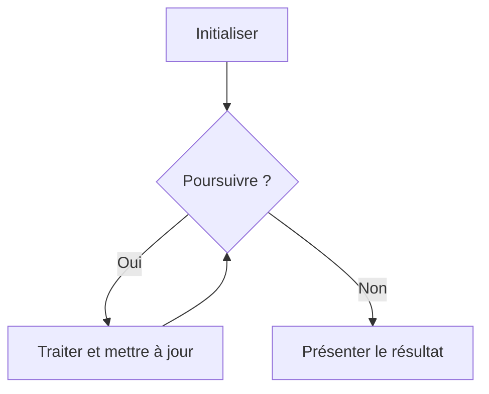

# Module 07 — Les structures de boucle

Une boucle répète des commandes. Définissez le premier état, ce qui déclenche un passage, la progression et la sortie. Le support utilise une condition de saisie, un compteur et une liste de fichiers.

## Faire progresser le traitement

`expr` effectue un calcul entier avec ses opérandes séparés par des espaces. Protégez `*` pour qu’il soit transmis à `expr` au lieu de développer des noms de fichiers. Le support cite également `let` et l’arithmétique Bash.

```bash
expr 2 + 7
expr 2 \* 7
n=0
n=$((n + 1))
printf '%s\n' "$n"
```

`$((…))` développe la valeur du calcul. `((…))` exécute une expression arithmétique et produit un statut. Vérifiez la progression dans chaque branche de la boucle, en particulier lorsqu’une erreur mène à une nouvelle tentative.

## Répéter avec while ou until

| Structure | Entrée dans le corps | Fin |
| --- | --- | --- |
| `while CONDITION` | Le test réussit | Le test a un statut non nul |
| `until CONDITION` | Le test a un statut non nul | Le test réussit |
| `while true` | À chaque passage | Une instruction comme `break` ou `exit` arrête le traitement |
| `for item in …` | Une fois par élément développé | Tous les éléments ont été traités |

Le support présente `while` pour demander un nom tant qu’il est vide et `until` pour demander un âge jusqu’à l’obtention d’une valeur. Dans ce dernier cas, une valeur non vide peut encore être non numérique. Traitez la fin de l’entrée pour éviter une boucle de demandes sans saisie possible.

```bash
nom=
while [[ -z $nom ]]; do
    IFS= read -r -p "Nom : " nom || exit 1
done

age=
until [[ $age =~ ^[0-9]+$ ]]; do
    IFS= read -r -p "Âge entier : " age || exit 1
done
```

Dans un menu, `while true` répète l’affichage. Le choix de quitter mène à `break` pour quitter la boucle ou `exit` pour terminer le script. Un choix inconnu doit produire un retour compréhensible avant le nouveau passage.

## Itérer sur une liste avec for

`for` parcourt les mots issus de la liste après les développements applicables. Les séparateurs d’`IFS` jouent sur le découpage des développements non cités. Les mots cités restent entiers. Avec `"$@"`, chaque argument fourni au script reste un élément.

```bash
for extension in sh txt bash; do
    printf 'Extension : %s\n' "$extension"
done
for argument in "$@"; do
    printf 'Argument : <%s>\n' "$argument"
done
```

Le support montre `set | grep ^IFS` et `IFS=$' \t\n'`. Modifier `IFS` agit sur les développements ultérieurs qui utilisent le découpage de champs. Une affectation placée juste avant `read` limite son usage à la lecture concernée. `for var in $(cat fichier.txt)` découpe des mots et peut développer des caractères génériques. Cette forme est inadaptée aux lignes contenant des espaces ou des motifs.

## Lire des lignes avec while read

```bash
while IFS= read -r ligne || [[ -n $ligne ]]; do
    printf '%s\n' "$ligne"
done < fichier.txt
```

`IFS=` préserve les espaces en bordure. `-r` conserve les antislashs. Le second test permet de traiter la dernière ligne même si elle est dépourvue de saut de ligne. Pour répartir les champs de `/etc/passwd`, utilisez `IFS=: read -r nom passe uid gid commentaire home shell`. Les champs vides et les espaces dans un commentaire restent en place.

Le support présente aussi `cat Edition | while read …` et `done < <(cat Edition)`. Une boucle dans un tube s’exécute généralement dans un sous-shell. Ses affectations peuvent rester locales à ce processus. Une redirection depuis un fichier ou une substitution de processus permet de garder la boucle dans le shell courant. [Pipelines Bash](https://www.gnu.org/software/bash/manual/html_node/Pipelines.html)

Un deuxième `read` sans redirection dans la boucle consomme la ligne suivante de la même entrée. Pour demander une réponse à l’utilisateur, le support redirige ce `read` depuis `/dev/tty`. Cette forme nécessite un terminal de contrôle.

## Trois travaux pratiques

| TP | Traitement | Vérification |
| --- | --- | --- |
| 01 partie 1 | Analyser `13.sh` et compléter sa documentation. Les mois sont parcourus jusqu’à 13 | Compteur initial, détection du vendredi, format de calendrier |
| 01 partie 2 | Rechercher les années bissextiles dans un intervalle inclusif | `2026 2029` donne 2028. Préciser la règle des siècles |
| 02 | Compter les fichiers selon une liste d’extensions | Répertoire contenant des espaces, extension absente et total |
| 03 | Lire `/etc/passwd` avec `while read` et afficher nom et UID | Délimiter sur `:` et conserver les champs vides |

### Progression — Complément pédagogique



## Mini-quiz

1. Quand une boucle `until` s’arrête-t-elle ?
2. Pourquoi préférer une redirection de fichier pour un compteur utilisé après la boucle ?
3. Que fait le second `read` quand il partage l’entrée du premier ?

**Réponses.** Dès que la condition réussit. Le compteur reste dans le shell courant. Le second `read` avance la même entrée.

- [TP du module et corrections](../../tp/11-initiation-scripting-bash/module-07/index.md)
- [Fiche de révision](../../revision/11-initiation-scripting-bash/module-07-les-structures-de-boucle.md)
