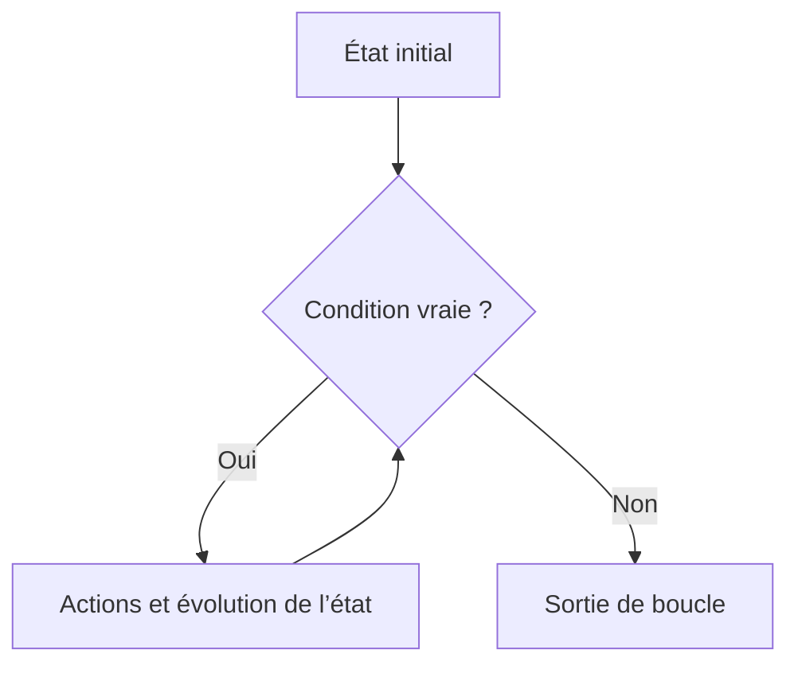

# Module 07 — Les structures de boucle

## Objectifs

Ce module présente les boucles en algorithmique, le calcul associé et les boucles `while`, `until` et `for`. Il introduit aussi `while read` pour traiter un fichier ligne par ligne.

## Répéter et faire progresser un calcul

Une boucle répète un bloc d'actions selon une condition ou une liste de valeurs. Lorsque la condition dépend d'une variable, le support rappelle de faire évoluer cette variable, notamment par un calcul.

```bash
expr 2 + 7
expr 2 \* 7
```

Les opérateurs de `expr` sont séparés par des espaces. Le support cite `let` et `((…))` comme alternatives, développées dans le module consacré à l'arithmétique entière.

## Boucle `while`

```bash
while CONDITION; do
    ACTIONS
done
```

Le support illustre une saisie de nom tant que la variable est vide :

```bash
while [[ -z "$nom" ]]; do
    read nom
done
```

Une boucle infinie est également illustrée avec `while true; do` dans un scénario de menu.

## Boucle `until`

```bash
until CONDITION; do
    ACTIONS
done
```

L'exemple demande une saisie tant que l'âge n'est pas renseigné :

```bash
until [[ -n "$age" ]]; do
    read age
done
```

## Boucle `for` et séparateurs

```bash
for element in LISTE DE VALEURS; do
    ACTIONS
done
```

La liste est interprétée par le Shell selon les séparateurs de champs `IFS`. Les formes montrées sont `set | grep ^IFS` et `IFS=$' \t\n'`.

## Lire ligne par ligne avec `while read`

Le support compare une itération `for`, qui découpe selon `IFS`, à `while read`, qui permet de traiter séparément les champs d'une ligne :

```bash
for var in $(cat fichier.txt); do
    echo "$var"
done

while read nom prenom suite; do
    echo "$prenom$nom"
done < fichier.txt
```

Les autres formes documentées sont `done < <(cat Edition)` et `cat Edition | while read nom prenom num`.

Dans le scénario où un second `read` est nécessaire pendant une boucle, son entrée est redirigée depuis le terminal :

```bash
read -p "message : " choix </dev/tty
```

## Mise en pratique

Le TP1 conserve deux parties distinctes : l'analyse du scénario vendredi 13, puis la recherche d'années bissextiles. Le TP2 porte sur une boucle `for` et un fichier d'extensions externe. Le TP3 documente une boucle `while read` sur `/etc/passwd`; sa correction source est explicitement signalée comme nécessitant une revue.

## Liens

- [TP M07](../../tp/11-initiation-scripting-bash/module-07/index.md)
- [Révision M07](../../revision/11-initiation-scripting-bash/module-07-les-structures-de-boucle.md)

<!-- TSSR-SERVICE-SCRIPT-VISUAL-20261020 -->

## Complément IA / externe au cours — Lire une boucle while

**Illustration IA / externe au cours.**



Illustration de synthèse IA : pour expliquer une boucle du TP, nommer l’état initial, la condition, l’action qui fait progresser l’état et le cas de sortie. Comparer ensuite avec `until`, qui poursuit lorsque sa condition est fausse.
