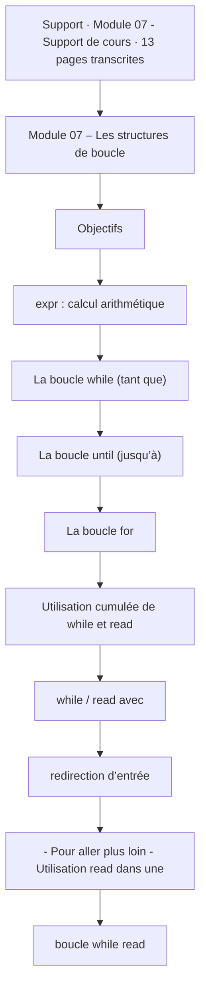

# Module 07 — Les structures de boucle

Les parties ci-dessous reprennent le cours original, dans le même ordre. Les encadrés et les schémas répètent ses formulations.

## Parcours de lecture

1. Support · Module 07 - Support de cours · 13 pages transcrites
2. Module 07 – Les structures de boucle
3. Objectifs
4. expr : calcul arithmétique
5. La boucle while (tant que)
6. La boucle until (jusqu’à)
7. La boucle for
8. Utilisation cumulée de while et read
9. while / read avec
10. redirection d’entrée
11. - Pour aller plus loin - Utilisation read dans une
12. boucle while read
13. Énoncé · M7 - Enoncé du TP 1 - Boucle until · 2 pages transcrites
14. Boucle until
15. Objectifs
16. Énoncé
17. Énoncé · M7 - Enoncé du TP 2 - Boucle for · 1 pages transcrites
18. Boucle for
19. Objectifs
20. Énoncé
21. Énoncé · M7 - Enoncé du TP 3 - Boucle while-read · 1 pages transcrites
22. Boucle while/read
23. Objectifs
24. Énoncé
25. Correction · M7 - Solution du TP 1 - Boucle until · 5 pages transcrites
26. Boucle until
27. Objectifs
28. Énoncé
29. Correction · M7 - Solution du TP 2 - Boucle for · 2 pages transcrites
30. Boucle for
31. Objectifs
32. Énoncé
33. Correction · M7 - Solution du TP 3 - Boucle while-read · 2 pages transcrites
34. Boucle while/read
35. Objectifs
36. Énoncé
37. Correction · M7 - Solution du TP 1 - partie1_13.sh · document texte
38. Correction · M7 - Solution du TP 1 - partie2.sh · document texte
39. Démonstration · 13.sh · document texte

**Visuel externe**



SOURCE DRIVE · TRANSCRIPTION DU SUPPORT

Le contenu des documents du dossier TSSR est transcrit ci-dessous, page par page. Les textes et tableaux sont intégrés à la page Web. Aucun fichier PDF, aucune diapositive entière ni aucune reproduction de page n’est affiché. Seuls des croquis ou visuels isolés et vérifiés peuvent accompagner la transcription. Les versions et les consignes restent celles des supports de formation. Les compléments IA sont conservés dans leur onglet distinct.

## Support · Module 07 - Support de cours · 13 pages transcrites

!!! note "À retenir"
    Le texte, les tableaux et le code sont transcrits d’après le PDF de formation.

Le texte, les tableaux et le code sont transcrits d’après le PDF de formation. Les sauts de ligne suivent la présentation du support. Les exemples historiques sont commentés dans le cours optimisé.

## Page 1

## Module 07 – Les structures de boucle

## Objectifs

!!! note "À retenir"
    Appréhender les boucles en algorithmique Utiliser des fonctions arithmétiques Maîtriser les boucles while, until, for Coupler read avec while pour lire des fichiers

**Visuel externe**


- Appréhender les boucles en algorithmique
- Utiliser des fonctions arithmétiques
- Maîtriser les boucles while, until, for
- Coupler read avec while pour lire des fichiers

## Page 2

### Les structures de boucle

!!! note "À retenir"
    Une boucle est une structure permettant de répéter plusieurs fois un même bloc d’actions.

**Visuel externe**


- Une boucle est une structure permettant de répéter plusieurs fois un même bloc d’actions.
- Le nombre de fois à exécuter le bloc d’actions peut être déterminé par une condition ou une liste d’objets à traiter.
- Quand il s’agit d’une condition, penser à faire évoluer la valeur des variables utilisées dans celle-ci (notamment au moyen de calcul).


Boucle de saisie tant que le choix n’est pas O, N ou Q.

Choix = O ou N ou Q ? OUI, poursuivre. NON, afficher les choix possibles, O(ui), N(on) ou Q(uitter), puis refaire la saisie utilisateur.

Trois mécanismes de boucles sont utilisables en Shell :

- `while`
- `until`
- `for`

## expr : calcul arithmétique

## Page 3

### expr : calcul arithmétique

!!! note "À retenir"
    Syntaxe Les arguments passés à la commande peuvent être des entiers ou des variables (contenant des entiers).

Syntaxe

```
expr calcul
```

- Les arguments passés à la commande peuvent être des entiers ou des variables (contenant des entiers). Chaque opérateur doit être précédé et suivi d’un espace.

```
expr 2 + 7
```

Les commandes let et ((…)) peuvent être utilisées

```
9
```

en remplacement de la commande expr.

```
expr 2 \* 7
```

Nous les étudions au module « L’arithmétique entière »

```
14
```

## La boucle while (tant que)

## Page 4

### La boucle while (tant que)

!!! note "À retenir"
    Structure de bouclage basée sur une condition atteinte : tant que la condition est atteinte, on effectue le bloc d’actions.

- Structure de bouclage basée sur une condition atteinte : tant que la condition est atteinte, on effectue le bloc d’actions. Moderne Classique

```
while CONDITION
```

```
while CONDITION ; do
```

```
do
```

```
ACTIONS
```

```
ACTIONS
```

```
done
```

```
done
```

- Dans ce support, la forme moderne de la structure sera prise pour les exemples. Mais vous pouvez choisir la méthode de votre choix.
- La boucle until vue plus loin aura les mêmes méthodes d’écriture moderne ou classique.

### La boucle while (tant que)

### Exemple

!!! note "À retenir"
    Imposer la saisie du nom à l’utilisateur La structure while analyse le code retour de la condition pour déterminer si le bloc d’actions est à exécuter ou s’il doit sortir de la boucle.

**Visuel externe**


- Imposer la saisie du nom à l’utilisateur

```
while [[ -z "$nom" ]] ; do
         echo -e "Veuillez entrer votre nom : \c"
         read nom
done
echo "Bonjour $nom"
```

- La structure while analyse le code retour de la condition pour déterminer si le bloc d’actions est à exécuter ou s’il doit sortir de la boucle.
- Généralement, la condition se matérialise par une commande de test.
- On agit alors dans le bloc d’actions afin de faire évoluer le résultat du test.
- Cependant, toute commande peut être utilisée en condition (tant que son code retour est « 0 », on reste dans la boucle).

## Page 5

### La boucle while (tant que)

### Cas particulier des boucles infinies

!!! note "À retenir"
    Pour générer une boucle infinie, on utilise la commande true ou ":".

- Pour générer une boucle infinie, on utilise la commande true ou ":".
- Les boucles infinies sont notamment utilisées pour la création de menus.

```
while true ;
```

```
          do
echo menu
```

```
                    # Affichage du menu
          echo "1) copie des fichiers"
          echo "2) restauration des fichiers"
          echo "q) Quitter"
          # Récupérer la saisie de l'utilisateur dans $choix
          read -p "Taper 1, 2 ou q pour continuer : " choix
          # Tester la valeur de $choix
          case $choix in
                    1) echo copie des fichiers; […] ;;
                    2) echo restauration des fichiers; […] ;;
                    q) clear ; exit 0 ;;
                    *) echo -e "\e[41msaisie incorrecte \e[0m" ;;
          esac
done
```

## La boucle until (jusqu’à)

## Page 6

### La boucle until

!!! note "À retenir"
    Structure basée sur une condition à atteindre : tant que la condition n’est pas atteinte, on effectue un bloc d’actions.

- Structure basée sur une condition à atteindre : tant que la condition n’est pas atteinte, on effectue un bloc d’actions.
- La vérification de la condition mène à la sortie de la boucle.
- La structure until et son mode de fonctionnement sont identiques à la boucle while. Seule la condition de bouclage les différencie.
- Pour faire une boucle infinie avec until, il est possible d’utiliser la commande false.

Structure

```
until [[ -n "$age" ]] ; do
```

```
until CONDITION ; do
```

```
echo -e "Saisissez votre age : \c"
```

```
ACTIONS
```

```
read age
```

```
Done
```

```
done
```

### la boucle until

Démo

La boucle until

## Page 7

## La boucle for

### La boucle for

**Visuel externe**


- La boucle for peut boucler :
- Pour un ensemble de valeurs à traiter
- Un nombre de fois prédéterminé

## Page 8

### La boucle for

### Boucler pour un ensemble de valeurs

- La syntaxe d’utilisation suivante permet de boucler pour un ensemble de valeurs à traiter.

```
for element in LISTE DE VALEURS ; do
         ACTIONS
done
```

- Lors du premier passage dans la boucle, la valeur affectée à la variable définie $element sera la première valeur de la liste : « LISTE ».
- Lors du second passage, $variable contiendra « DE » et ainsi de suite jusqu’à ce que les valeurs aient été traitées.

### La boucle for

### Boucler pour un ensemble de valeurs

- La liste de valeurs est

```
$ for valeurs in "petit exemple" de "boucle for" ; do
```

Exemple

```
>echo "Entrée dans le bloc d’actions de la boucle"
```

interprétée par le Shell.

```
>echo "contenu de la variable valeurs : $valeurs"
```

- La liste des caractères de

```
>done
```

séparation de champs entre

```
Entrée dans le bloc d’actions de la boucle
contenu de la variable valeurs : petit exemple
```

les différentes valeurs est

```
Entrée dans le bloc d’actions de la boucle
```

récupérée depuis la variable

```
contenu de la variable valeurs : de
```

d’environnement IFS

```
Entrée dans le bloc d’actions de la boucle
contenu de la variable valeurs : boucle for
```

(Internal Field Separator).

- Il est parfois utile de modifier

```
# set | grep ^IFS
```

cette valeur.

```
IFS=$' \t\n'
```

## Page 9

### Les structures de boucle

Mise en situation

Les boucles for

Réaliser l’atelier numéro 7 mis à disposition par le formateur

TP

## Utilisation cumulée de while et read

## Page 10

### Utilisation cumulée de while et read

- La boucle for récupère les séparateurs de champs définis pour le contexte d’exécution en cours (via la variable IFS).
- Les caractères espace, tabulation (\t) ou retour à la ligne (\n) ne sont pas interprétés comme caractères quelconques, mais comme des séparateurs.
- L’utilisation combinée de while et de read permet :
- De traiter ligne par ligne un fichier (ou résultat de commande)
- De traiter distinctement les champs de chaque ligne

### Utilisation cumulée de while et read

Exemple d’utilisation

```
thouin Frèdèric linux
brossier Gilles windows
[…]
```

Traitement avec une boucle for Traitement avec while read

```
for var in $(cat fichier.txt) ; do
```

```
while read nom prenom suite  ; do
```

```
echo "$var"
```

```
echo "$prenom $nom"
```

```
done
```

```
done < fichier.txt
```

```
thouin
```

```
Frédéric thouin
```

```
Frédéric
```

```
Gilles brossier
```

```
linux
brossier
Gilles
windows
…
```

## Page 11

### Utilisation cumulée de while et read

- La structure combinée while read nous permet d’utiliser distinctement les trois champs de chaque ligne du fichier, à la différence de for qui ne le permet pas directement.
- L’argument suite passé à la commande read n’est pas utilisé dans le bloc d’actions.
- Il est cependant nécessaire afin que toutes les informations de fin de ligne ne soient pas stockées dans la variable prenom.
- La syntaxe présentée ci-dessous est utilisée quand les informations à traiter se trouvent dans un fichier.

```
while read nom prenom suite  ; do
         echo "$prenom $nom"
done < fichier.txt
```

## while / read avec

## redirection d’entrée

## Page 12

### while / read avec redirection d’entrée

- Pour utiliser le résultat de commandes comme flux d’entrée ou pour effectuer un traitement au fichier avant la boucle while read, on utilise la syntaxe suivante :

```
while read nom prenom reste ; do
   echo "$prenom $nom"
```

Bien respecter les espaces

```
done < <(cat Edition)
```

comme dans cet exemple.

- Alternativement, cette syntaxe peut être utilisée :

```
cat Edition | while read nom prenom num
do
```

Le pipe suppose la création d’un sous Shell. Les variables

```
echo "$prenom $nom"
```

créées dans le script ne sont pas utilisables dans la boucle.

```
done
```

Cette méthode a l’avantage d’une meilleure lisibilité.

## - Pour aller plus loin - Utilisation read dans une

## boucle while read

## Page 13

### Pour aller plus loin – Utilisation de read dans une boucle while read

- La commande read utilisée avec while a pour flux d’entrée le flux stdin (généré par la commande avant le pipe).
- Ce flux n’est pas exploitable par un second read.
- Pour utiliser un second read, il faut rediriger son flux d’entrée standard depuis /dev/tty (périphérique correspondant aux saisies clavier).

```
cat fic | while read nom ; do
    if [[ "$nom" = toto ]] ; then
         echo "$nom"
                 read -p "message : " choix </dev/tty
                 echo "$choix"
         fi
done
```

- Alternativement, cette syntaxe peut être utilisée :

```
while read nom ; do
if [[ "$nom" = toto ]] ; then
    echo "$nom"
        read -p "message : " choix </dev/tty
        echo "$choix"
    fi
done < <(cat fic)
```

Référence du document : 1YXzt9MERa188L-jCfcKSZRQFyKKIIA0X · SHA-256 1d9cfb3656392d6b…

## Énoncé · M7 - Enoncé du TP 1 - Boucle until · 2 pages transcrites

Le texte, les tableaux et le code sont transcrits d’après le PDF de formation. Les sauts de ligne suivent la présentation du support. Les exemples historiques sont commentés dans le cours optimisé.

## Page 1

## Boucle until

### TP1 du Module 07 – Les structures de boucle

Avant de démarrer ce TP, il convient d’avoir suivi les vidéos des modules 1 à 6.

## Objectifs

Etudier et expliquer un script Shell utilisant des structures et enchaînements de commandes conditionnels.

## Énoncé

1- Analyse d’un script existant

- Récupérer le script 13.sh puis le copier dans votre machine virtuelle GNU/Linux. Pour ce faire, vous pouvez utiliser soit :

o La commande scp en ligne de commande. Depuis un système Windows, ouvrez une

invite « cmd » et tapez :

```
scp CheminEtNomFichierACopier Utilisateurlinux@AdresseIPLinux
```

Exemple :

```
scp C:\users\l.atreides\Downloads\13.sh paul@192.168.10.3
```

o L’utilitaire Windows gratuit Winscp disposant d’une interface graphique

- Rendre exécutable le script et le lancer
- Editer et analyser le contenu du script afin d’en appréhender :

o Son utilité

o Sa syntaxe d’utilisation

o Son fonctionnement

- Tâches à effectuer : remplacer les zones de commentaires identifiées <A COMPLETER> par une explication des actions effectuées par les commandes situées en-dessous

2- Rédaction d’un nouveau script

## Page 2

Créer un nouveau script nommé script_M7TP1.sh permettant sur une plage d’années donnée de déterminer le nombre d’années bissextiles pour la plage considérée. Pour rappel, ce sont les années qui comptent un 29ème jour au mois de février.

o Les années de début et de fin seront fournies en arguments au script

Par exemple : ./script_M7TP1.sh 2026 2029

S’il y a plus ou moins de 2 arguments, sortie du script avec un message précisant la syntaxe d’utilisation du script

o Inspirez-vous du script 13.sh (la boucle until, la commande cal et

l’incrémentation d’un compteur à chaque tour de boucle notamment…)

- L’objectif final est d’afficher à l’écran le nombre d’années bissextiles trouvées et les années exactes. Cela pourrait donner un visuel approchant comme ci-dessous :

```
./script_M7TP1.sh 2026 2029
##########################################

##  Période considérée de 2026 à 2029   ##

##########################################
Il y a 1 année(s) bissextile(s) dans la plage donnée
Année(s) : 2028
```

Référence du document : 1epqsjaQFmY7b_36ivYpoK2lMTYJUv32D · SHA-256 9dd3692207d6f261…

## Énoncé · M7 - Enoncé du TP 2 - Boucle for · 1 pages transcrites

Le texte, les tableaux et le code sont transcrits d’après le PDF de formation. Les sauts de ligne suivent la présentation du support. Les exemples historiques sont commentés dans le cours optimisé.

## Page 1

## Boucle for

### TP2 du Module 07 – Les structures de boucle

Avant de démarrer ce TP, il convient d’avoir suivi les vidéos des modules 1 à 7.

## Objectifs

Créer un script Shell utilisant une instruction de boucle for.

## Énoncé

Créer un script Shell script_M7TP2.sh permettant pour un répertoire donné, de comptabiliser les fichiers selon leurs extensions (ex : .txt, .sh, .docx etc.)

- Le script devra obligatoirement être lancé avec en argument le nom du dossier à traiter o S’il est lancé avec 0 ou plusieurs arguments -> affichage de la syntaxe d’utilisation,

puis sortie du script

- Les extensions de fichiers prises en compte par le script doivent être inscrites dans un fichier externe (une extension par ligne)

o Les extensions non référencées ne sont pas prises en compte

Conseil Créez-vous quelques fichiers au préalable, avec toutes sortes d’extensions, dans le dossier que vous ciblerez, avec la commande touch.

Exemple de résultat attendu pour le dossier /tmp

```
# ./script_M7TP2.sh /tmp
Nombre total de fichiers dans /tmp : 20
-----------
.sh
-----------
-> 6 fichier(s) trouvé(s)
-----------
.txt
-----------
-> 4 fichier(s) trouvé(s)
```

Référence du document : 179DDjUEXzQNI2pTLlR8vacvvxQk_fQVT · SHA-256 76e31d3be6c07131…

## Énoncé · M7 - Enoncé du TP 3 - Boucle while-read · 1 pages transcrites

Le texte, les tableaux et le code sont transcrits d’après le PDF de formation. Les sauts de ligne suivent la présentation du support. Les exemples historiques sont commentés dans le cours optimisé.

## Page 1

## Boucle while/read

### TP3 du Module 07 – Les structures de boucle

Avant de démarrer ce TP, il convient d’avoir suivi les vidéos des modules 1 à 7.

## Objectifs

Créer un script Shell utilisant une structure de boucle while/read.

## Énoncé

Créer un script Shell script_M7TP3.sh qui affiche pour chaque utilisateur présent dans le fichier /etc/passwd, le nom et l’UID.

Utiliser pour cela, la structure while read

- Afin de formater correctement la base de compte utilisateur, vous pourrez vous inspirer de la commande suivante :

tr -s ":" " " => permet de remplacer les “:” par un espace

Exemple de résultat attendu

```
# ./script_M7TP3.sh
-------------------------
Identifiant :    root
-  -  -  -  -
UID : 0
-------------------------
Identifiant :    daemon
-  -  -  -  -
UID : 1
etc..
```

Référence du document : 1OQU_jtjKVQlzf6QICICKdTjtWlZHeobJ · SHA-256 0adc6c3467c0501e…

## Correction · M7 - Solution du TP 1 - Boucle until · 5 pages transcrites

Le texte, les tableaux et le code sont transcrits d’après le PDF de formation. Les sauts de ligne suivent la présentation du support. Les exemples historiques sont commentés dans le cours optimisé.

Correction originale : à consulter après avoir tenté l’exercice.

## Page 1

## Boucle until

### Solution – TP1 du Module 07 – Les structures de boucle

Avant de démarrer ce TP, il convient d’avoir suivi les vidéos des modules 1 à 6.

## Objectifs

Etudier et expliquer un script Shell utilisant des structures et enchaînements de commandes conditionnels.

## Énoncé

1- Analyse d’un script existant

```
#!/bin/bash
# Definition des variables #
annee=$1
nummois=1
###annee=2011
rouge='\033[31m'
orange='\033[33m'
vert='\033[32m'
noir='\033[0m'
# Début du script #
# Vérification qu'un argument a été passé #
[[ -z $1 ]] && { echo -e "Syntaxe d'utilisation : $0 $rouge <annee> $noir";
exit 13; }
```

```
echo "###################"
echo "##  ANNEE $annee   ##"
echo "###################"
# Corps du script #
# On boucle pour tous les mois
until [[ $nummois -eq 13 ]]
```

## Page 2

```
do
ligne13=`cal $nummois $annee | grep 13`
     # format du retour de la commande precedente incorrect
     ligne13=$(echo $ligne13)
if [[ $ligne13 = *13\ 14 ]]
then
nommois=`date --date "$nummois/01" +%B`
listmois="$listmois $nommois,"
nbremois=`expr $nbremois + 1`
fi
nummois=`expr $nummois + 1`
done
```

```
# On affiche la liste des mois concernés #
echo -e "En $rouge $listmois $noir surveiller les paraskaviedekatriaphobes
"
# On catégorise l'année en fonction du nombre d'occurence(s) et choix
couleur
case $nbremois in
1)
niveau="calme"
color="$vert"
;;
2)
niveau="moyenne"
color="$orange"
;;
*)

### Test avec 2009

niveau="a forte vigilance"
color="$rouge"
;;
esac
```

```
# On résume l'état de l'année
echo -e "$annee sera une annee ${color}$niveau $noir( $nbremois )"
```

## Page 3

2- Rédaction d’un nouveau script

L’objectif ici, est de trouver quelles sont, dans l’intervalle donnée, les années bissextiles. On se focalise chaque année sur le mois de février seulement. Nous aurons besoin pour cela de la commande cal qui affiche le calendrier mensuel, permettant d’identifier l’existence d’un 29ème jour, ou pas, au mois de février.

Dans ce script, il y aura 3 compteurs à incrémenter : celui qui indiquera le nombre d’années bissextiles trouvées nbannées, celui qui stockera les années réelles listannees et enfin celui qui mettra fin à la boucle until lorsque toutes les années ont été analysées.

Pour ce dernier compteur, qui conditionne l’arrêt ou continuation de la boucle until, il s’agit de rajouter ‘+1’ à l’année de début, pour chaque boucle effectuée. La condition à respecter est : la date de fin de période fournie doit être supérieure au compteur (année de début + nb de boucle effectuée). Ainsi, si on débute la plage à 2024 avec une fin en 2029, voici ce qui se passe :

1er tour de boucle : vérification de la condition : annecourante (2024) est > à 2029 ? NON donc

o Recherche sur l’année 2024 de 29 jour au mois de février

o Incrément du compteur pour until : anneecourante ajout + 1

2ème tour de boucle : vérification de la condition : anneecourante (2025) est > à 2029 ? NON donc

o Recherche sur l’année 2025 de 29 jour au mois de février

o Incrément du compteur pour until : anneecourante ajout + 1

3ème tour de boucle : vérification de la condition : anneecourante (2026) est > à 2029 ? NON donc

o Recherche sur l’année 2026 de 29 jour au mois de février

o Incrément du compteur pour until : anneecourante ajout + 1

Et ainsi de suite …

- Créer et éditer le nouveau fichier script_M7TP1.sh

```
vim script_M7TP1.sh
```

- Y ajouter les lignes suivantes :

```
#! /bin/bash
# Definition des variables #
anneedeb=$1 # Stockage de la première année de la plage
```

## Page 4

```
anneefin=$2 # Stockage de la dernière année de la plage
anneecourante=$anneedeb # Création d'une variable année courante à partir
du début
nbannees=0 # Compteur nombre d’années bissextiles initialisé à zéro
```

```
# Debut du script #
# Si arguments fournis au script ne sont pas = à 2 => Sortie
if [[ $# -ne 2 ]]
then echo "Syntaxe utilisation : script_M6TP2.sh <annee_debut>
<annee_fin>"
exit 3
fi
echo "##########################################"
echo -e "##  Période considérée de $anneedeb a $anneefin   ##"
echo "##########################################"
```

```
# Bouclage pour chaque année sur le mois de février
until [[ $anneecourante -gt $anneefin ]]
do fevrier=$(cal 02 $anneecourante) # Recup du calendrier du mois de
février de l'année courante
echo "$fevrier" | grep "29" | grep -v "[0-9][0-9]29" >/dev/null 2>&1
# On cherche dans ce calendrier la présence du 29ème jour
if [[ $? -eq 0 ]] # Si la valeur 29 est trouvée (code retour = 0)
then nbannees=`expr $nbannees + 1` # Ajout +1 au nombre d'années
bissextiles
listannees="$listannees $anneecourante," # Ajout de l’année au listing
des années concernées
fi
anneecourante=`expr $anneecourante + 1` # Incrément de 1 du compteur
d'année courante afin de vérifier si condition de la boucle until toujours
vraie
done
```

```
# Résumé des années bissextiles trouvées (ou pas)
if [[ $nbannees -gt 0 ]]; then # Si plus d'une année
echo -e "Il y a $nbannees année(s) bissextile(s) dans la plage donnée"
echo -e "Année(s) : $listannees"
else # Si pas d’année bissextile dans la plage
echo -e "Il n'y a aucune année bissextile dans la plage donnée"
fi
```

## Page 5

- Rendre le script exécutable avec chmod et tester

Référence du document : 1UPOn8U2yKJx0QFYyi6snDuHrkMlsNmS3 · SHA-256 7922ba4446f79a2a…

## Correction · M7 - Solution du TP 2 - Boucle for · 2 pages transcrites

Le texte, les tableaux et le code sont transcrits d’après le PDF de formation. Les sauts de ligne suivent la présentation du support. Les exemples historiques sont commentés dans le cours optimisé.

Correction originale : à consulter après avoir tenté l’exercice.

## Page 1

## Boucle for

### Solution - TP2 du Module 07 – Les structures de boucle

Avant de démarrer ce TP, il convient d’avoir suivi les vidéos des modules 1 à 7.

## Objectifs

Créer un script Shell utilisant une instruction de boucle for.

## Énoncé

Les principales difficultés du script sont d’une part lancer un traitement ligne par ligne dans un fichier externe, celui portant les extensions de fichier à traiter, et d’autre part de comptabiliser le nombre de fichiers de chaque type.

Avant tout, il faudra vérifier la présence d’un argument derrière le script, et forcer la sortie s’il est différent de 1. Puis, une boucle for comptabilisera et traitera les fichiers pour chaque extension indiquée dans le fichier externe, avant de récapituler tout cela à l’écran.

- Créer et éditer un nouveau fichier script script_M7TP2.sh

```
vim script_M7TP2.sh
```

- Ajouter les lignes suivantes :

```
#! /bin/bash
# M7 - Solution du TP2 – Boucle for
#! /bin/bash
# Déclaration des variables
chemin=$1 # Récupération de la valeur de l’argument fourni
extfile=./ext.txt # Stockage du nom de fichier avec les extensions
# Vérification : si argument n’est pas = à 1 => sortie
if [[ $# -ne 1 ]]
then echo "Syntaxe utilisation : ./script_M7TP2.sh <chemin>"
exit 1
fi
# Calcul du nombre de fichiers présents dans le dossier cible
```

## Page 2

```
nbfictotal=$(ls $chemin | wc -l )
echo "Nombre total de fichiers dans $chemin : $nbfictotal"
echo ""
# Début de la boucle for pour traiter chaque extension
for ext in $(cat $extfile)
do
nbfic=$(ls $chemin/*.$ext 2>/dev/null | wc -w) # Comptabiliser nb
fichiers trouvés portant l’extension
if [[ $nbfic -gt 0 ]] # Si le nb fichiers trouvés > 0 alors affichage
     then echo "--------------"
     echo "     .$ext     "
     echo "--------------"
     echo "-> $nbfic fichier(s) trouvé(s)"
     echo ""
fi
done
```

- Rendre exécutable le script à l’aide de chmod

Référence du document : 1-kZ1c9EU7cu0aHtmn4SmJcErngNIj5sI · SHA-256 df6bd2c25798c474…

## Correction · M7 - Solution du TP 3 - Boucle while-read · 2 pages transcrites

Le texte, les tableaux et le code sont transcrits d’après le PDF de formation. Les sauts de ligne suivent la présentation du support. Les exemples historiques sont commentés dans le cours optimisé.

Correction originale : à consulter après avoir tenté l’exercice.

## Page 1

## Boucle while/read

### Solution – TP3 du Module 07 – Les structures de boucle

Avant de démarrer ce TP, il convient d’avoir suivi les vidéos des modules 1 à 7.

## Objectifs

Créer un script Shell utilisant une structure de boucle while/read.

## Énoncé

Le fichier /etc/passwd gère les comptes utilisateurs créés sur le système, un par ligne. On y trouve dans l’ordre : le login, le champ ‘x’ (indiquant qu’un mot de passe est présent), l’UID, le GID du groupe principal, le champ commentaire, le rép. d’accueil puis le shell par défaut.

Seuls nous intéresse donc, le 1er et 3ème champ de chaque ligne, sachant que le séparateur est le symbole “:”.

Il faut ainsi demander un traitement ligne par ligne en ne récupérant que le 1er et 3ème champ de chaque ligne et les afficher à l’écran.

- Créer et éditer le nouveau fichier script_M7TP3.sh

```
vim script_M7TP3.sh
```

- Y ajouter les lignes suivantes :

```
#! /bin/bash
# M7 - Solution du TP3 – Boucle while/read
# Definition des variables #
#!/bin/bash
while read login c2 uid
do
echo "-------------------------"
echo "Identifiant :  $id"
```

## Page 2

```
echo "-  -  -  -  -"
echo "UID : $uid
done < < (cat /etc/passwd | tr -s ":" " ")
```

- Rendre le script exécutable avec chmod et tester

Référence du document : 1Z3Tf96Tp7Xpt8Ex_FYMlxnpIchwCKfDT · SHA-256 a655da4f5623b879…

## Correction · M7 - Solution du TP 1 - partie1_13.sh · document texte

Le contenu du fichier shell est transcrit en texte. Les fins de ligne sont présentées au format Web.

Correction originale : à consulter après avoir tenté l’exercice.

## Page 1

```
#!/bin/bash

# Definition des variables #

annee=$1

nummois=1

###annee=2011

rouge='\033[31m'

orange='\033[33m'

vert='\033[32m'

noir='\033[0m'

# Debut du script #

# Verification qu'un argument a bien été passé

[[ -z $1 ]] && { echo -e "Syntaxe d'utilisation : $0 $rouge <annee> $noir"; exit 13; }

echo "###################"

echo "##  ANNEE $annee   ##"

echo "###################"

# On boucle pour tous les mois

until [[ $nummois -eq 13 ]]

        do

        ligne13=`cal $nummois $annee | grep 13`

	# format du retour de la commande precedente incorrect

	ligne13=$(echo $ligne13)

        if [[ $ligne13 = *13\ 14 ]]

                then

                nommois=`date --date "$nummois/01" +%B`

                listmois="$listmois $nommois,"

                nbremois=`expr $nbremois + 1`

        fi

        nummois=`expr $nummois + 1`

done

# On affiche la liste des mois concernés

echo -e "En $rouge $listmois $noir surveiller les paraskaviedekatriaphobes "

# On categorise l'annee en fonction du nombre d'occurence(s) et choix couleur

case $nbremois in

        1)

        niveau="calme"

        color="$vert"

        ;;

        2)

        niveau="moyenne"

        color="$orange"

        ;;

        *)

        ### Test avec 2009

        niveau="a forte vigilance"

        color="$rouge"

        ;;

esac

# On résume l'etat de l'annee

echo -e "$annee sera une annee ${color}$niveau $noir( $nbremois )"
```

Référence du document : 1BCvLWFpU75kfErsL8oAw0FrxBbLBc08r · SHA-256 3c29e00f69d813e6…

## Correction · M7 - Solution du TP 1 - partie2.sh · document texte

Le contenu du fichier shell est transcrit en texte. Les fins de ligne sont présentées au format Web.

Correction originale : à consulter après avoir tenté l’exercice.

## Page 1

```
#! /bin/bash

# Definition des variables #

anneedeb=$1 # Stockage de la première année de la plage

anneefin=$2 # Stockage de la dernière année de la plage

anneecourante=$anneedeb # Création d'une variable année courante à partir du début

nbannees=0 # Compteur nombre d’années bissextiles initialisé à zéro

# Debut du script #

# Si arguments fournis au script ne sont pas = à 2 => Sortie

if [[ $# -ne 2 ]]

  then echo "Syntaxe utilisation : script_M6TP2.sh <annee_debut> <annee_fin>"

  exit 3

fi

echo "##########################################"

echo -e "##  Période considérée de $anneedeb a $anneefin   ##"

echo "##########################################"

# Bouclage pour chaque année sur le mois de février

until [[ $anneecourante -gt $anneefin ]]

 do fevrier=$(cal 02 $anneecourante) # Recup du calendrier du mois de février de l'année courante

    echo "$fevrier" | grep "29" | grep -v "[0-9][0-9]29" >/dev/null 2>&1 # On cherche dans ce calendrier la présence du 29ème jour

if [[ $? -eq 0 ]] # Si la valeur 29 est trouvée (code retour = 0)

 then nbannees=`expr $nbannees + 1` # Ajout +1 au nombre d'années bissextiles

   listannees="$listannees $anneecourante," # Ajout de l’année au listing des années concernées

fi

anneecourante=`expr $anneecourante + 1` # Incrément de 1 du compteur d'année courante afin de vérifier si condition de la boucle until toujours vraie

done

# Résumé des années bissextiles trouvées (ou pas)

if [[ $nbannees -gt 0 ]]; then # Si plus d'une année

  echo -e "Il y a $nbannees année(s) bissextile(s) dans la plage donnée" 

  echo -e "Année(s) : $listannees"

else # Si pas d’année bissextile dans la plage

  echo -e "Il n'y a aucune année bissextile dans la plage donnée" 

fi
```

Référence du document : 14gK_dR3ytfTSI4XtGS3sRnKhOvwrjvO1 · SHA-256 382aee57014ba716…

## Démonstration · 13.sh · document texte

Le contenu du fichier shell est transcrit en texte. Les fins de ligne sont présentées au format Web.

## Page 1

```
#!/bin/bash

# A COMPLETER #
annee=$1
nummois=1
###annee=2011
rouge='\033[31m'
orange='\033[33m'
vert='\033[32m'
noir='\033[0m'

# A COMPLETER #

# A COMPLETER #
[[ -z $1 ]] && { echo -e "Syntaxe d'utilisation : $0 $rouge <annee> $noir"; exit 13; }

echo "###################"
echo "##  ANNEE $annee   ##"
echo "###################"

# A COMPLETER #
# On boucle pour tous les mois
until [[ $nummois -eq 13 ]]
        do
        ligne13=`cal $nummois $annee | grep 13`
	# format du retour de la commande precedente incorrect
	ligne13=$(echo $ligne13)
        if [[ $ligne13 = *13\ 14 ]]
                then
                nommois=`date --date "$nummois/01" +%B`
                listmois="$listmois $nommois,"
                nbremois=`expr $nbremois + 1`
        fi
        nummois=`expr $nummois + 1`
done

# A COMPLETER #
echo -e "En $rouge $listmois $noir surveiller les paraskaviedekatriaphobes "
# A COMPLETER #
case $nbremois in
        1)
        niveau="calme"
        color="$vert"
        ;;
        2)
        niveau="moyenne"
        color="$orange"
        ;;
        *)
        niveau="a forte vigilance"
        color="$rouge"
        ;;
esac

# A COMPLETER #
echo -e "$annee sera une annee ${color}$niveau $noir( $nbremois )"
```

Référence du document : 1Xgo-5CiGRnpkBSmk7lncRgk2yGZUR-aN · SHA-256 0ff9cec7b1089750…

## Fiche de synthèse

Les lignes reprennent les titres du cours et la première phrase de chaque partie.

| Partie | Repère du cours |
| --- | --- |
| Support · Module 07 - Support de cours · 13 pages transcrites | Le texte, les tableaux et le code sont transcrits d’après le PDF de formation. |
| Objectifs | Appréhender les boucles en algorithmique Utiliser des fonctions arithmétiques Maîtriser les boucles while, until, for Coupler read avec while pour lire des fichiers |
| Énoncé · M7 - Enoncé du TP 1 - Boucle until · 2 pages transcrites | Le texte, les tableaux et le code sont transcrits d’après le PDF de formation. |
| Objectifs | Etudier et expliquer un script Shell utilisant des structures et enchaînements de commandes conditionnels. |
| Énoncé | 1- Analyse d’un script existant Récupérer le script 13.sh puis le copier dans votre machine virtuelle GNU/Linux. |
| Période considérée de 2026 à 2029   ## | Il y a 1 année(s) bissextile(s) dans la plage donnée Année(s) : 2028 |
| Énoncé · M7 - Enoncé du TP 2 - Boucle for · 1 pages transcrites | Le texte, les tableaux et le code sont transcrits d’après le PDF de formation. |
| Objectifs | Créer un script Shell utilisant une instruction de boucle for. |
| Énoncé | Créer un script Shell script_M7TP2.sh permettant pour un répertoire donné, de comptabiliser les fichiers selon leurs extensions (ex : .txt, .sh, .docx etc.) Le script devra obli… |
| Énoncé · M7 - Enoncé du TP 3 - Boucle while-read · 1 pages transcrites | Le texte, les tableaux et le code sont transcrits d’après le PDF de formation. |
| Objectifs | Créer un script Shell utilisant une structure de boucle while/read. |
| Énoncé | Créer un script Shell script_M7TP3.sh qui affiche pour chaque utilisateur présent dans le fichier /etc/passwd, le nom et l’UID. |
| Correction · M7 - Solution du TP 1 - Boucle until · 5 pages transcrites | Le texte, les tableaux et le code sont transcrits d’après le PDF de formation. |
| Objectifs | Etudier et expliquer un script Shell utilisant des structures et enchaînements de commandes conditionnels. |
| Correction · M7 - Solution du TP 2 - Boucle for · 2 pages transcrites | Le texte, les tableaux et le code sont transcrits d’après le PDF de formation. |
| Objectifs | Créer un script Shell utilisant une instruction de boucle for. |
| Énoncé | Les principales difficultés du script sont d’une part lancer un traitement ligne par ligne dans un fichier externe, celui portant les extensions de fichier à traiter, et d’autre… |
| Correction · M7 - Solution du TP 3 - Boucle while-read · 2 pages transcrites | Le texte, les tableaux et le code sont transcrits d’après le PDF de formation. |
| Objectifs | Créer un script Shell utilisant une structure de boucle while/read. |
| Énoncé | Le fichier /etc/passwd gère les comptes utilisateurs créés sur le système, un par ligne. |
| Correction · M7 - Solution du TP 1 - partie1_13.sh · document texte | Le contenu du fichier shell est transcrit en texte. |
| Correction · M7 - Solution du TP 1 - partie2.sh · document texte | Le contenu du fichier shell est transcrit en texte. |
| Démonstration · 13.sh · document texte | Le contenu du fichier shell est transcrit en texte. |
