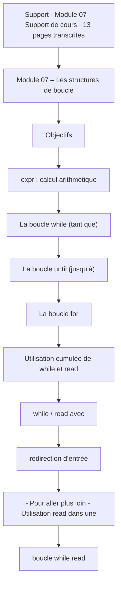
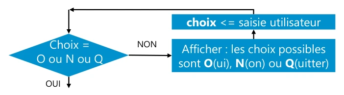

# Module 07 — Les structures de boucle

[Travaux pratiques](../../tp/11-initiation-scripting-bash/module-07/index.md)

Les parties ci-dessous reprennent le cours original, dans le même ordre. Les encadrés et les schémas répètent ses formulations.

## Parcours de lecture

1. Support · Module 07 - Support de cours · 13 pages transcrites
2. Module 07 – Les structures de boucle
3. Objectifs
4. expr : calcul arithmétique
5. La boucle while (tant que)
6. La boucle until (jusqu’à)
7. La boucle for
8. Utilisation cumulée de while et read
9. while / read avec
10. redirection d’entrée
11. - Pour aller plus loin - Utilisation read dans une
12. boucle while read
13. Boucle until
14. Objectifs
15. Énoncé
16. Boucle for
17. Objectifs
18. Énoncé
19. Boucle while/read
20. Objectifs
21. Énoncé
22. Boucle until
23. Objectifs
24. Énoncé
25. Boucle for
26. Objectifs
27. Énoncé
28. Boucle while/read
29. Objectifs
30. Énoncé

**Visuel externe**



SOURCE DRIVE · TRANSCRIPTION DU SUPPORT

Le contenu des documents du dossier TSSR est transcrit ci-dessous, page par page. Les textes et tableaux sont intégrés à la page Web. Aucun fichier PDF, aucune diapositive entière ni aucune reproduction de page n’est affiché. Seuls des croquis ou visuels isolés et vérifiés peuvent accompagner la transcription. Les versions et les consignes restent celles des supports de formation. Les compléments IA sont conservés dans leur onglet distinct.

## Support · Module 07 - Support de cours · 13 pages transcrites

!!! note "À retenir"
    Le texte, les tableaux et le code sont transcrits d’après le PDF de formation.

Le texte, les tableaux et le code sont transcrits d’après le PDF de formation. Les sauts de ligne suivent la présentation du support. Les exemples historiques sont commentés dans le cours optimisé.

## Page 1

## Module 07 – Les structures de boucle

## Objectifs

!!! note "À retenir"
    Appréhender les boucles en algorithmique Utiliser des fonctions arithmétiques Maîtriser les boucles while, until, for Coupler read avec while pour lire des fichiers

**Visuel externe**


- Appréhender les boucles en algorithmique
- Utiliser des fonctions arithmétiques
- Maîtriser les boucles while, until, for
- Coupler read avec while pour lire des fichiers

## Page 2

### Les structures de boucle

!!! note "À retenir"
    Une boucle est une structure permettant de répéter plusieurs fois un même bloc d’actions.

**Visuel externe**


- Une boucle est une structure permettant de répéter plusieurs fois un même bloc d’actions.
- Le nombre de fois à exécuter le bloc d’actions peut être déterminé par une condition ou une liste d’objets à traiter.
- Quand il s’agit d’une condition, penser à faire évoluer la valeur des variables utilisées dans celle-ci (notamment au moyen de calcul).



Boucle de saisie tant que le choix n’est pas O, N ou Q.

Choix = O ou N ou Q ? OUI, poursuivre. NON, afficher les choix possibles, O(ui), N(on) ou Q(uitter), puis refaire la saisie utilisateur.

Trois mécanismes de boucles sont utilisables en Shell :

- `while`
- `until`
- `for`

expr : calcul arithmétique

## Page 3

expr : calcul arithmétique

!!! note "À retenir"
    Syntaxe Les arguments passés à la commande peuvent être des entiers ou des variables (contenant des entiers).

Syntaxe

```
expr calcul
```

- Les arguments passés à la commande peuvent être des entiers ou des variables (contenant des entiers). Chaque opérateur doit être précédé et suivi d’un espace.

```
expr 2 + 7
```

Les commandes let et ((…)) peuvent être utilisées

```
9
```

en remplacement de la commande expr.

```
expr 2 \* 7
```

Nous les étudions au module « L’arithmétique entière »

```
14
```

## La boucle while (tant que)

## Page 4

### La boucle while (tant que)

!!! note "À retenir"
    Structure de bouclage basée sur une condition atteinte : tant que la condition est atteinte, on effectue le bloc d’actions.

- Structure de bouclage basée sur une condition atteinte : tant que la condition est atteinte, on effectue le bloc d’actions. Moderne Classique

```
while CONDITION
```

```
while CONDITION ; do
```

```
do
```

```
ACTIONS
```

```
ACTIONS
```

```
done
```

```
done
```

- Dans ce support, la forme moderne de la structure sera prise pour les exemples. Mais vous pouvez choisir la méthode de votre choix.
- La boucle until vue plus loin aura les mêmes méthodes d’écriture moderne ou classique.

### La boucle while (tant que)

### Exemple

!!! note "À retenir"
    Imposer la saisie du nom à l’utilisateur La structure while analyse le code retour de la condition pour déterminer si le bloc d’actions est à exécuter ou s’il doit sortir de la boucle.

**Visuel externe**


- Imposer la saisie du nom à l’utilisateur

```
while [[ -z "$nom" ]] ; do
         echo -e "Veuillez entrer votre nom : \c"
         read nom
done
echo "Bonjour $nom"
```

- La structure while analyse le code retour de la condition pour déterminer si le bloc d’actions est à exécuter ou s’il doit sortir de la boucle.
- Généralement, la condition se matérialise par une commande de test.
- On agit alors dans le bloc d’actions afin de faire évoluer le résultat du test.
- Cependant, toute commande peut être utilisée en condition (tant que son code retour est « 0 », on reste dans la boucle).

## Page 5

### La boucle while (tant que)

### Cas particulier des boucles infinies

!!! note "À retenir"
    Pour générer une boucle infinie, on utilise la commande true ou ":".

- Pour générer une boucle infinie, on utilise la commande true ou ":".
- Les boucles infinies sont notamment utilisées pour la création de menus.

```
while true ;
```

```
          do
echo menu
```

```
                    # Affichage du menu
          echo "1) copie des fichiers"
          echo "2) restauration des fichiers"
          echo "q) Quitter"
          # Récupérer la saisie de l'utilisateur dans $choix
          read -p "Taper 1, 2 ou q pour continuer : " choix
          # Tester la valeur de $choix
          case $choix in
                    1) echo copie des fichiers; […] ;;
                    2) echo restauration des fichiers; […] ;;
                    q) clear ; exit 0 ;;
                    *) echo -e "\e[41msaisie incorrecte \e[0m" ;;
          esac
done
```

## La boucle until (jusqu’à)

## Page 6

### La boucle until

!!! note "À retenir"
    Structure basée sur une condition à atteindre : tant que la condition n’est pas atteinte, on effectue un bloc d’actions.

- Structure basée sur une condition à atteindre : tant que la condition n’est pas atteinte, on effectue un bloc d’actions.
- La vérification de la condition mène à la sortie de la boucle.
- La structure until et son mode de fonctionnement sont identiques à la boucle while. Seule la condition de bouclage les différencie.
- Pour faire une boucle infinie avec until, il est possible d’utiliser la commande false.

Structure

```
until [[ -n "$age" ]] ; do
```

```
until CONDITION ; do
```

```
echo -e "Saisissez votre age : \c"
```

```
ACTIONS
```

```
read age
```

```
Done
```

```
done
```

la boucle until

Démo

La boucle until

## Page 7

## La boucle for

### La boucle for

**Visuel externe**


- La boucle for peut boucler :
- Pour un ensemble de valeurs à traiter
- Un nombre de fois prédéterminé

## Page 8

### La boucle for

### Boucler pour un ensemble de valeurs

- La syntaxe d’utilisation suivante permet de boucler pour un ensemble de valeurs à traiter.

```
for element in LISTE DE VALEURS ; do
         ACTIONS
done
```

- Lors du premier passage dans la boucle, la valeur affectée à la variable définie $element sera la première valeur de la liste : « LISTE ».
- Lors du second passage, $variable contiendra « DE » et ainsi de suite jusqu’à ce que les valeurs aient été traitées.

### La boucle for

### Boucler pour un ensemble de valeurs

- La liste de valeurs est

```
$ for valeurs in "petit exemple" de "boucle for" ; do
```

Exemple

```
>echo "Entrée dans le bloc d’actions de la boucle"
```

interprétée par le Shell.

```
>echo "contenu de la variable valeurs : $valeurs"
```

- La liste des caractères de

```
>done
```

séparation de champs entre

```
Entrée dans le bloc d’actions de la boucle
contenu de la variable valeurs : petit exemple
```

les différentes valeurs est

```
Entrée dans le bloc d’actions de la boucle
```

récupérée depuis la variable

```
contenu de la variable valeurs : de
```

d’environnement IFS

```
Entrée dans le bloc d’actions de la boucle
contenu de la variable valeurs : boucle for
```

(Internal Field Separator).

- Il est parfois utile de modifier

```
# set | grep ^IFS
```

cette valeur.

```
IFS=$' \t\n'
```

## Page 9

### Les structures de boucle

Mise en situation

Les boucles for

Réaliser l’atelier numéro 7 mis à disposition par le formateur

TP

## Utilisation cumulée de while et read

## Page 10

### Utilisation cumulée de while et read

- La boucle for récupère les séparateurs de champs définis pour le contexte d’exécution en cours (via la variable IFS).
- Les caractères espace, tabulation (\t) ou retour à la ligne (\n) ne sont pas interprétés comme caractères quelconques, mais comme des séparateurs.
- L’utilisation combinée de while et de read permet :
- De traiter ligne par ligne un fichier (ou résultat de commande)
- De traiter distinctement les champs de chaque ligne

### Utilisation cumulée de while et read

Exemple d’utilisation

```
thouin Frèdèric linux
brossier Gilles windows
[…]
```

Traitement avec une boucle for Traitement avec while read

```
for var in $(cat fichier.txt) ; do
```

```
while read nom prenom suite  ; do
```

```
echo "$var"
```

```
echo "$prenom $nom"
```

```
done
```

```
done < fichier.txt
```

```
thouin
```

```
Frédéric thouin
```

```
Frédéric
```

```
Gilles brossier
```

```
linux
brossier
Gilles
windows
…
```

## Page 11

### Utilisation cumulée de while et read

- La structure combinée while read nous permet d’utiliser distinctement les trois champs de chaque ligne du fichier, à la différence de for qui ne le permet pas directement.
- L’argument suite passé à la commande read n’est pas utilisé dans le bloc d’actions.
- Il est cependant nécessaire afin que toutes les informations de fin de ligne ne soient pas stockées dans la variable prenom.
- La syntaxe présentée ci-dessous est utilisée quand les informations à traiter se trouvent dans un fichier.

```
while read nom prenom suite  ; do
         echo "$prenom $nom"
done < fichier.txt
```

while / read avec

redirection d’entrée

## Page 12

while / read avec redirection d’entrée

- Pour utiliser le résultat de commandes comme flux d’entrée ou pour effectuer un traitement au fichier avant la boucle while read, on utilise la syntaxe suivante :

```
while read nom prenom reste ; do
   echo "$prenom $nom"
```

Bien respecter les espaces

```
done < <(cat Edition)
```

comme dans cet exemple.

- Alternativement, cette syntaxe peut être utilisée :

```
cat Edition | while read nom prenom num
do
```

Le pipe suppose la création d’un sous Shell. Les variables

```
echo "$prenom $nom"
```

créées dans le script ne sont pas utilisables dans la boucle.

```
done
```

Cette méthode a l’avantage d’une meilleure lisibilité.

## - Pour aller plus loin - Utilisation read dans une

boucle while read

## Page 13

### Pour aller plus loin – Utilisation de read dans une boucle while read

- La commande read utilisée avec while a pour flux d’entrée le flux stdin (généré par la commande avant le pipe).
- Ce flux n’est pas exploitable par un second read.
- Pour utiliser un second read, il faut rediriger son flux d’entrée standard depuis /dev/tty (périphérique correspondant aux saisies clavier).

```
cat fic | while read nom ; do
    if [[ "$nom" = toto ]] ; then
         echo "$nom"
                 read -p "message : " choix </dev/tty
                 echo "$choix"
         fi
done
```

- Alternativement, cette syntaxe peut être utilisée :

```
while read nom ; do
if [[ "$nom" = toto ]] ; then
    echo "$nom"
        read -p "message : " choix </dev/tty
        echo "$choix"
    fi
done < <(cat fic)
```

Référence du document : 1YXzt9MERa188L-jCfcKSZRQFyKKIIA0X · SHA-256 1d9cfb3656392d6b…

| Support · Module 07 - Support de cours · 13 pages transcrites | Le texte, les tableaux et le code sont transcrits d’après le PDF de formation. |
| Objectifs | Appréhender les boucles en algorithmique Utiliser des fonctions arithmétiques Maîtriser les boucles while, until, for Coupler read avec while pour lire des fichiers |
| Objectifs | Etudier et expliquer un script Shell utilisant des structures et enchaînements de commandes conditionnels. |
| Énoncé | 1- Analyse d’un script existant Récupérer le script 13.sh puis le copier dans votre machine virtuelle GNU/Linux. |
| Période considérée de 2026 à 2029   ## | Il y a 1 année(s) bissextile(s) dans la plage donnée Année(s) : 2028 |
| Objectifs | Créer un script Shell utilisant une instruction de boucle for. |
| Énoncé | Créer un script Shell script_M7TP2.sh permettant pour un répertoire donné, de comptabiliser les fichiers selon leurs extensions (ex : .txt, .sh, .docx etc.) Le script devra obli… |
| Objectifs | Créer un script Shell utilisant une structure de boucle while/read. |
| Énoncé | Créer un script Shell script_M7TP3.sh qui affiche pour chaque utilisateur présent dans le fichier /etc/passwd, le nom et l’UID. |
| Objectifs | Etudier et expliquer un script Shell utilisant des structures et enchaînements de commandes conditionnels. |
| Objectifs | Créer un script Shell utilisant une instruction de boucle for. |
| Énoncé | Les principales difficultés du script sont d’une part lancer un traitement ligne par ligne dans un fichier externe, celui portant les extensions de fichier à traiter, et d’autre… |
| Objectifs | Créer un script Shell utilisant une structure de boucle while/read. |
| Énoncé | Le fichier /etc/passwd gère les comptes utilisateurs créés sur le système, un par ligne. |
