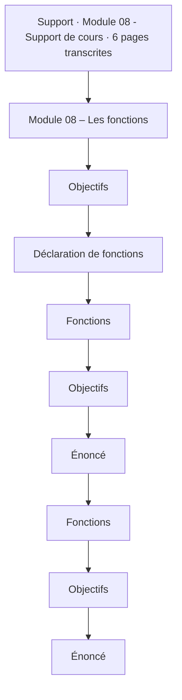
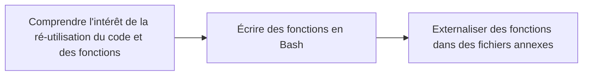
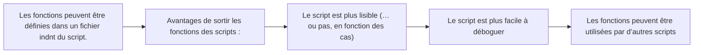

# Module 08 — Les fonctions

[Travaux pratiques](../../tp/11-initiation-scripting-bash/module-08/index.md)

Les parties ci-dessous reprennent le cours original, dans le même ordre. Les encadrés et les schémas répètent ses formulations.

## Parcours de lecture

1. Support · Module 08 - Support de cours · 6 pages transcrites
2. Module 08 – Les fonctions
3. Objectifs
4. Déclaration de fonctions
5. Fonctions
6. Objectifs
7. Énoncé
8. Fonctions
9. Objectifs
10. Énoncé

**Visuel externe**



SOURCE DRIVE · TRANSCRIPTION DU SUPPORT

Le contenu des documents du dossier TSSR est transcrit ci-dessous, page par page. Les textes et tableaux sont intégrés à la page Web. Aucun fichier PDF, aucune diapositive entière ni aucune reproduction de page n’est affiché. Seuls des croquis ou visuels isolés et vérifiés peuvent accompagner la transcription. Les versions et les consignes restent celles des supports de formation. Les compléments IA sont conservés dans leur onglet distinct.

## Support · Module 08 - Support de cours · 6 pages transcrites

!!! note "À retenir"
    Le texte, les tableaux et le code sont transcrits d’après le PDF de formation.

Le texte, les tableaux et le code sont transcrits d’après le PDF de formation. Les sauts de ligne suivent la présentation du support. Les exemples historiques sont commentés dans le cours optimisé.

## Page 1

## Module 08 – Les fonctions

## Objectifs

!!! note "À retenir"
    Comprendre l'intérêt de la ré-utilisation du code et des fonctions Écrire des fonctions en Bash Externaliser des fonctions dans des fichiers annexes

**Visuel externe**



- Comprendre l'intérêt de la ré-utilisation du code et des fonctions
- Écrire des fonctions en Bash
- Externaliser des fonctions dans des fichiers annexes

## Page 2

### Les fonctions

!!! note "À retenir"
    Les fonctions permettent de regrouper plusieurs commandes qui pourront être exécutées de façon régulière durant le script.

- Les fonctions permettent de regrouper plusieurs commandes qui pourront être exécutées de façon régulière durant le script.
- Il est conseillé d’utiliser des minuscules dans le nom des fonctions et de préfixer le nom de la fonction avec le terme « function_ » ou « func_ » suivi du nom réel de la fonction.
- Cela permet de lire le script plus facilement et savoir quand on fait appel à une fonction ou à une commande.

### Les fonctions

!!! note "À retenir"
    La mise en œuvre de fonction se fait en deux étapes : Déclaration de la fonction et de son contenu Appel de la fonction L’appel d’une fonction doit être réalisé APRÈS sa déclaration.

- La mise en œuvre de fonction se fait en deux étapes :
- Déclaration de la fonction et de son contenu
- Appel de la fonction L’appel d’une fonction doit être réalisé APRÈS sa déclaration.
- Les déclarations de fonctions peuvent être stockées dans un fichier séparé, pour rendre un script plus lisible et les réutiliser dans d’autres scripts.
- Les fonctions peuvent être invoquées avec des paramètres, comme les commandes et les scripts.

## Page 3

## Déclaration de fonctions

### Déclaration de fonctions

### Syntaxe de déclaration d’une fonction

```
nomfonction()
{
       ACTIONS
}
```

## Page 4

### Déclaration de fonctions

### Déclaration et utilisation dans le script

!!! note "À retenir"
    Exemple de déclaration et d’appel au sein d’un script

Exemple de déclaration et d’appel au sein d’un script

```
#!/bin/bash
func_infos() {
       echo "Informations sur la distribution utilisée"
       lsb_release -dric
}
# Afficher les infos sur l’OS
func_infos
```

### Déclaration de fonctions

### Les variables dans les fonctions

!!! note "À retenir"
    Les variables traversent les fonctions de manière transparente.

Les variables traversent les fonctions de manière transparente.

```
#!/bin/bash
nbr=50
func_majnbr () {
    nbr=100
}
echo "variable nbr avant fonction: $nbr"
func_majnbr
echo "variable nbr après fonction : $nbr"
```

## Page 5

### Déclaration de fonctions

### Passage de paramètres aux fonctions

!!! note "À retenir"
    Il est possible de passer des paramètres lors de l’appel de la fonction.

Il est possible de passer des paramètres lors de l’appel de la fonction.

```
#!/bin/bash
func_accueil () {
    echo "Message d’accueil :"
    echo "Bonjour $1 $2"
    echo "Bienvenue sur la machine $HOSTNAME"
}
read -p "Entrez votre prénom nom (ex Marc Dubois) : " prenom nom
func_accueil "$prenom" "$nom"
```

### Déclaration de fonctions

### Déclaration dans un fichier indépendant

!!! note "À retenir"
    Les fonctions peuvent être définies dans un fichier indnt du script.

**Visuel externe**



- Les fonctions peuvent être définies dans un fichier indnt du script.
- Il suffit ensuite d’appeler le fichier avec les commandes source ou « . » (point), afin que le contenu de ce fichier soit interprété dans l’environnement d’exécution courant.
- Avantages de sortir les fonctions des scripts :
- Le script est plus lisible (… ou pas, en fonction des cas)
- Le script est plus facile à déboguer
- Les fonctions peuvent être utilisées par d’autres scripts

## Page 6

### Déclaration de fonctions

### Déclaration dans un fichier indépendant

- Contenu du fichier de fonctions « mesfonctions »

```
func_accueil () {
    echo "Message d’accueil :"
    echo "Bonjour $1 $2"
    echo "Bienvenue sur la machine $HOSTNAME"
}
```

- Le fichier de fonction n’a pas besoin d’être exécutable, des privilèges de lecture suffisent.

### Déclaration de fonctions

### Déclaration dans un fichier indépendant

- Contenu du script

```
#!/bin/bash
# Déclaration des fonctions
source ~/mesfonctions
read -p "Saisissez votre prénom et votre nom (ex Marc Dubois) : " prenom nom
# on appelle la fonction accueil du fichier ~/mesfonctions
func_accueil "$prenom" "$nom"
```

Référence du document : 1SrP8wlyZsA2xImTPaCtsP8VCGVgr9MhC · SHA-256 2aa396c34ed8db97…

| Support · Module 08 - Support de cours · 6 pages transcrites | Le texte, les tableaux et le code sont transcrits d’après le PDF de formation. |
| Objectifs | Comprendre l'intérêt de la ré-utilisation du code et des fonctions Écrire des fonctions en Bash Externaliser des fonctions dans des fichiers annexes |
| Objectifs | Créer un script pour répondre à des besoins fonctionnels. |
| Énoncé | Créer un script Shell script_M8TP1.sh proposant les actions suivantes, dans le dossier courant pour tout fichier de script terminant par .sh : Créer des copies de sauvegarde des… |
| Objectifs | Créer un script pour répondre à des besoins fonctionnels. |
| Énoncé | L’objectif ici, est de créer un script principal dont le simple rôle est d’afficher le menu indiquant les actions possibles, et de prévoir les choix possibles de saisie utilisat… |
