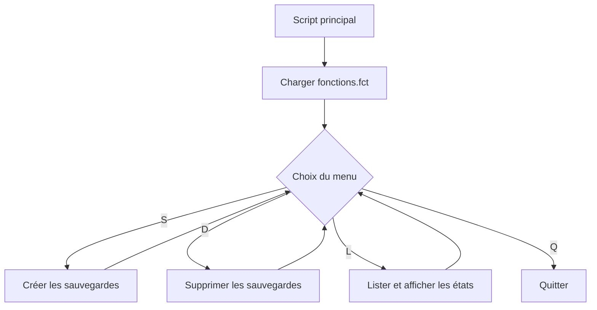

# Module 08 — Les fonctions

Une fonction donne un nom à un ensemble de commandes que le script peut réutiliser. Ce module couvre la déclaration, l’appel, les paramètres, l’usage des variables et le chargement d’un fichier de fonctions.

## Déclarer, puis appeler

Déclarez la fonction avant que le déroulement atteigne son premier appel. Le corps est exécuté lors de l’appel. Le support illustre `func_infos` avec les informations de la distribution, puis utilise un appel séparé pour démarrer la fonction.

```bash
func_infos() {
    printf '%s\n' "Informations sur la distribution utilisée"
    lsb_release -dric
}

func_infos
```

L’exemple suppose que `lsb_release` est disponible. Si cette commande est la dernière de la fonction, son statut devient celui de la fonction. Pour rendre un statut précis et sortir du corps, employez `return`. `exit` termine le shell ou le script qui exécute la fonction. Le résultat textuel peut passer par `printf` sur la sortie standard. [Fonctions Bash](https://www.gnu.org/software/bash/manual/html_node/Shell-Functions.html)

## Partager une valeur ou limiter sa portée

Le support initialise `nbr=50` puis montre une fonction qui écrit `nbr=100`. Quand l’appel se déroule dans le shell courant, cette affectation reste visible après le retour. `local` crée une variable limitée à la fonction et aux fonctions qu’elle appelle. Déclarez les variables de travail ainsi pour éviter de modifier une variable de même nom chez l’appelant.

```bash
nbr=50
func_majnbr() {
    nbr=100
}
func_majnbr
printf 'Après la mise à jour : %s\n' "$nbr"
```

Une substitution de commande comme `message=$(func_infos)` récupère la sortie standard dans une variable. La fonction s’exécute alors dans un sous-shell et ses affectations ne sont pas propagées au parent.

## Passer des paramètres

Les arguments d’un appel deviennent `$1`, `$2` et les autres paramètres positionnels de la fonction pendant son exécution. `$#` compte ces arguments et `"$@"` conserve leurs limites. Au retour, les paramètres positionnels de l’appelant reprennent leurs valeurs.

```bash
func_accueil() {
    [[ $# -eq 2 ]] || return 2
    local prenom=$1 nom=$2
    printf 'Message d’accueil\nBonjour %s %s\n' "$prenom" "$nom"
    printf 'Bienvenue sur la machine %s\n' "$HOSTNAME"
}

read -r -p "Entrez votre prénom et votre nom : " prenom nom || exit 1
func_accueil "$prenom" "$nom"
```

## Charger un fichier de fonctions

Le support utilise `source ~/mesfonctions`, puis le TP charge `. ./fonctions.fct`. Ces commandes lisent et exécutent le contenu dans le shell courant. Le fichier doit être lisible. La permission d’exécution n’est pas requise pour le charger de cette manière. Employez un chemin déterminé vers le fichier attendu, car une commande placée au niveau supérieur du fichier s’exécute lors du chargement.

```bash
if [[ -r ./fonctions.fct ]]; then
    . ./fonctions.fct || exit 1
else
    printf '%s\n' "Fichier de fonctions introuvable" >&2
    exit 1
fi
```

## TP 01 — Sauvegardes et menu

Le script principal affiche en boucle les choix S, D, L et Q. La création, la suppression des sauvegardes et le listing sont définis dans `fonctions.fct`. Les PDF du TP présentent ces fichiers sous forme de code.

| Choix | Fonction | Résultat à contrôler |
| --- | --- | --- |
| S | Copier les scripts `.sh` avec un suffixe `.save` | Le fichier source reste disponible et une copie correspondante existe |
| D | Supprimer les fichiers `.save` du dossier de travail | Les scripts `.sh` restent présents |
| L | Afficher les scripts et leur état | Vert si une sauvegarde existe, rouge dans le cas contraire |
| Q | Arrêter le menu | Le script se termine |

La correction distingue le dossier vide, un script sans copie et un script déjà sauvegardé. Les guillemets protègent les noms contenant des espaces. Une commande de copie ou de suppression doit signaler son résultat. Préparez un répertoire de laboratoire avec des fichiers de test pour observer chaque branche.

### Organisation du TP — Complément pédagogique



## Mini-quiz

1. Que désigne `$1` dans une fonction appelée avec un argument ?
2. Quel rôle joue `return 2` ?
3. À quel moment les commandes au niveau supérieur d’un fichier chargé s’exécutent-elles ?

**Réponses.** Le premier argument de la fonction. La fonction se termine avec le statut 2. Lors de `source` ou `.`.

- [TP 01 et correction](../../tp/11-initiation-scripting-bash/module-08/index.md)
- [Fiche de révision](../../revision/11-initiation-scripting-bash/module-08-les-fonctions.md)
