# Module 01 — Initiation à PowerShell

Les parties ci-dessous reprennent le cours original, dans le même ordre. Les encadrés et les schémas répètent ses formulations.

## Parcours de lecture

1. Support · Module 01 - Support de cours · 12 pages transcrites
2. Démonstration · Fiche démo 1 - Présentation du langage PowerShell-PowerShell Core · 2 pages transcrites
3. Démonstration · Fiche démo 2 - Les Cmdlets · 1 pages transcrites
4. Démonstration · Fiche démo 3 - Get-Command · 2 pages transcrites
5. Démonstration · Fiche démo 4 - Get-Help · 4 pages transcrites
6. Démonstration · Fiche démo 5 - Update-Help · 2 pages transcrites
7. Démonstration · Fiche démo 6 - La protection · 1 pages transcrites
8. Démonstration · Fiche démo 7 - Les modules · 2 pages transcrites
9. Démonstration · Fiche démo 8 - La personnalisation de la console · 3 pages transcrites
10. Énoncé · Énoncé du TP - Premières commandes · 5 pages transcrites
11. Correction · Solution du TP - Premières commandes · 6 pages transcrites

**Visuel externe**

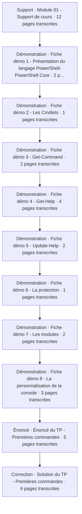

SOURCE DRIVE · TRANSCRIPTION DU SUPPORT

Le contenu des documents du dossier TSSR est transcrit ci-dessous, page par page. Les textes et tableaux sont intégrés à la page Web. Aucun fichier PDF, aucune diapositive entière ni aucune reproduction de page n’est affiché. Seuls des croquis ou visuels isolés et vérifiés peuvent accompagner la transcription. Les versions et les consignes restent celles des supports de formation. Les compléments IA sont conservés dans leur onglet distinct.

## Support · Module 01 - Support de cours · 12 pages transcrites

!!! note "À retenir"
    Les formulations historiques et les exemples du document sont conservés.

Transcription du support du Drive. Les formulations historiques et les exemples du document sont conservés. Les valeurs d’accès du laboratoire sont indiquées comme « fourni par le formateur ». Les adresses de messagerie personnelles utilisent example.com.

### Initiation à PowerShell

!!! note "À retenir"
    Module 01 – Présentation du langage PowerShell

Module 01 – Présentation du langage PowerShell

### Objectifs

!!! note "À retenir"
    Appréhender le fonctionnement des commandes PowerShell

- Appréhender le fonctionnement des commandes PowerShell

### L’évolution de PowerShell dans le temps

!!! note "À retenir"
    Sorti en 2006, PowerShell V1.0 était disponible sur les systèmes Windows XP Sp2, Vista et Windows Server 2003 Sp1.

!!! example "Exemple"
    Elle met à disposition 2855 commandes et supporte plusieurs milliers de modules par exemple « Azure », « Exchange »...

- Sorti en 2006, PowerShell V1.0 était disponible sur les systèmes Windows XP Sp2, Vista et Windows Server 2003 Sp1.
- Cette première version apporte 129 commandes réparties sur 5 modules.

Un outil flexible, performant et totalement adapté aux besoins des

techniciens et admins !

- La version 5.1 est actuellement installée par défaut sur Windows 10 et Windows server 2019.
- Elle met à disposition 2855 commandes et supporte plusieurs milliers de modules par exemple « Azure », « Exchange »...

### L’évolution de PowerShell dans le temps

**Visuel externe**

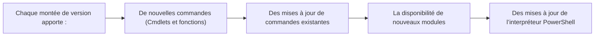

- Chaque montée de version apporte :
- De nouvelles commandes (Cmdlets et fonctions)
- Des mises à jour de commandes existantes
- La disponibilité de nouveaux modules
- Des mises à jour de l’interpréteur PowerShell
- De grands éditeurs comme VMware, Cisco, Sonicwall, Veeam… ont développé des modules permettant de piloter leurs plateformes et produits depuis PowerShell.

### PowerShell Core

!!! note "À retenir"
    Depuis août 2016 et dans la lignée des Frameworks .NET deux ans auparavant, PowerShell est passé en Open Source.

**Visuel externe**

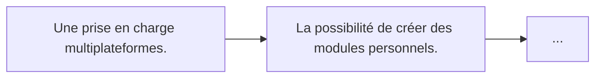

- Depuis août 2016 et dans la lignée des Frameworks .NET deux ans auparavant, PowerShell est passé en Open Source.
- La montée en version de PowerShell Core suit les évolutions du Framework .NET Core Actuellement en version 3.0.
- PowerShell Core est actuellement en 7.0, les avantages de la versions Core sont :
- Une prise en charge multiplateformes.
- La possibilité de créer des modules personnels.
- ...
- …

### PowerShell Core

!!! note "À retenir"
    C’est une évolution majeure de Microsoft ces dernières années, démontrant une volonté d’ouverture vers d’autres environnements.

**Visuel externe**

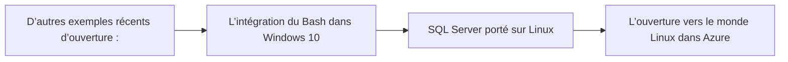

- C’est une évolution majeure de Microsoft ces dernières années, démontrant une volonté d’ouverture vers d’autres environnements.

Plus de rivalité, aujourd’hui tout

le monde cohabite !

- D’autres exemples récents d’ouverture :
- L’intégration du Bash dans Windows 10
- SQL Server porté sur Linux
- L’ouverture vers le monde Linux dans Azure
- …

### Les différentes versions de PowerShell Core

!!! note "À retenir"
    Installable aussi sous Windows à partir des versions 7 SP1, 2008 R2 et supérieur.

| Version | MacOS | Red Hat | CentOS | Oracle Linux | Fedora | Debian | Ubuntu | Open SUSE |
| --- | --- | --- | --- | --- | --- | --- | --- | --- |
| PowerShell Core 7 | 10.13 | 8 | 8 | 7 | 32 | 9,10 | 20,04 | 42.2+ |
| PowerShell Core 6.1 | 10.12+ | 7 | 7 | - | 27,28 | 8.7+, 9 | 18.10 | 42.2+ |

Installable aussi sous Windows

à partir des versions 7 SP1,

2008 R2 et supérieur.

### Les particularités PowerShell Core

**Visuel externe**

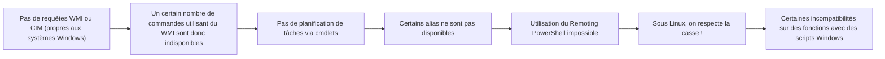

- Pour les habitués de PowerShell sous Windows, Powershell Core nécessite quelques points d’attention :
- Pas de requêtes WMI ou CIM (propres aux systèmes Windows)
- Un certain nombre de commandes utilisant du WMI sont donc indisponibles
- Pas de planification de tâches via cmdlets
- Certains alias ne sont pas disponibles
- Utilisation du Remoting PowerShell impossible
- Sous Linux, on respecte la casse !
- Certaines incompatibilités sur des fonctions avec des scripts Windows

| Version | MacOS | RedHat | CentOS | Oracle Linux | Fedora | Debian Ubuntu OpenSUSE |
| --- | --- | --- | --- | --- | --- | --- |
| PowerShellCore7 | 1013 . | 8 | 8 | 7 | 32 | 910 2004 422+ , , . |
| PowerShellCore61 . | 1012+ . | 7 | 7 | - | 2728 , | 87+ 9 1810 422+ . , . . |
|  |  |  |  |  | InstallableaussisousWindows |  |
|  |  |  |  |  |  | àpartirdesversions7SP1 , |
|  |  |  |  |  |  | 2008R2etsupérieur . |
|  |  |  |  |  |  | 7 |

### Les Cmdlets

- Les commandes PowerShell sont toujours composées ainsi :

### Verbe - Nom

```
Get-ChildItem
Get-Service
Get-Volume
Get-Process
Get-Item
Get-SMBShare
```

- Elles sont « parlantes », il est facile de deviner leur utilité

Le nom sera toujours au singulier

### Les Cmdlets

- Les commandes PowerShell disposent de paramètres nécessaires au bon fonctionnement de la commande :

```
PS > Get-LocalUser -Name « Nom de l’utilisateur recherché »
```

- Le paramètre est systématiquement indiqué avec un tiret. Une commande peut disposer de plusieurs paramètres.

```
PS > Get-LocalGroupMember –Group « Nom du groupe recherché » -
Member « Membre du groupe recherché dans le groupe indiqué »
```

- Dans cet exemple, deux paramètres pour une commande.

La valeur fournie aux paramètres est l’argument

### Get-Command

- Get-Command permet de rechercher et d’afficher les commandes disponibles. La recherche se fait sur le paramètre –Name.
- On utilise le caractère * pour substituer une chaîne de caractères.

Exemple Je recherche toutes les commandes relatives à la gestion des services.

```
PS > Get-Command -Name *-Service
```

Le résultat de la commande affiche toutes les « cmdlets » terminées par le nom « Service »

### Get-Command

```
Get-Command permet également d’effectuer une recherche sur le
paramètre –Verb.
```

Exemple Je recherche toutes les commandes utilisant le verbe « Stop ».

```
PS > Get-Command -Verb Stop
```

Le résultat de la commande affiche toutes les cmdlets dont le verbe d’action est « Stop »


Capture du support « Module 01 - Support de cours »


Capture du support « Module 01 - Support de cours »

### Get-Help

- Une fois la commande trouvée, il nous faut comprendre comment l’utiliser.
- La solution est bien connue, il faut lire le manuel.
- Toute Cmdlet comporte un manuel. Il est disponible avec la commande :

```
Get-Help suivi du paramètre –Name
« La Cmdlet concernée »
PS > Get-Help -Name Get-Service
```

### Get-Help

L’aide de la commande est affiché dans la console.

- Nous pouvons utiliser des paramètres supplémentaires afin d’améliorer les informations obtenues.
- L’aide des commandes est répartie en catégories. Le paramètre -Full permet d’afficher toutes les catégories disponibles dans l’aide d’une commande.

```
PS > Get-Help -Name Get-Service -Full
```

- On obtient une aide complète plus détaillée avec des exemples d’utilisation de commande, une catégorie lien plus fournie.

```
PS > Get-Help -Name Get-Service -Full
```

- Le paramètre -Online permet de suivre le lien fourni dans l’aide et de l’ouvrir dans un navigateur web. L’aide en ligne fournit la version la plus à jour avec des liens vers des commandes annexes.

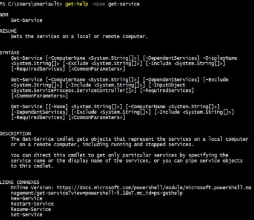

Capture du support « Module 01 - Support de cours »

### Get-Help

- Le paramètre -Examples permet d’afficher uniquement les exemples d’utilisation de la commande.

```
PS > Get-Help -Name Get-Service -Examples
```

- Pour faciliter la lecture de l’aide, PowerShell met à disposition une fenêtre avec un champ de recherche. Cela permet de filtrer les catégories, copier- coller des exemples, etc.

```
PS > Get-Help –Name Get-Service -ShowWindow
```

Champ de recherche

### Get-Help

Personnalisation des

sections affichées

Aide dans une nouvelle fenêtre

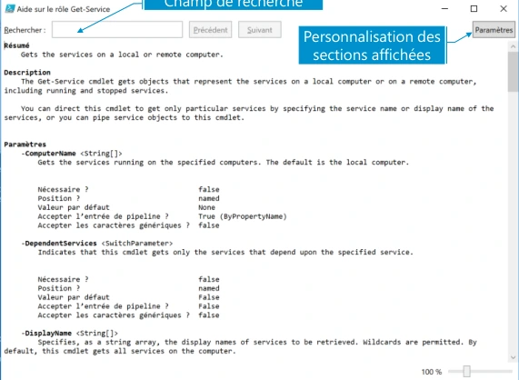

Capture du support « Module 01 - Support de cours »

### Update-Help

- Il est possible de mettre à jour l’ensemble des fichiers d’aide avec la commande :

```
PS > Update-Help
```

- Sans paramètres, cette commande va tenter de chercher sur le web les mises à jour de l’aide en passant par le service Windows Update
- Dans le cas où le service serait inaccessible, il est possible d’indiquer une source locale contenant les fichiers d’aide.

```
PS > Update-Help –SourcePath D:\PowerShell
```

- Il est également possible de choisir un langage.

```
PS > Update-Help –SourcePath D:\PowerShell –UICulture En-US
```

Ces commandes nécessitent un PowerShell avec les droits administrateur.

### La commande de protection

- L’exécution de script est par défaut soumise à une forte restriction.
- Le niveau de confiance requis pour l’exécution est modifiable :
- Restricted (par défaut) Niveau de sécurité élevé
- AllSigned
- Remote Signed

Cette commande permet l’exécution de tous les scripts.

- Unrestricted Niveau de sécurité limité
- Bypass
- Default
- Undefined

```
PS > Set-ExecutionPolicy –ExecutionPolicy
Unrestricted
```

Ces commandes nécessitent un PowerShell avec les droits administrateurs

### Les modules

- Chaque Cmdlet provient d’un module PowerShell.
- Les modules PowerShell sont des fichiers portant l’extension .PSM1.
- La commande Get-Module permet de voir les modules actuellement disponibles dans PowerShell.

### Les modules - Ajout

```
PS > $env:PsModulePath
```

- Après la récupération d’un fichier PSM1 pour connaître l’emplacement disponible, il faut saisir la commande :
- Après la copie du fichier dans l’emplacement, on importe le module dans la console :

```
PS > Import-Module –Name « Le nom du dossier contenant le module »
```

- Puis on vérifie l’importation :

```
PS > Get-Command –module « Le nom du module »
```

Ces commandes nécessitent un PowerShell avec les droits administrateurs.

Il faut également modifier les droits d’exécution de script sur le système.


Capture du support « Module 01 - Support de cours »

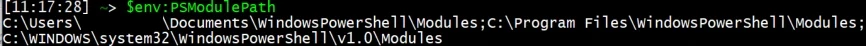

Capture du support « Module 01 - Support de cours »

### La personnalisation de la console

- Il est possible de modifier les propriétés de la console PowerShell en faisant un clic droit sur le bandeau puis en cliquant sur propriétés.
- La console se personnalise par le choix d’une police de la taille des caractères ainsi que des couleurs de caractères.
- Il est également possible de créer un profil personnalisé en saisissant la commande :

```
PS > New-Item –Path $Profile –Type File -Force
```

- Cette commande écrit dans le dossier Documents de l’utilisateur actuel un fichier PS1 qui peut contenir des commandes qui seront exécutées à l’ouverture de la console PowerShell.

### Découverte de PowerShell

### TP

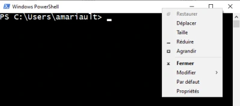

Capture du support « Module 01 - Support de cours »


Capture du support « Module 01 - Support de cours »

### Conclusion

- Vous connaissez le fonctionnement des commandes PowerShell

Référence du document : 1_iY1RKpxTekTi-QKbupFI4pP_tK2LRI1 · SHA-256 648c293e26027e17…

## Démonstration · Fiche démo 1 - Présentation du langage PowerShell-PowerShell Core · 2 pages transcrites

Transcription du support du Drive. Les formulations historiques et les exemples du document sont conservés. Les valeurs d’accès du laboratoire sont indiquées comme « fourni par le formateur ». Les adresses de messagerie personnelles utilisent example.com.

### Présentation du langage PowerShell, PowerShell Core

Démonstration 01 du module 1

L’objectif de cette démonstration est de vous montrer comment installer PowerShell Core sur un système Windows 10.

### Déroulement

- Récupérer l’archive d’installation sur le dépôt GitHub officiel PowerShell : https://github.com/PowerShell/PowerShell/releases
- Télécharger la version compatible avec votre plateforme actuelle.
- Réaliser une installation par défaut

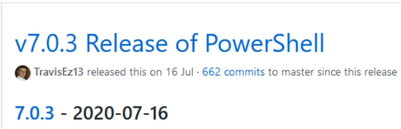

Capture du support « Fiche démo 1 - Présentation du langage PowerShell-PowerShell Core »

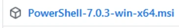

Capture du support « Fiche démo 1 - Présentation du langage PowerShell-PowerShell Core »


Capture du support « Fiche démo 1 - Présentation du langage PowerShell-PowerShell Core »

- Vous disposez d’un nouveau Shell reconnaissable à son icône et à l’en-tête de la console.
- La commande $PSVersionTable permet de connaître la version actuelle du Shell.
- La version de PowerShell installé par défaut est la 5.1 sur Windows 10.
- Elle est reconnaissable par l’icône :

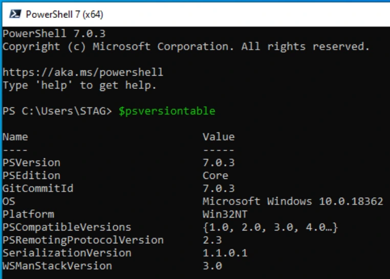

Capture du support « Fiche démo 1 - Présentation du langage PowerShell-PowerShell Core »


Capture du support « Fiche démo 1 - Présentation du langage PowerShell-PowerShell Core »

Référence du document : 1YxE6EJXvuIyx3sOVGFQdtbrkogxJDTwd · SHA-256 7b237af3ee799c19…

## Démonstration · Fiche démo 2 - Les Cmdlets · 1 pages transcrites

Transcription du support du Drive. Les formulations historiques et les exemples du document sont conservés. Les valeurs d’accès du laboratoire sont indiquées comme « fourni par le formateur ». Les adresses de messagerie personnelles utilisent example.com.

### Les Cmdlets

Démonstration 02 du module 1

L’objectif de cette démonstration est de vous faire découvrir la constitution d’une Cmdlet.

### Déroulement

- Une Cmdlet est toujours constituée d’un Verbe définissant une action puis du caractère «-»
- Elle se termine toujours par un nom décrivant un objet Windows.

Pour obtenir la liste des verbes disponible on utilise la Cmdlet Get-Verb

Chaque Cmdlet dispose de paramètres ; ils s’utilisent en ajoutant le caractère « - » puis le nom du paramètre.

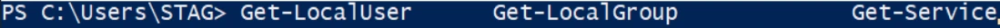

Capture du support « Fiche démo 2 - Les Cmdlets »


Capture du support « Fiche démo 2 - Les Cmdlets »


Capture du support « Fiche démo 2 - Les Cmdlets »

Référence du document : 1dI6jQ02IqlHIKSyHM0KpW0JOi1OtfI1s · SHA-256 85f9d555b636e5cf…

## Démonstration · Fiche démo 3 - Get-Command · 2 pages transcrites

Transcription du support du Drive. Les formulations historiques et les exemples du document sont conservés. Les valeurs d’accès du laboratoire sont indiquées comme « fourni par le formateur ». Les adresses de messagerie personnelles utilisent example.com.

### Get-Command

Démonstration 03 du module 1

L’objectif de cette démonstration est de vous présenter la commande Get-Command.

### Déroulement

- Pour obtenir la liste de toutes les commandes disponibles, utiliser la Cmdlet Get-Command

Le nombre de commandes disponible est très important. Nous avons ici un aperçu des commandes disponibles.

Afin de filtrer le résultat de sortie, utiliser le caractère * sur le paramètre Name.

Pour filtrer les commandes sur le verbe d’action, utiliser le caractère * sur le paramètre verb.

#### Commandes visibles dans les captures

```
Get-Command
Get-Command -Name *-service
```


Capture du support « Fiche démo 3 - Get-Command »

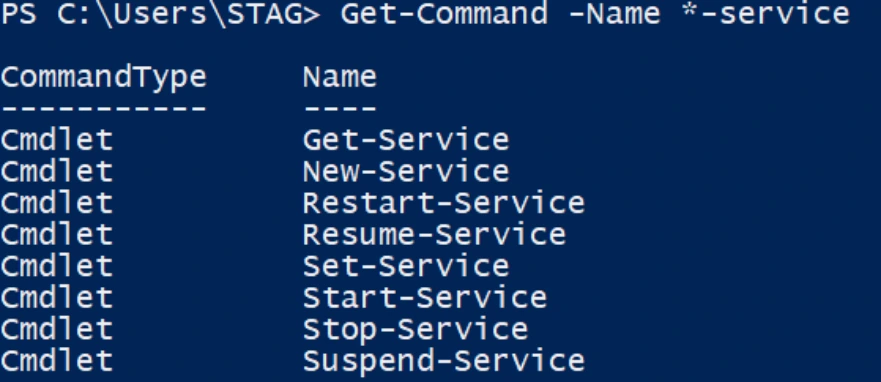

Capture du support « Fiche démo 3 - Get-Command »

```
Nous avons toutes les commandes qui utilisent le verbe New.
```

#### Commandes visibles dans les captures

```
Get-Command -Verb New
```


Capture du support « Fiche démo 3 - Get-Command »

Référence du document : 12_QrHqEHxOQM1w2aNQ_TM7aV59-onssx · SHA-256 11db6cec8822a159…

## Démonstration · Fiche démo 4 - Get-Help · 4 pages transcrites

Transcription du support du Drive. Les formulations historiques et les exemples du document sont conservés. Les valeurs d’accès du laboratoire sont indiquées comme « fourni par le formateur ». Les adresses de messagerie personnelles utilisent example.com.

### Get-Help

Démonstration 04 du module 1

```
L’objectif de cette démonstration est de vous présenter la commande Get-Help.
```

### Déroulement

- Pour comprendre le fonctionnement d’une commande, on utilise la Cmdlet Get-Help suivie de la Cmdlet sur laquelle on souhaite obtenir de l’aide.

Le résultat dépend de plusieurs facteurs. En fonction de la langue du système d’exploitation, de la mise à jour des fichiers d’aide ainsi que de la commande, le contenu peut différer.

Ici nous avons un fichier d’aide très restreint. Il est possible, en fournissant des paramètres additionnels d’obtenir d’autres informations.

Le paramètre -Full permet d’obtenir la totalité de l’aide disponible.

#### Commandes visibles dans les captures

```
Get-Help Get-Command
```


Capture du support « Fiche démo 4 - Get-Help »


Capture du support « Fiche démo 4 - Get-Help »

Le résultat est complet ; toutes les sections de l’aide sont affichées.

Pour améliorer la lecture, il est possible de spécifier le nom d’un paramètre ou d’une section.

Le paramètre -ShowWindow va ouvrir une nouvelle fenêtre et inclure les informations de l’aide. Il rajoute également un champ de recherche.

#### Commandes visibles dans les captures

```
Get-Help Get-Command -Full
Get-Help Get-Command -Parameter Verb
```


Capture du support « Fiche démo 4 - Get-Help »

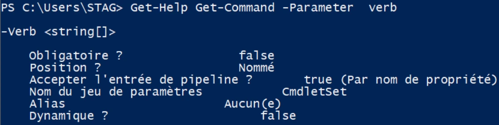

Capture du support « Fiche démo 4 - Get-Help »

Pour obtenir la dernière version disponible, il est possible de consulter la version mise à disposition par Microsoft en ligne. Il faut toutefois disposer d’un navigateur web et d’une connexion à Internet autorisant l’accès au site Microsoft.

#### Commandes visibles dans les captures

```
Get-Help Get-Command -ShowWindow
Get-Help Get-Command -Online
```

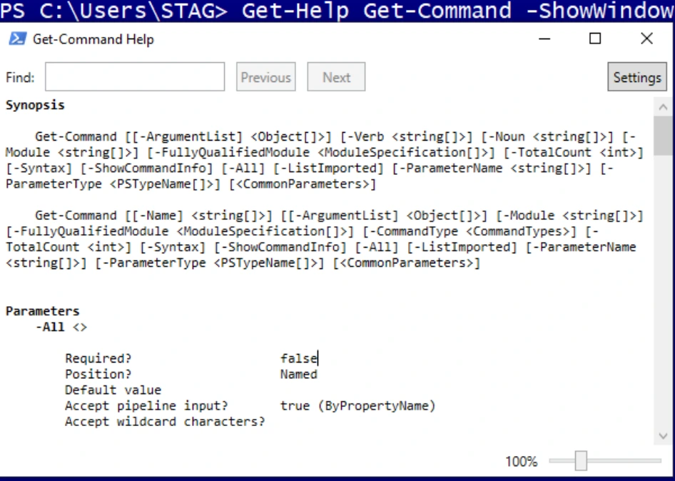

Capture du support « Fiche démo 4 - Get-Help »


Capture du support « Fiche démo 4 - Get-Help »

PowerShell dispose d’une aide sur ses propres fonctionnalités.

Les sections d’aide de la console PowerShell sont accessibles par la commande Get-Help, suivie du terme About_ puis de la section recherchée.

#### Commandes visibles dans les captures

```
Get-Help about_Command_Syntax
```

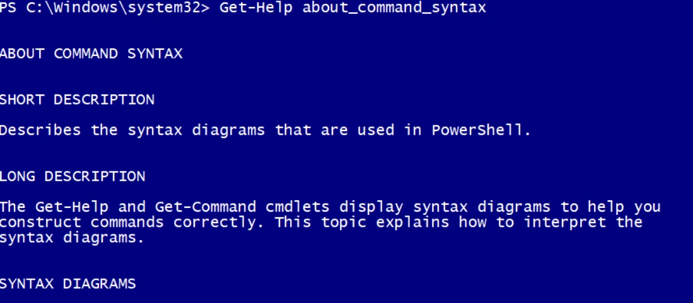

Capture du support « Fiche démo 4 - Get-Help » (partie 1/2)


Capture du support « Fiche démo 4 - Get-Help » (partie 2/2)

Référence du document : 1ZIjSGUvTZh_I7sTPGSqDuL_RLVWIfDGZ · SHA-256 8ec1b775fc0c7086…

## Démonstration · Fiche démo 5 - Update-Help · 2 pages transcrites

Transcription du support du Drive. Les formulations historiques et les exemples du document sont conservés. Les valeurs d’accès du laboratoire sont indiquées comme « fourni par le formateur ». Les adresses de messagerie personnelles utilisent example.com.

### Update-Help

Démonstration 05 du module 1

```
L’objectif de cette démonstration est de vous présenter la commande Update-Help.
```

### Déroulement

- Pour disposer de l’aide la plus à jour disponible, on utilise la commande Update-Help qui peut rechercher les fichiers d’aide disponibles à partir du service Windows Update ou d’une source locale.

La commande va rechercher sur les fichiers d’aide des commandes à disposition.

```
 Update-Help nécessite une console PowerShell avec les droits
d’administration.
Il est possible d’indiquer une source locale ou un chemin réseau avec le paramètre
SourcePatch. Il est également possible de choisir la langue des fichiers d’aide disponibles.
```

Pour obtenir des fichiers d’aide PowerShell, il est possible d’exporter ses fichiers avec la commande Save-Help.

#### Commandes visibles dans les captures

```
Update-Help
```


Capture du support « Fiche démo 5 - Update-Help »


Capture du support « Fiche démo 5 - Update-Help »

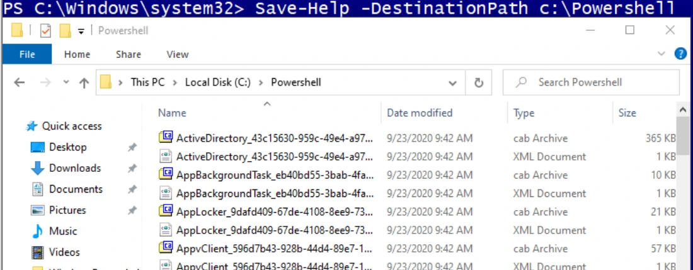

Capture du support « Fiche démo 5 - Update-Help » (partie 1/2)

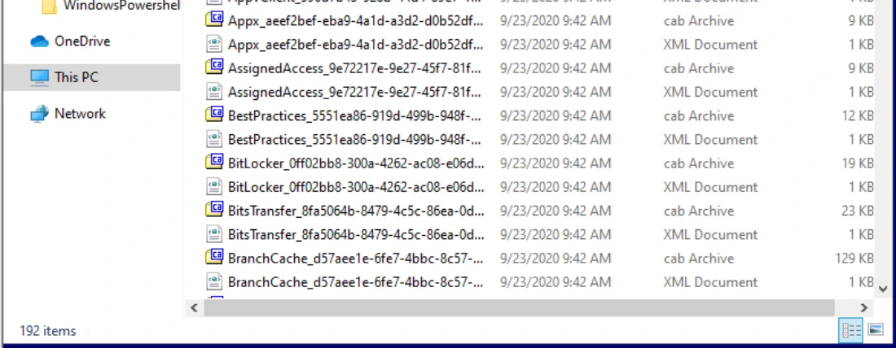

Capture du support « Fiche démo 5 - Update-Help » (partie 2/2)

Référence du document : 1RICbdwT8fAe4J4-4kmb6gy3NmJTLmEwD · SHA-256 7d0ec37b5f85c6c4…

## Démonstration · Fiche démo 6 - La protection · 1 pages transcrites

Transcription du support du Drive. Les formulations historiques et les exemples du document sont conservés. Les valeurs d’accès du laboratoire sont indiquées comme « fourni par le formateur ». Les adresses de messagerie personnelles utilisent example.com.

### La protection

Démonstration 06 du module 1

L’objectif de cette démonstration est de vous présenter la protection contre l’exécution des scripts indésirables.

### Déroulement

- Par défaut l’exécution de scripts PowerShell est restreinte aux scripts signés numériquement.

```
o Afin d’exécuter des scripts de test non signés, il faut modifier la règle de restriction des
```

scripts du système Windows.

```
o Pour obtenir le niveau de restriction actuelle du système, on utilise la commande Get-
ExecutionPolicy.
```

Set-ExecutionPolicy nécessite une console PowerShell avec les droits d’administration.

Pour modifier la restriction, on passe par la commande Set-ExecutionPolicy.

Une confirmation est demandée car il s’agit d’un paramètre de sécurité.

#### Commandes visibles dans les captures

```
Get-ExecutionPolicy
Set-ExecutionPolicy Unrestricted
```


Capture du support « Fiche démo 6 - La protection »


Capture du support « Fiche démo 6 - La protection »

Référence du document : 1fD9YtRzs0KoafARjOehaE2oHA4iRHUsy · SHA-256 96ddc610aa3fa732…

## Démonstration · Fiche démo 7 - Les modules · 2 pages transcrites

Transcription du support du Drive. Les formulations historiques et les exemples du document sont conservés. Les valeurs d’accès du laboratoire sont indiquées comme « fourni par le formateur ». Les adresses de messagerie personnelles utilisent example.com.

### Les modules

Démonstration 07 du module 1

L’objectif de cette démonstration est de vous présenter la notion de module.

### Déroulement

- Les modules sont des fichiers portant l’extension .PSM1
- La commande Get-Module permet d’obtenir la liste des modules actuellement disponibles dans la console.

Pour ajouter un module à la console PowerShell,l il faut ajouter le fichier PSM1 dans un emplacement valide. Pour connaître les emplacements valides, on utilise la commande :

```
$env :PsModulePath
```

On place ensuite le fichier PSM1 ou un dossier contenant un ensemble de fichiers.

Dans l’exemple, on utilise le module AWS permettant de gérer une infrastructure Amazon Web Services depuis la console PowerShell.

#### Commandes visibles dans les captures

```
Get-Module
$env:PSModulePath
```


Capture du support « Fiche démo 7 - Les modules »

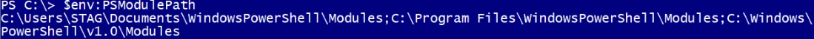

Capture du support « Fiche démo 7 - Les modules »

On importe ensuite le module dans la console avec la commande Import-Module.

On vérifie ensuite la bonne prise en charge avec la commande Get-Command -module AWSPOWERSHELL.

Le paramètre Measure-Object permet de compter le nombre de commandes.

Le module AwsPowershell ajoute presque 8000 commandes dans la console PowerShell.

#### Commandes visibles dans les captures

```
Import-Module -Name AWSPowerShell
Get-Command -Module AWSPowerShell | Measure-Object
```


Capture du support « Fiche démo 7 - Les modules »


Capture du support « Fiche démo 7 - Les modules »

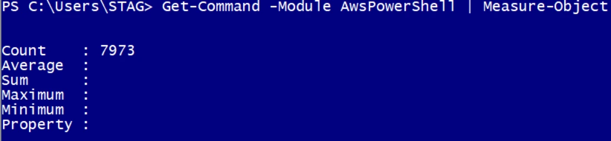

Capture du support « Fiche démo 7 - Les modules »

Référence du document : 1auDKYAA3_naumjziK-geVgf51NZMt3ng · SHA-256 ab0f08a2fd50e986…

## Démonstration · Fiche démo 8 - La personnalisation de la console · 3 pages transcrites

Transcription du support du Drive. Les formulations historiques et les exemples du document sont conservés. Les valeurs d’accès du laboratoire sont indiquées comme « fourni par le formateur ». Les adresses de messagerie personnelles utilisent example.com.

### La personnalisation de la console

Démonstration 08 du module 1

L’objectif de cette démonstration est de montrer que la console PowerShell peut s‘adapter aux besoins de chaque utilisateur.

### Déroulement

- La personnalisation de la console PowerShell se fait en faisant un clic droit sur le bandeau de la fenêtre.
- Il est possible de modifier la police, la taille les couleurs de fond…

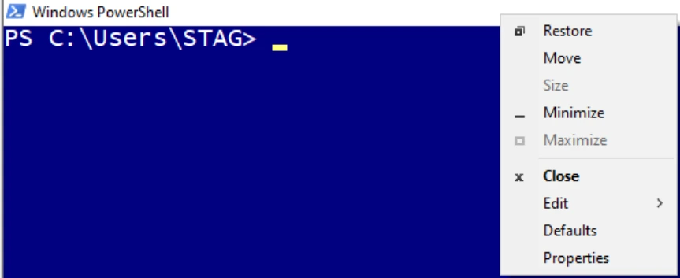

Capture du support « Fiche démo 8 - La personnalisation de la console »

La personnalisation de la console peut se faire avec l’aide d’un profil qui est un script PowerShell. Ce script sera exécuté à chaque lancement de la console.

Pour générer le fichier de profil, on utilise une commande PowerShell.

Le fichier est généré dans le dossier documents de l’utilisateur actuel.

Chaque utilisateur dispose de son propre profil.


Capture du support « Fiche démo 8 - La personnalisation de la console »


Capture du support « Fiche démo 8 - La personnalisation de la console »

Dans cet exemple on personnalise la console avec un bandeau d’accueil qui affiche le nom de l’utilisateur actuel ainsi que l’heure est la date.

Il est également possible de modifier le Prompt.

Le résultat est un prompt personnalisé.

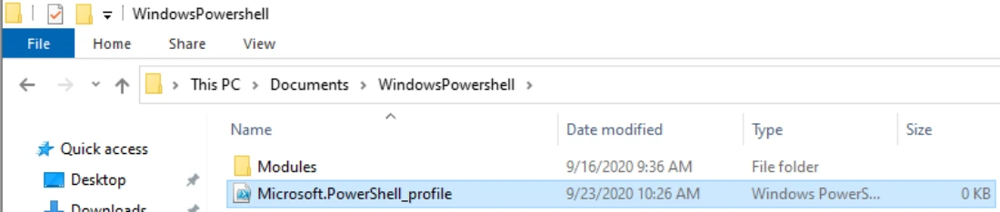

Capture du support « Fiche démo 8 - La personnalisation de la console »


Capture du support « Fiche démo 8 - La personnalisation de la console »


Capture du support « Fiche démo 8 - La personnalisation de la console »


Capture du support « Fiche démo 8 - La personnalisation de la console »


Capture du support « Fiche démo 8 - La personnalisation de la console »

Référence du document : 13xgz6ZrucWrrpleg5N3Jd1rM4brh2R3u · SHA-256 c8b83fe89809ce20…

## Énoncé · Énoncé du TP - Premières commandes · 5 pages transcrites

Transcription du support du Drive. Les formulations historiques et les exemples du document sont conservés. Les valeurs d’accès du laboratoire sont indiquées comme « fourni par le formateur ». Les adresses de messagerie personnelles utilisent example.com.

### Initiation à PowerShell Premières commandes

TP du Module 01

Avant de démarrer ce TP, il convient d’avoir suivi les vidéos du module 1 de ce cours.

Durée estimée

2 heures

### Énoncé

Objectifs :

Lancer des commandes PowerShell données

Analyser les différences de résultats d’exécution entre différents environnements

Prérequis :

Récupérer la maquette fournie par le formateur

Avoir une connexion internet

Consignes :

Décompresser la maquette fournie par le formateur

Intégrer les machines virtuelles dans VMware Workstation

Démarrer les machines virtuelles suivantes :

- CLI01
- CD01

S’y connecter :

- identifiant : Administrator@ad01.lcl
- mot de passe : fourni par le formateur

Depuis la machine CLI01 :

Lancez la console PowerShell en mode administrateur et découvrez l'interface utilisateur.

Exécutez la commande Get-Command | Measure. Indiquez le nombre de commandes renvoyées par la propriété Count

Lancez la console PowerShell Core en mode administrateur et découvrez l'interface utilisateur.

Exécutez la commande Get-Command | Measure. Indiquez le nombre de commandes renvoyées par la propriété Count.

Affichez la liste des verbes disponibles dans chaque console PowerShell. Que remarquez-vous ?

Listez les commandes utilisant le verbe New. Quelle commande avez-vous utilisée ?

Listez les commandes contenant user dans le nom. Quelle commande avez-vous utilisée ?

Indiquez la commande permettant de créer un nouvel utilisateur local.

Listez les cinq premiers utilisateurs locaux de chaque machine virtuelle.

- Utilisateurs de CD01
- Utilisateurs de CLI01

Bonus

Modifiez la description d’un utilisateur local sur « SRV01 » et « CLI01 ». Quelles commandes avez-vous utilisées ?

Depuis la machine CLI01

Affichez l’aide de la commande permettant de lister tous les services du système.

Affichez l’aide dans une nouvelle fenêtre. Indiquez la commande utilisée.

Affichez la totalité de l’aide disponible. Quelle commande avez-vous utilisée ?

Affichez l’aide en ligne de la commande permettant de lister les membres d’un groupe d’utilisateurs locaux. Quelle commande avez-vous utilisée, quels sont les avantages de l’aide en ligne ?

Mettez à jour les fichiers d’aide de votre console PowerShell.

- Vous allez effectuer la mise à jour de toutes vos commandes à partir d’un dépôt local situé sur « CD01 ».
- Voici le chemin « UNC » du dépôt : \\CD01\Partage\Depot\CLI01
- Indiquez vos remarques

Effectuez la même action mais en sélectionnant le langage « fr-FR ». Indiquez vos remarques.

Depuis la machine CLI01

Affichez les modules actuellement chargés par la console PowerShell.

- Combien de modules sont actuellement disponibles ?
- De quel module la commande Get-LocalUser est-elle issue ?

Affichez les emplacements disponibles pour déposer les fichiers contenant les modules. Quelle commande avez-vous utilisée ?

Installer le module AWSPowerShell. L’archive est disponible sur le partage \\CD01\ Partage\Modules

- Quelles commandes avez-vous utilisées ?

Vous allez obtenir un message d’erreur à l’importation du module

- Quelle commande allez-vous exécuter pour permettre l’importation du module ?
- Indiquez trois commandes disponibles dans le module AwsPowerShell

Mettez en place un profil personnel sur chaque console PowerShell.

- Vous pouvez modifier la coloration ainsi que la police.
- Affichez l’aide de la commande Get-Help à chaque ouverture de la console PowerShell.
- Quel fichier avez-vous édité ?

Bonus

Modifiez le prompt de votre console PowerShell.

- En vous basant sur le fichier \\CD01\Partage\Aplication\Prompt.ps1
- Modifiez votre prompt pour afficher l’heure ainsi que la localisation actuelle du prompt dans le système de fichier.

Vous pouvez également afficher une bannière avec le nom de l’utilisateur actuel.

### Solution

Une solution est proposée pour ce TP sous la forme d'un PDF commenté, disponible dans les ressources à télécharger.

Référence du document : 17gKQ4X46H6zq3ZYZtll4gFhX-l7sTvaH · SHA-256 3c336006434e1b83…

## Correction · Solution du TP - Premières commandes · 6 pages transcrites

Transcription du support du Drive. Les formulations historiques et les exemples du document sont conservés. Les valeurs d’accès du laboratoire sont indiquées comme « fourni par le formateur ». Les adresses de messagerie personnelles utilisent example.com.

Correction originale : à consulter après avoir tenté l’exercice.

### Premières commandes

TP du Module 01

Avant de démarrer ce TP, il convient d’avoir suivi les vidéos du module 1 de ce cours.

Durée estimée

2 heures

### Énoncé

Objectifs :

- Lancer des commandes PowerShell données
- Analyser les différences de résultats d’exécution entre différents environnements

Prérequis :

- Récupérer la maquette fournie par le formateur
- Avoir une connexion internet

Consignes :

- Décompresser la maquette fournie par le formateur
- Intégrer les machines virtuelles dans VMware Workstation
- Démarrer les machines virtuelles suivantes :

```
o CLI01
o CD01
```

- S’y connecter :

```
o identifiant : Administrator@ad01.lcl
o mot de passe : fourni par le formateur
```

Depuis la machine CLI01 :

- Lancez la console PowerShell en mode administrateur et découvrez l'interface utilisateur.
- Exécutez la commande Get-Command | Measure. Indiquez le nombre de commandes renvoyées par la propriété Count

2855

- Lancez la console PowerShell Core en mode administrateur et découvrez l'interface

utilisateur.

- Exécutez la commande Get-Command | Measure. Indiquez le nombre de commandes renvoyées par la propriété Count.

Admin 2825 / user 2796

- Affichez la liste des verbes disponibles dans chaque console PowerShell. Que remarquez-vous ?

```
Get-Verb (| measure)
PS = 98
PSCore = 100
```

On remarque les verbes sont classés par groupe.

- Listez les commandes utilisant le verbe New. Quelle commande avez-vous utilisée ?

```
Get-Command -Verb New
```

- Listez les commandes contenant user dans le nom. Quelle commande avez-vous utilisée ?

```
Get-Command -Noun *User*
```

- Indiquez la commande permettant de créer un nouvel utilisateur local.

```
Get-command -Noun *localuser*
```

- Listez les cinq premiers utilisateurs locaux de chaque machine virtuelle.

```
o Utilisateurs de CD01
Get-LocalUser | select -first 5
o  Utilisateurs de CLI01
```

Get-LocalUser | select -first 5

Bonus

- Modifiez la description d’un utilisateur local sur « SRV01 » et « CLI01 ». Quelles commandes avez-vous utilisées ?

```
Set-LocalUser -Name "AxelRios" -Description "Operateur"
Get-LocalUser -Name "AxelRios"
```

Depuis la machine CLI01

- Affichez l’aide de la commande permettant de lister tous les services du système.

```
Get-Help Get-Service
```

- Affichez l’aide dans une nouvelle fenêtre. Indiquez la commande utilisée.

```
 Get-Help Get-Service -showwindow
```

- Affichez la totalité de l’aide disponible. Quelle commande avez-vous utilisée ?

```
Get-Help Get-Service -full
```

- Affichez l’aide en ligne de la commande permettant de lister les membres d’un groupe d’utilisateurs locaux. Quelle commande avez-vous utilisée, quels sont les avantages de l’aide en ligne ?

```
Get-Help Get-LocalGroup – Online
```

Afficher les membres d'un groupe

```
Get-LocalGroupMember -Online
```

- Mettez à jour les fichiers d’aide de votre console PowerShell.

```
o Vous allez effectuer la mise à jour de toutes vos commandes à
```

partir d’un dépôt local situé sur « CD01 ».

```
o Voici
le
chemin
«
UNC
»
du
dépôt
:
\\CD01\Partage\Depot\CLI01
o Indiquez vos remarques
Update-Help -Sourcepath \\CD01\Partage\Depot\CLI01\ -UICulture EN-US
```

On remarque que certains modules n’ont pas de fichier d’aide disponible.

- Effectuez la même action mais en sélectionnant le langage « fr-FR ». Indiquez vos remarques.

```
Update-Help -Sourcepath \\CD01\Partage\Depot\CLI01\ -UICulture fr-FR
```

On remarque que très peu de modules disposent de fichiers d’aide traduits.

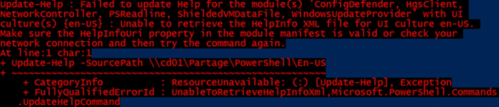

Capture du support « Solution du TP - Premières commandes »

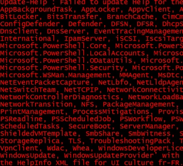

Capture du support « Solution du TP - Premières commandes »

Depuis la machine CLI01

- Affichez les modules actuellement chargés par la console PowerShell.

```
Get-Module ou Get-module -all
o Combien de modules sont actuellement disponibles ?
Get-Module | measure
o De quel module la commande Get-LocalUser est-elle issue ?
get-command get-localuser
get-command get-localuser | ft wrap
get-command get-localuser | select module
>> Microsoft.PowerShell.LocalAccounts
```

- Affichez les emplacements disponibles pour déposer les fichiers contenant les modules. Quelle commande avez-vous utilisée ?

```
Get-Help about_modules -showwindow
```

On cherche "Path"

#variable d'environnement :

```
$env:PSModulePath
```

C:\Users\Administrator\Documents\WindowsPowerShell\Modules;C:\Program Files\WindowsPowerShell\Modules;C:\Windows\system32\WindowsPowerShell\v1.0\Mod ules

- Installer le module AWSPowerShell. L’archive est disponible sur le partage \\CD01\Partage\Modules

```
o Quelles commandes avez-vous utilisées ?
```

- Vous allez obtenir un message d’erreur à l’importation du module

```
o Quelle
commande
allez-vous
exécuter
pour
permettre
l’importation du module ?
Import-Module AWSPowserShell
o Indiquez trois commandes disponibles dans le module
```

AwsPowerShell

- Mettez en place un profil personnel sur chaque console PowerShell.

```
o Vous pouvez modifier la coloration ainsi que la police.
o Affichez l’aide de la commande Get-Help à chaque ouverture
```

de la console PowerShell.

```
o Quel fichier avez-vous édité ?
```

Microsoft.PowerShell_profile.ps1

Bonus

- Modifiez le prompt de votre console PowerShell.

```
o En
vous
basant
sur
le
fichier
\\CD01\Partage\Aplication\Prompt.ps1
o Modifiez votre prompt pour afficher l’heure ainsi que la
```

localisation actuelle du prompt dans le système de fichier.

Vous pouvez également afficher une bannière avec le nom de l’utilisateur actuel.

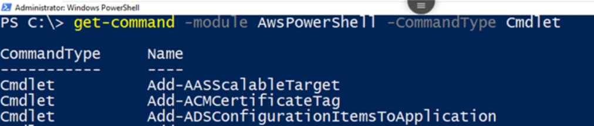

Capture du support « Solution du TP - Premières commandes »

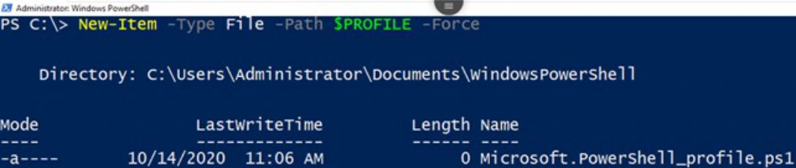

Capture du support « Solution du TP - Premières commandes »

### Solution

Une solution est proposée pour ce TP sous la forme d'un PDF commenté, disponible dans les ressources à télécharger.

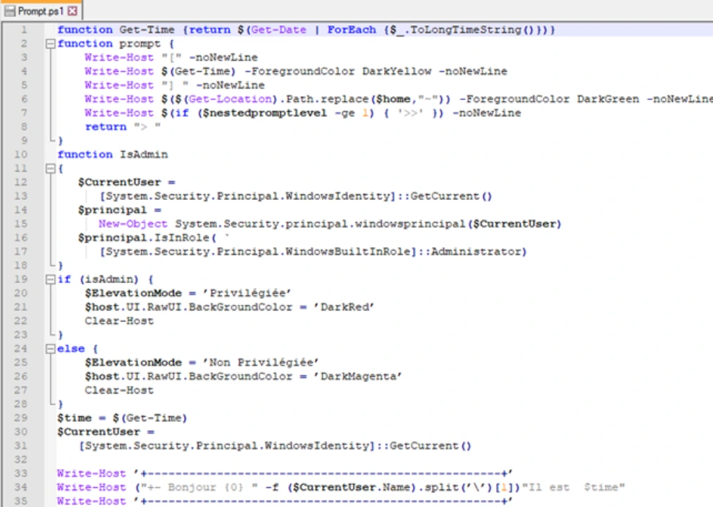

Capture du support « Solution du TP - Premières commandes »

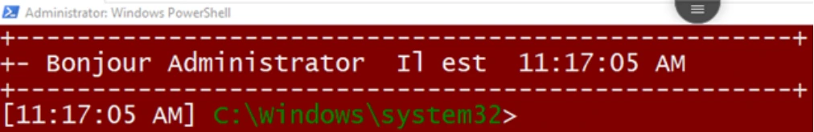

Capture du support « Solution du TP - Premières commandes »

Référence du document : 1GrgQJ2ZZl4DDnJpqNjGT-BUvZ-b-ZDE7 · SHA-256 76a648d72c452e6f…

## Fiche de synthèse

Les lignes reprennent les titres du cours et la première phrase de chaque partie.

| Partie | Repère du cours |
| --- | --- |
| Support · Module 01 - Support de cours · 12 pages transcrites | Les formulations historiques et les exemples du document sont conservés. |
| Démonstration · Fiche démo 1 - Présentation du langage PowerShell-PowerShell Core · 2 pages transcrites | Les formulations historiques et les exemples du document sont conservés. |
| Démonstration · Fiche démo 2 - Les Cmdlets · 1 pages transcrites | Les formulations historiques et les exemples du document sont conservés. |
| Démonstration · Fiche démo 3 - Get-Command · 2 pages transcrites | Les formulations historiques et les exemples du document sont conservés. |
| Démonstration · Fiche démo 4 - Get-Help · 4 pages transcrites | Les formulations historiques et les exemples du document sont conservés. |
| Démonstration · Fiche démo 5 - Update-Help · 2 pages transcrites | Les formulations historiques et les exemples du document sont conservés. |
| Démonstration · Fiche démo 6 - La protection · 1 pages transcrites | Les formulations historiques et les exemples du document sont conservés. |
| Démonstration · Fiche démo 7 - Les modules · 2 pages transcrites | Les formulations historiques et les exemples du document sont conservés. |
| Démonstration · Fiche démo 8 - La personnalisation de la console · 3 pages transcrites | Les formulations historiques et les exemples du document sont conservés. |
| Énoncé · Énoncé du TP - Premières commandes · 5 pages transcrites | Les formulations historiques et les exemples du document sont conservés. |
| Correction · Solution du TP - Premières commandes · 6 pages transcrites | Les formulations historiques et les exemples du document sont conservés. |
