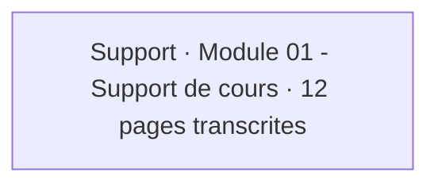
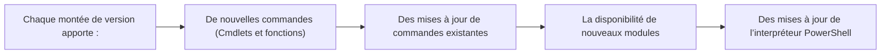
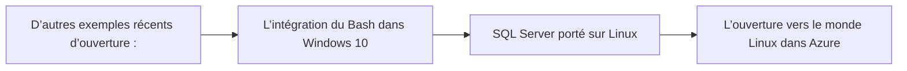
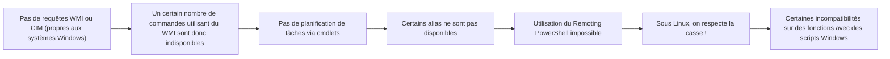
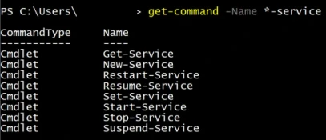
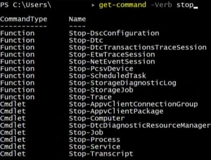
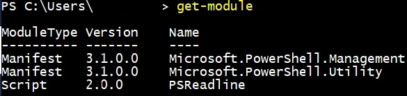
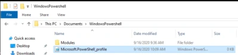

# Module 01 — Initiation à PowerShell

[Travaux pratiques](../../tp/12-initiation-powershell/module-01/index.md)

Les parties ci-dessous reprennent le cours original, dans le même ordre. Les encadrés et les schémas répètent ses formulations.

## Parcours de lecture

1. Support · Module 01 - Support de cours · 12 pages transcrites

**Visuel externe**



SOURCE DRIVE · TRANSCRIPTION DU SUPPORT

Le contenu des documents du dossier TSSR est transcrit ci-dessous, page par page. Les textes et tableaux sont intégrés à la page Web. Aucun fichier PDF, aucune diapositive entière ni aucune reproduction de page n’est affiché. Seuls des croquis ou visuels isolés et vérifiés peuvent accompagner la transcription. Les versions et les consignes restent celles des supports de formation. Les compléments IA sont conservés dans leur onglet distinct.

## Support · Module 01 - Support de cours · 12 pages transcrites

!!! note "À retenir"
    Les formulations historiques et les exemples du document sont conservés.

Transcription du support du Drive. Les formulations historiques et les exemples du document sont conservés. Les valeurs d’accès du laboratoire sont indiquées comme « fourni par le formateur ». Les adresses de messagerie personnelles utilisent example.com.

### Initiation à PowerShell

!!! note "À retenir"
    Module 01 – Présentation du langage PowerShell

Module 01 – Présentation du langage PowerShell

### Objectifs

!!! note "À retenir"
    Appréhender le fonctionnement des commandes PowerShell

- Appréhender le fonctionnement des commandes PowerShell

### L’évolution de PowerShell dans le temps

!!! note "À retenir"
    Sorti en 2006, PowerShell V1.0 était disponible sur les systèmes Windows XP Sp2, Vista et Windows Server 2003 Sp1.

!!! example "Exemple"
    Elle met à disposition 2855 commandes et supporte plusieurs milliers de modules par exemple « Azure », « Exchange »...

- Sorti en 2006, PowerShell V1.0 était disponible sur les systèmes Windows XP Sp2, Vista et Windows Server 2003 Sp1.
- Cette première version apporte 129 commandes réparties sur 5 modules.

Un outil flexible, performant et totalement adapté aux besoins des

techniciens et admins !

- La version 5.1 est actuellement installée par défaut sur Windows 10 et Windows server 2019.
- Elle met à disposition 2855 commandes et supporte plusieurs milliers de modules par exemple « Azure », « Exchange »...

### L’évolution de PowerShell dans le temps

**Visuel externe**



- Chaque montée de version apporte :
- De nouvelles commandes (Cmdlets et fonctions)
- Des mises à jour de commandes existantes
- La disponibilité de nouveaux modules
- Des mises à jour de l’interpréteur PowerShell
- De grands éditeurs comme VMware, Cisco, Sonicwall, Veeam… ont développé des modules permettant de piloter leurs plateformes et produits depuis PowerShell.

### PowerShell Core

!!! note "À retenir"
    Depuis août 2016 et dans la lignée des Frameworks .NET deux ans auparavant, PowerShell est passé en Open Source.

**Visuel externe**


- Depuis août 2016 et dans la lignée des Frameworks .NET deux ans auparavant, PowerShell est passé en Open Source.
- La montée en version de PowerShell Core suit les évolutions du Framework .NET Core Actuellement en version 3.0.
- PowerShell Core est actuellement en 7.0, les avantages de la versions Core sont :
- Une prise en charge multiplateformes.
- La possibilité de créer des modules personnels.
- ...
- …

### PowerShell Core

!!! note "À retenir"
    C’est une évolution majeure de Microsoft ces dernières années, démontrant une volonté d’ouverture vers d’autres environnements.

**Visuel externe**



- C’est une évolution majeure de Microsoft ces dernières années, démontrant une volonté d’ouverture vers d’autres environnements.

Plus de rivalité, aujourd’hui tout

le monde cohabite !

- D’autres exemples récents d’ouverture :
- L’intégration du Bash dans Windows 10
- SQL Server porté sur Linux
- L’ouverture vers le monde Linux dans Azure
- …

### Les différentes versions de PowerShell Core

!!! note "À retenir"
    Installable aussi sous Windows à partir des versions 7 SP1, 2008 R2 et supérieur.

| Version | MacOS | Red Hat | CentOS | Oracle Linux | Fedora | Debian | Ubuntu | Open SUSE |
| --- | --- | --- | --- | --- | --- | --- | --- | --- |
| PowerShell Core 7 | 10.13 | 8 | 8 | 7 | 32 | 9,10 | 20,04 | 42.2+ |
| PowerShell Core 6.1 | 10.12+ | 7 | 7 | - | 27,28 | 8.7+, 9 | 18.10 | 42.2+ |

Installable aussi sous Windows

à partir des versions 7 SP1,

2008 R2 et supérieur.

### Les particularités PowerShell Core

**Visuel externe**



- Pour les habitués de PowerShell sous Windows, Powershell Core nécessite quelques points d’attention :
- Pas de requêtes WMI ou CIM (propres aux systèmes Windows)
- Un certain nombre de commandes utilisant du WMI sont donc indisponibles
- Pas de planification de tâches via cmdlets
- Certains alias ne sont pas disponibles
- Utilisation du Remoting PowerShell impossible
- Sous Linux, on respecte la casse !
- Certaines incompatibilités sur des fonctions avec des scripts Windows

| Version | MacOS | RedHat | CentOS | Oracle Linux | Fedora | Debian Ubuntu OpenSUSE |
| --- | --- | --- | --- | --- | --- | --- |
| PowerShellCore7 | 1013 . | 8 | 8 | 7 | 32 | 910 2004 422+ , , . |
| PowerShellCore61 . | 1012+ . | 7 | 7 | - | 2728 , | 87+ 9 1810 422+ . , . . |
|  |  |  |  |  | InstallableaussisousWindows |  |
|  |  |  |  |  |  | àpartirdesversions7SP1 , |
|  |  |  |  |  |  | 2008R2etsupérieur . |
|  |  |  |  |  |  | 7 |

### Les Cmdlets

- Les commandes PowerShell sont toujours composées ainsi :

### Verbe - Nom

```
Get-ChildItem
Get-Service
Get-Volume
Get-Process
Get-Item
Get-SMBShare
```

- Elles sont « parlantes », il est facile de deviner leur utilité

Le nom sera toujours au singulier

### Les Cmdlets

- Les commandes PowerShell disposent de paramètres nécessaires au bon fonctionnement de la commande :

```
PS > Get-LocalUser -Name « Nom de l’utilisateur recherché »
```

- Le paramètre est systématiquement indiqué avec un tiret. Une commande peut disposer de plusieurs paramètres.

```
PS > Get-LocalGroupMember –Group « Nom du groupe recherché » -
Member « Membre du groupe recherché dans le groupe indiqué »
```

- Dans cet exemple, deux paramètres pour une commande.

La valeur fournie aux paramètres est l’argument

### Get-Command

- Get-Command permet de rechercher et d’afficher les commandes disponibles. La recherche se fait sur le paramètre –Name.
- On utilise le caractère * pour substituer une chaîne de caractères.

Exemple Je recherche toutes les commandes relatives à la gestion des services.

```
PS > Get-Command -Name *-Service
```

Le résultat de la commande affiche toutes les « cmdlets » terminées par le nom « Service »

### Get-Command

```
Get-Command permet également d’effectuer une recherche sur le
paramètre –Verb.
```

Exemple Je recherche toutes les commandes utilisant le verbe « Stop ».

```
PS > Get-Command -Verb Stop
```

Le résultat de la commande affiche toutes les cmdlets dont le verbe d’action est « Stop »



Capture du support « Module 01 - Support de cours »



Capture du support « Module 01 - Support de cours »

### Get-Help

- Une fois la commande trouvée, il nous faut comprendre comment l’utiliser.
- La solution est bien connue, il faut lire le manuel.
- Toute Cmdlet comporte un manuel. Il est disponible avec la commande :

```
Get-Help suivi du paramètre –Name
« La Cmdlet concernée »
PS > Get-Help -Name Get-Service
```

### Get-Help

L’aide de la commande est affiché dans la console.

- Nous pouvons utiliser des paramètres supplémentaires afin d’améliorer les informations obtenues.
- L’aide des commandes est répartie en catégories. Le paramètre -Full permet d’afficher toutes les catégories disponibles dans l’aide d’une commande.

```
PS > Get-Help -Name Get-Service -Full
```

- On obtient une aide complète plus détaillée avec des exemples d’utilisation de commande, une catégorie lien plus fournie.

```
PS > Get-Help -Name Get-Service -Full
```

- Le paramètre -Online permet de suivre le lien fourni dans l’aide et de l’ouvrir dans un navigateur web. L’aide en ligne fournit la version la plus à jour avec des liens vers des commandes annexes.


Capture du support « Module 01 - Support de cours »

### Get-Help

- Le paramètre -Examples permet d’afficher uniquement les exemples d’utilisation de la commande.

```
PS > Get-Help -Name Get-Service -Examples
```

- Pour faciliter la lecture de l’aide, PowerShell met à disposition une fenêtre avec un champ de recherche. Cela permet de filtrer les catégories, copier-coller des exemples, etc.

```
PS > Get-Help –Name Get-Service -ShowWindow
```

Champ de recherche

### Get-Help

Personnalisation des

sections affichées

Aide dans une nouvelle fenêtre


Capture du support « Module 01 - Support de cours »

### Update-Help

- Il est possible de mettre à jour l’ensemble des fichiers d’aide avec la commande :

```
PS > Update-Help
```

- Sans paramètres, cette commande va tenter de chercher sur le web les mises à jour de l’aide en passant par le service Windows Update
- Dans le cas où le service serait inaccessible, il est possible d’indiquer une source locale contenant les fichiers d’aide.

```
PS > Update-Help –SourcePath D:\PowerShell
```

- Il est également possible de choisir un langage.

```
PS > Update-Help –SourcePath D:\PowerShell –UICulture En-US
```

Ces commandes nécessitent un PowerShell avec les droits administrateur.

### La commande de protection

- L’exécution de script est par défaut soumise à une forte restriction.
- Le niveau de confiance requis pour l’exécution est modifiable :
- Restricted (par défaut) Niveau de sécurité élevé
- AllSigned
- Remote Signed

Cette commande permet l’exécution de tous les scripts.

- Unrestricted Niveau de sécurité limité
- Bypass
- Default
- Undefined

```
PS > Set-ExecutionPolicy –ExecutionPolicy
Unrestricted
```

Ces commandes nécessitent un PowerShell avec les droits administrateurs

### Les modules

- Chaque Cmdlet provient d’un module PowerShell.
- Les modules PowerShell sont des fichiers portant l’extension .PSM1.
- La commande Get-Module permet de voir les modules actuellement disponibles dans PowerShell.

### Les modules - Ajout

```
PS > $env:PsModulePath
```

- Après la récupération d’un fichier PSM1 pour connaître l’emplacement disponible, il faut saisir la commande :
- Après la copie du fichier dans l’emplacement, on importe le module dans la console :

```
PS > Import-Module –Name « Le nom du dossier contenant le module »
```

- Puis on vérifie l’importation :

```
PS > Get-Command –module « Le nom du module »
```

Ces commandes nécessitent un PowerShell avec les droits administrateurs.

Il faut également modifier les droits d’exécution de script sur le système.



Capture du support « Module 01 - Support de cours »


Capture du support « Module 01 - Support de cours »

### La personnalisation de la console

- Il est possible de modifier les propriétés de la console PowerShell en faisant un clic droit sur le bandeau puis en cliquant sur propriétés.
- La console se personnalise par le choix d’une police de la taille des caractères ainsi que des couleurs de caractères.
- Il est également possible de créer un profil personnalisé en saisissant la commande :

```
PS > New-Item –Path $Profile –Type File -Force
```

- Cette commande écrit dans le dossier Documents de l’utilisateur actuel un fichier PS1 qui peut contenir des commandes qui seront exécutées à l’ouverture de la console PowerShell.

### Découverte de PowerShell

### TP


Capture du support « Module 01 - Support de cours »



Capture du support « Module 01 - Support de cours »

### Conclusion

- Vous connaissez le fonctionnement des commandes PowerShell

Référence du document : 1_iY1RKpxTekTi-QKbupFI4pP_tK2LRI1 · SHA-256 648c293e26027e17…

| Support · Module 01 - Support de cours · 12 pages transcrites | Les formulations historiques et les exemples du document sont conservés. |
