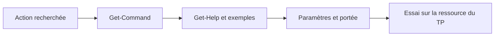

# Module 01 — Initiation à PowerShell

## Objectifs

À l'issue de ce module, vous devez pouvoir repérer la structure d'une cmdlet,
rechercher une commande, consulter son aide et identifier les modules et le
profil utilisés par une console PowerShell. Les comparaisons entre consoles et
les résultats chiffrés restent liés au scénario de laboratoire du TP.

## Repères historiques issus du support de formation

Le support situe PowerShell v1.0 en 2006 et évoque notamment Windows XP SP2,
Vista et Windows Server 2003 SP1. Il présente également PowerShell 5.1 sur
Windows 10 et Windows Server 2019, ainsi que des références à .NET Core 3.0 et PowerShell Core 7.0. Ces repères sont des informations historiques issues du support de
formation : ils ne décrivent pas nécessairement l'état actuel des produits.

Le support distingue Windows PowerShell et PowerShell Core. Il associe à Core
une prise en charge multiplateforme et signale, dans le contexte historique
décrit, des différences possibles concernant certaines commandes, certains
alias, le remoting, la casse sous Linux et la compatibilité de scripts Windows.

## Les cmdlets : verbe, nom, paramètres et arguments

Le support présente une cmdlet sous la forme **Verbe-Nom**. Parmi les exemples
figurent `Get-ChildItem`, `Get-Service`, `Get-Volume`, `Get-Process`,
`Get-Item` et `Get-SMBShare`.

Un paramètre est introduit par un tiret ; la valeur fournie à ce paramètre est
un argument. Les exemples suivants appartiennent au support :

```powershell
Get-LocalUser -Name "Nom de l’utilisateur recherché"
Get-LocalGroupMember -Group "Nom du groupe recherché" -Member "Membre du groupe recherché dans le groupe indiqué"
```

La démonstration consacrée aux cmdlets utilise aussi `Get-Verb` pour afficher
la liste des verbes disponibles.

## Rechercher des commandes avec `Get-Command`

`Get-Command` permet d'afficher les commandes disponibles. Le support illustre
une recherche sur le nom et une recherche sur le verbe :

```powershell
Get-Command -Name *-Service
Get-Command -Verb Stop
```

Le TP demande notamment de comparer des environnements PowerShell, de compter
les commandes retournées et de rechercher les commandes utilisant `New` ou
contenant `User`. Les nombres observés dépendent de l'environnement de
laboratoire ; ils ne constituent pas des valeurs générales.

```powershell
Get-Command | Measure
Get-Command -Verb New
Get-Command -Noun *User*
Get-command -Noun *localuser*
Get-LocalUser | select -first 5
```

## Comprendre une commande avec `Get-Help`

Le support présente l'aide d'une cmdlet et plusieurs niveaux d'affichage :

```powershell
Get-Help -Name Get-Service
Get-Help -Name Get-Service -Full
Get-Help -Name Get-Service -Examples
Get-Help -Name Get-Service -Online
Get-Help -Name Get-Service -ShowWindow
```

L'aide affichée peut varier selon la langue du système, la mise à jour des
fichiers d'aide et la commande interrogée. L'aide en ligne suppose un navigateur
et un accès Internet autorisé.

!!! note "Formes documentaires à conserver"
    Le TP et sa correction emploient aussi `Get-Help Get-Service -showwindow`
    et `Get-Help Get-Service -full`. Une divergence persiste pour l'aide liée
    aux groupes locaux ; elle reste documentée dans la correction du TP plutôt
    que corrigée silencieusement ici.

## Mettre à jour l'aide

La source présente `Update-Help` pour rechercher des fichiers d'aide depuis les sources d’aide des modules ou depuis un dépôt local ou réseau. `Save-Help` est cité dans
la démonstration comme commande d'export des fichiers d'aide. Le support décrit la mise à jour avec des droits d’administration dans son environnement Windows PowerShell.

```powershell
Update-Help
Update-Help -SourcePath D:\PowerShell
Update-Help -SourcePath D:\PowerShell -UICulture En-US
Save-Help
```

Dans le TP, la mise à jour s'appuie sur une ressource de laboratoire fournie par
le formateur et peut être répétée avec une culture sélectionnée. Cette ressource
ne fait pas partie des fichiers Drive M01.

## Exécution de scripts et protection

La démonstration présente `Get-ExecutionPolicy` et `Set-ExecutionPolicy`. Le
support énumère les niveaux `Restricted`, `AllSigned`, `RemoteSigned`,
`Unrestricted`, `Bypass`, `Default` et `Undefined`, et montre la forme suivante :

```powershell
Set-ExecutionPolicy -ExecutionPolicy Unrestricted
```

Ces commandes et leurs niveaux de protection sont présentés selon le support de
formation. Elles nécessitent les droits administrateur et ne constituent pas
une consigne générale de modification de sécurité.

## Modules PowerShell

Le support indique qu'une cmdlet provient d'un module et associe les modules à
l'extension `.PSM1`. Les emplacements de modules sont consultés avec la variable
d'environnement suivante :

```powershell
Get-Module
$env:PSModulePath
Import-Module -Name "nom du dossier contenant le module"
Get-Command -Module "nom du module"
```

Le TP emploie un module AWS dans son scénario de laboratoire. Le module,
l'archive et le partage de laboratoire cités ne sont pas disponibles dans le
dossier Drive M01. Les variantes documentaires de son nom sont conservées dans
la correction, sans normalisation.

## Profil et personnalisation de la console

La console peut être personnalisée par ses propriétés graphiques, notamment la
police, la taille et les couleurs. Le support montre la création d'un profil :

```powershell
if (-not (Test-Path -LiteralPath $PROFILE)) {
    $dossier = Split-Path -Parent $PROFILE
    New-Item -Path $dossier -ItemType Directory -Force | Out-Null
    New-Item -Path $PROFILE -ItemType File | Out-Null
}
```

Le support décrit ce profil comme un fichier créé dans le dossier Documents de
l'utilisateur actuel et exécuté à l'ouverture de la console. Le TP demande de
mettre en place un profil et comporte un bonus de personnalisation du prompt à
partir d'un script de laboratoire non fourni dans Drive M01.

## Vérifications issues du TP

- comparer les résultats entre les consoles présentes dans le scénario, sans
  transformer les valeurs observées en règle générale ;
- relever les commandes, modules et emplacements effectivement affichés par
  l'environnement de laboratoire ;
- vérifier l'aide demandée avec la forme de commande indiquée par le TP ;
- utiliser les identifiants fournis dans l'environnement de laboratoire lorsque
  le scénario demande une connexion.

## Choisir la console et interpréter les versions

La démonstration installe PowerShell 7.0.3 et compare son `$PSVersionTable` avec Windows PowerShell 5.1. Le premier présente `PSEdition = Core` et le second `PSEdition = Desktop`. Dans le support, la version 3.0 désigne **.NET Core**. Le tableau des systèmes pris en charge correspond à la période où la fiche a été rédigée. Les valeurs 129 commandes pour PowerShell 1.0 ou 2855 pour un poste 5.1 servent de repères historiques.

`powershell.exe` ouvre Windows PowerShell et `pwsh` ouvre PowerShell moderne lorsque les deux sont installés. Une commande peut manquer parce qu’un module, un rôle Windows ou une session particulière est nécessaire. La fiche d’origine indique que le remoting n’est pas disponible dans son contexte. PowerShell moderne prend en charge le remoting sur SSH et conserve des usages Windows avec WinRM. [Documentation Microsoft sur le remoting SSH](https://learn.microsoft.com/en-us/powershell/scripting/learn/remoting/ssh-remoting-in-powershell-core).

```powershell
$PSVersionTable
Get-Verb
Get-Command -Name '*-Service'
Get-Command -Verb Stop
Get-Command -Verb New
Get-Command -Noun '*User*'
Get-Command | Measure-Object
```

L’astérisque représente une suite de caractères. `Get-Command -Verb New` cible le verbe. `Get-Command -Noun '*User*'` cherche dans le nom après le tiret. Pour expliquer un écart de comptage entre deux consoles, relever `PSEdition`, `PSVersion` et les modules chargés dans chacune.

## Passer de la commande au bon exemple



*Schéma pédagogique externe au cours.*

La fiche Get-Help démontre les paramètres `-Full`, `-Parameter Verb`, `-ShowWindow` et `-Online` avec `Get-Command`. Les crochets de la syntaxe de l’aide signalent une partie facultative. `about_Command_Syntax` explique les conventions de lecture de ces lignes.

```powershell
Get-Help Get-Command -Full
Get-Help Get-Command -Parameter Verb
Get-Help Get-Command -ShowWindow
Get-Help Get-Command -Online
Get-Help about_Command_Syntax
Get-Help Get-LocalGroupMember -Examples
```

Le TP demande d’identifier la commande qui liste les membres d’un groupe. `Get-LocalGroupMember` correspond à cette action. L’aide de `Get-LocalGroup` concerne l’objet groupe. L’Original et la correction conservent la différence observée entre les deux réponses du dossier. [Référence de Get-LocalGroupMember](https://learn.microsoft.com/en-us/powershell/module/microsoft.powershell.localaccounts/get-localgroupmember?view=powershell-5.1).

Les fichiers d’aide sont associés aux modules. `Save-Help` les dépose dans un répertoire et `Update-Help -SourcePath` les lit depuis ce dépôt. Le choix `en-US` ou `fr-FR` ne produit des résultats que si le module fournit la culture demandée. À partir de PowerShell 6.1, la portée utilisateur est disponible et utilisée par défaut. L’installation dans les répertoires système conserve ses exigences de droits. [Référence de Update-Help](https://learn.microsoft.com/en-us/powershell/module/microsoft.powershell.core/update-help?view=powershell-7.2).

```powershell
Save-Help -DestinationPath 'C:\PowerShell'
Update-Help -SourcePath 'C:\PowerShell' -UICulture en-US
Get-ExecutionPolicy -List
Get-Module
Get-Module -ListAvailable
$env:PSModulePath
```

Le support compare `Restricted`, `AllSigned`, `RemoteSigned`, `Unrestricted` et `Bypass`. La stratégie active dépend de sa portée. Une stratégie de groupe a priorité sur les réglages de la session et du poste. L’exemple historique passe à `Unrestricted` pour illustrer l’effet d’un changement. Pour le TP, lire le résultat de `Get-ExecutionPolicy -List` avant d’expliquer la stratégie effective. [Règles de stratégie d’exécution](https://learn.microsoft.com/en-us/powershell/module/microsoft.powershell.core/about/about_execution_policies?view=powershell-7).

## Charger un module et retrouver son profil

`Get-Module` montre les modules de la session. `Get-Module -ListAvailable` cherche dans les emplacements référencés par `PSModulePath`. Une implémentation de module peut utiliser un script `.psm1`, un manifeste `.psd1` ou un assembly. Le support montre l’import d’AWSPowerShell et compte les commandes exportées. Ce total varie selon la version du module.

```powershell
Import-Module -Name AWSPowerShell
Get-Command -Module AWSPowerShell | Measure-Object
Get-Command -Module AWSPowerShell -CommandType Cmdlet | Select-Object -First 3
$PROFILE
Test-Path -LiteralPath $PROFILE
```

Les propriétés de la console règlent son apparence. Le profil est un script exécuté au démarrage d’un hôte. La démonstration y affiche le nom et l’heure, puis redéfinit `prompt`. Un profil peut être différent entre Windows PowerShell, PowerShell moderne et le terminal de l’éditeur. Vérifier son chemin avant de l’éditer.

## TP guidé

### Comparer les consoles et identifier les comptes

Sur CLI01, lancer Windows PowerShell et PowerShell moderne dans les mêmes conditions. Relever pour chaque hôte l’édition, la version, le nombre de commandes et les verbes approuvés disponibles. Répéter `Get-Command -Verb New` et `Get-Command -Noun '*User*'` dans les deux consoles. Les noms et les nombres relevés constituent la preuve du TP.

```powershell
$PSVersionTable | Select-Object -Property PSEdition,PSVersion
Get-Verb | Select-Object Verb,Group
(Get-Command | Measure-Object).Count
Get-Command -Name New-LocalUser -ErrorAction SilentlyContinue
Get-LocalUser | Select-Object -First 5 Name,Enabled
```

La consigne demande aussi de comparer CLI01 et CD01. Vérifier le rôle de CD01. Un contrôleur de domaine ne présente pas les mêmes comptes locaux qu’un poste membre. Si la commande n’est pas disponible, relever son message et la machine interrogée. Pour le bonus, vérifier auprès du formateur que SRV01 est bien une cible autorisée, car les étapes précédentes nomment CD01. Relever la description du compte local de test avant et après un changement approuvé.

### Comparer les formes d’aide et les cultures

Consulter l’aide de `Get-Service` dans la console puis dans une fenêtre si l’hôte le permet. Comparer la version complète et l’aide en ligne de `Get-LocalGroupMember`. Une page en ligne peut décrire une version différente de la commande installée.

```powershell
Get-Help Get-Service
Get-Help Get-Service -ShowWindow
Get-Help Get-Service -Full
Get-Help Get-LocalGroupMember -Online
$depot = '\\CD01\Partage\Depot\CLI01'
Test-Path -LiteralPath $depot
Update-Help -SourcePath $depot
Update-Help -SourcePath $depot -UICulture fr-FR
```

Utiliser le chemin de la maquette si le dépôt est accessible. Relever quelles cultures et quels modules ont une aide dans le dépôt, puis noter les erreurs de chemin, de droits ou de langue séparément.

### Charger l’archive et préparer un profil par hôte

1. Relever les modules chargés, les modules disponibles et le module de `Get-LocalUser`. Vérifier les chemins de `PSModulePath` avant de déposer le dossier extrait de l’archive approuvée.
2. Essayer l’import d’AWSPowerShell, relever l’erreur exacte et vérifier la politique effective. Si l’archive approuvée est bloquée par sa provenance, contrôler son origine et demander la procédure de déblocage de la maquette. Une stratégie de groupe conserve la priorité.
3. Après import, relever trois commandes réellement exportées. Sauvegarder tout profil existant avant de l’éditer. Ajouter `Get-Help Get-Help` au profil de l’hôte voulu, rouvrir la même console et vérifier son exécution. Pour le bonus, modifier une fonction `prompt` de travail pour y inclure l’heure et le chemin courant.

```powershell
Get-Module
Get-Module -ListAvailable | Measure-Object
(Get-Command Get-LocalUser).ModuleName
$env:PSModulePath -split [IO.Path]::PathSeparator
Import-Module AWSPowerShell -ErrorAction Stop
Get-Command -Module AWSPowerShell | Select-Object -First 3 Name
$PROFILE.CurrentUserCurrentHost
Test-Path -LiteralPath $PROFILE.CurrentUserCurrentHost
```

## À retenir

Comparer des consoles en relevant d’abord leur édition et leur version. Utiliser `Get-Command` pour chercher une action, `Get-Help` pour vérifier ses paramètres et `Get-Module` pour identifier la commande disponible. Dans le TP, vérifier le dépôt d’aide, l’origine du module et le profil de l’hôte.

## Mini-quiz

1. Quelle commande distingue les éditions Desktop et Core ?
2. Quel paramètre de `Get-Command` recherche `Stop` comme verbe ?
3. Pourquoi le nombre de commandes change-t-il entre deux consoles ?
4. Quelle commande liste les portées de stratégie d’exécution ?
5. Comment distinguer les modules chargés des modules présents sur le disque ?

??? success "Réponses commentées"
    1. `$PSVersionTable` contient `PSEdition` et `PSVersion`.
    2. `-Verb Stop`.
    3. Les versions, les modules et les rôles disponibles diffèrent.
    4. `Get-ExecutionPolicy -List`.
    5. `Get-Module` affiche les modules chargés dans cette session. `Get-Module -ListAvailable` recherche ceux que l’hôte peut trouver dans `PSModulePath`.

## Travaux pratiques et révision

- [TP et correction du module](../../tp/12-initiation-powershell/module-01/index.md)
- [Fiche de révision](../../revision/12-initiation-powershell/module-01.md)
- [Sommaire du cours](index.md)
