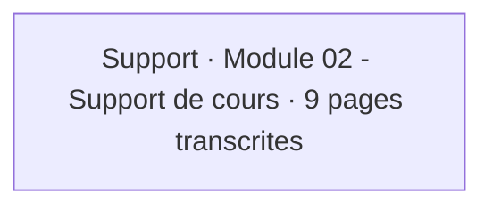
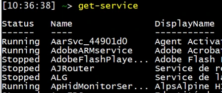
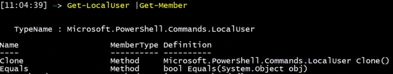
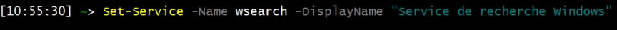
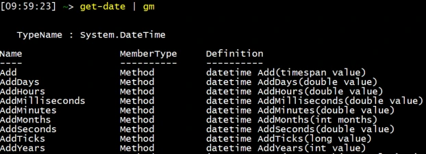

# Module 02 — PowerShell : langage objet

[Travaux pratiques](../../tp/12-initiation-powershell/module-02/index.md)

Les parties ci-dessous reprennent le cours original, dans le même ordre. Les encadrés et les schémas répètent ses formulations.

## Parcours de lecture

1. Support · Module 02 - Support de cours · 9 pages transcrites

**Visuel externe**



SOURCE DRIVE · TRANSCRIPTION DU SUPPORT

Le contenu des documents du dossier TSSR est transcrit ci-dessous, page par page. Les textes et tableaux sont intégrés à la page Web. Aucun fichier PDF, aucune diapositive entière ni aucune reproduction de page n’est affiché. Seuls des croquis ou visuels isolés et vérifiés peuvent accompagner la transcription. Les versions et les consignes restent celles des supports de formation. Les compléments IA sont conservés dans leur onglet distinct.

## Support · Module 02 - Support de cours · 9 pages transcrites

!!! note "À retenir"
    Les formulations historiques et les exemples du document sont conservés.

Transcription du support du Drive. Les formulations historiques et les exemples du document sont conservés. Les valeurs d’accès du laboratoire sont indiquées comme « fourni par le formateur ». Les adresses de messagerie personnelles utilisent example.com.

### Initiation à PowerShell

Module 02 – PowerShell : langage objet

### Objectifs

!!! note "À retenir"
    Utiliser un langage objet pour administrer les systèmes Microsoft.

- Utiliser un langage objet pour administrer les systèmes Microsoft.

### PowerShell, un langage orienté objet

!!! note "À retenir"
    Contrairement au Bash ou au CMD, PowerShell est un langage orienté objet.

!!! example "Exemple"
    Exemple : on recherche l’utilisateur local « Tom » en CMD et avec PowerShell.

Contrairement au Bash ou au CMD, PowerShell est un langage orienté objet. Exemple : on recherche l’utilisateur local « Tom » en CMD et avec PowerShell.

Tom Tom CMD PowerShell

### PowerShell, un langage orienté objet

!!! note "À retenir"
    Regardons la composition d’un objet PowerShell : • Un objet est défini par un ensemble de propriétés et de méthodes.

Regardons la composition d’un objet PowerShell : • Un objet est défini par un ensemble de propriétés et de méthodes. • On peut comparer un objet PowerShell à un objet du quotidien. • Un feutre possède des propriétés et des méthodes.

| Propriétés | Méthodes |
| --- | --- |
| Marque, Couleur | Enlever le bouchon |
| Forme, Pointe | Écrire |
| Taille, Poids | Mettre le bouchon |


Capture du support « Module 02 - Support de cours »

### PowerShell, un langage orienté objet

!!! note "À retenir"
    La commande renvoie un objet « service Windows ».

```
PS > Get-Service
```

La commande renvoie un objet « service Windows ».

| Propriétés | Méthodes |
| --- | --- |
| Nom du service | Démarrer le service |
| Type de démarrage | Désactiver le service |
| Statut du service | Arrêter le service |

### Get-Member

!!! note "À retenir"
    La CMDLET est la commande qui permet de connaître : Le type d’objet traité par la “CMDLET” Les méthodes applicables à l’objet Les propriétés connues de l’objet Capture du support « Module 02 - Support de cours » Capture du support « Module 02 - Support de cours »

```
PS> Get-Member
```

La CMDLET est la commande qui permet de connaître :

Le type d’objet traité par la “CMDLET”

Les méthodes applicables à l’objet

Les propriétés connues de l’objet



Capture du support « Module 02 - Support de cours »


Capture du support « Module 02 - Support de cours »

### Get-Member

!!! note "À retenir"
    La Cmdlet Get-member s’utilise exclusivement à la suite d’une commande dont le verbe est Get.

```
PS > Get-Member
```

La Cmdlet

- Get-member s’utilise exclusivement à la suite d’une commande dont le verbe est Get.
- Le PIPE ou | est obtenu par la combinaison de touche ALT GR puis 6.
- Elle est à ajouter aux deux commandes vues précédemment Get-Command et Get-Help.
- Ces trois commandes sont dites commandes clés pour pratiquer le langage PowerShell.

```
PS > Get-Command
Get-Help
Get-Member
```

### Démonstration



Capture du support « Module 02 - Support de cours »

### Les objets : propriétés

- Les propriétés d’un objet PowerShell sont définies par le type d’objet.
- La valeur des propriétés peut être de différents types.

| Type de valeurs | Contenus acceptés |
| --- | --- |
| STRING « Chaîne de caractères Unicode » | De « a » à « Z » plus la ponctuation |
| INT « Integer » | De « -2 147 483 648 et 2 147 483 647 inclus. » |
| BOOL « Boolean » | « $FALSE » « $TRUE » « $NULL » |
| Array « Tableau » | Un tableau contient des valeurs facilement identifiables par un jeu de coordonnées. |
| Object « Objet » | Une propriété peut contenir un objet complet. |

### Les objets : propriétés et valeur

Constitution d’un objet

OBJET

Propriété Propriété Propriété Propriété

Valeur Valeur Valeur Valeur

```
PS > Get-Service
-ServiceName
« Wsearch »
```

| Typedevaleurs | Contenusacceptés |
| --- | --- |
| STRING«ChaînedecaractèresUnicode» | De«a»à«Z»pluslaponctuation |
| INT«Integer» | De « -2 147 483 648 et 2 147 483 647 inclus . » |
| BOOL«Boolean» | «$FALSE» «$TRUE» «$NULL» |
| Array«Tableau» | Untableaucontientdesvaleursfacilement identifiablesparunjeudecoordonnées . |
| Object«Objet» | Unepropriétépeutcontenirunobjetcomplet . |


Capture du support « Module 02 - Support de cours »

### Les objets : propriétés et valeur

- On peut modifier la valeur d’une propriété avec le verbe Set en début de commande suivi du nom de l’objet.

```
PS > Get-Service –ServiceName «wsearch»
```

- On effectue à nouveau la commande

### Démonstration



Capture du support « Module 02 - Support de cours »


Capture du support « Module 02 - Support de cours »

### Les objets : méthodes

- Les objets disposent également de méthodes parfois communes à plusieurs types d’objets.
- Contrairement aux propriétés, les méthodes effectuent des actions sur la totalité de l’objet ou sur la valeur d’une ou plusieurs propriétés d’un objet.

```
L’objet
«system.datetime»
peut être employé avec
plusieurs méthodes.
```

### Les objets : méthodes

- Pour appliquer une méthode, on utilise la commande permettant d’obtenir un objet.

```
PS > Get-Date
```

- On encadre la commande avec des parenthèses afin d’appliquer la méthode. On ajoute la méthode précédée d’un point de concaténation, puis à la suite de la méthode on ajoute entre parenthèses la valeur nécessaire à la méthode.

```
PS > (Get-Date).AddDays(*)
```

- Ici la méthode AddDays ajoute un jour de plus à l’objet System.DateTime renvoyé par la commande Get-date.



Capture du support « Module 02 - Support de cours »


Capture du support « Module 02 - Support de cours »


Capture du support « Module 02 - Support de cours »

### Démonstration

### TP

### Conclusion

- Vous savez utiliser un langage objet pour administrer les systèmes Microsoft.

Référence du document : 1NMGTFA7wCb6r7SmzRYR2FaLWCFOT9AVl · SHA-256 3929e85d6989805b…

| Support · Module 02 - Support de cours · 9 pages transcrites | Les formulations historiques et les exemples du document sont conservés. |
