# Module 02 — PowerShell : langage objet

Les parties ci-dessous reprennent le cours original, dans le même ordre. Les encadrés et les schémas répètent ses formulations.

## Parcours de lecture

1. Support · Module 02 - Support de cours · 9 pages transcrites
2. Démonstration · Fiche démo 1 - Get-Member · 2 pages transcrites
3. Démonstration · Fiche démo 2 - Les propriétés · 2 pages transcrites
4. Démonstration · Fiche démo 3 - Les méthodes · 2 pages transcrites
5. Énoncé · Énoncé du TP - L'objet · 3 pages transcrites
6. Correction · Solution du TP - L'objet · 4 pages transcrites

**Visuel externe**

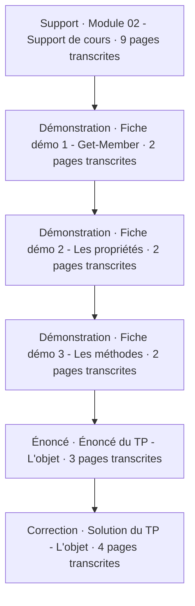

SOURCE DRIVE · TRANSCRIPTION DU SUPPORT

Le contenu des documents du dossier TSSR est transcrit ci-dessous, page par page. Les textes et tableaux sont intégrés à la page Web. Aucun fichier PDF, aucune diapositive entière ni aucune reproduction de page n’est affiché. Seuls des croquis ou visuels isolés et vérifiés peuvent accompagner la transcription. Les versions et les consignes restent celles des supports de formation. Les compléments IA sont conservés dans leur onglet distinct.

## Support · Module 02 - Support de cours · 9 pages transcrites

!!! note "À retenir"
    Les formulations historiques et les exemples du document sont conservés.

Transcription du support du Drive. Les formulations historiques et les exemples du document sont conservés. Les valeurs d’accès du laboratoire sont indiquées comme « fourni par le formateur ». Les adresses de messagerie personnelles utilisent example.com.

### Initiation à PowerShell

Module 02 – PowerShell : langage objet

### Objectifs

!!! note "À retenir"
    Utiliser un langage objet pour administrer les systèmes Microsoft.

- Utiliser un langage objet pour administrer les systèmes Microsoft.

### PowerShell, un langage orienté objet

!!! note "À retenir"
    Contrairement au Bash ou au CMD, PowerShell est un langage orienté objet.

!!! example "Exemple"
    Exemple : on recherche l’utilisateur local « Tom » en CMD et avec PowerShell.

Contrairement au Bash ou au CMD, PowerShell est un langage orienté objet. Exemple : on recherche l’utilisateur local « Tom » en CMD et avec PowerShell.

Tom Tom CMD PowerShell

### PowerShell, un langage orienté objet

!!! note "À retenir"
    Regardons la composition d’un objet PowerShell : • Un objet est défini par un ensemble de propriétés et de méthodes.

Regardons la composition d’un objet PowerShell : • Un objet est défini par un ensemble de propriétés et de méthodes. • On peut comparer un objet PowerShell à un objet du quotidien. • Un feutre possède des propriétés et des méthodes.

| Propriétés | Méthodes |
| --- | --- |
| Marque, Couleur | Enlever le bouchon |
| Forme, Pointe | Écrire |
| Taille, Poids | Mettre le bouchon |


Capture du support « Module 02 - Support de cours »

### PowerShell, un langage orienté objet

!!! note "À retenir"
    La commande renvoie un objet « service Windows ».

```
PS > Get-Service
```

La commande renvoie un objet « service Windows ».

| Propriétés | Méthodes |
| --- | --- |
| Nom du service | Démarrer le service |
| Type de démarrage | Désactiver le service |
| Statut du service | Arrêter le service |

### Get-Member

!!! note "À retenir"
    La CMDLET est la commande qui permet de connaître : Le type d’objet traité par la “CMDLET” Les méthodes applicables à l’objet Les propriétés connues de l’objet Capture du support « Module 02 - Support de cours » Capture du support « Module 02 - Support de cours »

```
PS> Get-Member
```

La CMDLET est la commande qui permet de connaître :

Le type d’objet traité par la “CMDLET”

Les méthodes applicables à l’objet

Les propriétés connues de l’objet


Capture du support « Module 02 - Support de cours »

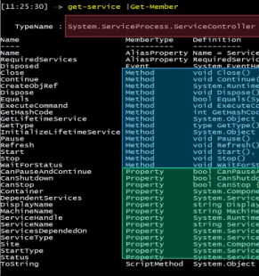

Capture du support « Module 02 - Support de cours »

### Get-Member

!!! note "À retenir"
    La Cmdlet Get-member s’utilise exclusivement à la suite d’une commande dont le verbe est Get.

```
PS > Get-Member
```

La Cmdlet

- Get-member s’utilise exclusivement à la suite d’une commande dont le verbe est Get.
- Le PIPE ou | est obtenu par la combinaison de touche ALT GR puis 6.
- Elle est à ajouter aux deux commandes vues précédemment Get-Command et Get-Help.
- Ces trois commandes sont dites commandes clés pour pratiquer le langage PowerShell.

```
PS > Get-Command
Get-Help
Get-Member
```

### Démonstration


Capture du support « Module 02 - Support de cours »

### Les objets : propriétés

- Les propriétés d’un objet PowerShell sont définies par le type d’objet.
- La valeur des propriétés peut être de différents types.

| Type de valeurs | Contenus acceptés |
| --- | --- |
| STRING « Chaîne de caractères Unicode » | De « a » à « Z » plus la ponctuation |
| INT « Integer » | De « -2 147 483 648 et 2 147 483 647 inclus. » |
| BOOL « Boolean » | « $FALSE » « $TRUE » « $NULL » |
| Array « Tableau » | Un tableau contient des valeurs facilement identifiables par un jeu de coordonnées. |
| Object « Objet » | Une propriété peut contenir un objet complet. |

### Les objets : propriétés et valeur

Constitution d’un objet

OBJET

Propriété Propriété Propriété Propriété

Valeur Valeur Valeur Valeur

```
PS > Get-Service
-ServiceName
« Wsearch »
```

| Typedevaleurs | Contenusacceptés |
| --- | --- |
| STRING«ChaînedecaractèresUnicode» | De«a»à«Z»pluslaponctuation |
| INT«Integer» | De « -2 147 483 648 et 2 147 483 647 inclus . » |
| BOOL«Boolean» | «$FALSE» «$TRUE» «$NULL» |
| Array«Tableau» | Untableaucontientdesvaleursfacilement identifiablesparunjeudecoordonnées . |
| Object«Objet» | Unepropriétépeutcontenirunobjetcomplet . |

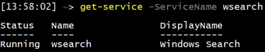

Capture du support « Module 02 - Support de cours »

### Les objets : propriétés et valeur

- On peut modifier la valeur d’une propriété avec le verbe Set en début de commande suivi du nom de l’objet.

```
PS > Get-Service –ServiceName «wsearch»
```

- On effectue à nouveau la commande

### Démonstration


Capture du support « Module 02 - Support de cours »

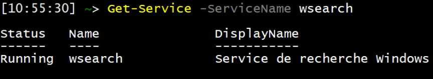

Capture du support « Module 02 - Support de cours »

### Les objets : méthodes

- Les objets disposent également de méthodes parfois communes à plusieurs types d’objets.
- Contrairement aux propriétés, les méthodes effectuent des actions sur la totalité de l’objet ou sur la valeur d’une ou plusieurs propriétés d’un objet.

```
L’objet
«system.datetime»
peut être employé avec
plusieurs méthodes.
```

### Les objets : méthodes

- Pour appliquer une méthode, on utilise la commande permettant d’obtenir un objet.

```
PS > Get-Date
```

- On encadre la commande avec des parenthèses afin d’appliquer la méthode. On ajoute la méthode précédée d’un point de concaténation, puis à la suite de la méthode on ajoute entre parenthèses la valeur nécessaire à la méthode.

```
PS > (Get-Date).AddDays(*)
```

- Ici la méthode AddDays ajoute un jour de plus à l’objet System.DateTime renvoyé par la commande Get-date.


Capture du support « Module 02 - Support de cours »

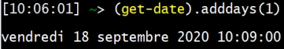

Capture du support « Module 02 - Support de cours »

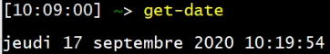

Capture du support « Module 02 - Support de cours »

### Démonstration

### TP

### Conclusion

- Vous savez utiliser un langage objet pour administrer les systèmes Microsoft.

Référence du document : 1NMGTFA7wCb6r7SmzRYR2FaLWCFOT9AVl · SHA-256 3929e85d6989805b…

## Démonstration · Fiche démo 1 - Get-Member · 2 pages transcrites

Transcription du support du Drive. Les formulations historiques et les exemples du document sont conservés. Les valeurs d’accès du laboratoire sont indiquées comme « fourni par le formateur ». Les adresses de messagerie personnelles utilisent example.com.

### Get-Member

Démonstration 01 du module 2

```
L’objectif de cette démonstration est de présenter la commande Get-Member qui permet de
visualiser les informations d’un objet PowerShell.
```

### Déroulement

- Toute commande PowerShell agit sur un objet du système Windows. La commande Get-member permet de connaître trois informations fondamentales sur l’objet en cours.

On obtient le type d’objet Paramètre TypeName.

La colonne MemberType renseigne sur les méthodes et les propriétés qui composent notre objet.

La commande Get-Member fait partie des trois commandes dites clés pour utiliser PowerShell

#### Commandes visibles dans les captures

```
Get-LocalUser | Get-Member
```

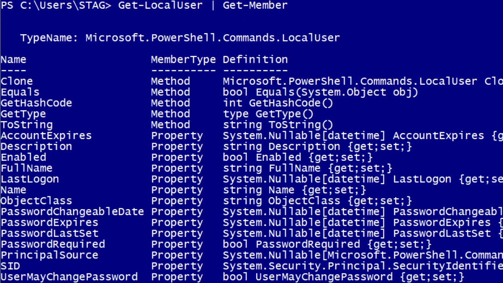

Capture du support « Fiche démo 1 - Get-Member »

comme langage d’administration de système. Pour rappel les commandes clés sont :

Get-Command

Get-Help

Get-Member

Une bonne connaissance de ces trois commandes est essentielle.

#### Commandes visibles dans les captures

```
Get-Command -Name *-service
Get-Help Get-Command
```

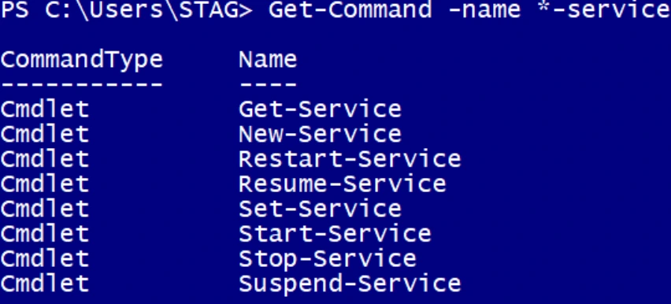

Capture du support « Fiche démo 1 - Get-Member »

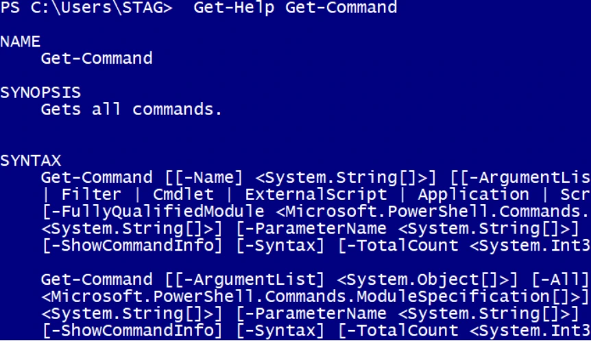

Capture du support « Fiche démo 1 - Get-Member »

Référence du document : 1Q8B3yCRRfLODG9poBxUvigyimrtsAYFg · SHA-256 f4986df6713d8bef…

## Démonstration · Fiche démo 2 - Les propriétés · 2 pages transcrites

Transcription du support du Drive. Les formulations historiques et les exemples du document sont conservés. Les valeurs d’accès du laboratoire sont indiquées comme « fourni par le formateur ». Les adresses de messagerie personnelles utilisent example.com.

### Les propriétés

Démonstration 02 du module 2

L’objectif de cette démonstration est de vous présenter les propriétés.

### Déroulement

Chaque objet PowerShell contient des propriétés. La liste de ses propriétés est définie par le type d’objet auquel il appartient.

- Le type de propriétés est indiqué par la commande Get-Member dans la colonne Definition.
- Connaître le type de propriété est essentiel pour pouvoir la manipuler.

La propriété Description est de type String ; elle n’accepte donc que les chaînes de caractères.

La propriété PasswordRequired est type Bool ; elle n’accepte que les valeurs de type booléen.

Pour modifier les valeurs d’une propriété, on va dans un premier temps choisir l’objet sur lequel on souhaite modifier la valeur de la propriété.

#### Commandes visibles dans les captures

```
Get-LocalUser | Get-Member
```


Capture du support « Fiche démo 2 - Les propriétés »

On indique à la commande Get-Service que l’on souhaite uniquement les services contenant search en fin de nom de service.

On obtient la valeur de la propriété DisplayName ici Windows Search.

Pour modifier la valeur, il faut disposer de l’objet de la propriété et de la valeur. On utilise en suite la commande permettant de modifier les valeurs de propriété de l’objet Service.

La commande Set-Service est associée au nom de l’objet service puis à la propriété à modifier et enfin à la valeur de la propriété souhaitée.

La propriété DisplayName est de type String ; nous lui indiquons donc une chaîne de caractères encadrée par les symboles ‘’ ou double quote.

La commande L’objet La propriété La valeur de type « String »

On vérifie la bonne prise en compte de la modification.

La modification d’un objet système nécessite une console avec les droits d’administration

#### Commandes visibles dans les captures

```
Get-Service -ServiceName *search
Set-Service -ServiceName Wsearch -DisplayName "Service de recherche windows"
Get-Service -ServiceName *search
```

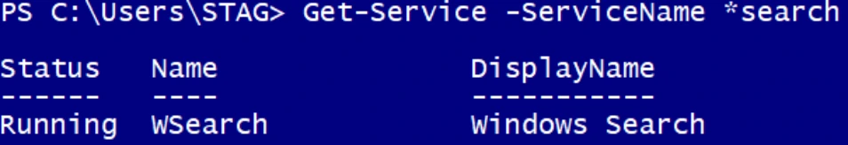

Capture du support « Fiche démo 2 - Les propriétés »


Capture du support « Fiche démo 2 - Les propriétés »

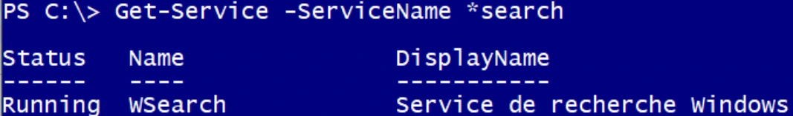

Capture du support « Fiche démo 2 - Les propriétés »

Référence du document : 1TMjGZOgeMyCZiXLYdPiiNrL_fQ_1CMnl · SHA-256 6d99a86e47a7b23a…

## Démonstration · Fiche démo 3 - Les méthodes · 2 pages transcrites

Transcription du support du Drive. Les formulations historiques et les exemples du document sont conservés. Les valeurs d’accès du laboratoire sont indiquées comme « fourni par le formateur ». Les adresses de messagerie personnelles utilisent example.com.

### Les méthodes

Démonstration 03 du module 2

L’objectif de cette démonstration est de vous présenter ce que sont les méthodes.

### Déroulement

De la même façon qu’un objet contient des propriétés, les méthodes qu’il contient vont permettre d’effectuer des actions sur la totalité de l’objet, sur une propriété ou de faire des actions de conversion par exemple.

- Les méthodes sont révélées par la commande Get-Member.
- Les méthodes sont des actions à la différence des propriétés qui, elles, sont statiques.

La méthode Start a une portée sur tout l’objet service.

L’utilisation d’une méthode se fait en ayant les informations à disposition telles que l’objet sur lequel on souhaite exécuter la méthode ou la propriété de l’objet sur laquelle on va exécuter cette méthode.

#### Commandes visibles dans les captures

```
Get-Service | Get-Member
```

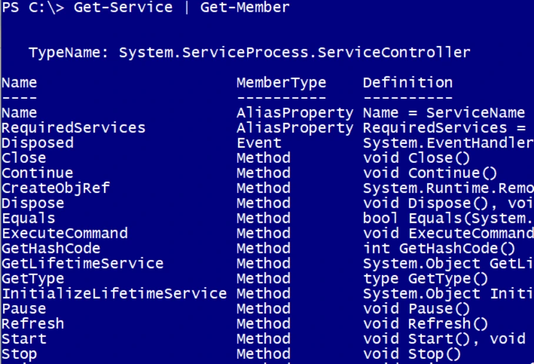

Capture du support « Fiche démo 3 - Les méthodes »

```
L’objet System.DateTime dispose de méthodes permettant de faire varier les valeurs obtenues par
```

la commande Get-Date.

Pour ajouter un jour au résultat, on utilise la méthode Add-Days suivie du nombre de jours que l’on souhaite ajouter.

L’objet la méthode la valeur

L’objet est contenu entre parenthèses ; il est suivi d’un point puis de la méthode, ce qui indique que l’on utilise la méthode de cet objet.

La valeur fournie entre parenthèses de la méthode doit être d’un type utilisable par la méthode.

#### Commandes visibles dans les captures

```
Get-Date | Get-Member
(Get-Date).AddDays(1)
```

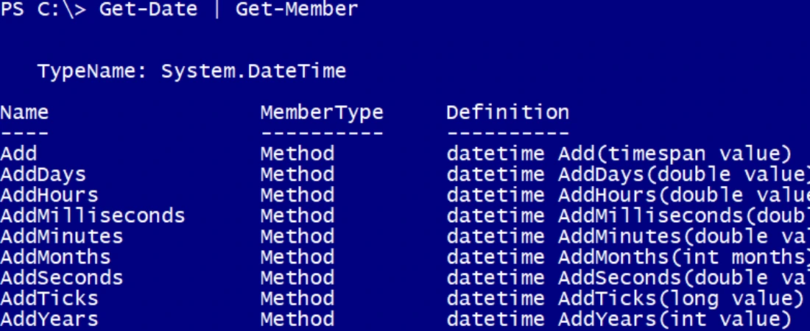

Capture du support « Fiche démo 3 - Les méthodes »

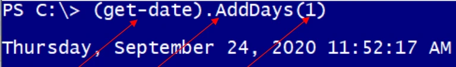

Capture du support « Fiche démo 3 - Les méthodes »

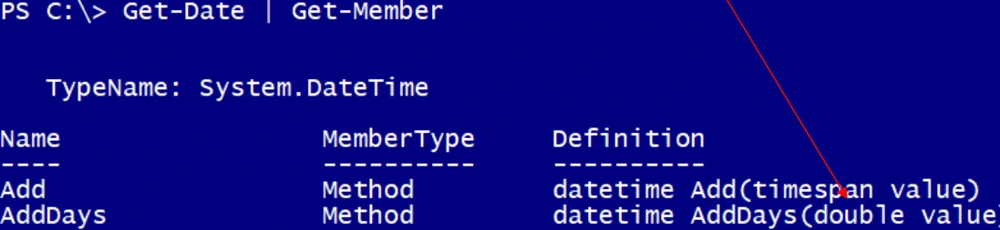

Capture du support « Fiche démo 3 - Les méthodes »

Référence du document : 1tgwX51FKJ8Rir-NZAix7etPRe6HWF8bv · SHA-256 cffd3435671bffbd…

## Énoncé · Énoncé du TP - L'objet · 3 pages transcrites

Transcription du support du Drive. Les formulations historiques et les exemples du document sont conservés. Les valeurs d’accès du laboratoire sont indiquées comme « fourni par le formateur ». Les adresses de messagerie personnelles utilisent example.com.

### Initiation à PowerShell L’objet

TP du Module 02

Avant de démarrer ce TP, il convient d’avoir suivi les vidéos du module 2 de ce cours.

Durée estimée

30 minutes

### Énoncé

Objectifs :

Comprendre le langage objet.

Utiliser les commandes de gestion de l’objet.

Consignes :

Depuis la machine CLI01 :

Utilisez la commande Get-Member pour afficher les propriétés et méthodes de l’objet System.ServiceProcess.ServiceController

Quelle commande avez-vous utilisée ?

Indiquez deux propriétés de type String

Indiquez une méthode de type Bool et une de type int.

Affichez les propriétés du service Spooler.

Quelle commande avez-vous utilisée ?

Quelles propriétés avez-vous affichées ?

Indiquez les valeurs de chaque propriété.

Affichez les propriétés de l’utilisateur local Adara Mcintyre.

Quelle commande avez-vous utilisée ?

Quelles propriétés avez-vous affichées ?

Indiquez les valeurs de chaque propriété.

Modifiez la valeur de la propriété de Description en Administrateur. Quelle commande avez-vous utilisée ?

Affichez le statut du service Spooler.

Utilisez la méthode pour arrêter le service Spooler. Quelle commande avez-vous utilisée ?

Vérifier à nouveau le statut du service.

Bonus

Utilisez la méthode de l’objet Get-Date pour renseigner la valeur de la propriété AccountExpires du compte de l’utilisateur Axel Rios.

Testez la mise à jour de la propriété avec la commande Get-LocalUser «Axel Rios » | select *

La valeur de la propriété AccountExpires doit être, au minimum, de 48 heures supérieure

à la date actuelle.

### Solution

Une solution est proposée pour ce TP sous la forme d'un PDF commenté, disponible dans les ressources à télécharger.

Référence du document : 1xn1SKBNjc5eBQSLwmp2ZYpD-iUlG4SA7 · SHA-256 0b856b384bf49271…

## Correction · Solution du TP - L'objet · 4 pages transcrites

Transcription du support du Drive. Les formulations historiques et les exemples du document sont conservés. Les valeurs d’accès du laboratoire sont indiquées comme « fourni par le formateur ». Les adresses de messagerie personnelles utilisent example.com.

Correction originale : à consulter après avoir tenté l’exercice.

### L’objet

TP du Module 02

Avant de démarrer ce TP, il convient d’avoir suivi les vidéos du module 2 de ce cours.

Durée estimée

30 minutes

### Énoncé

**Visuel externe**

```mermaid
flowchart LR
    N1["Comprendre le langage objet."]
    N2["Utiliser les commandes de gestion de l’objet."]
    N3["Indiquez deux propriétés de type String"]
    N4["Indiquez une méthode de type Bool et une de type int."]
    N5["Affichez les propriétés du service Spooler."]
    N6["Indiquez les valeurs de chaque propriété."]
    N7["Affichez les propriétés de l’utilisateur local Adara Mcintyre."]
    N8["Affichez le statut du service Spooler."]
    N1 --> N2
    N2 --> N3
    N3 --> N4
    N4 --> N5
    N5 --> N6
    N6 --> N7
    N7 --> N8
```

Objectifs :

- Comprendre le langage objet.
- Utiliser les commandes de gestion de l’objet.

Consignes :

Depuis la machine CLI01 :

- Utilisez la commande Get-Member pour afficher les propriétés et méthodes de l’objet System.ServiceProcess.ServiceController

Quelle commande avez-vous utilisée ?

```
Get-Service | Get-Member
```

- Indiquez deux propriétés de type String

```
DisplayName               Property      string DisplayName {get;set;}
MachineName               Property      string MachineName {get;set;}
```

- Indiquez une méthode de type Bool et une de type int.

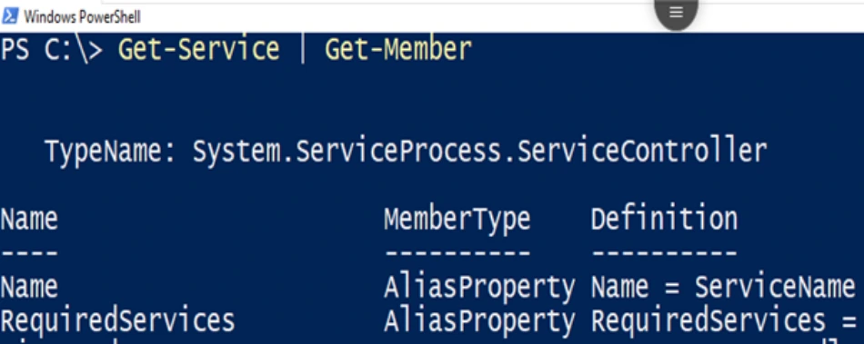

Capture du support « Solution du TP - L'objet »

```
Equals                    Method        bool Equals(System.Object obj)
GetHashCode               Method        int GetHashCode()
```

La méthode de type Bool est Equals la méthode de type Int est GetHashCode

- Affichez les propriétés du service Spooler.

Quelle commande avez-vous utilisée ?

```
get-service -name spooler | get-member -MemberType Property
```

Quelles propriétés avez-vous affichées ?

```
Get-Service -Name Spooler
```

Les propriétés affichées par défaut sont :

```
Status Name DisplayName
```

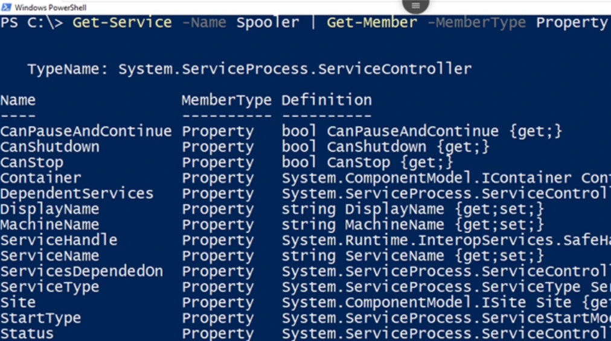

Capture du support « Solution du TP - L'objet »

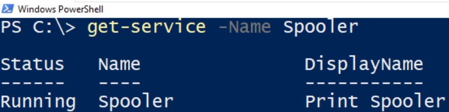

Capture du support « Solution du TP - L'objet »

- Indiquez les valeurs de chaque propriété.

Running Spooler Print Spooler

- Affichez les propriétés de l’utilisateur local Adara Mcintyre.

Quelle commande avez-vous utilisée ?

```
Get-LocalUser -Name
```

Quelles propriétés avez-vous affichées ?

```
Name Enabled Description
```

Indiquez les valeurs de chaque propriété.

Adara Mcintyre True Technician

Modifiez la valeur de la propriété de Description en Administrateur. Quelle commande avez-vous utilisée ?

```
Set-LocalUser -Name "adara mcintyre"-Description "Administrateur"
Get-LocalUser -Name "adara mcintyre"
```

- Affichez le statut du service Spooler.

Utilisez la Cmdlet pour arrêter le service Spooler. Quelle commande avez-vous utilisée ?

```
(Get-Service -Name Spooler).stop()
```

Vérifier à nouveau le statut du service.

```
Get-Service -Name Spooler
```

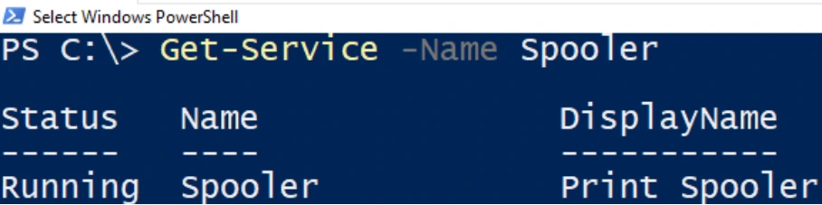

Capture du support « Solution du TP - L'objet »

Bonus

Utilisez la méthode de l’objet Get-Date pour renseigner la valeur de la propriété AccountExpires du compte de l’utilisateur Axel Rios.

- Testez la mise à jour de la propriété avec la commande Get-LocalUser «Axel Rios » | select *

La valeur de la propriété AccountExpires doit être, au minimum, de 48 heures supérieure à la date actuelle.

```
Set-LocalUser -Name "adara mcintyre"-AccountExpires (get-date).adddays(2)
Set-LocalUser -Name "adara mcintyre"| select *
```

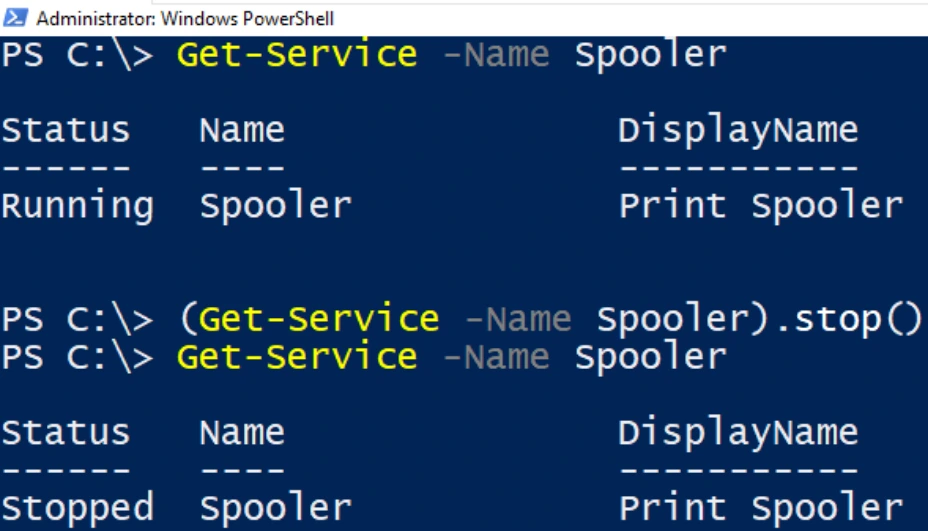

Capture du support « Solution du TP - L'objet »

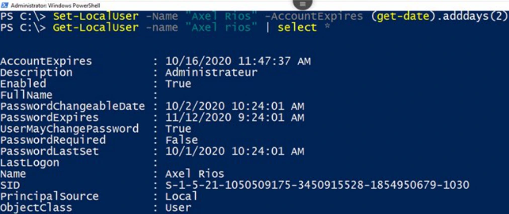

Capture du support « Solution du TP - L'objet »

Référence du document : 1TqWsLOg5YcprfveeH7NzxLpEr8QNWTWB · SHA-256 bd72edfae79c22a0…

## Fiche de synthèse

Les lignes reprennent les titres du cours et la première phrase de chaque partie.

| Partie | Repère du cours |
| --- | --- |
| Support · Module 02 - Support de cours · 9 pages transcrites | Les formulations historiques et les exemples du document sont conservés. |
| Démonstration · Fiche démo 1 - Get-Member · 2 pages transcrites | Les formulations historiques et les exemples du document sont conservés. |
| Démonstration · Fiche démo 2 - Les propriétés · 2 pages transcrites | Les formulations historiques et les exemples du document sont conservés. |
| Démonstration · Fiche démo 3 - Les méthodes · 2 pages transcrites | Les formulations historiques et les exemples du document sont conservés. |
| Énoncé · Énoncé du TP - L'objet · 3 pages transcrites | Les formulations historiques et les exemples du document sont conservés. |
| Correction · Solution du TP - L'objet · 4 pages transcrites | Les formulations historiques et les exemples du document sont conservés. |
