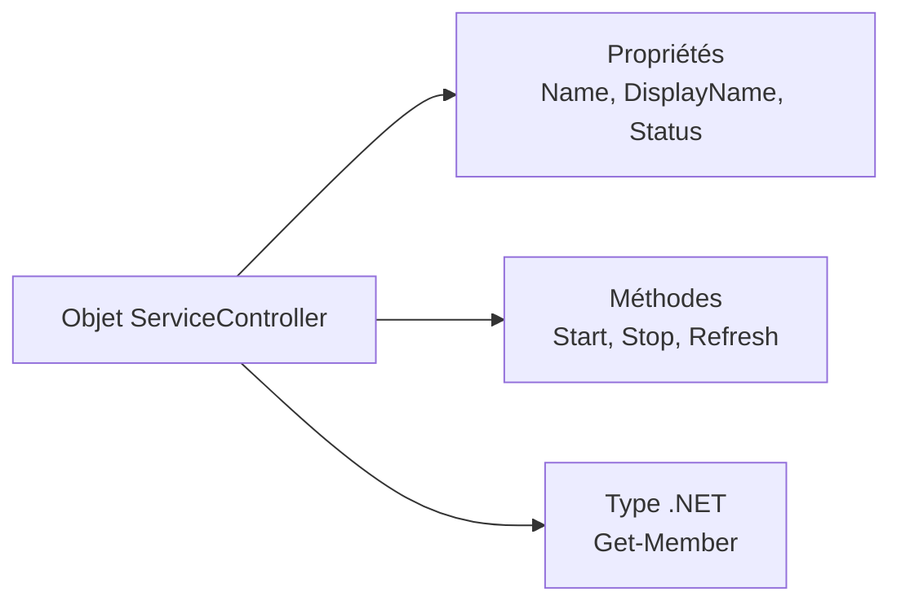

# Module 02 — PowerShell : langage objet

## Objectifs

À l'issue de ce module, vous devez pouvoir reconnaître un objet PowerShell,
repérer ses membres et distinguer ses propriétés de ses méthodes. Le TP
utilise des objets de service, d'utilisateur local et de date dans un
environnement de laboratoire.

## PowerShell : un langage orienté objet

Le support présente PowerShell comme un langage orienté objet. Un objet est
défini par un ensemble de **propriétés** et de **méthodes**. Les exemples du
module utilisent notamment les objets retournés par `Get-Service`,
`Get-LocalUser` et `Get-Date`.

Les objets observés, leurs membres et les résultats affichés dépendent de
l'environnement historique du laboratoire. Ils servent ici d'exemples du
support, pas d'inventaire universel.

## Examiner les membres avec `Get-Member`

`Get-Member` permet de visualiser les informations d'un objet PowerShell. Les
sources mettent en avant les colonnes suivantes :

- `TypeName` : le type de l'objet traité ;
- `MemberType` : la nature du membre affiché ;
- `Definition` : la définition connue du membre.

```powershell
Get-Service | Get-Member
Get-LocalUser | Get-Member
Get-Date | Get-Member
```

!!! note "Formulation du support"
    Le support affirme que `Get-Member` s'utilise exclusivement après une
    commande dont le verbe est `Get`. Cette formulation est conservée comme
    indication documentaire du support ; elle n'est pas présentée ici comme
    une règle universelle.

La démonstration rappelle également les commandes suivantes, déjà utilisées
dans le parcours, pour rechercher une commande puis consulter son aide :

```powershell
Get-Command -name *-service
Get-Help Get-Command
```

## Propriétés et valeurs

Les propriétés d'un objet sont définies par son type. Le support indique que
leurs valeurs peuvent avoir différents types : `String`, `Int`, `Bool`,
`Array` et `Object`.

Dans le TP, l'observation des propriétés d'un service passe notamment par :

```powershell
Get-Service -Name Spooler | Get-Member -MemberType Property
Get-Service -Name Spooler
```

Les noms de comptes, valeurs de propriétés et sorties propres au laboratoire
ne sont pas publiés. Utilisez les valeurs fournies dans l'environnement de
formation lorsque le TP les demande.

!!! note "Formes documentaires à conserver"
    Certaines démonstrations emploient `-ServiceName`, alors que la correction
    emploie `-Name`. Cette divergence est documentée dans la correction du TP
    et n'est pas harmonisée silencieusement.

## Méthodes

Le support distingue les méthodes des propriétés : les méthodes réalisent des
actions sur l'objet, sur la valeur d'une ou plusieurs propriétés, ou des
conversions. Les propriétés sont, elles, décrites comme « statiques » dans la
démonstration.

Pour appliquer une méthode, les sources encadrent la commande qui retourne
l'objet, ajoutent un point puis la méthode et ses parenthèses :

```powershell
(get-date).adddays(1)
(Get-Service -Name Spooler).stop()
```

La seconde commande appartient au scénario du TP : elle modifie l'état du
service ciblé. Les états, dates et membres affichés dans les captures sont des
observations historiques ou dynamiques de laboratoire.

## Vérifications issues du TP

- identifier le type, les propriétés et les méthodes affichés pour l'objet
  demandé ;
- relever les propriétés et les valeurs observées dans le scénario ;
- vérifier l'état du service après l'appel de la méthode demandée ;
- contrôler une date d'expiration de compte après la mise à jour demandée,
  avec les identifiants fournis dans le laboratoire.

## Examiner le type avant de choisir une action

Le support compare le nom « Tom » affiché par CMD avec un objet qui possède plusieurs propriétés et méthodes. Le feutre illustre la distinction entre **décrire** une chose, par sa couleur ou son poids, et **agir** sur elle, par exemple enlever son bouchon. Dans PowerShell, `Get-Service` renvoie des objets de service. `Name`, `DisplayName` et `Status` décrivent ces objets. Des méthodes comme `Start()` et `Stop()` agissent sur le service.



*Schéma pédagogique externe au cours.*

```powershell
$service = Get-Service -Name Spooler
$service | Get-Member
$service | Get-Member -MemberType Property
$service | Get-Member -MemberType Method
$service.Name
$service.DisplayName
$service.Status
```

`TypeName` décrit le type examiné. `MemberType` distingue notamment les propriétés, les méthodes et les alias. `Definition` précise le type et les formes d’appel. Pour afficher les membres du tableau lui-même, passer celui-ci à `Get-Member -InputObject`. Avec le pipeline, `Get-Member` inspecte les objets qui circulent dans le tableau.

## Lire, modifier, puis relire

La démonstration recherche `WSearch`, relève son nom d’affichage, modifie ce nom, puis interroge de nouveau le service. La possibilité de lire une propriété dépend du type et de la définition de son membre. Pour appliquer un changement au système, utiliser la commande appropriée avec la bonne cible et les droits du laboratoire.

```powershell
Get-Service -Name '*search'
Get-Service -Name WSearch | Select-Object Name,DisplayName,Status
Set-Service -Name WSearch -DisplayName 'Service de recherche Windows'
Get-Service -Name WSearch | Select-Object Name,DisplayName,Status
```

La table d’origine cite `String`, `Int`, `Bool`, `Array` et `Object`. Une valeur booléenne vaut `$true` ou `$false`. `$null` indique une absence de valeur. Une propriété peut elle-même contenir une collection ou un objet. Dans le TP, la description du compte local est comparée avant et après `Set-LocalUser`. Le nom du compte est celui de la maquette du formateur.

## Comprendre le résultat d’une méthode

```powershell
$maintenant = Get-Date
$maintenant | Get-Member -MemberType Method
$demain = $maintenant.AddDays(1)
$maintenant
$demain
```

`AddDays(1)` produit une nouvelle valeur de type `DateTime`. La valeur initiale reste dans `$maintenant`. Une méthode de type `void` peut agir sans produire un objet utilisable dans un pipeline. Le TP compare le statut du spouleur avant et après l’appel de `Stop()` sur le service de laboratoire. Le contrôle passe par une nouvelle interrogation de `Get-Service -Name Spooler`.

## TP guidé

### Décrire le spouleur avant d’agir

Sur CLI01, examiner les membres du service. Noter deux propriétés de type chaîne et relever dans `Definition` une méthode à retour booléen et une méthode à retour entier. Comparer `Equals()` et `GetHashCode()` dans la console de la maquette. Relever ensuite les valeurs réelles du nom, du nom affiché et de l’état.

```powershell
$spouleur = Get-Service -Name Spooler
$spouleur | Get-Member -MemberType Property
$spouleur | Get-Member -MemberType Method -Name Equals,GetHashCode,Stop
$spouleur | Select-Object Name,DisplayName,Status
```

### Modifier le compte de test, puis relire

Sélectionner le compte local prévu dans l’énoncé et relever ses propriétés. Vérifier le nom avant de simuler la modification de la description. La relecture après simulation doit montrer la valeur initiale. Après la modification autorisée dans la maquette, relire l’objet pour confirmer la valeur demandée.

```powershell
$nom = Read-Host 'Nom exact du compte local du TP'
Get-LocalUser -Name $nom | Format-List Name,Enabled,Description,AccountExpires
Set-LocalUser -Name $nom -Description 'Administrateur' -WhatIf
```

Le TP demande ensuite d’appeler `Stop()` sur le spouleur. Dans la VM autorisée, relever d’abord `Status` et vérifier que l’arrêt ne perturbe aucun autre travail. Après appel, interroger le service à nouveau. `Stop()` demande un arrêt et ne renvoie pas le nouvel état. Si le service est encore en arrêt, attendre ou relire son état avant de conclure. Rétablir l’état initial du service et la description initiale du compte de test selon la consigne de la maquette.

### Vérifier le bonus sur l’expiration

Construire une nouvelle date avec une méthode de `DateTime`, par exemple `(Get-Date).AddDays(3)`. Simuler `Set-LocalUser -AccountExpires` sur le compte du bonus. Après validation de la cible et application autorisée, relire `AccountExpires` et vérifier qu’il reste au moins 48 heures par rapport à l’heure du contrôle.

## À retenir

Lire le type et les membres avant de choisir une propriété ou une méthode. Une méthode peut produire une nouvelle valeur ou modifier l’état d’une ressource. Le TP se valide par deux lectures, avant l’action et après son effet.

## Mini-quiz

1. Quelle colonne décrit les arguments et le type de retour d’une méthode ?
2. Comment lire le statut d’un objet stocké dans `$service` ?
3. Que renvoie `$maintenant.AddDays(1)` ?
4. Pourquoi réinterroger le spouleur après `Stop()` ?
5. Quelle propriété contrôle l’expiration demandée dans le bonus ?

??? success "Réponses commentées"
    1. `Definition` dans la sortie de `Get-Member`.
    2. `$service.Status`.
    3. Une nouvelle date augmentée d’un jour.
    4. La méthode ne renvoie pas le nouvel état et l’objet conservé peut être ancien. Une nouvelle lecture de `Get-Service` permet de constater l’état.
    5. `AccountExpires`. Après la modification autorisée, comparer cette valeur à la date actuelle sur la machine de test.

## Travaux pratiques et révision

- [TP et correction du module](../../tp/12-initiation-powershell/module-02/index.md)
- [Fiche de révision](../../revision/12-initiation-powershell/module-02.md)
- [Sommaire du cours](index.md)
