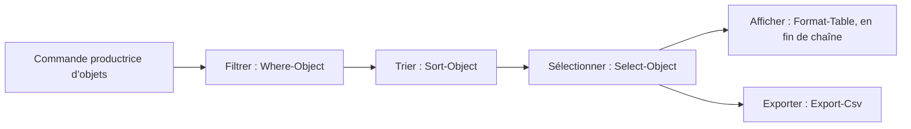

# Manipulation des objets

## Objectifs

À l’issue du module, vous devez pouvoir enchaîner des commandes PowerShell pour sélectionner, filtrer, trier, mesurer, mettre en forme et produire une représentation des objets retournés par une commande.

## Faire circuler des objets dans un pipeline

Le caractère `|` transmet un ou plusieurs objets à la commande suivante. Un pipeline peut contenir plusieurs commandes tant que les objets produits sont utilisables par la suite de la chaîne.

Dans les expressions qui examinent l’objet courant, les sources utilisent `$PSItem` et sa forme raccourcie `$_`.

## Sélectionner et mesurer

`Select-Object` permet de choisir des propriétés ou une partie des objets :

- `-Property`
- `-First`
- `-Last`
- `-Unique`
- `-ExpandProperty`

`Measure-Object` fournit un comptage par défaut. Avec `-Property`, les sources montrent aussi `-Average`, `-Minimum`, `-Maximum` et `-Sum` pour des propriétés numériques.

## Trier et filtrer

`Sort-Object` trie sur une propriété ; les sources emploient aussi `-Descending` et le tri sur plusieurs propriétés.

`Where-Object` conserve les objets qui répondent à une condition. Les formes présentées sont `-Property`, `-FilterScript`, `$PSItem` et `$_`.

Les opérateurs attestés sont :

- `-eq`, `-ceq`, `-ne`, `-cne`
- `-gt`, `-cgt`, `-ge`, `-cge`, `-lt`, `-clt`, `-le`, `-cle`
- `-like`, `-clike`, `-notlike`, `-cnotlike`, `-match`
- `-and`, `-or`

Les formes courtes rencontrées dans les documents sont `Select`, `sort`, `where` et `measure`.

## Mettre en forme le résultat final

Le formatage intervient en fin de chaîne, après les opérations de sélection, de tri ou de filtrage.

- `Format-Table` : `-Property`, `-HideTableHeaders`, `-GroupBy`, `-Wrap` ;
- `Format-Wide` : `-AutoSize`, `-Column`, `-Property` ;
- `Format-List` : `-Property`.

Les formes courtes `fl` et `fw` apparaissent également dans les sources.

## Exporter, convertir et relire

Les documents présentent `Export-Csv` avec `-Path`, `-Delimiter`, `-NoTypeInformation` et `-Append`. Ils citent aussi CliXML au niveau de l’export d’objets.

Pour produire une représentation, les exemples utilisent `ConvertTo-Html`, `ConvertTo-Json` et `Out-File`, y compris `-Append` et `-Width`. `Get-Content` avec `-Tail` sert à consulter la fin d’un fichier et `Import-Csv` avec `-Delimiter` à importer des données CSV.

## Propriétés calculées

Une propriété calculée est présentée sous la forme suivante :

```powershell
@{
  n = 'Label'
  e = { ... }
}
```

Dans les cas montrés, cette structure sert à renommer ou traduire une propriété, adapter une colonne CSV, transformer une valeur, modifier une précision, convertir une taille ou combiner plusieurs propriétés calculées.

## Mise en pratique et vérification

Le TP unique « Manipuler des objets » (1 h 30) mobilise sélection, aide, utilisateurs, filtres, tris, comptes actifs ou inactifs, comptage, fichiers, tailles, formats, événements, export, import et propriétés calculées. Les prérequis vidéo et l’environnement de laboratoire cités par les sources ne sont pas fournis avec ce module.

Une commande de suppression d’utilisateur est présente dans le scénario source. Elle relève exclusivement du laboratoire : elle ne doit pas être exécutée hors de ce contexte et l’identité de laboratoire n’est pas reproduite ici.

## Synthèse

La progression source consiste à faire circuler des objets, sélectionner ou filtrer ce qui est utile, mesurer ou trier si nécessaire, puis formater ou exporter le résultat.

Le TP et la fiche de révision sont proposés séparément dans l’écosystème du module.

<!-- TSSR-SERVICE-SCRIPT-VISUAL-20261020 -->

## Complément IA / externe au cours — Garder les objets jusqu’au résultat

**Illustration IA / externe au cours.**



Le dessin IA reprend les opérations présentées dans ce module. L’affichage et l’export sont deux issues de travail : conserver les objets avant de choisir la sortie ; ne pas insérer `Format-Table` avant `Export-Csv`.
