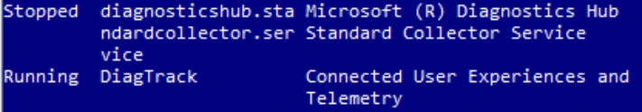
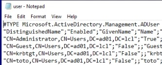
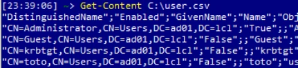
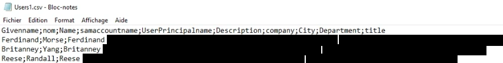
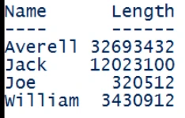
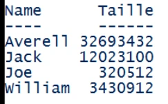

# Module 03 — Manipuler des objets

[Travaux pratiques](../../tp/12-initiation-powershell/module-03/index.md)

Les parties ci-dessous reprennent le cours original, dans le même ordre. Les encadrés et les schémas répètent ses formulations.

## Parcours de lecture

1. Support · Module 03 - Support de cours · 15 pages transcrites

**Visuel externe**


SOURCE DRIVE · TRANSCRIPTION DU SUPPORT

Le contenu des documents du dossier TSSR est transcrit ci-dessous, page par page. Les textes et tableaux sont intégrés à la page Web. Aucun fichier PDF, aucune diapositive entière ni aucune reproduction de page n’est affiché. Seuls des croquis ou visuels isolés et vérifiés peuvent accompagner la transcription. Les versions et les consignes restent celles des supports de formation. Les compléments IA sont conservés dans leur onglet distinct.

## Support · Module 03 - Support de cours · 15 pages transcrites

!!! note "À retenir"
    Les formulations historiques et les exemples du document sont conservés.

Transcription du support du Drive. Les formulations historiques et les exemples du document sont conservés. Les valeurs d’accès du laboratoire sont indiquées comme « fourni par le formateur ». Les adresses de messagerie personnelles utilisent example.com.

### Initiation à PowerShell

Module 03 – Manipulation des objets

### Objectifs

!!! note "À retenir"
    Employer les commandes appropriées pour les objets Microsoft

- Employer les commandes appropriées pour les objets Microsoft

### Introduction

!!! note "À retenir"
    Comme abordé précédemment, le résultat d’exécution de commandes peut être composé d’un ensemble objets.

- Comme abordé précédemment, le résultat d’exécution de commandes peut être composé d’un ensemble objets.

```
PS > Get-Service
```

- Le nombre d’objets étant souvent élevé, il est important de pouvoir sélectionner et mettre en forme le résultat d’une commande.

```
PS > Get-EventLog
```

- L’utilisation de redirections au moyen de pipeline (caractère | ) permet d’effectuer des commandes de triage, de mise en forme, de sélection et également de conditionner le résultat final.

### Le pipe

!!! note "À retenir"
    Le pipe | permet de passer un ou plusieurs objets à la commande qui suit.

- Le pipe | permet de passer un ou plusieurs objets à la commande qui suit.

```
PS > Get-Service | Get-Member
```

- Le pipe | peut être utilisé à plusieurs reprises, tant que l’on dispose d’objets à traiter.

```
PS > Get-EventLog –LogName « System » | Select-Object Name | Format-Table
```

- Le pipe | utilise une variable réservée qui est $PSItem. Cela permet de cibler une propriété d’un objet.

```
PS > Get-Process | Select Name,Id | Where { $PSItem.Id –gt 1500 –and $PSItem.Id –lt 2000}
```

Propriété

Id

### La commande Select-Object

!!! note "À retenir"
    La commande Select-Object permet de sélectionner une ou plusieurs propriétés.

**Visuel externe**


La commande Select-Object permet de sélectionner une ou plusieurs propriétés.

- À l’exécution de la commande, seules les propriétés sélectionnées seront affichées ou utilisables dans une troisième commande.

```
PS > Get-Service | Select-Object –Property Name
```

- Ici, seule la propriété Name de tous les services sera affichée.

```
PS > Get-Service | Select-Object –Property
Name,Status
```

- Pour sélectionner plusieurs propriétés, on utilise la , .

```
PS > Get-Service | Select   Name,Status
```

- La commande Select-Object peut se réduire.

### La commande Select-Object

!!! note "À retenir"
    La commande Select-Object permet de sélectionner des objets en fonction de l’ordre dans lequel ils sont organisés.

!!! warning "Attention"
    Le paramètre ExpandProperty permet de ne pas afficher le nom de la propriété, mais uniquement les valeurs dans la console.

La commande Select-Object permet de sélectionner des objets en fonction de l’ordre dans lequel ils sont organisés.

```
PS > Get-Service | Select-Object –First 5
PS > Get-Service | Select-Object –Last 5
```

- Dans le cas où plusieurs objets possèdent les mêmes valeurs pour la même propriété, il est possible d’obtenir un seul objet.

```
PS > Get-Process | Select-Object -Unique Name
```

- Ici seuls plusieurs process partagent le même nom, Select n’affichera qu’un seul process.
- Le paramètre ExpandProperty permet de ne pas afficher le nom de la propriété, mais uniquement les valeurs dans la console.

```
PS > Get-Service | Select-Object –ExpandProperty Name
```

### La commande Sort-Object

!!! note "À retenir"
    La commande Sort-Object est une commande de tri selon un critère donné.

La commande Sort-Object est une commande de tri selon un critère donné.

```
PS > Get-Service | Select-Object Name,Status | Sort-Object Status
```

- On sélectionne d’abord les propriétés sur lesquelles on va appliquer le tri final des objets.

```
PS > Get-Process | Select Name,id | Sort id -Descending
```

- Ici, on applique un tri par ordre décroissant sur la propriété Id.

```
PS > Get-ChildItem -Path C:\Windows -File | Sort-Object -Property Length
```

- La propriété Length indique le poids des fichiers en octet. Ils seront classés du plus faible au plus élevé.

### La commande Measure-Object

La commande Measure-Object permet de compter le nombre d’objets, d’établir des moyennes, etc.

```
PS > Get-Process | Measure-Object
```

- L’action par défaut de Measure-Objet est le comptage.

```
PS > Get-ChildItem –File | Measure-Object –Property Length -Average
```

- La commande est aussi utilisable sur une propriété pour déterminer une valeur moyenne.

### La commande Measure-Object

La commande Measure-Object sert également à déterminer la valeur minimale et maximale.

```
PS > Get-Get-ChildItem -File | Measure-Object –Property Length -Minimum -Maximum
```

- Comme toutes les commandes, le fonctionnement complet est décrit dans le fichier d’aide de la commande.

```
PS > Get-Help Measure-Object
```

- Ne jamais oublier de vous référer à l’aide si vous doutez du fonctionnement d’une commande.

### La commandes Where-Object

**Visuel externe**


La commande Where-Object conditionne la présence d’un objet dans le résultat de sortie.

- Les conditions sont toujours appliquées sur des valeurs de propriété.
- Elles peuvent être uniques ou multiples, obligatoires ou optionnelles.

```
PS > Get-Service | Where-Object -Property
Status –eq ’’Running’’
```

- Dans cet exemple, ne seront affichés que les objets dont la propriété Status est égale à la valeur Running.
- Les autres ne seront pas affichés.

```
PS > Get-Process | Where-Object –Property
Name –like ’’Power*’’
```

- Ici la propriété nom doit débuter par Power, quelle que soit la suite. Le caractère * permet de ne pas tester la suite de la valeur.

### La commande Where-Object

Afin de pouvoir tester des valeurs de propriété, chaque type de valeur dispose d’un opérateur de comparaison adapté.

| Comparaison | Insensibilité à la casse | Sensibilité à la casse |
| --- | --- | --- |
| Égalité | -eq | -ceq |
| Inégalité | -ne | -cne |
| Supérieur à | -gt | -cgt |
| Supérieur ou égal à | -ge | -cge |
| Inférieur à | -lt | -clt |
| Inférieur ou égal à | -le | -cle |
| Comparaison d’égalité d’expression | -like | -clike |
| Comparaison d’inégalité d’expression | -notlike | -cnotlike |

### La commande Where-Object

Si on applique plusieurs conditions à la commande Where-Object, on va utiliser les expressions logiques ET et OU.

- Dans le cas d’un ET logique, les deux conditions doivent être valides pour que l’objet soit retenu.

```
PS > Get-Process | Select Name,Id | Where –Filterscript{$PSitem.Id–gt1500
–and$PSItem.Id–lt2000}
```

- On peut réduire la syntaxe de $PSItem par $_.

```
PS > Get-Process | Select Name,Id | Where{$_.Name–like’’Power*’’–and$_.Id
–eq825}
```

| Comparaison | Insensibilitéàlacasse | Sensibilitéàlacasse |
| --- | --- | --- |
| É galité | -eq | -ceq |
| Inégalité | -ne | -cne |
| Supérieurà | -gt | -cgt |
| Supérieurouégalà | -ge | -cge |
| Inférieurà | -lt | -clt |
| Inférieurouégalà | -le | -cle |
| Comparaisond’égalitéd’expression | -like | -clike |
| Comparaisond’inégalitéd’expression | -notlike | -cnotlike |

### La commande Where-Object

- Dans le cas d’un OU logique, l’une ou l’autre des conditions doit être valide pour que l’objet soit retenu.

```
PS > Get-LocalUser | Select Name,Sid | Where–Filterscript{$PSitem.Name–eq
« TOTO »-or$PSItem.Sid–eq S-1-5-21-3376288570-2491860933-3167967787-500}
```

- Il est possible de tester de multiples valeurs.

```
PS > Get-localuser | Select Name,Sid,Enabled | Where{$_.Name–like«Toto»-or
$_.Sid–eqS-1-5-21-3376288570-2491860933-3167967787-500–or$_.Enabled–eq
$true}
```

Pensez à inclure les propriétés à tester dans le Select-Object.

### La commande Where-Object

- Il est également possible de faire collaborer les deux conditions.

```
PS> Get-AdUser –Filter * | Select Name,UserPrincipalName |
Where –Filterscript {
```

On teste ensuite la

On teste d’abord

l’une ou l’autre

```
($PSitem.Name –eq « Administrator »
-or
$PSItem.Name –eq « Administrator » )
```

valeur de la seconde propriété.

des valeurs.

```
-and $PSItem.UserPrincipalName –eq « Admin » }
```

### La commande Format-Table

- Une fois les objets sélectionnés, conditionnés et triés, la dernière étape est de mettre en forme les propriétés et leurs valeurs.
- L’objectif est d’améliorer la lecture du résultat, mais également de permettre l’export vers un fichier dans un ou plusieurs formats.

```
PS >Get-AdUser –Filter * | SelectName,GivenName,Enabled | Format-table
```

- La commande Format-Table va organiser les valeurs en colonnes.
- Les en-têtes de colonnes correspondent au nom de propriété.

### La commande Format-Table

- L’ordre des colonnes est personnalisable.

```
PS > Get-AdUser –Filter * | Format-table-Property Enabled,Name,SamAccountName
```

- Il est également possible de regrouper les objets par valeur de propriété identique.

```
PS > Get-AdUser –Filter * | Format-table-GroupBy Enabled
```

- Les utilisateurs seront regroupés selon l’état de leur compte actif ou inactif.

Le Select-Object n’est pas obligatoire pour l’utilisation des commandes de format.


Capture du support « Module 03 - Support de cours »

### La commande Format-Table

- Le paramètre HideTableHeaders masque le nom de la propriété.

```
PS > Get-Service | Format-Table –HideTableHeaders
```

- Les valeurs sont affichées de manière brute dans la console.

```
PS > Get-Service | Format-Table –Wrap
```

- Le paramètre Wrap va forcer le retour à la ligne en fin de console pour améliorer l’affichage.

### La commande Format-Wide

- Format-Wide permet de mettre en forme les valeurs d’une propriété en colonne. Le nombre de colonnes est paramétrable.

```
PS > Get-Service | Format-Wide –Column 10
```

- Avec le paramètre Autosize, le nombre de colonnes est déterminé automatiquement.

```
PS > Get-Service | Format-Wide –AutoSize
```



Capture du support « Module 03 - Support de cours »

### La commande Format-List

- Le classement des objets peut être formaté en liste.
- L’ordre d’affichage des propriétés dans la liste est paramétrable dans la commande.

```
PS >Get-AdUser –Filter * | Format-List –Property Name,Enabled,SamAccountName
```

### La commande Export-Object

- Les valeurs contenues dans les objets sont exportables dans des formats utilisables dans les applications métiers. Les formats pris en charge nativement sont : le CSV, le CLIXML, le JSON, le HTML.

```
PS > Get-AdUser –filter * | Export-CSVC:\LAB\ExportCSV.csv–Délimiter «;»
PS > Get-AdUser –filter * | Export-CSVC:\LAB\ExportCSV.csv–Delimiter «;»
NoTypeInformation
```

- Le type d’objet ne sera plus exporté dans le fichier CSV.


Capture du support « Module 03 - Support de cours »



Capture du support « Module 03 - Support de cours »

### La commande Export-Object

Pour les formats HTML et JSON, il faut convertir les données puis les exporter.

```
PS > Get-Service | ConvertTo-Html | Out-File C:\LAB\Services.html
```

Il existe des modules supplémentaires qui permettent de manipuler plus de formats (module Import-Excel par exemple).

### La commande Out-File

- Comme en Bash, les chevrons ( > ; >> ) peuvent être utilisés pour rediriger le résultat de commandes dans un fichier.
- Alternativement, la commande Out-File peut être utilisée. Elle prend en charge un ensemble d’options :

```
PS > Get-Service | Out-File C:\LAB\Services.txt
```

- Pour ajouter les données à la suite de celles présentes dans le fichier, on ajoute le paramètre Append.

```
PS > Get-Service | Out-File C:\LAB\Services.txt –Append
PS > Get-Service | Out-File C:\LAB\Services.txt –Width 42
```

- Le paramètre Width spécifie le nombre de caractères par ligne. Par défaut le nombre de caractères est de 80.


Capture du support « Module 03 - Support de cours »

### La commande Get-Content

Pour afficher le contenu d’un fichier dans la console, on utilise la commande

```
Get-Content.
PS > Get-Content C:\User.csv
PS > Get-Content | C:\User.csv –Tail 1
```

Le paramètre Tail permet de sélectionner un nombre de lignes en fin de fichier.

### La commande Import-CSV

- PowerShell prend en charge l’import de données dans les formats dans lesquels il permet l’export (CSV et CliXML). Cela permet leur manipulation dans le Shell.

```
PS > Import-CSV C:\Users.csv –Delimiter « ; » | New -AdUser
```

- Pendant l’importation, les paramètres du fichier CSV vont être comparés aux propriétés de l’objet AdUser.



Capture du support « Module 03 - Support de cours »


Capture du support « Module 03 - Support de cours »

### La commande Import-CSV

Il n’est pas possible de cibler une propriété du fichier CSV et de l’attribuer à une propriété particulière d’un l’objet.

```
PS >Import-CSV C:\Users.csv –Delimiter « ; » | New -AdUser
–Name $_.nom
–GivenName $_.GivenName
```

Cette commande n’est pas fonctionnelle !

### Les propriétés calculées

- Lorsque les propriétés ne correspondent pas, il faut créer de nouvelles propriétés et récupérer la valeur de propriété d’origine.
- Cela peut être utile pour mieux interpréter le résultat d’une commande, notamment en assurant la traduction de la propriété.

Exemple



Capture du support « Module 03 - Support de cours »



Capture du support « Module 03 - Support de cours »



Capture du support « Module 03 - Support de cours »

### Les propriétés calculées

Syntaxe

```
PS > Import-CSV C:\Users.csv –Delimiter «;»|New-AdUser –Name$_.nom
–GivenName$_.GivenName
```

Nouvelle étiquette

de la propriété

Nom de la propriété

```
PS > Import-CSV C:\Users.csv –Delimiter « ; » |
```

dont la valeur va

```
Select-Object GivenName,@{n=‘Name’; e={$_.nom}} |
```

être récupérée

```
New-AdUser –Name $_.Name
–GivenName $_.GivenName
```

Utilisation de la nouvelle

propriété avec son

nouveau « Label »

### Les propriétés calculées

- On peut également changer l’unité de mesure remontée par les commandes.
- La propriété Length n’est pas très lisible en Octet. Essayons de transformer cette valeur en Mo.

La conversion est

```
PS > Get-ChildItem -File | Select Name,
```

faite en Bytes et

non en Octet

```
@{
n='Taille’;
e={ '{0:N2}' -f ( $PSItem.Length / 1MB)}
}
```

Numérique à 2

décimales

### Les propriétés calculées

- Et également intégrer plusieurs propriétés calculées dans une même commande :

```
PS > Get-Volume | Select DriveLetter,
@{
n=‘ Taille (GB) ’;
e={ '{0:N2}' -f ($PSItem.Size / 1GB)}
} ,
@{
n=‘ Espace Libre (GB) ’;
e={ '{0:N2}' -f ($PSItem.SizeRemaining / 1GB)}
}
```

### Conclusion

- Vous savez employer les commandes appropriées aux objets Microsoft

Référence du document : 1QFC1_tXd6PhXvwUg0gisgE7SABd8fBf1 · SHA-256 05fe89244edfff8f…

| Support · Module 03 - Support de cours · 15 pages transcrites | Les formulations historiques et les exemples du document sont conservés. |
