# Module 03 — Manipuler des objets

Les parties ci-dessous reprennent le cours original, dans le même ordre. Les encadrés et les schémas répètent ses formulations.

## Parcours de lecture

1. Support · Module 03 - Support de cours · 15 pages transcrites
2. Démonstration · Fiche démo 1 - Le pipeline · 2 pages transcrites
3. Démonstration · Fiche démo 10 - ConvertTo · 2 pages transcrites
4. Démonstration · Fiche démo 11 - Get-Content · 1 pages transcrites
5. Démonstration · Fiche démo 12 - Import des objets · 2 pages transcrites
6. Démonstration · Fiche démo 13 - Les propriétés calculées · 2 pages transcrites
7. Démonstration · Fiche démo 2 - Select-Object · 3 pages transcrites
8. Démonstration · Fiche démo 3 - Measure-Object · 2 pages transcrites
9. Démonstration · Fiche démo 4 - Sort-Object · 2 pages transcrites
10. Démonstration · Fiche démo 5 - Where-Object · 4 pages transcrites
11. Démonstration · Fiche démo 6 - Format-Table · 3 pages transcrites
12. Démonstration · Fiche démo 8 - Format-List · 2 pages transcrites
13. Démonstration · Fiche démo 9 - Export-Object · 3 pages transcrites
14. Démonstration · Fiche démo 7 - Format-Wide · 2 pages transcrites
15. Énoncé · Énoncé du TP - Manipuler des objets · 6 pages transcrites
16. Correction · Solution du TP - Manipuler des objets · 5 pages transcrites

**Visuel externe**

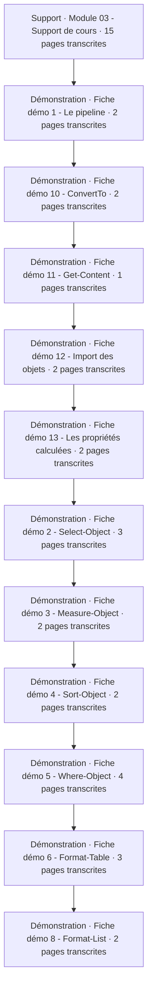

SOURCE DRIVE · TRANSCRIPTION DU SUPPORT

Le contenu des documents du dossier TSSR est transcrit ci-dessous, page par page. Les textes et tableaux sont intégrés à la page Web. Aucun fichier PDF, aucune diapositive entière ni aucune reproduction de page n’est affiché. Seuls des croquis ou visuels isolés et vérifiés peuvent accompagner la transcription. Les versions et les consignes restent celles des supports de formation. Les compléments IA sont conservés dans leur onglet distinct.

## Support · Module 03 - Support de cours · 15 pages transcrites

!!! note "À retenir"
    Les formulations historiques et les exemples du document sont conservés.

Transcription du support du Drive. Les formulations historiques et les exemples du document sont conservés. Les valeurs d’accès du laboratoire sont indiquées comme « fourni par le formateur ». Les adresses de messagerie personnelles utilisent example.com.

### Initiation à PowerShell

Module 03 – Manipulation des objets

### Objectifs

!!! note "À retenir"
    Employer les commandes appropriées pour les objets Microsoft

- Employer les commandes appropriées pour les objets Microsoft

### Introduction

!!! note "À retenir"
    Comme abordé précédemment, le résultat d’exécution de commandes peut être composé d’un ensemble objets.

- Comme abordé précédemment, le résultat d’exécution de commandes peut être composé d’un ensemble objets.

```
PS > Get-Service
```

- Le nombre d’objets étant souvent élevé, il est important de pouvoir sélectionner et mettre en forme le résultat d’une commande.

```
PS > Get-EventLog
```

- L’utilisation de redirections au moyen de pipeline (caractère | ) permet d’effectuer des commandes de triage, de mise en forme, de sélection et également de conditionner le résultat final.

### Le pipe

!!! note "À retenir"
    Le pipe | permet de passer un ou plusieurs objets à la commande qui suit.

- Le pipe | permet de passer un ou plusieurs objets à la commande qui suit.

```
PS > Get-Service | Get-Member
```

- Le pipe | peut être utilisé à plusieurs reprises, tant que l’on dispose d’objets à traiter.

```
PS > Get-EventLog –LogName « System » | Select-Object Name | Format-Table
```

- Le pipe | utilise une variable réservée qui est $PSItem. Cela permet de cibler une propriété d’un objet.

```
PS > Get-Process | Select Name,Id | Where { $PSItem.Id –gt 1500 –and $PSItem.Id –lt 2000}
```

Propriété

Id

### La commande Select-Object

!!! note "À retenir"
    La commande Select-Object permet de sélectionner une ou plusieurs propriétés.

**Visuel externe**


La commande Select-Object permet de sélectionner une ou plusieurs propriétés.

- À l’exécution de la commande, seules les propriétés sélectionnées seront affichées ou utilisables dans une troisième commande.

```
PS > Get-Service | Select-Object –Property Name
```

- Ici, seule la propriété Name de tous les services sera affichée.

```
PS > Get-Service | Select-Object –Property
Name,Status
```

- Pour sélectionner plusieurs propriétés, on utilise la , .

```
PS > Get-Service | Select   Name,Status
```

- La commande Select-Object peut se réduire.

### La commande Select-Object

!!! note "À retenir"
    La commande Select-Object permet de sélectionner des objets en fonction de l’ordre dans lequel ils sont organisés.

!!! warning "Attention"
    Le paramètre ExpandProperty permet de ne pas afficher le nom de la propriété, mais uniquement les valeurs dans la console.

La commande Select-Object permet de sélectionner des objets en fonction de l’ordre dans lequel ils sont organisés.

```
PS > Get-Service | Select-Object –First 5
PS > Get-Service | Select-Object –Last 5
```

- Dans le cas où plusieurs objets possèdent les mêmes valeurs pour la même propriété, il est possible d’obtenir un seul objet.

```
PS > Get-Process | Select-Object -Unique Name
```

- Ici seuls plusieurs process partagent le même nom, Select n’affichera qu’un seul process.
- Le paramètre ExpandProperty permet de ne pas afficher le nom de la propriété, mais uniquement les valeurs dans la console.

```
PS > Get-Service | Select-Object –ExpandProperty Name
```

### La commande Sort-Object

!!! note "À retenir"
    La commande Sort-Object est une commande de tri selon un critère donné.

La commande Sort-Object est une commande de tri selon un critère donné.

```
PS > Get-Service | Select-Object Name,Status | Sort-Object Status
```

- On sélectionne d’abord les propriétés sur lesquelles on va appliquer le tri final des objets.

```
PS > Get-Process | Select Name,id | Sort id -Descending
```

- Ici, on applique un tri par ordre décroissant sur la propriété Id.

```
PS > Get-ChildItem -Path C:\Windows -File | Sort-Object -Property Length
```

- La propriété Length indique le poids des fichiers en octet. Ils seront classés du plus faible au plus élevé.

### La commande Measure-Object

La commande Measure-Object permet de compter le nombre d’objets, d’établir des moyennes, etc.

```
PS > Get-Process | Measure-Object
```

- L’action par défaut de Measure-Objet est le comptage.

```
PS > Get-ChildItem –File | Measure-Object –Property Length -Average
```

- La commande est aussi utilisable sur une propriété pour déterminer une valeur moyenne.

### La commande Measure-Object

La commande Measure-Object sert également à déterminer la valeur minimale et maximale.

```
PS > Get-Get-ChildItem -File | Measure-Object –Property Length -Minimum -Maximum
```

- Comme toutes les commandes, le fonctionnement complet est décrit dans le fichier d’aide de la commande.

```
PS > Get-Help Measure-Object
```

- Ne jamais oublier de vous référer à l’aide si vous doutez du fonctionnement d’une commande.

### La commandes Where-Object

**Visuel externe**


La commande Where-Object conditionne la présence d’un objet dans le résultat de sortie.

- Les conditions sont toujours appliquées sur des valeurs de propriété.
- Elles peuvent être uniques ou multiples, obligatoires ou optionnelles.

```
PS > Get-Service | Where-Object -Property
Status –eq ’’Running’’
```

- Dans cet exemple, ne seront affichés que les objets dont la propriété Status est égale à la valeur Running.
- Les autres ne seront pas affichés.

```
PS > Get-Process | Where-Object –Property
Name –like ’’Power*’’
```

- Ici la propriété nom doit débuter par Power, quelle que soit la suite. Le caractère * permet de ne pas tester la suite de la valeur.

### La commande Where-Object

Afin de pouvoir tester des valeurs de propriété, chaque type de valeur dispose d’un opérateur de comparaison adapté.

| Comparaison | Insensibilité à la casse | Sensibilité à la casse |
| --- | --- | --- |
| Égalité | -eq | -ceq |
| Inégalité | -ne | -cne |
| Supérieur à | -gt | -cgt |
| Supérieur ou égal à | -ge | -cge |
| Inférieur à | -lt | -clt |
| Inférieur ou égal à | -le | -cle |
| Comparaison d’égalité d’expression | -like | -clike |
| Comparaison d’inégalité d’expression | -notlike | -cnotlike |

### La commande Where-Object

Si on applique plusieurs conditions à la commande Where-Object, on va utiliser les expressions logiques ET et OU.

- Dans le cas d’un ET logique, les deux conditions doivent être valides pour que l’objet soit retenu.

```
PS > Get-Process | Select Name,Id | Where –Filterscript{$PSitem.Id–gt1500
–and$PSItem.Id–lt2000}
```

- On peut réduire la syntaxe de $PSItem par $_.

```
PS > Get-Process | Select Name,Id | Where{$_.Name–like’’Power*’’–and$_.Id
–eq825}
```

| Comparaison | Insensibilitéàlacasse | Sensibilitéàlacasse |
| --- | --- | --- |
| É galité | -eq | -ceq |
| Inégalité | -ne | -cne |
| Supérieurà | -gt | -cgt |
| Supérieurouégalà | -ge | -cge |
| Inférieurà | -lt | -clt |
| Inférieurouégalà | -le | -cle |
| Comparaisond’égalitéd’expression | -like | -clike |
| Comparaisond’inégalitéd’expression | -notlike | -cnotlike |

### La commande Where-Object

- Dans le cas d’un OU logique, l’une ou l’autre des conditions doit être valide pour que l’objet soit retenu.

```
PS > Get-LocalUser | Select Name,Sid | Where–Filterscript{$PSitem.Name–eq
« TOTO »-or$PSItem.Sid–eq S-1-5-21-3376288570-2491860933-3167967787-500}
```

- Il est possible de tester de multiples valeurs.

```
PS > Get-localuser | Select Name,Sid,Enabled | Where{$_.Name–like«Toto»-or
$_.Sid–eqS-1-5-21-3376288570-2491860933-3167967787-500–or$_.Enabled–eq
$true}
```

Pensez à inclure les propriétés à tester dans le Select-Object.

### La commande Where-Object

- Il est également possible de faire collaborer les deux conditions.

```
PS> Get-AdUser –Filter * | Select Name,UserPrincipalName |
Where –Filterscript {
```

On teste ensuite la

On teste d’abord

l’une ou l’autre

```
($PSitem.Name –eq « Administrator »
-or
$PSItem.Name –eq « Administrator » )
```

valeur de la seconde propriété.

des valeurs.

```
-and $PSItem.UserPrincipalName –eq « Admin » }
```

### La commande Format-Table

- Une fois les objets sélectionnés, conditionnés et triés, la dernière étape est de mettre en forme les propriétés et leurs valeurs.
- L’objectif est d’améliorer la lecture du résultat, mais également de permettre l’export vers un fichier dans un ou plusieurs formats.

```
PS >Get-AdUser –Filter * | SelectName,GivenName,Enabled | Format-table
```

- La commande Format-Table va organiser les valeurs en colonnes.
- Les en-têtes de colonnes correspondent au nom de propriété.

### La commande Format-Table

- L’ordre des colonnes est personnalisable.

```
PS > Get-AdUser –Filter * | Format-table-Property Enabled,Name,SamAccountName
```

- Il est également possible de regrouper les objets par valeur de propriété identique.

```
PS > Get-AdUser –Filter * | Format-table-GroupBy Enabled
```

- Les utilisateurs seront regroupés selon l’état de leur compte actif ou inactif.

Le Select-Object n’est pas obligatoire pour l’utilisation des commandes de format.

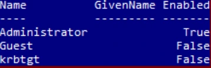

Capture du support « Module 03 - Support de cours »

### La commande Format-Table

- Le paramètre HideTableHeaders masque le nom de la propriété.

```
PS > Get-Service | Format-Table –HideTableHeaders
```

- Les valeurs sont affichées de manière brute dans la console.

```
PS > Get-Service | Format-Table –Wrap
```

- Le paramètre Wrap va forcer le retour à la ligne en fin de console pour améliorer l’affichage.

### La commande Format-Wide

- Format-Wide permet de mettre en forme les valeurs d’une propriété en colonne. Le nombre de colonnes est paramétrable.

```
PS > Get-Service | Format-Wide –Column 10
```

- Avec le paramètre Autosize, le nombre de colonnes est déterminé automatiquement.

```
PS > Get-Service | Format-Wide –AutoSize
```


Capture du support « Module 03 - Support de cours »

### La commande Format-List

- Le classement des objets peut être formaté en liste.
- L’ordre d’affichage des propriétés dans la liste est paramétrable dans la commande.

```
PS >Get-AdUser –Filter * | Format-List –Property Name,Enabled,SamAccountName
```

### La commande Export-Object

- Les valeurs contenues dans les objets sont exportables dans des formats utilisables dans les applications métiers. Les formats pris en charge nativement sont : le CSV, le CLIXML, le JSON, le HTML.

```
PS > Get-AdUser –filter * | Export-CSVC:\LAB\ExportCSV.csv–Délimiter «;»
PS > Get-AdUser –filter * | Export-CSVC:\LAB\ExportCSV.csv–Delimiter «;»
NoTypeInformation
```

- Le type d’objet ne sera plus exporté dans le fichier CSV.

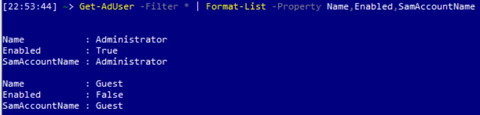

Capture du support « Module 03 - Support de cours »


Capture du support « Module 03 - Support de cours »

### La commande Export-Object

Pour les formats HTML et JSON, il faut convertir les données puis les exporter.

```
PS > Get-Service | ConvertTo-Html | Out-File C:\LAB\Services.html
```

Il existe des modules supplémentaires qui permettent de manipuler plus de formats (module Import-Excel par exemple).

### La commande Out-File

- Comme en Bash, les chevrons ( > ; >> ) peuvent être utilisés pour rediriger le résultat de commandes dans un fichier.
- Alternativement, la commande Out-File peut être utilisée. Elle prend en charge un ensemble d’options :

```
PS > Get-Service | Out-File C:\LAB\Services.txt
```

- Pour ajouter les données à la suite de celles présentes dans le fichier, on ajoute le paramètre Append.

```
PS > Get-Service | Out-File C:\LAB\Services.txt –Append
PS > Get-Service | Out-File C:\LAB\Services.txt –Width 42
```

- Le paramètre Width spécifie le nombre de caractères par ligne. Par défaut le nombre de caractères est de 80.

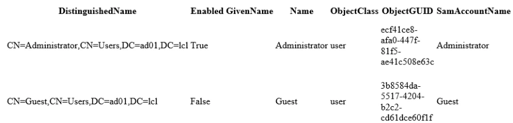

Capture du support « Module 03 - Support de cours »

### La commande Get-Content

Pour afficher le contenu d’un fichier dans la console, on utilise la commande

```
Get-Content.
PS > Get-Content C:\User.csv
PS > Get-Content | C:\User.csv –Tail 1
```

Le paramètre Tail permet de sélectionner un nombre de lignes en fin de fichier.

### La commande Import-CSV

- PowerShell prend en charge l’import de données dans les formats dans lesquels il permet l’export (CSV et CliXML). Cela permet leur manipulation dans le Shell.

```
PS > Import-CSV C:\Users.csv –Delimiter « ; » | New -AdUser
```

- Pendant l’importation, les paramètres du fichier CSV vont être comparés aux propriétés de l’objet AdUser.


Capture du support « Module 03 - Support de cours »

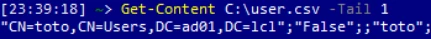

Capture du support « Module 03 - Support de cours »

### La commande Import-CSV

Il n’est pas possible de cibler une propriété du fichier CSV et de l’attribuer à une propriété particulière d’un l’objet.

```
PS >Import-CSV C:\Users.csv –Delimiter « ; » | New -AdUser
–Name $_.nom
–GivenName $_.GivenName
```

Cette commande n’est pas fonctionnelle !

### Les propriétés calculées

- Lorsque les propriétés ne correspondent pas, il faut créer de nouvelles propriétés et récupérer la valeur de propriété d’origine.
- Cela peut être utile pour mieux interpréter le résultat d’une commande, notamment en assurant la traduction de la propriété.

Exemple


Capture du support « Module 03 - Support de cours »


Capture du support « Module 03 - Support de cours »


Capture du support « Module 03 - Support de cours »

### Les propriétés calculées

Syntaxe

```
PS > Import-CSV C:\Users.csv –Delimiter «;»|New-AdUser –Name$_.nom
–GivenName$_.GivenName
```

Nouvelle étiquette

de la propriété

Nom de la propriété

```
PS > Import-CSV C:\Users.csv –Delimiter « ; » |
```

dont la valeur va

```
Select-Object GivenName,@{n=‘Name’; e={$_.nom}} |
```

être récupérée

```
New-AdUser –Name $_.Name
–GivenName $_.GivenName
```

Utilisation de la nouvelle

propriété avec son

nouveau « Label »

### Les propriétés calculées

- On peut également changer l’unité de mesure remontée par les commandes.
- La propriété Length n’est pas très lisible en Octet. Essayons de transformer cette valeur en Mo.

La conversion est

```
PS > Get-ChildItem -File | Select Name,
```

faite en Bytes et

non en Octet

```
@{
n='Taille’;
e={ '{0:N2}' -f ( $PSItem.Length / 1MB)}
}
```

Numérique à 2

décimales

### Les propriétés calculées

- Et également intégrer plusieurs propriétés calculées dans une même commande :

```
PS > Get-Volume | Select DriveLetter,
@{
n=‘ Taille (GB) ’;
e={ '{0:N2}' -f ($PSItem.Size / 1GB)}
} ,
@{
n=‘ Espace Libre (GB) ’;
e={ '{0:N2}' -f ($PSItem.SizeRemaining / 1GB)}
}
```

### Conclusion

- Vous savez employer les commandes appropriées aux objets Microsoft

Référence du document : 1QFC1_tXd6PhXvwUg0gisgE7SABd8fBf1 · SHA-256 05fe89244edfff8f…

## Démonstration · Fiche démo 1 - Le pipeline · 2 pages transcrites

Transcription du support du Drive. Les formulations historiques et les exemples du document sont conservés. Les valeurs d’accès du laboratoire sont indiquées comme « fourni par le formateur ». Les adresses de messagerie personnelles utilisent example.com.

### Le pipeline

Démonstration 01 du module 3

L’objectif de cette démonstration est de présenter le pipeline.

### Déroulement

Lors de la manipulation d’un objet, il arrive que le nombre d’objets soit important, ou que l’on souhaite appliquer un traitement sur l’objet ou une propriété avant de l’afficher.

Pour cela, on utilise le pipe qui permet d’appliquer une commande sur le résultat d’une autre commande.

- Le pipe est réalisé avec la combinaison de touches Alt Gr et 6

```
o Le pipe sert à mettre en forme un résultat de sortie ou générer un tri de valeurs.
o Nous l’avons déjà utilisé avec la commande Get-Member.
```

Dans ce cas, la commande Get-Member est appliquée sur la commande précédant le pipe.

Nous l’avons également utilisé pour mettre en forme les résultats de sortie de commande qui disposent de nombreux résultats.

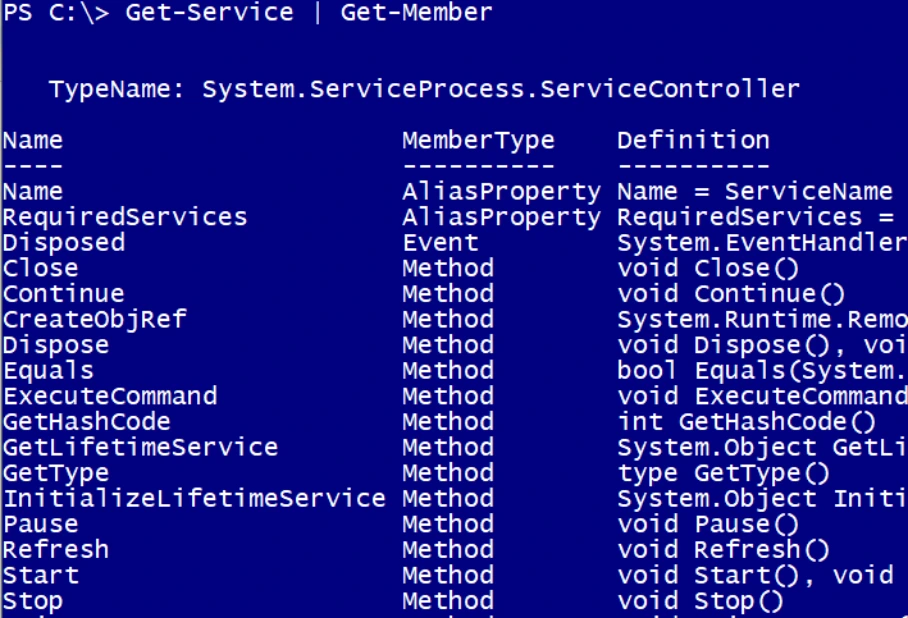

Capture du support « Fiche démo 1 - Le pipeline »

```
Il permet d’indiquer à la commande Format-Wide le nombre de colonnes dans lesquelles les
verbes seront classés. Ici la commande Format-Wide est raccourcie en Fw.
```

Le pipe dispose également d’un système d’exploration des propriétés de l’objet $PSItem.

Nous reviendrons sur les variables plus tard, mais nous pouvons voir un cas simple de l’utilisation de cette variable réservée.

```
Ici la variable $PSItem permet de tester la valeur de la propriété Id de chaque objet Process et
de n’afficher que ceux dans la valeur est supérieure à 1500.
```

Le pipe est utilisable à plusieurs reprises tant que l’objet dispose de suffisamment de propriétés.

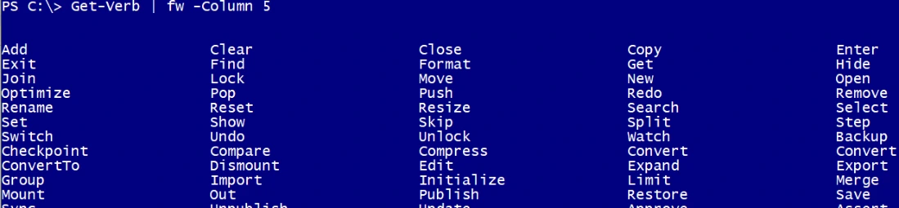

Capture du support « Fiche démo 1 - Le pipeline »

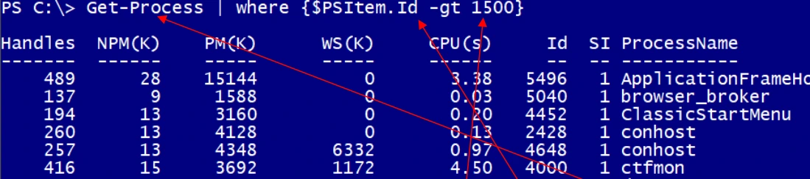

Capture du support « Fiche démo 1 - Le pipeline »

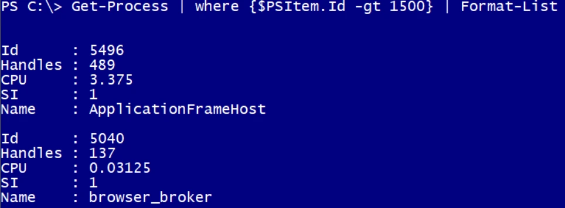

Capture du support « Fiche démo 1 - Le pipeline »

Référence du document : 1hPZ8GBo1zPcMJPAwhx8y8uEkdmXrR3Am · SHA-256 1430d01933d23f6d…

## Démonstration · Fiche démo 10 - ConvertTo · 2 pages transcrites

Transcription du support du Drive. Les formulations historiques et les exemples du document sont conservés. Les valeurs d’accès du laboratoire sont indiquées comme « fourni par le formateur ». Les adresses de messagerie personnelles utilisent example.com.

### ConvertTo

Démonstration 11 du module 3

L’objectif de cette démonstration est de vous présenter la commande ConvertTo.

### Déroulement

Comme nous venons de le voir pour les formats pris en charge, l’export se fait directement depuis la console. Pour les autres formats, il est nécessaire de passer par une étape de conversion des données.

- Pour les formats HTML et JSON on doit :

```
o Convertir dans un premier temps les données au format souhaité
o Exporter les données converties dans un fichier.
```

Les données sont converties en balises HTML compatibles avec un navigateur web.

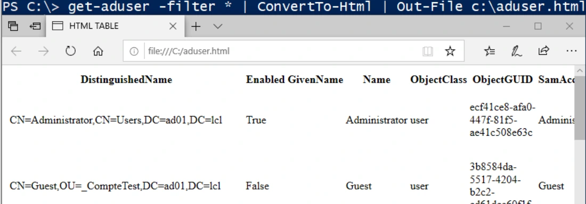

Capture du support « Fiche démo 10 - ConvertTo » (partie 1/2)

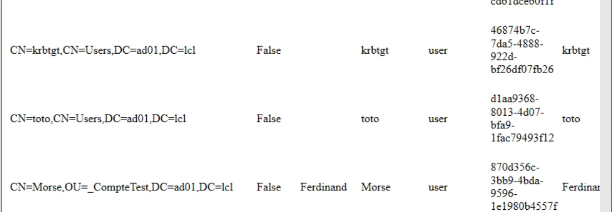

Capture du support « Fiche démo 10 - ConvertTo » (partie 2/2)

Pour le format JSON, la procédure est identique mais la lecture se fera indirectement par une application prenant en charge le fichier JSON.

Pour éviter l’écrasement des données, on ajoute le paramètre Append à la commande Out-File.

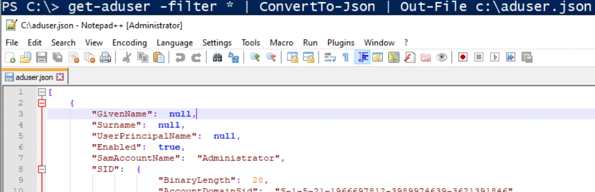

Capture du support « Fiche démo 10 - ConvertTo » (partie 1/2)

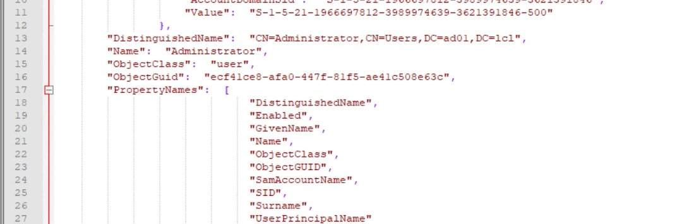

Capture du support « Fiche démo 10 - ConvertTo » (partie 2/2)

Référence du document : 1wE9qF_IeceXC9qtml-dDiFcqX8I3QToG · SHA-256 a15e93e3b6bee417…

## Démonstration · Fiche démo 11 - Get-Content · 1 pages transcrites

Transcription du support du Drive. Les formulations historiques et les exemples du document sont conservés. Les valeurs d’accès du laboratoire sont indiquées comme « fourni par le formateur ». Les adresses de messagerie personnelles utilisent example.com.

### Get-Content

Démonstration 12 du module 3

L’objectif de cette démonstration est de vous présenter la commande Get-Content

### Déroulement

Il est possible d’afficher le contenu d’un fichier dans la console PowerShell.

Toutefois, ce n’est possible que sur un fichier au format lisible par la console.

- Prenons l’exemple d’un fichier CSV :

```
o On utilise la commande Get-Content suivie du chemin du fichier.
```

Les données apparaissent ligne par ligne.

Pour sélectionner certaines lignes, on utilise le paramètre tail puis une valeur pour indiquer le nombre de lignes sélectionnées en fin de fichier.

#### Commandes visibles dans les captures

```
Get-Content C:\FIC2.csv
Get-Content C:\FIC2.csv -Tail 5
```

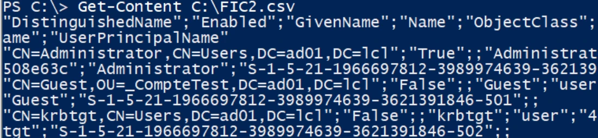

Capture du support « Fiche démo 11 - Get-Content »

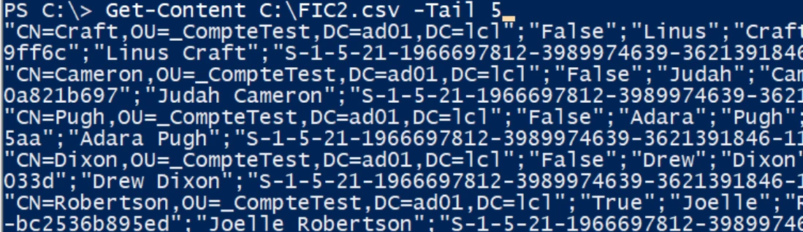

Capture du support « Fiche démo 11 - Get-Content »

Référence du document : 123mTRkoU8p08hLgEFA7PpadhfsFFKVSN · SHA-256 b834dad0e1d8c38c…

## Démonstration · Fiche démo 12 - Import des objets · 2 pages transcrites

Transcription du support du Drive. Les formulations historiques et les exemples du document sont conservés. Les valeurs d’accès du laboratoire sont indiquées comme « fourni par le formateur ». Les adresses de messagerie personnelles utilisent example.com.

### Import des objets

Démonstration 12 du module 3

Nous venons de voir la transformation et l’exportation des objets en fichiers utilisables sur des systèmes externes. L’objectif de cette démonstration est de voir comment il est possible de renverser le processus en se servant de fichiers contenant des données et de les transformer en objets utilisables dans notre système.

### Déroulement

- La commande Import-Csv :

```
o Dans un fichier CSV, la première ligne contient les en-têtes de colonnes.
```

Comparés à un objet PowerShell, ces en-têtes deviennent le nom des propriétés des objets.

```
o Chaque ligne du fichier CSV contient donc les valeurs des propriétés des
```

objets.

```
o Ce qui sépare les valeurs est le délimiteur.
```

A partir des données du fichier CSV, on recrée des objets. Il ne faut surtout pas oublier d’indiquer le délimiteur sans cela l’importation ne sera pas fonctionnelle.

On peut profiter de cette commande d’importation pour exécuter une commande de création

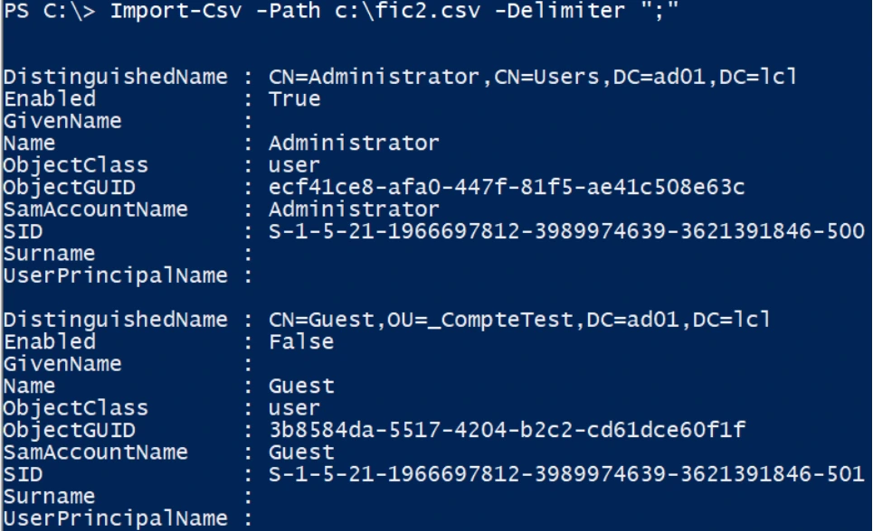

Capture du support « Fiche démo 12 - Import des objets »

d’utilisateurs Active Directory.

Chaque objet du fichier CSV va se transformer en objet AdUser.

Notre annuaire va être peuplé par les objets du fichier CSV.

Que faire dans le cas où les en-têtes de colonnes du fichier CSV ne correspondent pas au nom des propriétés des objets ?

S’il n’est pas possible de modifier les valeurs des en-têtes, alors on peut utiliser une action vue précédemment.

Cette action provient du pipe, c’est la variable $PSItem.

En effet cette variable contient les valeurs récupérées dans la première commande, il suffit de faire correspondre ses valeurs avec les propriétés attendues dans les objets.

Cette commande ne fonctionne pas. La cause est une particularité du fonctionnement du pipe qui ne parvient pas à faire la correspondance entre les données du fichier CSV et la demande de la variable $PSItem.

Dans tous les cas, il faut un fichier CSV respectant à la lettre les propriétés de l’objet.


Capture du support « Fiche démo 12 - Import des objets »

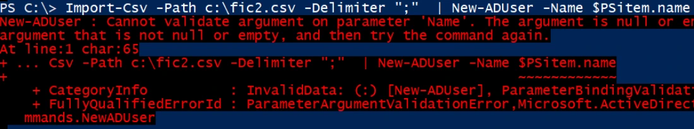

Capture du support « Fiche démo 12 - Import des objets »

Référence du document : 1HKcnE-tbSeypD8UeCEoGoIsknm6pM8k8 · SHA-256 69cc31a1a2fca91c…

## Démonstration · Fiche démo 13 - Les propriétés calculées · 2 pages transcrites

Transcription du support du Drive. Les formulations historiques et les exemples du document sont conservés. Les valeurs d’accès du laboratoire sont indiquées comme « fourni par le formateur ». Les adresses de messagerie personnelles utilisent example.com.

### Les propriétés calculées

Démonstration 13 du module 3

L’objectif de cette démonstration est de découvrir les propriétés calculées.

### Déroulement

La modification d’une propriété peut être effectuée de plusieurs manières : soit par l’utilisation d’une commande Set, soit par l’utilisation d’une variable intermédiaire. Dans certains cas, il va être nécessaire de créer une propriété pour la durée d’une commande.

Comme la traduction du nom de la propriété ou la gestion des décimales, après l’exécution de la commande la propriété ne sera plus accessible.

- Les propriétés dites calculées servent très souvent pour traduire les noms des propriétés.
- Dans un premier temps, on va créer une propriété, puis on va lui assigner les valeurs de la propriété d’origine que l’on souhaite traduire.

On récupère les valeurs de la propriété Name pour les intégrer dans une nouvelle propriété dont le

```
label est Nom.
```

Cela va permettre de créer de nouvelles propriétés qui vont parfaitement correspondre aux propriétés des objets à importer.

Si notre fichier CSV contient une propriété dont le nom ne correspond pas à une propriété de l’objet, alors on doit passer par la propriété calculée pour faire correspondre les valeurs de la propriété du fichier CSV avec la propriété de l’objet.

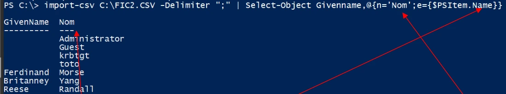

Capture du support « Fiche démo 13 - Les propriétés calculées »

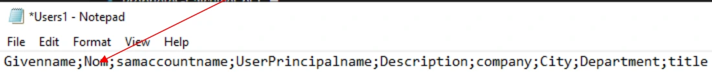

Capture du support « Fiche démo 13 - Les propriétés calculées »

Pour réaliser ces lignes de commandes plus longues, nous utilisons le logiciel Visual Studio Code

dans sa version 1.49.1 avec le complément PowerShell

La commande Select-Object permet de créer la propriété Name avec les valeurs du fichier CSV Nom puis de les envoyer dans la propriété Name de l’objet ADUser.

Une deuxième utilité des propriétés calculées est de permettre de modifier les valeurs de la propriété.

On modifie le nombre de décimales, puis on divise la valeur de la propriété Length pour obtenir un résultat lisible.

Les propriétés calculées sont disponibles à plusieurs reprises dans une ligne de commande.

Nous avons traduit toutes les propriétés et transformé leurs valeurs dans un format plus lisible et exportable.

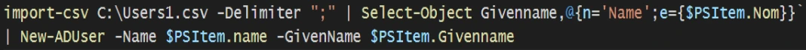

Capture du support « Fiche démo 13 - Les propriétés calculées »

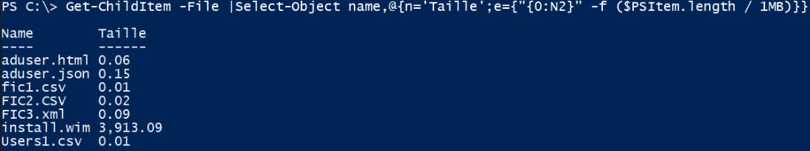

Capture du support « Fiche démo 13 - Les propriétés calculées »

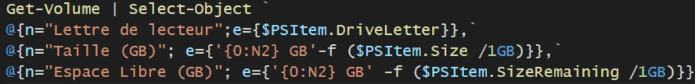

Capture du support « Fiche démo 13 - Les propriétés calculées »

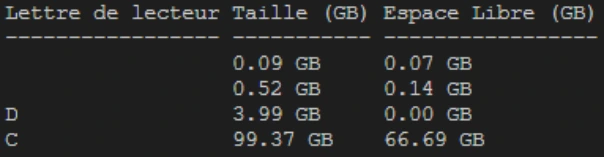

Capture du support « Fiche démo 13 - Les propriétés calculées »

Référence du document : 1-dGKNfkxuPAohf4cUVqwe0jRnWDFfMsM · SHA-256 531d46bbcfcfb759…

## Démonstration · Fiche démo 2 - Select-Object · 3 pages transcrites

Transcription du support du Drive. Les formulations historiques et les exemples du document sont conservés. Les valeurs d’accès du laboratoire sont indiquées comme « fourni par le formateur ». Les adresses de messagerie personnelles utilisent example.com.

### Select-Object

Démonstration 02 du module 3

L’objectif de cette démonstration est de présenter la commande Select-Object.

### Déroulement

La commande Select-Object permet de sélectionner des propriétés d’un ou de tous les objets renvoyés par la commande initiale. De cette façon, l’affichage du résultat sera constitué des propriétés sélectionnées. Si une commande est indiquée à la suite du Select-Object elle pourra travailler uniquement sur les propriétés sélectionnées précédemment.

- À la suite d’une commande renvoyant un ou des objets

```
o Le Select va disposer les propriétés dans l’ordre souhaité par l’utilisateur.
o Il va également proposer de n’afficher qu’un certain nombre d’objets en fonction de
```

leur classement.

On indique avec la commande Select-Object suivie du paramètre Property les propriétés que l’on afficha dans le résultat. Lorsque l’on souhaite indiquer plusieurs propriétés, le séparateur est la virgule.

```
L’ordre d’affichage est fonction de l’ordre des propriétés indiqué dans la commande Select-
Object.
```

La commande permet également de préciser un nombre d’objets.

#### Commandes visibles dans les captures

```
Get-Service | Select-Object -Property Name,Status
```

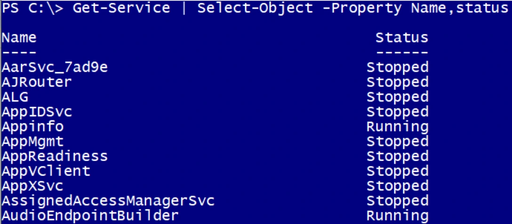

Capture du support « Fiche démo 2 - Select-Object »

Le paramètre Last permet d’indiquer le nombre d’objets présent dans le résultat en commençant par la fin. L’ordre de classement est alphabétique sur la première propriété indiquée.

Le paramètre Unique regroupe les objets qui partagent une valeur de propriété identique.

Dans l’exemple d’un process, la propriété ID a une valeur commune pour plusieurs process.

```
Sans le paramètre Unique on obtient 91 objets dont certains ont une valeur de propriété identique.
```

Avec le paramètre Unique, les objets ont tous des valeurs de propriétés uniques.

Le paramètre ExpandProperty permet de ne garder que la valeur sans le nom de la propriété,

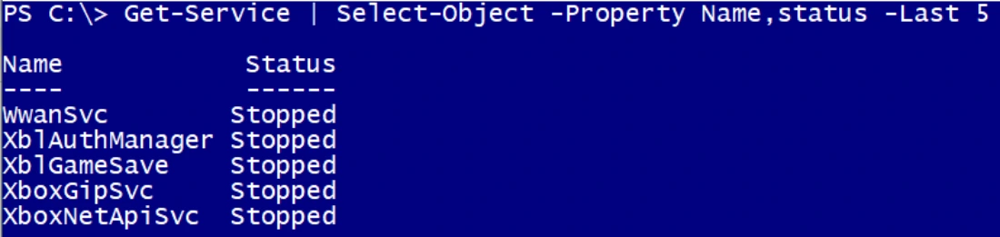

Capture du support « Fiche démo 2 - Select-Object »


Capture du support « Fiche démo 2 - Select-Object »

A l’affichage du résultat, l’en-tête de propriété n’apparaît plus dans le résultat.

#### Commandes visibles dans les captures

```
Get-Service | Select-Object -ExpandProperty Name
```

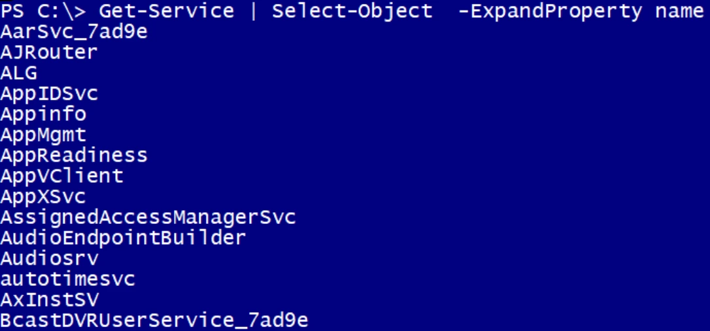

Capture du support « Fiche démo 2 - Select-Object »

Référence du document : 17PeQA7NPkv5tN6N6ilTPSlmlbMlts7Ga · SHA-256 88661c6ea7711b5b…

## Démonstration · Fiche démo 3 - Measure-Object · 2 pages transcrites

Transcription du support du Drive. Les formulations historiques et les exemples du document sont conservés. Les valeurs d’accès du laboratoire sont indiquées comme « fourni par le formateur ». Les adresses de messagerie personnelles utilisent example.com.

### Measure-Object

Démonstration 03 du module 3

```
L’objectif de cette démonstration est de vous présenter la commande Measure-Object.
```

### Déroulement

Comptabiliser le nombre d’objets est important pour identifier des défaillances, des besoins d’intervention ou pour vérifier la bonne prise en compte de certaines commandes.

- La commande Measure-Object permet :

```
o De comptabiliser le nombre d’objets renvoyés par une commande
```

Dans ce cas et sans précision, c’est le paramètre Count qui est pris à défaut.

Il est également possible de déterminer la moyenne des valeurs renvoyées par une commande.

#### Commandes visibles dans les captures

```
Get-Process | Select-Object | Measure-Object
Get-Process | Select-Object -Unique | Measure-Object
```

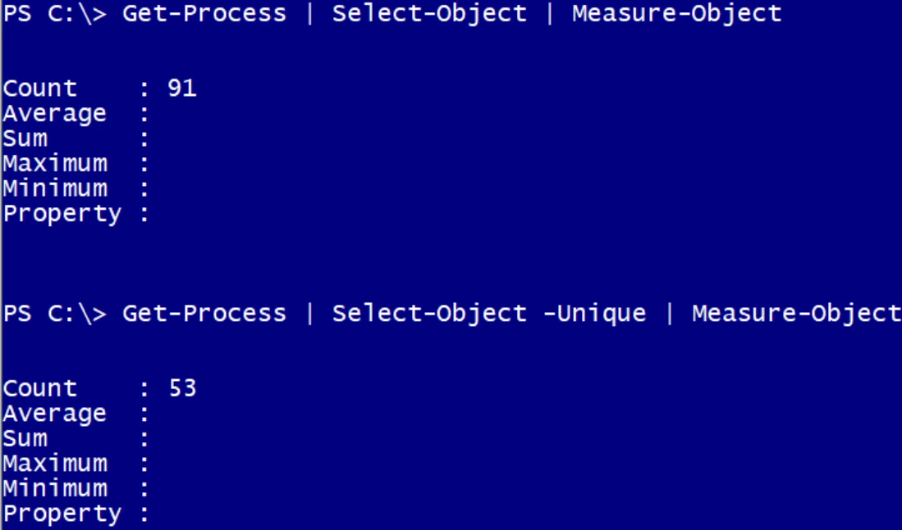

Capture du support « Fiche démo 3 - Measure-Object »

```
Nous indiquons à Measure-Object la propriété Id qui est de type Int et il est renvoyé la moyenne
des valeurs.
Attention, les calculs ne se font que sur les propriétés dont le type est Int.
Nous avons toutes les possibilités de la commande Measure-Object.
```

C’est une commande particulièrement importante pour évaluer les tailles de fichier.

La propriété Length indique la taille des dossiers présents dans le répertoire Windows.

```
Measure-Object indique la taille la plus faible, la plus élevée, la taille moyenne, le nombre d’objets
et nous rappelle la propriété testée.
```

La taille est en octets à défaut.

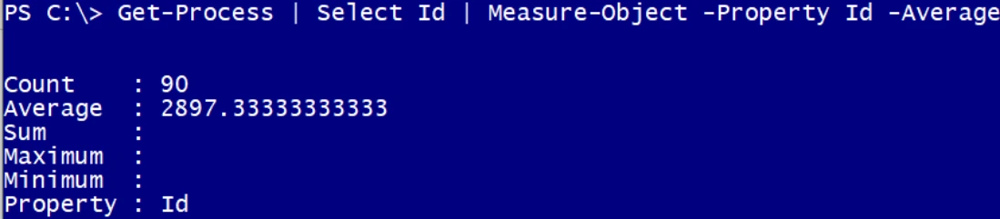

Capture du support « Fiche démo 3 - Measure-Object »

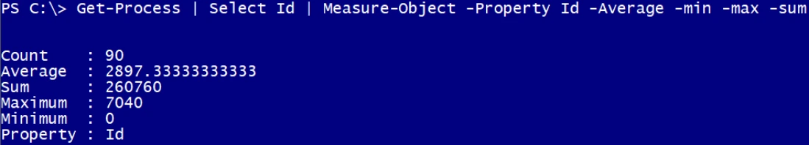

Capture du support « Fiche démo 3 - Measure-Object »

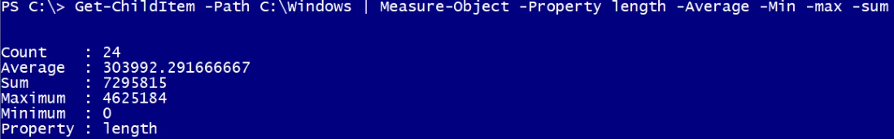

Capture du support « Fiche démo 3 - Measure-Object »

Référence du document : 1tiw_26jEXuOwOrFcerBrLa1u82jAoldx · SHA-256 658af100882af469…

## Démonstration · Fiche démo 4 - Sort-Object · 2 pages transcrites

Transcription du support du Drive. Les formulations historiques et les exemples du document sont conservés. Les valeurs d’accès du laboratoire sont indiquées comme « fourni par le formateur ». Les adresses de messagerie personnelles utilisent example.com.

### Sort-Object

Démonstration 04 du module 3

L’objectif de cette démonstration est de vous présenter la commande Sort-Object.

### Déroulement

L’ordre d’affichage des objets dans le résultat de commande est déterminé selon le type de valeur.

Pour une valeur de type String c’est un ordre alphabétique, pour une valeur de type Int c’est un ordre croissant. La commande Sort-Object permet de modifier ses ordres.

La commande Sort-Object s’utilise en fin de linge de commande de manière à mettre en forme le résultat final.

- A la suite d’une commande Select-Object

```
o Les objets sont affichés par état de leur statut, les statuts Stopped puis les statuts
Running.
o La
valeur
de
propriété
Status
étant
de
type
System.ServiceProcess.serviceControllerStatus, l’ordre de tri se fait
en premier sur les statuts arrêtés.
```

La commande permet aussi d’inverser l’ordre de tri standard.

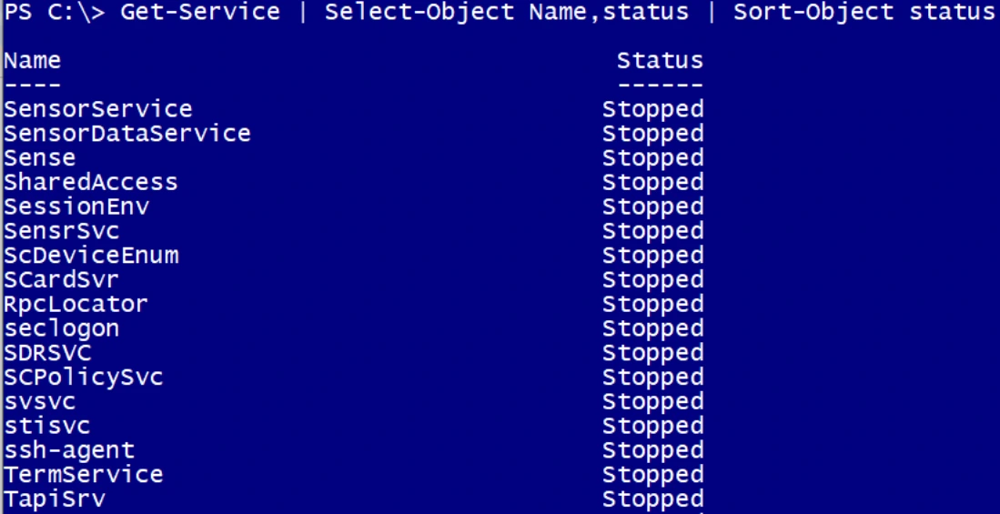

Capture du support « Fiche démo 4 - Sort-Object »

Le paramètre Descending inverse l’ordre de tri, quel que soit le type de valeurs de propriété.

```
Comme on le voit dans l’exemple précédent, seule la propriété Status subit un tri ; la propriété
Name est non triée.
```

La commande Sort-Object accepte plusieurs propriétés pour effectuer un tri.

Les services sont triés par leurs statuts et ensuite l’ensemble des services Stopped subissent un tri au niveau de leur nom.

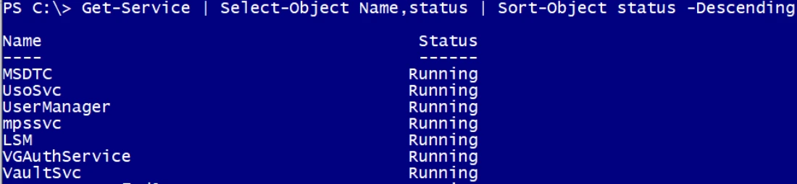

Capture du support « Fiche démo 4 - Sort-Object »

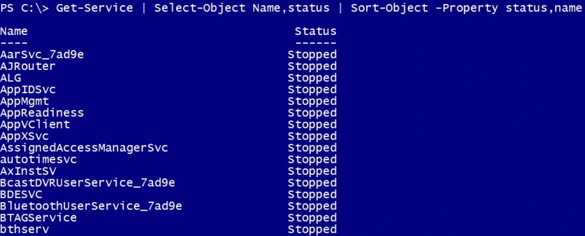

Capture du support « Fiche démo 4 - Sort-Object »

Référence du document : 1J0sVqx5QD-73uZSlj2eOKbtKcbx3K02o · SHA-256 2fa6bdd22bb4647d…

## Démonstration · Fiche démo 5 - Where-Object · 4 pages transcrites

Transcription du support du Drive. Les formulations historiques et les exemples du document sont conservés. Les valeurs d’accès du laboratoire sont indiquées comme « fourni par le formateur ». Les adresses de messagerie personnelles utilisent example.com.

### Where-Object

Démonstration 05 du module 3

L’objectif de cette démonstration est de présenter la commande Where-Object.

### Déroulement

Une des commandes les plus utilisées permet d’appliquer une ou plusieurs conditions sur une ou plusieurs propriétés d’un objet.

Le conditionnement permet de définir des listes d’objets précises et de pouvoir obtenir un résultat correspondant au besoin exprimé.

- La commande Where-Object s’utilise en complément de la commande Select-Object
- Dans un premier temps, nous allons voir une condition simple.

La commande utilisée permet de chercher un ou plusieurs utilisateurs dans la base de données Active Directory.

La condition Where-Object permet de trouver le ou les objets utilisateurs pour laquelle la propriété Name est égale à Oneal.

La condition Where-Object utilise les opérateurs de comparaison ici le -eq indique l’égalité.

Nous allons voir qu’il est possible de tester une propriété sans connaître le contenu exact.

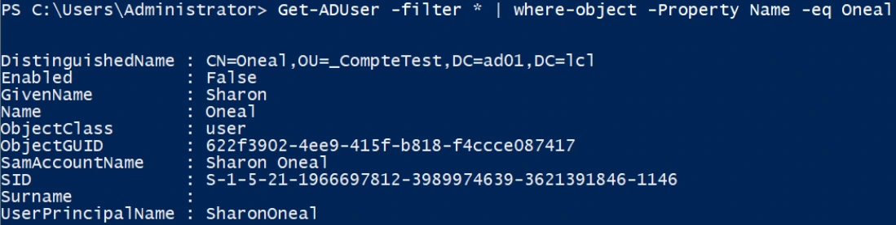

Capture du support « Fiche démo 5 - Where-Object »

Pour cela, on utilise l’opérateur de comparaison Like avec le caractère * , ce qui nous permet d’obtenir tous les utilisateurs dont le nom débute par Ro.

```
o Pour rappel, les opérateurs de comparaison par défaut sont insensibles à la
```

casse.

```
o Pour les rendre sensibles à la casse, il faut les préfixer par un c.
```

La commande Where-Object est également utilisable sur des propriétés de type booléen.

Dans ce cas, la propriété est comparée à la variable $True ou $False selon si l’on souhaite tester la validation ou non.

Dans le cas de notre commande, on affiche uniquement les comptes Active Directory actifs.

```
Where-Object permet également d’utiliser les opérateurs logiques and et or.
```

Dans ce cas, il faut vérifier plusieurs propriétés. On se sert de la variable réservée $PSItem vu précédemment.

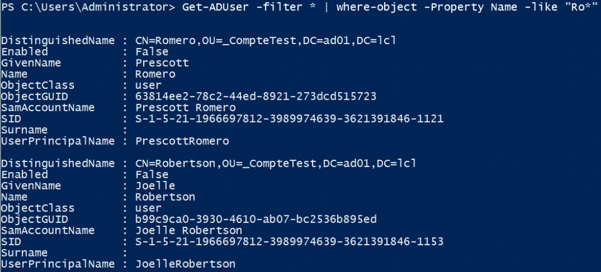

Capture du support « Fiche démo 5 - Where-Object »

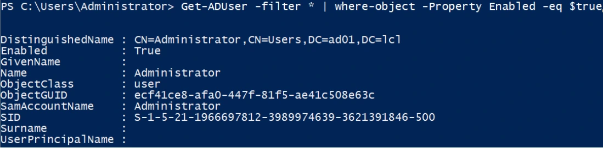

Capture du support « Fiche démo 5 - Where-Object »

On utilise le paramètre FisterScript indiqué par l’utilisation des accolades de la commande

```
Where-Object puis, on utilise la variable réservée $PSItem suivie d’un point puis le nom de la
propriété à tester.
```

Le test est ensuite répété sur la seconde propriété ; entre les deux on place l’opérateur logique.

Dans le cas d’un And, les deux propriétés doivent répondre « vrai » à la condition pour que l’objet soit affiché dans le résultat.

Dans notre test, il faut que l’utilisateur « Active Directory » soit actif et que son nom commence par un R.

```
Voyons maintenant le cas d’un Or.
```

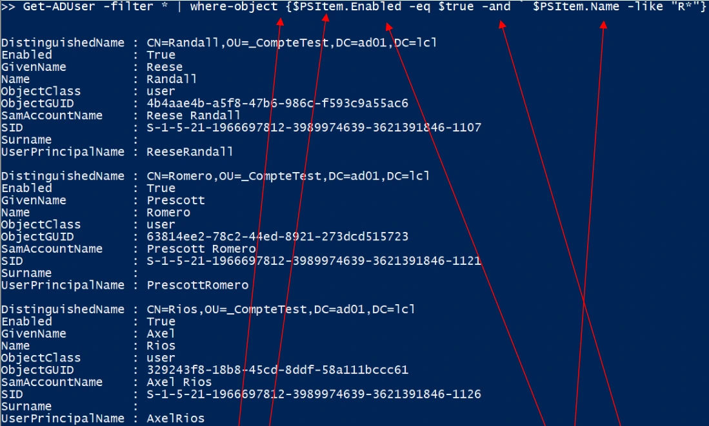

Capture du support « Fiche démo 5 - Where-Object »


Capture du support « Fiche démo 5 - Where-Object »

Avec l’opérateur Or, il faut que l’une ou l’autre des propriétés testées répondre « vrai » pour que l’objet soit sélectionné.

```
Ici on obtient les utilisateurs dont le nom commence par un R ou par un  S
```

Il est également possible de faire cohabiter les deux opérateurs de comparaison.

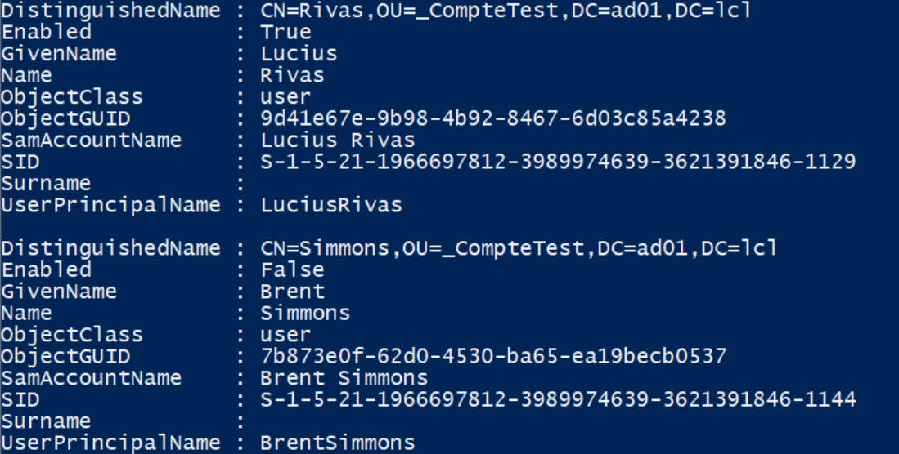

Capture du support « Fiche démo 5 - Where-Object »

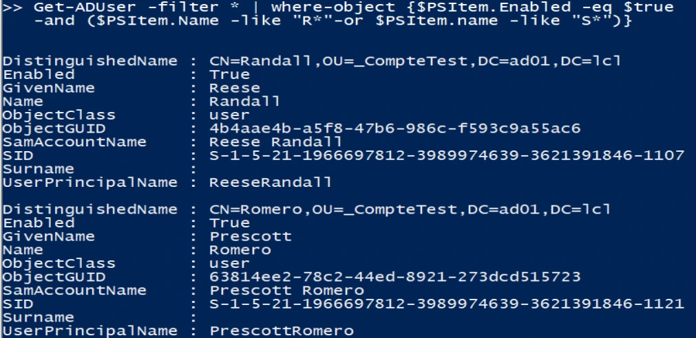

Capture du support « Fiche démo 5 - Where-Object »

Référence du document : 1L51B4JI2gf8z_fvz0zHlUqbJmGnlHOkQ · SHA-256 95b4aeb84563e269…

## Démonstration · Fiche démo 6 - Format-Table · 3 pages transcrites

Transcription du support du Drive. Les formulations historiques et les exemples du document sont conservés. Les valeurs d’accès du laboratoire sont indiquées comme « fourni par le formateur ». Les adresses de messagerie personnelles utilisent example.com.

### Format-Table

Démonstration 06 du module 3

L’objectif de cette démonstration est de vous présenter la commande Format-Table.

### Déroulement

Lorsque les objets sont correctement sélectionnés, triés et conditionnés, il est utile de les exporter dans un format adapté à un tableur par exemple.

Pour cela, il va falloir mettre sous forme de tableaux les objets obtenus ainsi que leurs propriétés.

La commande Format-Table permet d’organiser les colonnes et les valeurs de nos objets.

- Placé en fin de ligne de commande, le Format-Table travaille à partir des propriétés.
- Il s’accompagne pratiquement tout le temps d’un Select-Object

La commande place les en-têtes de colonne dans l’ordre indiqué au paramètre Property.

Le paramètre HidetableHeaders masque les en-têtes de colonnes pour ne laisser que les valeurs.

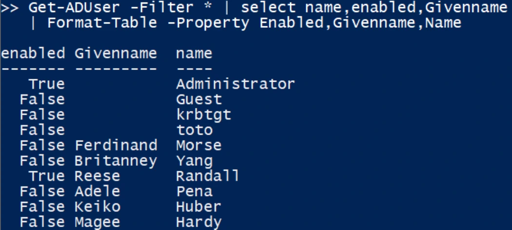

Capture du support « Fiche démo 6 - Format-Table »

Le paramètre Groupby permet de regrouper des objets selon la valeur d’une propriété.

On retrouve les utilisateurs actifs et les inactifs.

Le paramètre Wrap va forcer le retour à la ligne dans le cas où la valeur d’une propriété serait trop longue pour l’affichage.

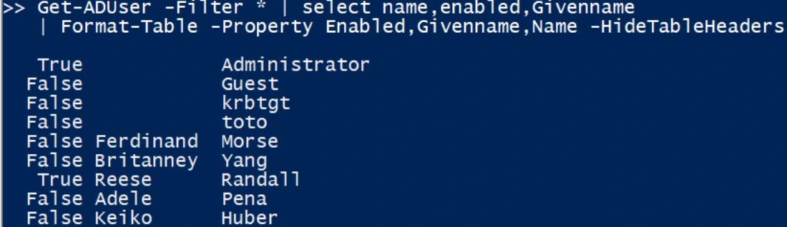

Capture du support « Fiche démo 6 - Format-Table »

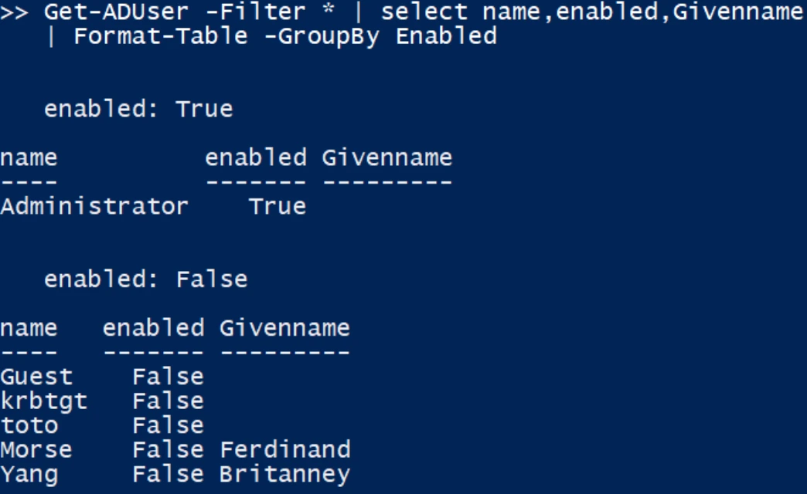

Capture du support « Fiche démo 6 - Format-Table »

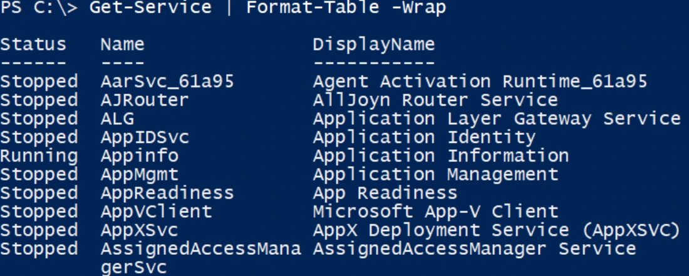

Capture du support « Fiche démo 6 - Format-Table »

Référence du document : 1RZTyNl8v0lgrVPdenc9H6fYOSFEOGrtL · SHA-256 e753036abe86b7c8…

## Démonstration · Fiche démo 8 - Format-List · 2 pages transcrites

Transcription du support du Drive. Les formulations historiques et les exemples du document sont conservés. Les valeurs d’accès du laboratoire sont indiquées comme « fourni par le formateur ». Les adresses de messagerie personnelles utilisent example.com.

### Format-List

Démonstration 08 du module 3

L’objectif de cette démonstration est de vous présenter la commande Format-List

### Déroulement

La commande Format-List a un rôle de mise en forme des propriétés d’un objet sous forme de liste. De la même manière que la commande Format-Table, elle reprend les mêmes principes.

- Dans un premier temps, toutes les propriétés sont mises sous forme de liste.

On peut constater que la mise en forme de type liste est la mise en forme par défaut de la commande Get-AdUser. Les objets sont présentés à l’horizontale, leurs propriétés sont les unes sur les autres. Chaque objet est déroulé par ordre de tri.

La commande Format-List permet de sélectionner les propriétés présentes dans la liste.

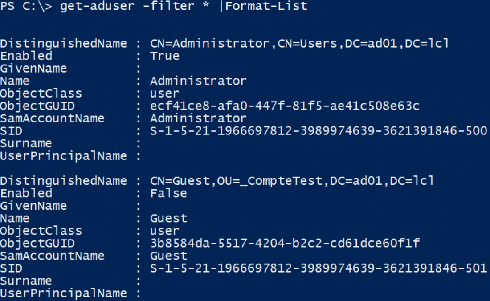

Capture du support « Fiche démo 8 - Format-List »

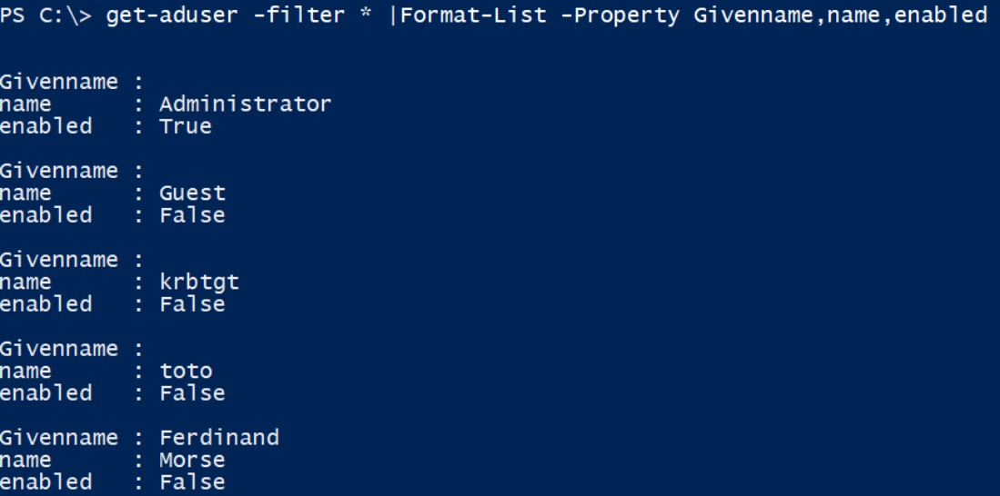

Capture du support « Fiche démo 8 - Format-List »

Référence du document : 1seN7AcUmhXSPdYkI4pyvdgfKAUr__9BU · SHA-256 01643372ae792724…

## Démonstration · Fiche démo 9 - Export-Object · 3 pages transcrites

Transcription du support du Drive. Les formulations historiques et les exemples du document sont conservés. Les valeurs d’accès du laboratoire sont indiquées comme « fourni par le formateur ». Les adresses de messagerie personnelles utilisent example.com.

### Export-Object

Démonstration 10 du module 3

L’objectif de cette démonstration est de présenter la commande Export-Object

### Déroulement

Une fois la mise en forme terminée, il faut exporter les résultats de commandes vers un logiciel ou une application. Selon le format choisi, il va falloir exporter ces données vers un fichier.

- Il existe différents types de fichiers dont le format est pris en charge nativement par la console PowerShell :

```
o Le format CSV qui comporte un délimiteur. La plupart du temps, ce délimiteur
```

est le point-virgule.

```
o Certains logiciels peuvent demander la présence d’un autre délimiteur
```

comme la virgule.

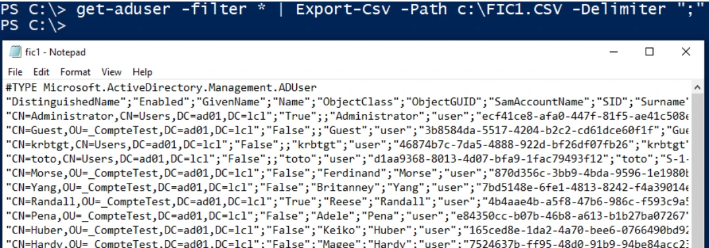

Capture du support « Fiche démo 9 - Export-Object » (partie 1/2)

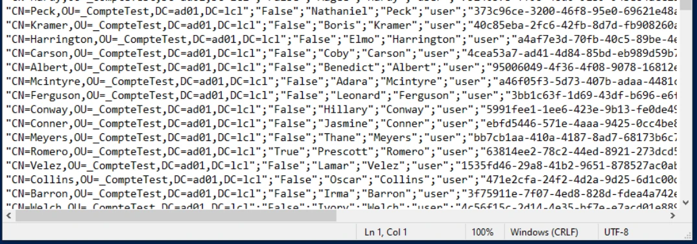

Capture du support « Fiche démo 9 - Export-Object » (partie 2/2)

On peut constater que la première ligne du fichier CSV contient le TypeName de l’objet.

Afin de ne pas avoir le type d’objet dans le fichier CSV on ajoute le paramètre NoTypeInformation.

Si on exécute une commande d’export sur un fichier existant, la commande va automatiquement supprimer les données présentes dans le fichier.

Pour éviter l’écrasement des données, on ajoute le paramètre Append.

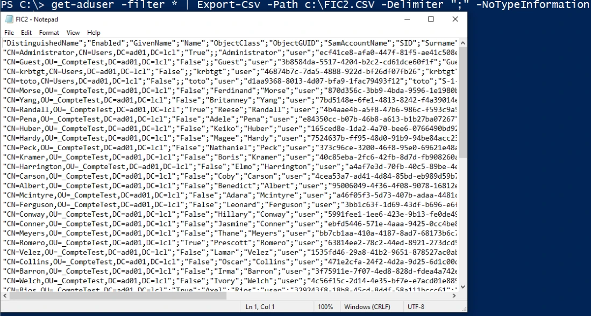

Capture du support « Fiche démo 9 - Export-Object »

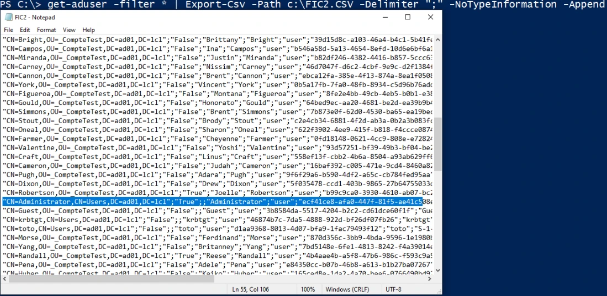

Capture du support « Fiche démo 9 - Export-Object »

On se retrouve avec les comptes d’utilisateur à nouveau à la suite de la première exportation.

Le second format pris en charge nativement est le CliXml. Il permet l’export de données vers des applications web.

Les règles d’exportation sont identiques au CSV ; on élimine le délimiteur inutile dans le format CSV.

D’autres formats peuvent être ajoutés par l’intermédiaire de l’installation de module.

Il est intéressant de pouvoir exporter des données sous forme de fichiers de base de données, de code PHP ou de fichier XLSX.

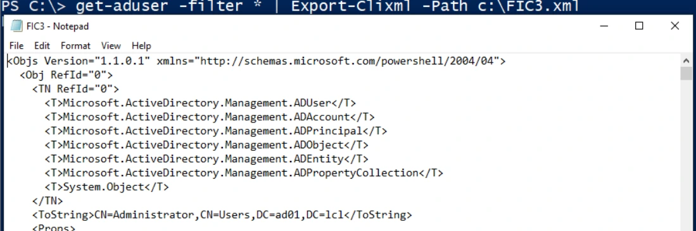

Capture du support « Fiche démo 9 - Export-Object » (partie 1/2)


Capture du support « Fiche démo 9 - Export-Object » (partie 2/2)

Référence du document : 10nnSDbh474FxYYmhhOzJyzOW1eQz-tJm · SHA-256 24441a6b66fd2cf7…

## Démonstration · Fiche démo 7 - Format-Wide · 2 pages transcrites

Transcription du support du Drive. Les formulations historiques et les exemples du document sont conservés. Les valeurs d’accès du laboratoire sont indiquées comme « fourni par le formateur ». Les adresses de messagerie personnelles utilisent example.com.

### Format-Wide

Démonstration 07 du module 3

L’objectif de cette démonstration est de vous présenter la commande Format-Wide

### Déroulement

```
Lorsque les objets sont très nombreux, la commande Format-Wide permet de les répartir sur toute
```

la largeur de l’écran.

La première possibilité est de laisser la commande répartir les objets de façon automatique

Le paramètre Autosize va répartir les résultats sur un nombre de colonnes idéal.

```
Il est possible de forcer le nombre de colonnes avec le paramètre Column puis d’indiquer la valeur
en int pour le nombre de colonnes.
Autre paramètre plus classique Property qui va répartir le nom d’une seule propriété à la place
de l’objet.
```


Capture du support « Fiche démo 7 - Format-Wide »


Capture du support « Fiche démo 7 - Format-Wide »

```
Il n’est pas possible de spécifier au paramètre property plusieurs propriétés, la commande
Format-Wide ne le prend pas en charge.
```


Capture du support « Fiche démo 7 - Format-Wide »

Référence du document : 1hQEtBdFpF1oVt3rPMdBVHEW3kR2VqhIA · SHA-256 8e4ab4aa3f7b9d45…

## Énoncé · Énoncé du TP - Manipuler des objets · 6 pages transcrites

Transcription du support du Drive. Les formulations historiques et les exemples du document sont conservés. Les valeurs d’accès du laboratoire sont indiquées comme « fourni par le formateur ». Les adresses de messagerie personnelles utilisent example.com.

### Initiation à PowerShell Manipuler des objets

TP du Module 03

Avant de démarrer ce TP, il convient d’avoir suivi les vidéos du module 3 de ce cours.

Durée estimée

1 heure 30

### Énoncé

Objectifs :

Manipuler les objets leurs propriétés et leurs méthodes

Utilisation de la commande Select-Object, Sort-Object et Where-Object.

Consignes :

Depuis la machine CLI01

Affichez la liste des utilisateurs ActiveDirectory avec la propriété GivenName, Name, Enabled Department City.

Quelle commande avez-vous utilisée ?

Consultez l’aide de la commande Get-AdUser pour trouver la solution aux valeurs vides des propriétés Department et City ?

Indiquez la commande complète permettant l’affichage des valeurs de toutes les propriétés.

Affichez les cinq premiers utilisateurs Active Directory

Quelle commande avez-vous utilisée ?

Sélectionnez les utilisateurs Active Directory par leurs propriétés City puis par leur propriété Department

Indiquez les commandes utilisées.

Affichez les utilisateurs Active Directory avec les propriétés Name, Enabled, Department, City puis triez par la propriété City.

Quelle commande avez-vous utilisée ?

Reprenez la commande précédente puis appliquez le tri sur la propriété Department dans l’ordre descendant.

Quelle commande avez-vous utilisée ?

Effectuer le tri sur les deux propriétés City et Department.

Reprenez la commande précédente puis ajoutez une condition sur le nom qui doit comporter un r.

Quelle commande avez-vous utilisée ?

Bonus

Désactiver les utilisateurs dont le nom commence par un D.

Utiliser la commande Disable-AdAccount

Depuis la machine CLI01

Affichez la liste des utilisateurs Active Directory dont le compte est actif.

Quelle commande avez-vous utilisée ?

Conditionnez le résultat pour ceux qui ont un nom qui débute par un A ou un F. Quelle commande avez-vous utilisée ?

Reprenez la commande précédente et ajouter la condition sur le compte actif. Quelle commande avez-vous utilisée ?

En reprenant la commande précédente, comptez le nombre d’utilisateurs actifs et le nombre d’utilisateurs inactifs.

Indiquez les commandes utilisées.

Affichez tous les fichiers du répertoire \\CD01\Partage.

Quelle commande avez-vous utilisée ?

Reprenez la commande précédente puis affichez la taille moyenne des fichiers.

Quelle commande avez-vous utilisée ?

Affichez la valeur la plus faible et la plus élevée de taille de fichiers.

BONUS

Reprenez les commandes précédentes et indiquez les fichiers dont la taille est supérieure à 10 Mo et inférieure à 100 Mo.

Quelle commande avez-vous utilisée ?

Affichez le résultat avec les propriétés Name, Length et mode et effectuez un tri descendant sur le nom.

Depuis la machine CLI01

Affichez la liste des utilisateurs Active Directory sur cinq colonnes.

Quelle commande avez-vous utilisée ?

Affichez la liste des utilisateurs Active Directory qui sont actifs, en format tableau, avec les propriétés : Name, Enabled, Department, City

Quelle commande avez-vous utilisée ?

Affichez la liste des groupes Active Directory sous forme de tableau avec leurs noms, leurs descriptions ainsi que la date de création. Puis regroupez-les par type de groupe.

Quelle commande avez-vous utilisée ?

Affichez la liste des ordinateurs du domaine sous forme de liste avec les propriétés : Nom, NomdDns, Distinguishedname, AdresseipV4 puis regroupez-les par système d’exploitation.

Indiquez les commandes utilisées.

Affichez tous les événements du journal system avec les propriétés : Time, Index, Message.

Faites en sorte que le contenu du message soit affiché en totalité sur la console. Quelle commande avez-vous utilisée ?

Depuis la machine CLI01

Exportez les utilisateurs Active Directory dans un fichier CSV \\CD01\Partage\Exports\ Csv.

Quelle commande avez-vous utilisée ?

Répétez la commande précédente mais dans le format HTML puis dans le dossier \\ CD01\Partage\Exports\CSV\.

Quelle commande avez-vous utilisée ?

Ajoutez à la suite du fichier CSV les Ordinateurs Active Directory

Quelle commande avez-vous utilisée ?

Modifiez le nom de la colonne Name de votre fichier CSV exporté précédemment.

Faite l’importation des utilisateurs Active Directory à partir du fichier CSV modifié.

Si vous obtenez le message d’erreur Already exist, utilisez la commande suivante :

```
Get-Aduser -filter * | Remove-aduser -confirm : $False
```

Que remarquez-vous ?

Sans modifier le fichier CSV, trouvez une solution pour ne plus avoir de message d’erreur sur la propriété Name.

Quelle commande avez-vous utilisée ?

Affichez la liste des fichiers du partage de CD01 ; pour chaque propriété vous allez traduire le nom de la propriété. Chaque valeur sera exprimée en GB :

Indiquez votre commande.

### Solution

Une solution est proposée pour ce TP sous la forme d'un PDF commenté, disponible dans les ressources à télécharger.

Référence du document : 1WvzWMpdknTaN7Uw07NG9460kw-qGdQBZ · SHA-256 b233ed14007424a6…

## Correction · Solution du TP - Manipuler des objets · 5 pages transcrites

Transcription du support du Drive. Les formulations historiques et les exemples du document sont conservés. Les valeurs d’accès du laboratoire sont indiquées comme « fourni par le formateur ». Les adresses de messagerie personnelles utilisent example.com.

Correction originale : à consulter après avoir tenté l’exercice.

### Manipuler des objets

TP du Module 03

Avant de démarrer ce TP, il convient d’avoir suivi les vidéos du module 3 de ce cours.

Durée estimée

1 heure 30

### Énoncé

**Visuel externe**


Objectifs :

- Manipuler les objets leurs propriétés et leurs méthodes
- Utilisation de la commande Select-Object, Sort-Object et Where-Object.

Consignes :

Depuis la machine CLI01

- Affichez la liste des utilisateurs ActiveDirectory avec la propriété GivenName, Name, Enabled Department City.

Quelle commande avez-vous utilisée ?

```
Get-AdUser -Filter * | Select-Object -Property GivenName,Name,Enabled,Department,City
```

Consultez l’aide de la commande Get-AdUser pour trouver la solution aux valeurs vides des propriétés Department et City ?

```
Get-Help Get-ADUser -ShowWindow
```

Indiquez la commande complète permettant l’affichage des valeurs de toutes les propriétés.

```
Get-AdUser -Filter * -Properties *
get-ADuser -filter * -properties City, Department | select-object -Property
Givenname, Name , Enabled, Department, city
```

- Affichez les cinq premiers utilisateurs Active Directory

Quelle commande avez-vous utilisée ?

```
Get-AdUser -Filter * | Select-Object -First 5
```

- Sélectionnez les utilisateurs Active Directory par leurs propriétés City puis par leur propriété Department

Indiquez les commandes utilisées.

```
Get-AdUser -Filter * | Select-Object City
Get-AdUser -Filter * | Select-Object Department
get-ADuser -filter * -properties * | select-object department,city
```

- Affichez les utilisateurs Active Directory avec les propriétés Name, Enabled, Department, City puis triez par la propriété City.

Quelle commande avez-vous utilisée ?

```
Get-ADUser -Filter * -Properties * | Select Name,Enabled,Department,City
| sort -property City
```

- Reprenez la commande précédente puis appliquez le tri sur la propriété Department dans l’ordre descendant.

Quelle commande avez-vous utilisée ?

```
Get-ADUser -Filter * -Properties * | Select Name,Enabled,Department,City
| sort -property Department -Descending
```

Effectuer le tri sur les deux propriétés City et Department.

```
Get-ADUser -Filter * -Properties * | Select Name,Enabled,Department,City
| sort -property City,Department
```

- Reprenez la commande précédente puis ajoutez une condition sur le nom qui doit comporter un r.

Quelle commande avez-vous utilisée ?

```
Get-ADUser -Filter * -Properties * | Select Name,Enabled,Department,City
| Where -Property Name -like "R"
get-ADuser
-filter
*
-properties
*
|
select-object
Name,Enabled,city,department | where-object name -like "*r*" |sort-object
-Property department, City
```

Bonus

- Désactiver les utilisateurs dont le nom commence par un D.

Utiliser la commande Disable-AdAccount

```
Get-ADUser -Filter * -Properties * | Select Name,Enabled,Department,City
| Where -Property Name -like "R" | Disabled-ADAccount
get-ADuser -filter 'name -like "d*"' | Disable-ADAccount
```

Depuis la machine CLI01

- Affichez la liste des utilisateurs Active Directory dont le compte est actif.

Quelle commande avez-vous utilisée ?

```
Get-ADUser -Filter * | Where enabled -eq $True
```

Conditionnez le résultat pour ceux qui ont un nom qui débute par un A ou un F. Quelle commande avez-vous utilisée ?

```
Get-ADUser -Filter * | Where-object -filterscript { $PSItem.enabled -eq
$True -And ($PSItem.Name -like "a*" -or $PSItem.name "F*"}
#en regex
get-ADuser -filter * -properties * | where-object -filterscript {
$PSITEM.enabled -like "$true" -AND $PSITEM.name -match "^[AF]" } | select-
object name,Enabled
```

- En reprenant la commande précédente, comptez le nombre d’utilisateurs actifs et le nombre d’utilisateurs inactifs.

Indiquez les commandes utilisées.

```
Get-ADUser -Filter * | Where-Object Enabled -like $True | measure
Get-ADUser -Filter * | Where-Object Enabled -like $False | measure
```

- Affichez tous les fichiers du répertoire \\CD01\Partage.

Quelle commande avez-vous utilisée ?

```
Get-ChildItem \\CD01\Partage\ -File -Recurse
```

- Reprenez la commande précédente puis affichez la taille moyenne des fichiers.

Quelle commande avez-vous utilisée ?

```
Get-ChildItem \\CD01\Partage\ -File -Recurse | Measure -Property length -
average
```

Affichez la valeur la plus faible et la plus élevée de taille de fichiers.

```
Get-ChildItem \\CD01\Partage\ -File -Recurse | Measure -Property length -
min -max
BONUS
```

- Reprenez les commandes précédentes et indiquez les fichiers dont la taille est supérieure à 10 Mo et inférieure à 100 Mo.

Quelle commande avez-vous utilisée ?

```
Get-ChildItem \\CD01\Partage\ -File -Recurse | Where -FilterScript
{$PSItem.length -gt 10000 -and $PSItem.length -lt 100000 }
Get-ChildItem \\CD01\Partage\ -File -Recurse | Where -FilterScript
{$PSItem.length -gt 10000 -and $PSItem.length -lt 100000 }
```

```
Get-ChildItem -path \\CD01\Partage -File -recurse | where -filterscript {
$PSItem.length -gt 10MB -and $PSItem.length -lt 100MB }
```

Affichez le résultat avec les propriétés Name, Length et mode et effectuez un tri descendant sur le nom.

Depuis la machine CLI01

- Affichez la liste des utilisateurs Active Directory sur cinq colonnes.

Quelle commande avez-vous utilisée ?

```
Get-ADUser -Filter * | Format-Wide -Column 5
```

- Affichez la liste des utilisateurs Active Directory qui sont actifs, en format tableau, avec les propriétés : Name, Enabled, Department, City

Quelle commande avez-vous utilisée ?

```
Get-ADUser -Filter * -Properties * | Where enabled -eq $True | Format-
Table name,enabled,Department,City
```

- Affichez la liste des groupes Active Directory sous forme de tableau avec leurs noms, leurs descriptions ainsi que la date de création. Puis regroupez-les par type de groupe.

Quelle commande avez-vous utilisée ?

```
Get-ADGroup -Filter * -Properties * | Format-Table -Property
name,description,created -GroupBy GroupScope
```

- Affichez la liste des ordinateurs du domaine sous forme de liste avec les propriétés : Nom, NomdDns, Distinguishedname, AdresseipV4 puis regroupez-les par système d’exploitation.

Indiquez les commandes utilisées.

```
Get-ADComputer
-Filter
*
-Properties
*
|
Format-List
name,dnshostname,distinguishedname,ipv4address -GroupBy operatingsytem
```

- Affichez tous les événements du journal system avec les propriétés : Time, Index, Message.

```
Get-EventLog system | select-object time,index,message
```

Faites en sorte que le contenu du message soit affiché en totalité sur la console. Quelle commande avez-vous utilisée ?

```
Get-EventLog system | fl -property timewritten,index,message
```

Depuis la machine CLI01

- Exportez les utilisateurs Active Directory dans un fichier CSV \\CD01\Partage\Exports\Csv.

Quelle commande avez-vous utilisée ?

```
Get-ADUser
-Filter
*
|
Export-CSV
-Path
\\CD01\Partage\PowerShell\Exports\CSV\Users.csv -delimiter "."
```

- Répétez la commande précédente mais dans le format HTML puis dans le dossier \\CD01\Partage\Exports\CSV\.

Quelle commande avez-vous utilisée ?

```
Get-ADUser
-Filter
*
-properties
*
|
Export-CSV
-Path
\\CD01\Partage\Exports\CSV\Users_prop.csv -delimiter "."
```

- Ajoutez à la suite du fichier CSV les Ordinateurs Active Directory

Quelle commande avez-vous utilisée ?

```
Get-ADComputer
-Filter
*
|
Export-CSV
-Path
\\CD01\Partage\PowerShell\Exports\CSV\Users.CSV -delimiter ";" -Append -
Force
```

- Modifiez le nom de la colonne Name de votre fichier CSV exporté précédemment.

Faite l’importation des utilisateurs Active Directory à partir du fichier CSV modifié.

```
Import-CSV -Path \\CD01\Partage\Exports\CSV\Users.CSV -delimiter ";" |
Select @{n="Name";e={$PSItem.Nom}} | New-ADUser
```

Si vous obtenez le message d’erreur Already exist, utilisez la commande suivante :

```
Get-Aduser -filter * | Remove-aduser -confirm : $False
```

Que remarquez-vous ?

Les utilisateurs Administrator et guest ont été conservés.

- Sans modifier le fichier CSV, trouvez une solution pour ne plus avoir de message d’erreur sur la propriété Name.

Quelle commande avez-vous utilisée ?

```
Import-CSV
-Path
\\CD01\Partage\PowerShell\Exports\CSV\Users.CSV
-
delimiter ";" | Select @{n="Name";e={$PSItem.Nom}} | New-ADUser
```

- Affichez la liste des fichiers du partage de CD01 ; pour chaque propriété vous allez traduire le nom de la propriété. Chaque valeur sera exprimée en GB :

Indiquez votre commande.

```
Get-ChildItem
-path
\\CD01\Partage\
-file
-recurse
|
Select
@{n="nom";e={$PSItem.name}},@{n="taille";e={'{0:N2}
KB'
-f
($PSItem.length /1KB) }} | Format-List
```

Référence du document : 1AWWRP3sm9JLep9ATxwpu3ZEuO91tymga · SHA-256 36507f9b95b90749…

## Fiche de synthèse

Les lignes reprennent les titres du cours et la première phrase de chaque partie.

| Partie | Repère du cours |
| --- | --- |
| Support · Module 03 - Support de cours · 15 pages transcrites | Les formulations historiques et les exemples du document sont conservés. |
| Démonstration · Fiche démo 1 - Le pipeline · 2 pages transcrites | Les formulations historiques et les exemples du document sont conservés. |
| Démonstration · Fiche démo 10 - ConvertTo · 2 pages transcrites | Les formulations historiques et les exemples du document sont conservés. |
| Démonstration · Fiche démo 11 - Get-Content · 1 pages transcrites | Les formulations historiques et les exemples du document sont conservés. |
| Démonstration · Fiche démo 12 - Import des objets · 2 pages transcrites | Les formulations historiques et les exemples du document sont conservés. |
| Démonstration · Fiche démo 13 - Les propriétés calculées · 2 pages transcrites | Les formulations historiques et les exemples du document sont conservés. |
| Démonstration · Fiche démo 2 - Select-Object · 3 pages transcrites | Les formulations historiques et les exemples du document sont conservés. |
| Démonstration · Fiche démo 3 - Measure-Object · 2 pages transcrites | Les formulations historiques et les exemples du document sont conservés. |
| Démonstration · Fiche démo 4 - Sort-Object · 2 pages transcrites | Les formulations historiques et les exemples du document sont conservés. |
| Démonstration · Fiche démo 5 - Where-Object · 4 pages transcrites | Les formulations historiques et les exemples du document sont conservés. |
| Démonstration · Fiche démo 6 - Format-Table · 3 pages transcrites | Les formulations historiques et les exemples du document sont conservés. |
| Démonstration · Fiche démo 8 - Format-List · 2 pages transcrites | Les formulations historiques et les exemples du document sont conservés. |
| Démonstration · Fiche démo 9 - Export-Object · 3 pages transcrites | Les formulations historiques et les exemples du document sont conservés. |
| Démonstration · Fiche démo 7 - Format-Wide · 2 pages transcrites | Les formulations historiques et les exemples du document sont conservés. |
| Énoncé · Énoncé du TP - Manipuler des objets · 6 pages transcrites | Les formulations historiques et les exemples du document sont conservés. |
| Correction · Solution du TP - Manipuler des objets · 5 pages transcrites | Les formulations historiques et les exemples du document sont conservés. |
