# Module 04 — Les structures et variables

Les parties ci-dessous reprennent le cours original, dans le même ordre. Les encadrés et les schémas répètent ses formulations.

## Parcours de lecture

1. Support · Module 04 - Support de cours · 19 pages transcrites
2. Démonstration · Fiche démo 1 - Les variables · 3 pages transcrites
3. Démonstration · Fiche démo 2 - Les types de variables · 3 pages transcrites
4. Démonstration · Fiche démo 3 - La variable ArrayList · 1 pages transcrites
5. Démonstration · Fiche démo 4 - Les structures - If - Else - ElseIf · 3 pages transcrites
6. Démonstration · Fiche démo 5 - Les structures - While · 2 pages transcrites
7. Démonstration · Fiche démo 6 - Les structures - Do-While - Do-Until · 2 pages transcrites
8. Démonstration · Fiche démo 7 - Les structures - Foreach · 2 pages transcrites
9. Démonstration · Fiche démo 8 - Les structures - Switch · 2 pages transcrites
10. Démonstration · Fiche démo 9 - L'imbrication · 1 pages transcrites
11. Énoncé · Énoncé TP - Variables et structures · 3 pages transcrites
12. Correction · Solution du TP - Variables et structures · 4 pages transcrites

**Visuel externe**

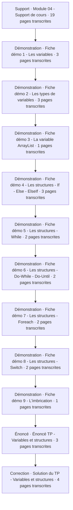

SOURCE DRIVE · TRANSCRIPTION DU SUPPORT

Le contenu des documents du dossier TSSR est transcrit ci-dessous, page par page. Les textes et tableaux sont intégrés à la page Web. Aucun fichier PDF, aucune diapositive entière ni aucune reproduction de page n’est affiché. Seuls des croquis ou visuels isolés et vérifiés peuvent accompagner la transcription. Les versions et les consignes restent celles des supports de formation. Les compléments IA sont conservés dans leur onglet distinct.

## Support · Module 04 - Support de cours · 19 pages transcrites

!!! note "À retenir"
    Les formulations historiques et les exemples du document sont conservés.

Transcription du support du Drive. Les formulations historiques et les exemples du document sont conservés. Les valeurs d’accès du laboratoire sont indiquées comme « fourni par le formateur ». Les adresses de messagerie personnelles utilisent example.com.

### Initiation à PowerShell

Module 04 – Les structures et variables

### Objectifs

!!! note "À retenir"
    Utiliser les structures fondamentales dans des scripts simples

- Utiliser les structures fondamentales dans des scripts simples

### Les variables

!!! note "À retenir"
    Les variables stockent des objets ou informations dans la mémoire vive afin de permettre leur réutilisation.

- Les variables stockent des objets ou informations dans la mémoire vive afin de permettre leur réutilisation.
- Pour déclarer ou appeler une variable, on utilise le symbole $

```
PS > $A = 1« La valeur 1 est de type Int donc la variable sera de type Int
```

- Le symbole = assigne une valeur à la variable.

```
PS > $A = « Bonjour » Ici la valeur est de type String
PS > $User = Get-AdUser –Filter * La variable et de type Objet
```

### Les variables

!!! note "À retenir"
    Les variables conservent leurs valeurs et leurs types tant que l’on ne réassigne pas de nouvelle valeur à la variable.

- Les variables conservent leurs valeurs et leurs types tant que l’on ne réassigne pas de nouvelle valeur à la variable.
- À la fermeture de la console, les variables sont supprimées de la mémoire vive.

```
PS > Get-Variable permet d’afficher les variables actuellement déclarées
```

dans la console.

- Pour connaître le type d’une variable, on utilise la fonction GetType()

```
PS > $A.GetType()
```

### Les variables : conseils

!!! note "À retenir"
    Donner des noms explicites aux variables en fonction des valeurs que les variables vont recevoir.

- Donner des noms explicites aux variables en fonction des valeurs que les variables vont recevoir.

```
PS > $LogFile
```

- La commande Read-Host permet de récupérer la saisie utilisateur et de la stocker dans une variable.

```
PS > $a = Read-Host « Veuillez saisir votre choix »
```

- Les variables peuvent être incluses dans la commande Write-Host.

```
PS > Write-Host « Voici votre choix $a »
```

### Démonstration

### Les variables : le type Objet

!!! note "À retenir"
    Quand une variable contient un objet, on peut agir sur celui-ci : • Pour afficher le contenu de la variable, il suffit de saisir le nom de la variable.

Quand une variable contient un objet, on peut agir sur celui-ci : • Pour afficher le contenu de la variable, il suffit de saisir le nom de la variable.

```
PS > $Services
```

- Pour afficher la propriété d’un objet contenu dans une variable, on spécifie le nom de la propriété à la suite de la variable avec un point de concaténation entre les deux.

```
PS > $Services.ServiceName
```

- Si votre variable contient plusieurs objets, vous pouvez spécifier le numéro de l’objet à afficher. La numérotation débute à 0.

```
PS > $AdUser[2] « Affichera le troisième utilisateur »
```

### Les variables : le type Objet

!!! note "À retenir"
    Les objets sont un ensemble de propriétés et de méthodes : Pour utiliser une méthode sur un objet, on spécifie le numéro de l’objet, puis on ajoute la méthode.

Les objets sont un ensemble de propriétés et de méthodes :

- Pour utiliser une méthode sur un objet, on spécifie le numéro de l’objet, puis on ajoute la méthode.
- La commande Get-Member permet de connaître l’ensemble des méthodes.

```
PS > $Services[3].stop() va arrêter le quatrième service.
```

- Beaucoup de méthodes sont des convertisseurs de valeur.

```
PS > $Date = (Get-Date).ToString(« yyyyMMdd »)
```

- La variable $Date contient le résultat de la commande get-date tout en étant de type String.

```
PS > $Date.GetType()
```

### Les variables : le type String

!!! note "À retenir"
    Quand une variable est de type String, on peut utiliser le symbole +.

Quand une variable est de type String, on peut utiliser le symbole +.

```
PS > $a = « abc »
PS > $b = « def »
PS > $c = $a + $b
PS > $c
PS > abcdef
PS > $d = Get-AdUser –Filter *
PS > $e = $d.Name
PS > $f = $d.Surname
PS > $g = $e + $f
PS > $g
PS > Nom Prénom
```

Il faut toujours additionner des variables de type identique.

### Les variables : le type Int

Quand une variable est de type Int, on peut utiliser les symboles + et -.

```
PS > $a = 1
PS > $d = Get-Process
PS > $b = 2
PS > $e = $d[1].Id
PS > $c = $a + $b
PS > $f = $d[2].Id
PS > $c
PS > $g = $e - $f
PS > 3
PS > $g
PS > id  du process 1 - id du process 2
```

### Démonstration

### Les variables : le type Array

- Le type Array représente une variable qui stocke ses valeurs ou objets sous forme de tableau.
- Chaque valeur possède un numéro d’index initié à 0.

```
PS > $array = "PC1","PC2","PC3"
PS > $array[1]
PS > PC2
```

Le séparateur des valeurs est la virgule

Les tableaux Array sont de taille fixe. On ne peut pas supprimer de valeur.

### Les variables : le type Array

- Le type Array permet également de gérer les valeurs présentes avec des méthodes.

```
PS >$array = "PC1","PC2","PC3"
PS >$array = "PC1","PC2","PC3"
PS >$array += "PC4
PS >$array.Replace(« PC1 », « PC11 »)
PS >$array
PS >$array[0]
PS >PC1 PC2 PC3 PC4
PS >PC11
```

La section de l’aide Get-Help about_Array vous indiquera toutes les possibilités d’une variable tableau.

### Les variables : le type ArrayList

```
Alternativement aux tableaux de type Array, il est possible d’utiliser des tableaux à
taille variable, de type ArrayList :
```

- On doit d’abord forcer le type de variable.

```
PS > $machines = New-Object System.Collections.ArrayList
```

- Deuxième méthode pour typer une variable.

```
PS > [System.Collections.ArrayList]$machines = "PC1","PC2"
PS > $machines.Gettype().FullName
```

Les tableaux de type ArrayList ont une taille variable, ce qui simplifie l’ajout et la suppression de contenu.

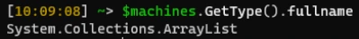

Capture du support « Module 04 - Support de cours »

### Les variables : le type ArrayList

Les méthodes utilisables sont plus nombreuses que sur une variable de type Array.

```
PS > [System.Collections.ArrayList] $machines
= "PC1","PC2"
PS > $machines.Add("PC3")
PS > $machines
PS > PC1 PC2 PC3
PS > $machines.Remove("PC2")
PS > $machines
PS > PC1 PC3
```

Ces variables vont être dédiées au stockage d’objet.

### Démonstration

### Les structures

**Visuel externe**

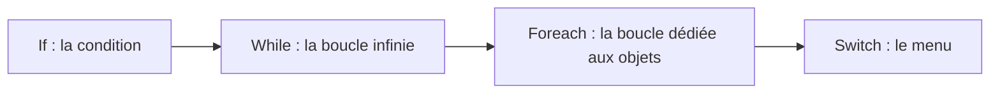

```
Il existe plusieurs types de structures couramment utilisées dans les scripts.
Nous allons en explorer quelques-unes :
```

- If : la condition
- While : la boucle infinie
- Foreach : la boucle dédiée aux objets
- Switch : le menu

### Les structures : If

La structure If va tester des valeurs grâce à un ou plusieurs opérateurs de comparaison. • Si la condition est validée, If renvoie le message Boolean $True.

```
If ($x –eq $y)
{
Write-Host ’’
```

Le test est validé $True’’ \}

- Dans ce cas-là, les commandes présentent entre les accolades sont exécutées.
- Si If renvoie $False, la ou les commandes ne seront pas exécutées.

Si ça est égal à ça, alors je fais ça !

### Les structures : Else

Le ELSE permet l’exécution de commandes lorsque le résultat du test est $False.

```
If ($x –eq $y)
{
Write-Host ’’Le test est validé $True’’
}
Else
{
Write-Host ’’Le test n’est pas validé $False’’
}
```

Si le premier test est $False, alors on effectue un second test. Si le second test est $False, alors on affiche la commande contenue dans le Else.

### Les structures : Else If

Les conditions peuvent être imbriquées afin de créer un second test sur une réponse $False.

```
If ($x –eq $y)
{
Write-Host ’’Le test est validé $True’’
}
ElseIf ($x –eq $z)
{
Write-Host ’’Le test est validé’ $True’
}
Else
{
Write-Host ’’Le test n’est pas validé $False’’
}
```

Si le premier test est $False, alors on effectue un second test. Si le second test est $False alors on affiche la commande contenue dans le Else.

### Démonstration

### Les structures : While

La structure While permet de boucler sur un bloc de commandes tant que la condition est $True :

- Dès que la condition est $False, la boucle s’arrête.

```
While ($x –ne « q » )
{
$x = Read-Host « Veuillez faire un choix »
#Si l’utilisateur saisit la lettre « q » la boucle s’arrête.
}
```

### Les structures : While

La boucle while est utilisable à condition que la variable de test ici $x possède une valeur avant le test.

- On doit souvent lui attribuer une valeur manuellement pour que la boucle démarre.
- En effet si $x est égale à $Null, on n’entrera pas dans la boucle.
- Donc il faut initialiser la valeur de la variable de test avant la boucle.

```
PS > $x = « A »
While ($x –ne « q » )
{
$x = Read-Host « Veuillez faire un choix »
#Si l’utilisateur saisit la lettre « q » la boucle s’arrête.
}
```

### Les structures : Do While

Une autre solution consiste à utiliser la boucle Do While.

- Contrairement à While, la condition se fait en fin de boucle et non pas en début de boucle.
- On peut donc accéder à notre boucle et laisser l’utilisateur saisir sa première valeur sans avoir à initier la valeur manuellement avant la boucle.

```
Do {
$x = Read-Host « Veuillez faire un choix »
```

#Si l’utilisateur saisit la lettre « q » la boucle s’arrête.

```
} While ($x –ne « q » )
```

### Les structures : Do Until

```
Il existe une troisième structure de boucle le Do Until.
```

- À la différence du Do While, la sortie se fera lorsque la condition est vraie.
- C’est la seule différence entre les deux structures.

```
Do {
$x = Read-Host « Veuillez faire un choix »
```

#Si l’utilisateur saisit la lettre « q » la boucle s’arrête.

```
} Until ($x –eq « q » )
```

### Démonstration

### Les structures : ForEach

- La structure ForEach ne s’utilise que dans un seul cas.
- Lorsque l’on dispose d’une variable de type Array ou ArrayList.

```
PS > $liste = « PC1 »,
« PC2 », « PC3 »
Foreach ( $i in $liste)
{
Write-Host ’’Le nom de la machine est $i ’’
}
```

- Le nombre de tours de boucle est déterminé par le nombre de valeurs dans la variable.
- À chaque tour de boucle, la variable $i prend la valeur suivante dans le tableau.

### Les structures : Foreach

**Visuel externe**

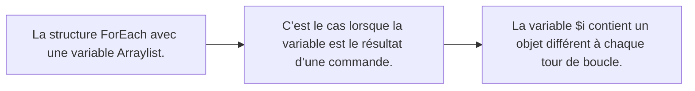

- La structure ForEach avec une variable Arraylist.
- C’est le cas lorsque la variable est le résultat d’une commande.

```
PS > $liste = Get-AdUser –Filter *
Foreach ( $i in $liste)
{
Write-Host ’’Le nom de l’utilisateur est $i.name ’’
Write-Host ’’Le prénom de l’utilisateur est $i.surname ’’
}
```

- La variable $i contient un objet différent à chaque tour de boucle.
- On utilise le . pour indiquer la valeur de la propriété de l’objet que l’on souhaite afficher.

### Les structures : Foreach

```
Il est possible d’interagir avec la structure de boucle pour prendre une décision sur
l’action à effectuer :
```

- Passer à l’objet suivant sans traiter l’actuel \{continue\}
- Sortir de la boucle \{break\}

```
ForEach ($i in $liste)
```

On teste la valeur de $i. Si elle est égale à

```
{
```

PC2 alors on arrête la boucle, sinon la

boucle continue normalement.

```
If ($i –eq ’’PC2’’)
{Break}
Write-Host ’’ Le nom de la machine est $i’’
}
```

### Les structures : Foreach

```
Foreach et méthode Continue
Foreach ( $i in $liste)
{
```

On teste la valeur de $i. Si elle est égale à PC2 alors on ne traite pas

```
If ($i –eq ’’PC2’’)
```

l’objet et on passe au suivant.

```
{Continue}
Write-Host ’’
```

Le nom de la machine est $i’’ \}

### Démonstration

### Les structures : Switch

```
En fonction de la valeur d’une propriété, le Switch va déclencher la ou les
commandes indiquée(s) pour cette valeur.
```

- Le Switch est la structure permettant de créer des menus à choix multiples.

```
Switch ($AdGroup)
{
’User’
{Write-Host ’’Le groupe est Utilisateur’’}
’Administrator’ {Write-Host ’’Le groupe est Admin’’}
’Default’ {Write-Host ’’ Le groupe n’est pas valide’’}
}
```

Si plusieurs valeurs correspondent au critère, les blocs d’actions correspondants sont appliqués

### Les structures : Switch

Le Switch accepte des méthodes.

- Passer au test suivant sans exécuter la commande \{continue\}
- Sortir du switch \{break\}

```
Switch ($AdGroup)
{
’User’  {CONTINUE}
’Administrator’ {Write-Host ’’Le groupe est Admin’’ } {BREAK}
’Default’ {Write-Host ’’ Le groupe n’est pas valide’’ }
}
```

Si le groupe est user, on teste le groupe suivant sans exécuter de commande. Si le groupe est Administrator, on arrête le switch.

### Démonstration

### Les structures : Imbrication

L’objectif des structures et de permettre leur imbrication. Dans ce cas, la ponctuation permet de définir la portée de chaque structure.

```
Do {
if ($x -gt 10){
Switch($x) {
‘11’ {Write-Host « La valeur est 11 »}
‘12’ {Write-Host « La valeur est 12 »}
}
}else { $x = Read-Host « Veuillez saisir une valeur supérieure à 10 »}
} while ($x –lt 100)
```

### Démonstration

### Conclusion

- Vous savez utiliser les structures fondamentales dans des scripts simples.

Référence du document : 1y95nEmGPpxFgKRHR7ZXQg4CiFW0s43WL · SHA-256 9f223839885de3c1…

## Démonstration · Fiche démo 1 - Les variables · 3 pages transcrites

Transcription du support du Drive. Les formulations historiques et les exemples du document sont conservés. Les valeurs d’accès du laboratoire sont indiquées comme « fourni par le formateur ». Les adresses de messagerie personnelles utilisent example.com.

### Les variables

Démonstration 01 du module 4

L’objectif de cette démonstration est de découvrir en quoi, comme tout langage-objet, PowerShell utilise les variables qui permettent de stocker des données dans la mémoire vive de l’ordinateur puis de les réutiliser dans d’autre commande.

### Déroulement

- La console PowerShell dispose de variables réservées comme nous avons pu le voir avec

```
$PSItem. Nous allons étudier les façons de travailler avec les variables.
```

- La commande Get-Variable permet de connaître toutes les variables disponibles actuellement dans la console PowerShell.
- Pour déclarer une nouvelle variable, on utilise le caractère $ suivi du symbole = puis de la valeur à attribuer à la variable.

Attention au type de variable ! Le fait d’attribuer la valeur 1 type la variable en INT.

Pour obtenir le type de variable, on utilise la méthode getType()

Le paramètre FullName permet d’afficher le type complet de la variable.

```
Lorsque l’on souhaite déclarer une variable de type String qui va contenir une chaîne de
caractères, il faut encadrer les caractères avec des doubles quotes.
```

La variable $b est de type SystemString car la valeur 1 est encadrée avec des doubles quotes.

#### Commandes visibles dans les captures

```
Get-Variable
$a = 1
$a.GetType().FullName
$b = "1"
$b.GetType().FullName
```

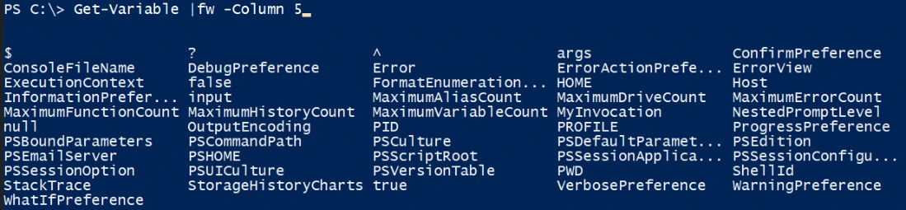

Capture du support « Fiche démo 1 - Les variables »

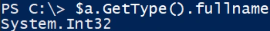

Capture du support « Fiche démo 1 - Les variables »

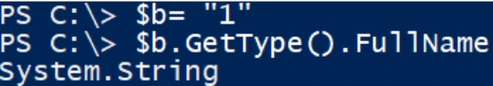

Capture du support « Fiche démo 1 - Les variables »

Les variables vont contenir également des objets, qui par la suite vont être réutilisés dans d’autres traitements.

Pour contenir des objets dans une variable, on déclare la variable puis on assigne un résultat de commande à cette variable.

On obtient une variable de type System.Object qui contient le résultat de la commande Get- Aduser.

Lorsque la variable est déclarée, elle est utilisable dans la console.

Pour visualiser son contenu, il suffit de saisir son nom précédé du $.

La variable peut également servir de conteneur à une saisie dans la console. Elle va être combinée à la commande Read-Host

La variable peut être utilisable avec la commande Write-Host pour afficher le contenu dans une chaîne de caractères avec des outils de mise en forme.

La valeur de la variable $choix est affichée dans la chaîne de caractères.

Les variables de type System.Object peuvent être utilisées pour afficher une ou plusieurs propriétés d’un ou des objets qu’elles contiennent.

On utilise le . à la suite de la variable pour indiquer le nom de la propriété à afficher.

#### Commandes visibles dans les captures

```
$u = Get-ADUser -Filter *
$u.GetType().FullName
$choix = Read-Host "Veuillez saisir votre choix"
$choix
```

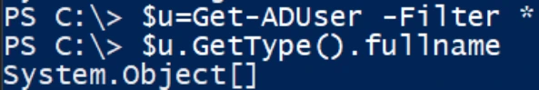

Capture du support « Fiche démo 1 - Les variables »

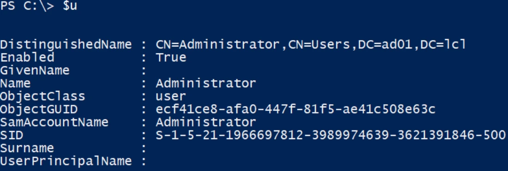

Capture du support « Fiche démo 1 - Les variables »

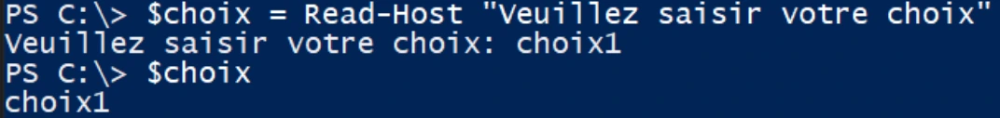

Capture du support « Fiche démo 1 - Les variables »

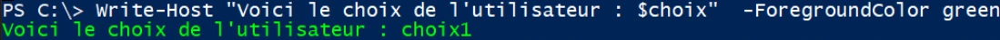

Capture du support « Fiche démo 1 - Les variables »

Il est possible de sélectionner un seul objet dans la variable en lui indiquant une valeur d’index.

On sélectionne un seul objet avec les [] puis on sélectionne une seule propriété avec le .

Avec les variables de type Objet on peut également se servir des méthodes contenues dans le type d’objet.

La variable $d utilise la méthode de conversion ToString pour convertir une valeur de type DateTime renvoyée par la commande Get-Date.

```
En fin de conversion, on obtient une valeur de type string utilisable dans une commande Write-
Host.
```

#### Commandes visibles dans les captures

```
$s[4].Name
$s[4]
```

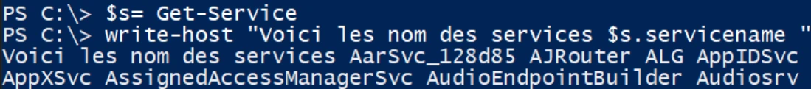

Capture du support « Fiche démo 1 - Les variables »

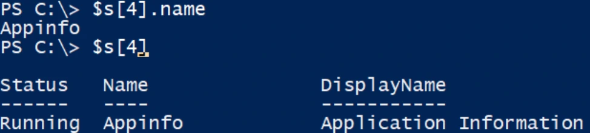

Capture du support « Fiche démo 1 - Les variables »

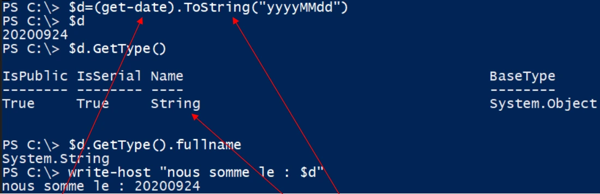

Capture du support « Fiche démo 1 - Les variables »

Référence du document : 1TVcJwMjiSWdewednfJRSYM6Xkq15PPAy · SHA-256 3ea1f706e7f2d3a6…

## Démonstration · Fiche démo 2 - Les types de variables · 3 pages transcrites

Transcription du support du Drive. Les formulations historiques et les exemples du document sont conservés. Les valeurs d’accès du laboratoire sont indiquées comme « fourni par le formateur ». Les adresses de messagerie personnelles utilisent example.com.

### Les types de variables

Démonstration 02 du module 4

L’objectif de cette démonstration est de découvrir comment nous pouvons lier les variables entre elles, en gardant à l’esprit que les variables doivent être de type identique.

### Déroulement

- Dans le cas où nous disposons de deux variables de même type, la variable contenant le résultat sera du même type que les variables d’origine.
- Voici ce qu’il est possible de faire avec des variables de type String

Les variables de type String peuvent être fusionnées pour obtenir une chaîne de caractères.

On récupère les valeurs des propriétés avec le « . » puis on le stocke en variable.

La variable finale conserve le type SystemString et hérite des variables $e et $f.

Le type de variable int va interpréter les chiffres et va permettre d’utiliser les opérateurs mathématiques.

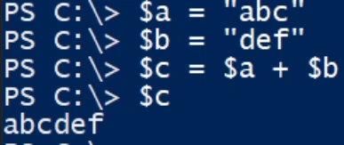

Capture du support « Fiche démo 2 - Les types de variables »

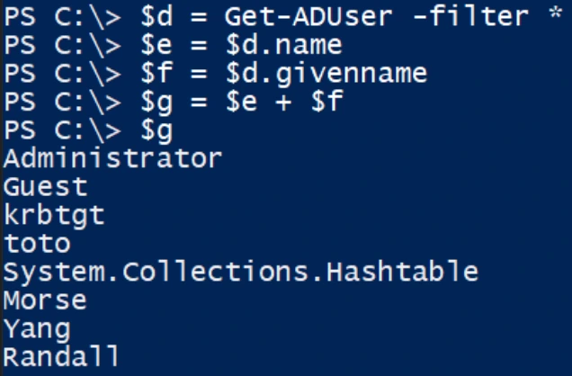

Capture du support « Fiche démo 2 - Les types de variables »

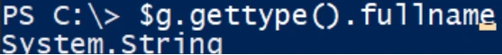

Capture du support « Fiche démo 2 - Les types de variables »

```
Il est possible de récupérer une valeur de type Int sur un objet.
```

Cette méthode appliquée à la variable $g arrondit le nombre de décimales à la valeur indiquée entre les parenthèses.

Le troisième type de variable est le type Array qui permet de stocker des valeurs en leur attribuant un index.

La variable $array est de type System.Object car les variables de type Array sont utilisées pour stocker des objets sur des résultats de commande comme Get-Aduser.

```
L’avantage de ces variables est qu’il est possible de leur appliquer des méthodes (puisqu’étant de
type System.Object)
```

Attention la méthode Replace est sensible à la casse sur les valeurs entre les parenthèses.

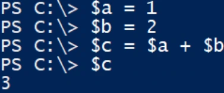

Capture du support « Fiche démo 2 - Les types de variables »

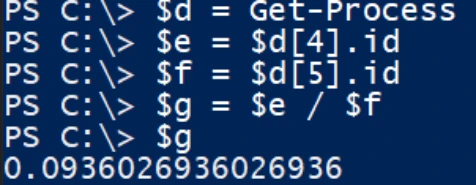

Capture du support « Fiche démo 2 - Les types de variables »

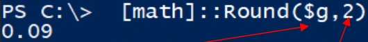

Capture du support « Fiche démo 2 - Les types de variables »

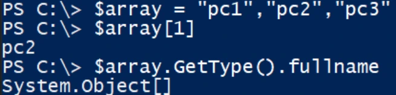

Capture du support « Fiche démo 2 - Les types de variables »

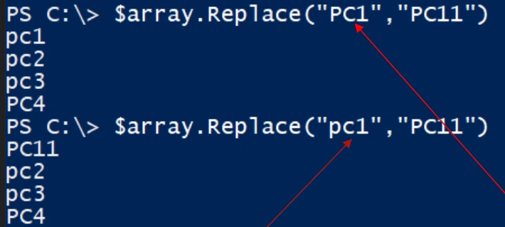

Capture du support « Fiche démo 2 - Les types de variables »

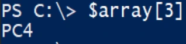

Capture du support « Fiche démo 2 - Les types de variables »

Attention également à l’indexation qui débute à 0 ; ainsi la valeur d’index 3 pointe vers la quatrième valeur du tableau.

```
Toutefois la variable de type array est statique ; le nombre de valeurs ne peut être diminué.
```

Référence du document : 1OjFFSdwFMyoRG43DHB7P0K9pEjlD-XE9 · SHA-256 b52c4648eb00d1f5…

## Démonstration · Fiche démo 3 - La variable ArrayList · 1 pages transcrites

Transcription du support du Drive. Les formulations historiques et les exemples du document sont conservés. Les valeurs d’accès du laboratoire sont indiquées comme « fourni par le formateur ». Les adresses de messagerie personnelles utilisent example.com.

### La variable ArrayList

Démonstration 03 du module 4

Pour pallier le problème de taille fixe des variables de type Array, il existe un autre type de variable, le type ArrayList, qui permet plus de liberté dans la gestion des valeurs qu’elle contient.

### Déroulement

- Une variable de type ArrayList doit être déclarée de la sorte :

```
o Elle ne peut pas se déclarer en fonction de la valeur qu’elle reçoit.
o Maintenant que nous disposons d’une variable de type ArrayList nous lui
```

indiquons les valeurs à prendre en compte

Le chiffre indiqué est celui de l’index de la valeur ajoutée.

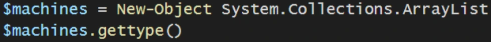

Capture du support « Fiche démo 3 - La variable ArrayList »

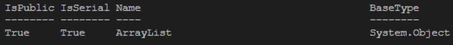

Capture du support « Fiche démo 3 - La variable ArrayList »

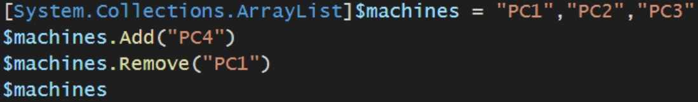

Capture du support « Fiche démo 3 - La variable ArrayList »

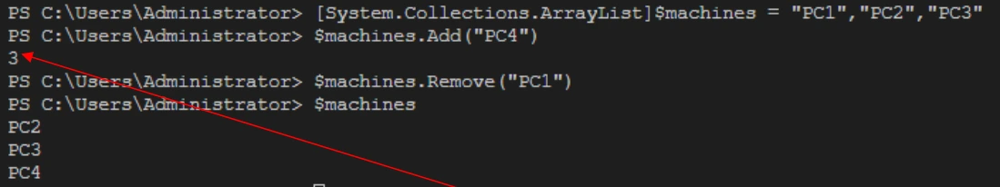

Capture du support « Fiche démo 3 - La variable ArrayList »

Référence du document : 1ANjHIeqY1XBCbpnrZkrdUBHgJm6D5nBp · SHA-256 86f631bd04c6cc53…

## Démonstration · Fiche démo 4 - Les structures - If - Else - ElseIf · 3 pages transcrites

Transcription du support du Drive. Les formulations historiques et les exemples du document sont conservés. Les valeurs d’accès du laboratoire sont indiquées comme « fourni par le formateur ». Les adresses de messagerie personnelles utilisent example.com.

### Les structures : If, Else, ElseIf

Démonstration 04 du module 4

L’objectif de cette démonstration est de montrer comment les variables permettent de manipuler des objets, des valeurs de propriétés à l’aide de conditions appliquées à ces variables pour déclencher ou non d’autres commandes ou méthodes.

### Déroulement

- La structure If est essentielle, car elle conditionne l’exécution d’une commande en fonction de la réponse à un test.
- Le résultat du test peut être soit « Vrai » soit « Faux », mais aucune autre valeur.
- Le test est effectué entre les parenthèses. Dans notre exemple on teste la valeur de la variable

```
$x.
```

Si la valeur est supérieure à 0 alors le test répond « Vrai ». Dans ce cas, la commande entre les accolades est exécutée.

Dans cet exemple $x n’est pas supérieur à 0, donc le test répond « Faux » : aucune commande ne sera exécutée.

```
Si l’on souhaite exécuter une commande lorsque le test est « Faux », alors il faut ajouter le paramètre
Else à la structure If.
```

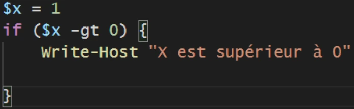

Capture du support « Fiche démo 4 - Les structures - If - Else - ElseIf »

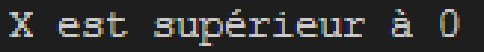

Capture du support « Fiche démo 4 - Les structures - If - Else - ElseIf »

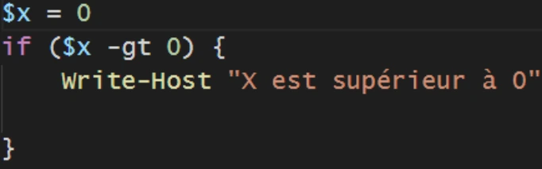

Capture du support « Fiche démo 4 - Les structures - If - Else - ElseIf »

Dans le cas où le test initial est « Faux », il est possible de faire un test secondaire via l’utilisation du paramètre ElseIf.

Le test secondaire peut vérifier une autre variable que la variable présente dans le test initial.

```
Si le second test répond « Vrai », alors la commande entre les accolades du ElseIf sera exécutée.
```

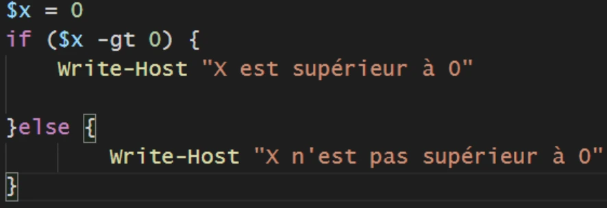

Capture du support « Fiche démo 4 - Les structures - If - Else - ElseIf »

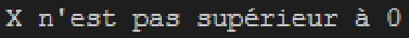

Capture du support « Fiche démo 4 - Les structures - If - Else - ElseIf »

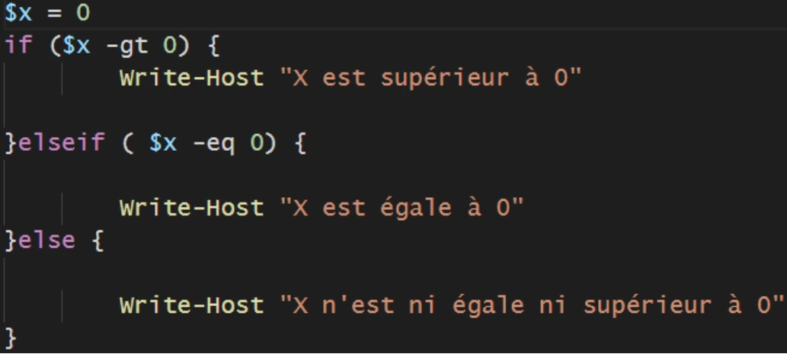

Capture du support « Fiche démo 4 - Les structures - If - Else - ElseIf »


Capture du support « Fiche démo 4 - Les structures - If - Else - ElseIf »

Avec une valeur négative, les deux tests répondent « Faux ». C’est donc la valeur du Else qui sera prise en compte.

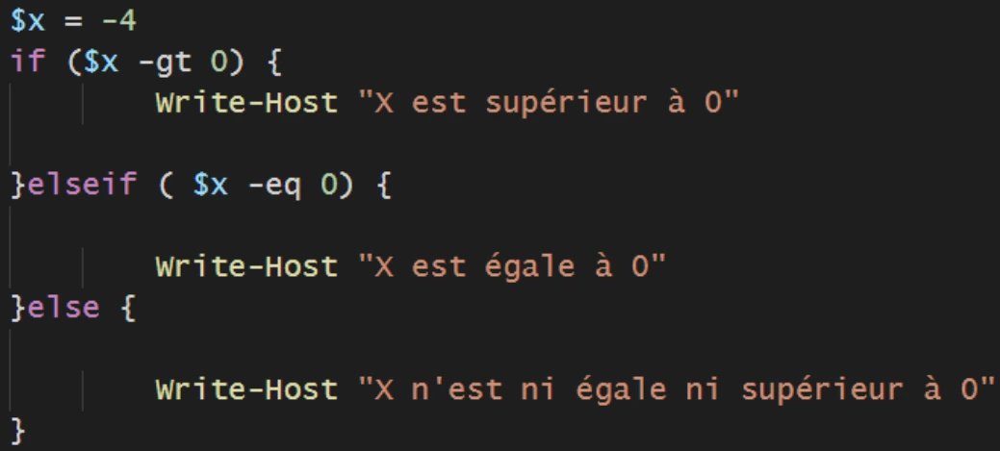

Capture du support « Fiche démo 4 - Les structures - If - Else - ElseIf »

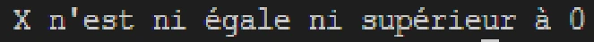

Capture du support « Fiche démo 4 - Les structures - If - Else - ElseIf »

Référence du document : 1CEt9g9piknHUSPHvnsJ5EhyDDhyHRIIz · SHA-256 7e59feafc016da3d…

## Démonstration · Fiche démo 5 - Les structures - While · 2 pages transcrites

Transcription du support du Drive. Les formulations historiques et les exemples du document sont conservés. Les valeurs d’accès du laboratoire sont indiquées comme « fourni par le formateur ». Les adresses de messagerie personnelles utilisent example.com.

### Les structures : While

Démonstration 05 du module 4

Les boucles sont des structures essentielles dans un langage et PowerShell n’y échappe pas. L’objectif de cette démonstration est de montrer comment la boucle While exécute des commandes, sous réserve que son test renvoie une réponse « Vrai » (si la réponse au test passe à « Faux », la boucle s’arrête).

### Déroulement

- La boucle While commence par un test, puis si la réponse est « Vraie », elle boucle une série de commandes.
- La boucle tourne tant que la réponse au test est « Vraie »

Pour déterminer un nombre de tours de boucle maximum, on va initier une variable dite de « Comptage » qui à chaque tour de boucle va s’incrémenter.

Lorsque la valeur de la variable de comptage atteint la limite, la boucle s’arrête.

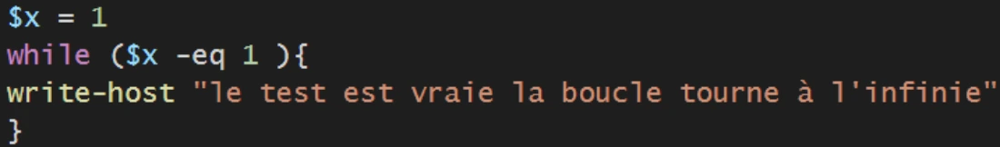

Capture du support « Fiche démo 5 - Les structures - While »

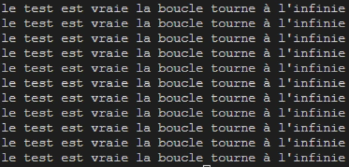

Capture du support « Fiche démo 5 - Les structures - While »

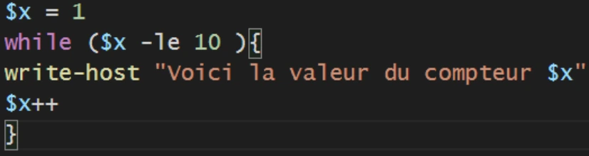

Capture du support « Fiche démo 5 - Les structures - While »

Lorsque la variable atteint la valeur « 10 » la boucle s’arrête.

La boucle s’utilise beaucoup comme vérificateur de valeur saisie par un utilisateur. En effet, tant que la valeur souhaitée n’est pas atteinte, la boucle ne s’arrête pas.

```
Combiné à la commande Read-Host, la valeur saisie est testée à chaque tour de boucle, si la
valeur est conforme, on sort de la boucle.
```

Tant que la lettre est différente de « Q » on boucle.

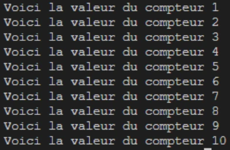

Capture du support « Fiche démo 5 - Les structures - While »

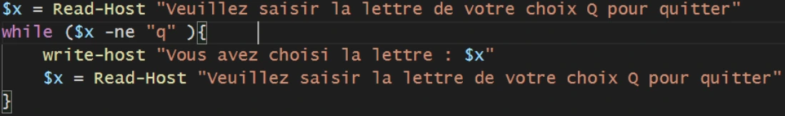

Capture du support « Fiche démo 5 - Les structures - While »

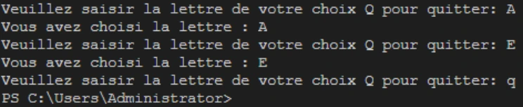

Capture du support « Fiche démo 5 - Les structures - While »

Référence du document : 1PQk0Fu-Ogyu2Am_36GonkntA7jSlrP2q · SHA-256 b4d4318541db71cf…

## Démonstration · Fiche démo 6 - Les structures - Do-While - Do-Until · 2 pages transcrites

Transcription du support du Drive. Les formulations historiques et les exemples du document sont conservés. Les valeurs d’accès du laboratoire sont indiquées comme « fourni par le formateur ». Les adresses de messagerie personnelles utilisent example.com.

### Les structures : Do-While et Do-Until

Démonstration 06 du module 4

La boucle nécessite une valeur de variable à tester pour commencer à boucler. Cela est parfois impossible car la variable à tester peut-être déclarée à l’intérieur même de la boucle.

```
L’objectif de cette démonstration est de montrer que la boucle Do-While permet un tour de
boucle initiale sans condition. La condition sera faite en sortie de boucle et, en fonction de la
réponse, d’autres tours de boucle (ou aucun) seront effectués.
```

### Déroulement

- La boucle Do-While va continuer à boucler tant que le test final va répondre « Vrai » ; dès que le test répond « faux », la boucle s’arrête.
- La boucle tourne tant que la réponse au test est « Vraie »

Pour le Do-until, le sens est inversé au niveau de la condition : on boucle tant que le test répond « Faux ».

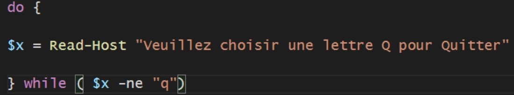

Capture du support « Fiche démo 6 - Les structures - Do-While - Do-Until »

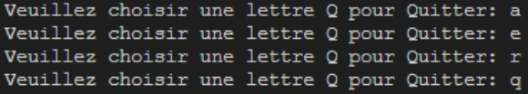

Capture du support « Fiche démo 6 - Les structures - Do-While - Do-Until »

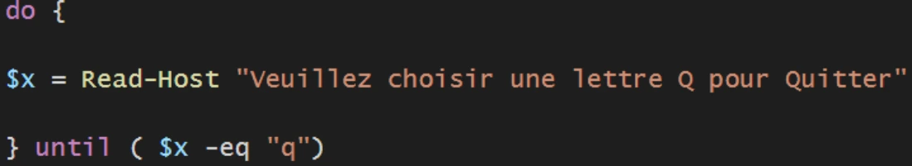

Capture du support « Fiche démo 6 - Les structures - Do-While - Do-Until »

Pour bien différencier les deux structures, il faut penser à certains types de tests qui ne peuvent pas être inversés par des opérateurs de comparaison comme les booléens.

Dans le premier cas $x est égale à $False. Until boucle à l’infini. Dans le second cas, Until ne boucle pas.

```
Nous avons le comportement inverse avec While
```

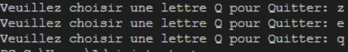

Capture du support « Fiche démo 6 - Les structures - Do-While - Do-Until »

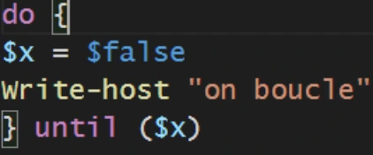

Capture du support « Fiche démo 6 - Les structures - Do-While - Do-Until »

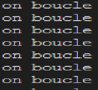

Capture du support « Fiche démo 6 - Les structures - Do-While - Do-Until »

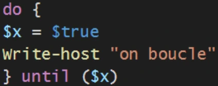

Capture du support « Fiche démo 6 - Les structures - Do-While - Do-Until »

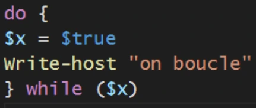

Capture du support « Fiche démo 6 - Les structures - Do-While - Do-Until »

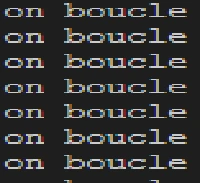

Capture du support « Fiche démo 6 - Les structures - Do-While - Do-Until »


Capture du support « Fiche démo 6 - Les structures - Do-While - Do-Until »

Référence du document : 1ikLiim6Ss5HZkOkk8p3oDJtG-jGjKooj · SHA-256 7274e1473abc23a1…

## Démonstration · Fiche démo 7 - Les structures - Foreach · 2 pages transcrites

Transcription du support du Drive. Les formulations historiques et les exemples du document sont conservés. Les valeurs d’accès du laboratoire sont indiquées comme « fourni par le formateur ». Les adresses de messagerie personnelles utilisent example.com.

### Les structures : Foreach

Démonstration 07 du module 4

L’objectif de cette démonstration est de vous montrer le fonctionnement la boucle Foreach.

### Déroulement

La boucle Foreach est la boucle qui s’utilise avec des variables de type Array et ArrayList.

En effet la boucle fonctionne avec un index qui va parcourir les variables et traiter les valeurs contenues dans chaque index du tableau.

Le nombre de tours de boucle dépend du nombre de valeurs contenues dans la variable.

- La structure Foreach est employée pour exprimer les propriétés d’un ou de plusieurs objets contenus dans une variable.
- Reprenons l’exemple de la variable Array :

```
Trois index sont présents dans la variable $array donc trois tours de boucle.
A chaque tour de boucle, la valeur de l’index $i prend la valeur de l’index suivant dans le tableau.
```

Avec une variable de type ArrayList, nous allons explorer des objets.


Capture du support « Fiche démo 7 - Les structures - Foreach »


Capture du support « Fiche démo 7 - Les structures - Foreach »


Capture du support « Fiche démo 7 - Les structures - Foreach »

A chaque tour de boucle, l’index contient un objet, ici un utilisateur Active Directory. On spécifie les propriétés de l’objet avec le « . ».

La structure Foreach accepte des commandes « action ». Ces actions sont décidées la plupart du temps pour donner suite à un test venant d’une structure If.

Avec l’action BREAK la boucle s’arrête si elle détecte un des quatre comptes indiqués dans la condition du If.

Avec l’action CONTINUE la boucle continue sans traiter l’objet qui a répondu « Vrai » au test.


Capture du support « Fiche démo 7 - Les structures - Foreach »


Capture du support « Fiche démo 7 - Les structures - Foreach »


Capture du support « Fiche démo 7 - Les structures - Foreach »

Référence du document : 18m5Utae9SKmg9nacgq7o0-8yJ-pQLr8Z · SHA-256 9e3f186cbd71d16e…

## Démonstration · Fiche démo 8 - Les structures - Switch · 2 pages transcrites

Transcription du support du Drive. Les formulations historiques et les exemples du document sont conservés. Les valeurs d’accès du laboratoire sont indiquées comme « fourni par le formateur ». Les adresses de messagerie personnelles utilisent example.com.

### Les structures : Switch

Démonstration 08 du module 4

La condition If permet de tester et de définir des commandes à exécuter en fonction d’un résultat « Vrai » ou « Faux ». Le If se limite à un ou deux tests maximum, au-delà il faut passer par la structure Switch. L’objectif de cette démonstration est de voir que le Switch permet de définir une action précise en fonction de la saisie d’une valeur.

### Déroulement

- Pour utiliser un Switch, il faut définir la variable qui va être testée.
- Ensuite, on déclare les valeurs ainsi que les actions à effectuer en fonction de la valeur.

Le Switch teste, au moyen d’expressions régulières, la variable $choix. Pour cela, il faut ajouter le paramètre Regex à la commande Switch.

En cas de caractère non identifié par les deux premières conditions, c’est la sortie par défaut qui est exécutée.

La structure Switch accède, comme la structure Foreach, les actions Continue et Break.


Capture du support « Fiche démo 8 - Les structures - Switch »


Capture du support « Fiche démo 8 - Les structures - Switch »


Capture du support « Fiche démo 8 - Les structures - Switch »


Capture du support « Fiche démo 8 - Les structures - Switch »

```
Si le groupe est User, il sera non testé. Les autres groupes seront testés ensuite.
```

La structure Switch est largement utilisée pour constituer des menus à choix multiple.


Capture du support « Fiche démo 8 - Les structures - Switch »


Capture du support « Fiche démo 8 - Les structures - Switch »


Capture du support « Fiche démo 8 - Les structures - Switch »


Capture du support « Fiche démo 8 - Les structures - Switch »

Référence du document : 1ci0EpL_sZg3PtmUJ3ogC65yHpgr7jaWg · SHA-256 242ea33e6c9c0d19…

## Démonstration · Fiche démo 9 - L'imbrication · 1 pages transcrites

Transcription du support du Drive. Les formulations historiques et les exemples du document sont conservés. Les valeurs d’accès du laboratoire sont indiquées comme « fourni par le formateur ». Les adresses de messagerie personnelles utilisent example.com.

### L’imbrication

Démonstration 09 du module 4

Les structures sont faites pour être imbriquées les unes avec les autres afin de répondre à un besoin. L’objectif de cette démonstration est de vous donner un exemple.

### Déroulement

- Nous allons combiner plusieurs structures afin de créer un menu interactif.
- Ce menu doit être intégré dans une boucle qui s’arrêtera lorsque l’utilisateur appuiera sur une touche assignée à la sortie du menu.
- La variable « choix » est réinitialisée à chaque tour de boucle. Cela permet de ne pas garder en mémoire la valeur du choix précédent.


Capture du support « Fiche démo 9 - L'imbrication »


Capture du support « Fiche démo 9 - L'imbrication »

Référence du document : 18XS11dIOrl1c15hmDq6Vw-OnN01TASLm · SHA-256 a81cef7bd65e2076…

## Énoncé · Énoncé TP - Variables et structures · 3 pages transcrites

Transcription du support du Drive. Les formulations historiques et les exemples du document sont conservés. Les valeurs d’accès du laboratoire sont indiquées comme « fourni par le formateur ». Les adresses de messagerie personnelles utilisent example.com.

### Initiation à PowerShell Variables et structures

TP du Module 04

Avant de démarrer ce TP, il convient d’avoir suivi les vidéos du module 4 de ce cours.

Durée estimée

4 heures

### Énoncé

Objectifs :

Utiliser les variables dans le langage de commande PowerShell

Intégrer les structures de commandes dans des scripts de base

Consignes :

Depuis la machine CLI01

Stocker dans une variable le résultat de la commande Get-EventLog system.

Quelle commande avez-vous utilisée ?

Affichez l’entrée de journal numéro 10.

Quelle est la valeur de l’Index du journal ?

Créer une variable qui stockera l’addition de l’index de journal numéro 10 et 20. Quelles commandes avez-vous utilisées ?

Pour répondre au besoin, vous utiliserez les structures If et DoWhile.

Créer un script qui dans un premier temps demande la saisie de la date de naissance d’un utilisateur, puis dans un second temps demande à l’utilisateur de trouver cette date de naissance en indiquant si la valeur saisie est supérieure ou inférieure.

Si la date saisie est correcte, la boucle s’arrête et l’utilisateur est félicité.

BONUS : indiquez le nombre d’essais effectués par l’utilisateur.

Pour répondre au besoin, vous utiliserez les structures If et ForEach.

Créer un script qui générera deux variables de tableaux $UserActif et $SUserInactif ;

dans chacune sera stockée la liste des utilisateurs actifs et inactifs de votre serveur Active Directory.

Indiquez le nombre d’utilisateurs actif et inactif.

Utilisation de While / If ou Switch

Réalisez un menu à choix multiples, voici l'affichage attendu :

Bienvenue dans l'outil d'inventaire, faites votre choix parmi les menus suivants : 1) Affichage des ordinateurs du domaine. 2) Affichage des groupes de domaines locaux 3) Importation des utilisateurs « AD » à partir d’un fichier « CSV » 4) Quitter

Entrez votre choix :

Si la saisie de l'utilisateur est incorrecte, la saisie doit être proposée à nouveau en indiquant l'erreur.

Indiquez les lignes de commandes utilisées.

Chargez dans une variable les objets utilisateurs Active Directory.

Pour chaque utilisateur, réinitialisez le mot de passe puis vérifiez si l’utilisateur est inactif. Activer leurs comptes.

Quelles commandes avez-vous utilisées ?

### Solution

Une solution est proposée pour ce TP sous la forme d'un PDF commenté, disponible dans les ressources à télécharger.

Référence du document : 1ruZignmyI2vKV4BJy8Udzl9Pkq9CtwW2 · SHA-256 f0d6685dbc44dec9…

## Correction · Solution du TP - Variables et structures · 4 pages transcrites

Transcription du support du Drive. Les formulations historiques et les exemples du document sont conservés. Les valeurs d’accès du laboratoire sont indiquées comme « fourni par le formateur ». Les adresses de messagerie personnelles utilisent example.com.

Correction originale : à consulter après avoir tenté l’exercice.

### Variables et structures

TP du Module 04

Avant de démarrer ce TP, il convient d’avoir suivi les vidéos du module 4 de ce cours.

Durée estimée

4 heures

### Énoncé

**Visuel externe**


Objectifs :

- Utiliser les variables dans le langage de commande PowerShell
- Intégrer les structures de commandes dans des scripts de base

Consignes :

Depuis la machine CLI01

- Stocker dans une variable le résultat de la commande Get-EventLog system.

Quelle commande avez-vous utilisée ?

Affichez l’entrée de journal numéro 10.

Quelle est la valeur de l’Index du journal ?

Créer une variable qui stockera l’addition de l’index de journal numéro 10 et 20. Quelles commandes avez-vous utilisées ?

#### Commandes visibles dans les captures

```
$event = Get-EventLog -LogName System
$event[10].Index
$index = $event[10].Index + $event[20].Index
$index
```


Capture du support « Solution du TP - Variables et structures »


Capture du support « Solution du TP - Variables et structures »


Capture du support « Solution du TP - Variables et structures »

- Pour répondre au besoin, vous utiliserez les structures If et DoWhile.

Créer un script qui dans un premier temps demande la saisie de la date de naissance d’un utilisateur, puis dans un second temps demande à l’utilisateur de trouver cette date de naissance en indiquant si la valeur saisie est supérieure ou inférieure.

Si la date saisie est correcte, la boucle s’arrête et l’utilisateur est félicité.

BONUS : indiquez le nombre d’essais effectués par l’utilisateur.

- Pour répondre au besoin, vous utiliserez les structures If et ForEach.

Créer un script qui générera deux variables de tableaux $UserActif et $SUserInactif ;

dans chacune sera stockée la liste des utilisateurs actifs et inactifs de votre serveur Active Directory.

Indiquez le nombre d’utilisateurs actifs et inactifs.

#### Script de la capture

```
[int]$n = Read-Host "Veuillez saisir votre date de naissance"
$compteur=0
do {
[int]$date=Read-Host "Indiquez une date "
    if ($date -gt $n){
        write-host "La valeur saisie est trop grande"
    }elseif($date -lt $n) {
        Write-Host "La valeur saisie est trop petite "
        }else {write-host "Felicitation vous avez trouvez la valeur"
            write-host "Voici votre nombre de tentative" $compteur}
        $compteur++
}while( $date -ne $n)
```


Capture du support « Solution du TP - Variables et structures »


Capture du support « Solution du TP - Variables et structures »

- Utilisation de While / If ou Switch

Réalisez un menu à choix multiples, voici l'affichage attendu :

Bienvenue dans l'outil d'inventaire, Faites votre choix parmi les menus suivants : 1) Affichage des ordinateurs du domaine. 2) Affichage des groupes de domaines locaux 3) Importation des utilisateurs AD à partir d’un fichier CSV 4) Quitter Entrez votre choix :

Si la saisie de l'utilisateur est incorrecte, la saisie doit être proposée à nouveau en indiquant l'erreur.

Indiquez les lignes de commandes utilisées.

#### Script de la capture

```
$users = get-aduser -filter *
$UserActif = New-Object system.collections.arraylist
$UserInActif = New-Object system.collections.arraylist
Foreach($i in $users){
    if ($i.enabled -eq $true){
        $UserActif.add($i)
    }else {
        $UserInActif.add($i)
    }
}
Write-Host "VOici le nombre d'utilisateur actif : "`
 -NoNewline ; ($UserActif | measure).count
Write-Host "Voici le nombre d'utilisateur inactifs : "`
 -NoNewline ;($UserInActif | measure).count
```


Capture du support « Solution du TP - Variables et structures »

- Chargez dans une variable les objets utilisateurs Active Directory.

Pour chaque utilisateur, réinitialisez le mot de passe puis vérifiez si l’utilisateur est inactif. Activer leurs comptes.

Quelles commandes avez-vous utilisées ?

#### Script de la capture

```
do {
Write-Host "Bienvenue dans l'outils d'inventaire,
Faites votre choix parmis les menus suivants:
1) Affichage des ordinateurs du domaine
2) Affichages des groupes de domaines locaux
3) Importation des utilisateurs AD  partir d'un fichier CSV
4) Quitter"
$choix = read-host "Veuillez faire un choix"
if ($choix -notin 1,2,3,4 ){
    Write-Host "votre choix est incorecte"
}
switch ($choix){
    "1" { $computer = get-adcomputer -filter * ;
        Write-host "Voici les ordinateurs du domaine : " $computer.name `
        -foregroundcolor green }
    "2" { $group = get-adgroup -filter * | where groupscope -eq domainlocal
        Write-host "Voici les groupes de domaine locaux : " $group.name `
        -foregroundcolor yellow}
    "3" {$path = read-host "Veuillez indiquer le chemin du fichier CSV ";
       import-csv -path $path -delimiter ";" | new-aduser}
    "4" { Write-Host "Sortie du programme"}
}
} while ( $choix -ne 4)
```

#### Commandes visibles dans les captures

```
$user = get-aduser -filter *
foreach ($i in $user){
    $p = convertto-securestring -asplaintext -force "fourni par le formateur"
    set-adaccountpassword -newpassword $p -identity $i.distinguishedname
    if ($i.enabled -eq $false){
        enable-adaccount -identity $i.distinguishedname
    }
}
```


Capture du support « Solution du TP - Variables et structures »

Référence du document : 1eFOzHmjkgvoaFtUTU5J85KTrqDlH7v8h · SHA-256 093b0952e91c8ab2…

## Fiche de synthèse

Les lignes reprennent les titres du cours et la première phrase de chaque partie.

| Partie | Repère du cours |
| --- | --- |
| Support · Module 04 - Support de cours · 19 pages transcrites | Les formulations historiques et les exemples du document sont conservés. |
| Démonstration · Fiche démo 1 - Les variables · 3 pages transcrites | Les formulations historiques et les exemples du document sont conservés. |
| Démonstration · Fiche démo 2 - Les types de variables · 3 pages transcrites | Les formulations historiques et les exemples du document sont conservés. |
| Démonstration · Fiche démo 3 - La variable ArrayList · 1 pages transcrites | Les formulations historiques et les exemples du document sont conservés. |
| Démonstration · Fiche démo 4 - Les structures - If - Else - ElseIf · 3 pages transcrites | Les formulations historiques et les exemples du document sont conservés. |
| Démonstration · Fiche démo 5 - Les structures - While · 2 pages transcrites | Les formulations historiques et les exemples du document sont conservés. |
| Démonstration · Fiche démo 6 - Les structures - Do-While - Do-Until · 2 pages transcrites | Les formulations historiques et les exemples du document sont conservés. |
| Démonstration · Fiche démo 7 - Les structures - Foreach · 2 pages transcrites | Les formulations historiques et les exemples du document sont conservés. |
| Démonstration · Fiche démo 8 - Les structures - Switch · 2 pages transcrites | Les formulations historiques et les exemples du document sont conservés. |
| Démonstration · Fiche démo 9 - L'imbrication · 1 pages transcrites | Les formulations historiques et les exemples du document sont conservés. |
| Énoncé · Énoncé TP - Variables et structures · 3 pages transcrites | Les formulations historiques et les exemples du document sont conservés. |
| Correction · Solution du TP - Variables et structures · 4 pages transcrites | Les formulations historiques et les exemples du document sont conservés. |
