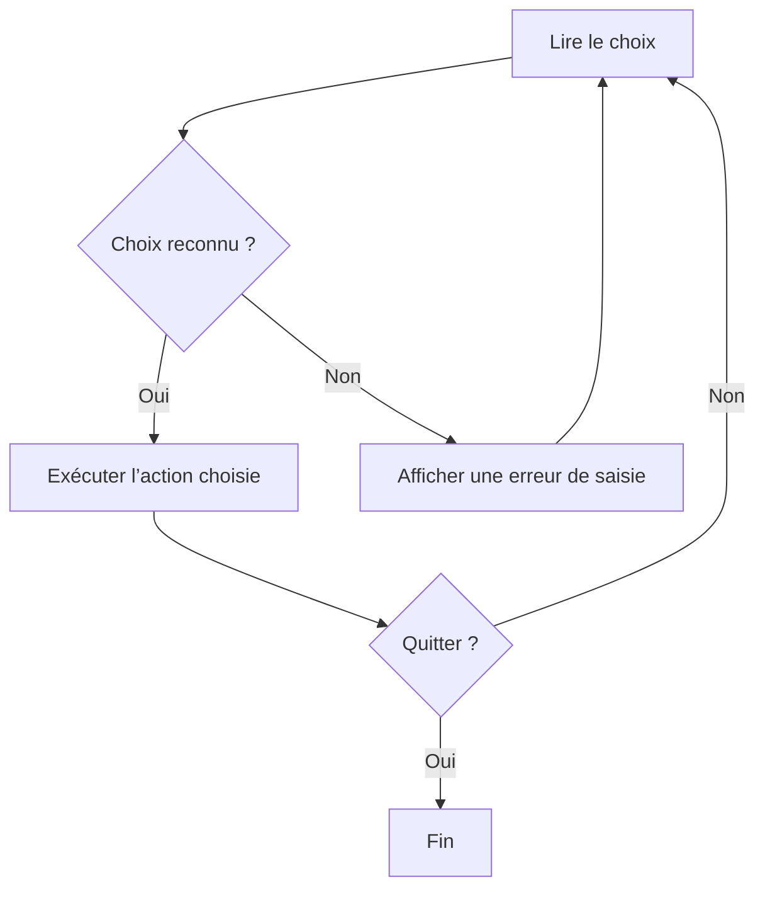

# Module 04 — Les structures et variables

## Objectifs

À l’issue des activités de ce module, vous devez pouvoir manipuler des variables,
des collections et des structures de contrôle dans des scripts PowerShell de base.
Les exemples et la syntaxe ci-dessous reprennent le périmètre des sources du module.

## Variables, objets et types présentés

Une affectation associe une valeur à une variable :

```powershell
$nom = 'valeur'
```

Les démonstrations utilisent également des propriétés, des méthodes et des
collections :

```powershell
$objet = Get-Date
$objet.Year
$objet.AddDays(1)
$collection = @('PC1','PC2')
$collection[0]
Get-Variable
```

Pour observer un type, les sources emploient `.GetType()` et
`.GetType().FullName`. Les types présentés sont **Int**, **String**,
**Object / System.Object**, **Array**, **ArrayList** et **DateTime** dans le
contexte de conversion de date. Les interactions et affichages illustrés
reposent notamment sur `Read-Host`, `Write-Host` et
`(Get-Date).ToString("yyyyMMdd")`.

## Collections : Array et ArrayList

Un tableau est présenté avec une indexation et des valeurs séparées par des
virgules. Les démonstrations montrent aussi `+`, `-`, `+=` et `Replace(...)`.
Une `ArrayList` est illustrée avec les formes suivantes :

```powershell
New-Object System.Collections.ArrayList
[System.Collections.ArrayList]
.Add(...)
.Remove(...)
```

> **Point documentaire à vérifier.** Les sources qualifient l’`Array` de taille
> fixe tout en illustrant un ajout avec `+=`. Une ligne visuelle d’exemple ne
> montre pas son guillemet fermant. Cette page ne complète pas ces éléments.

## Choisir une structure de contrôle

Les sources présentent les structures suivantes :

```powershell
If (...) {
  ...
}
ElseIf (...) {
  ...
}
Else {
  ...
}
```

Les opérateurs utilisés dans ce module sont `-eq`, `-ne`, `-gt`, `-lt` et
`-le`.

`While (...) { ... }` vérifie sa condition avant l’entrée dans le bloc. Les
formes `Do { ... } While (...)` et `Do { ... } Until (...)` testent leur
condition après l’exécution du bloc ; les sources opposent ainsi la logique de
`While` et de `Until`.

Pour parcourir une liste, la forme attestée est :

```powershell
Foreach ($i in $liste) {
  ...
}
```

`Break` et `Continue` sont présentés dans les démonstrations. `Foreach` ne doit
pas être confondu avec `ForEach-Object`, qui ne fait pas partie de ce module.

## Menus et choix

Les exemples de choix reposent sur `Switch ($choix)` et
`Switch -regex ($choix)`, avec `Default`, `Break` et `Continue`. Les motifs
montrés sont `[a-zA-Z]`, `[0-9]` et `.`. Ils servent à illustrer le menu et les
choix des sources, sans constituer un cours général sur les expressions
régulières.

L’imbrication du module associe un menu interactif, une boucle, une condition
et un `Switch` ; aucune structure plus complexe n’est introduite ici.

## Mise en pratique et vérifications

Le module comporte un seul TP « Variables et structures » de 4 heures,
organisé en cinq exercices : journal et variable/index, devinette avec `If` et
`DoWhile`, collections avec `If` et `Foreach`, menu avec `While`/`If` ou
`Switch`, puis objets utilisateurs et opérations administratives. Les données
d’un environnement de laboratoire ne sont pas des résultats universels et ne
sont pas reproduites dans cette page.

Les vérifications portent sur le comportement attendu des variables,
collections et structures employées par chaque exercice. Certaines actions
d’administration sont réservées au scénario de laboratoire : elles ne doivent
pas être exécutées hors de ce cadre.

## Prévoir les types au moment de la saisie

Le support compare `$a = 1` et `$b = "1"`. Le premier est un entier, le second une chaîne. `GetType().FullName` montre le type. `Read-Host` renvoie une chaîne. Pour comparer des nombres ou des dates, convertir explicitement la saisie et prévoir le cas où elle n’est pas valide. Les guillemets doubles interpolent une variable. Les guillemets simples conservent le texte littéral.

```powershell
$a = 1
$b = '1'
$a.GetType().FullName
$b.GetType().FullName
$services = @(Get-Service)
$services[0].Name
$aujourdhui = Get-Date
$aujourdhui.ToString('yyyyMMdd')
```

Les tableaux utilisent un indice à partir de zéro. Un tableau classique possède une taille fixe. Ajouter avec `+=` crée un tableau de remplacement. L’`ArrayList` de la démonstration accepte `Add` et `Remove`. `Add` renvoie l’indice de l’élément ajouté. Si seul l’effet sur la liste vous intéresse, `[void]` écarte ce résultat.

```powershell
[System.Collections.ArrayList]$machines = @('PC1','PC2','PC3')
[void]$machines.Add('PC4')
$machines.Remove('PC1')
$machines[0]
```

## Choisir la bonne condition d’arrêt

| Structure | Moment du test | Résultat à prévoir |
| --- | --- | --- |
| `if`, `elseif`, `else` | Avant la branche | La première condition vraie choisit la branche |
| `while` | Avant chaque tour | Zéro tour si la condition est fausse au début |
| `do ... while` | Après le corps | Au moins un tour, puis reprise tant que la condition est vraie |
| `do ... until` | Après le corps | Au moins un tour, puis arrêt dès que la condition devient vraie |
| `foreach` | Pour chaque élément | Un élément courant, ses propriétés et ses méthodes |
| `switch` | À chaque correspondance | Les cas correspondants peuvent s’exécuter, `break` quitte le switch |



*Schéma pédagogique externe au cours.*

```powershell
do {
    $choix = Read-Host '1 pour afficher les services, Q pour quitter'
    switch ($choix) {
        '1' { Get-Service | Select-Object -First 5 Name,Status }
        'Q' { 'Fin du menu' }
        default { 'Choix inconnu' }
    }
} until ($choix -eq 'Q')
```

`continue` passe à l’itération suivante et `break` quitte la structure de boucle courante. Dans une structure imbriquée, repérer la paire d’accolades et la boucle visée. `foreach ($element in $collection)` et `ForEach-Object` parcourent tous deux des éléments, mais l’un est une structure du langage et l’autre une commande de pipeline. Une variable utilisée dans une boucle doit être mise à jour au bon endroit pour atteindre la condition de sortie.

## Vérifier les exercices du TP

L’index d’un événement et sa position dans le tableau sont deux valeurs distinctes. Les nombres relevés dans le journal système de la maquette varient selon la machine. Contrôler que le tableau possède au moins 21 entrées avant d’accéder à `[20]`. Les deux collections d’utilisateurs se répartissent selon `Enabled`, puis leurs nombres se lisent avec `Count`. Pour le menu, vérifier chaque action et le retour à la saisie après une valeur inconnue.

Le script fourni pour la dernière consigne réinitialise le mot de passe des utilisateurs sélectionnés puis réactive les comptes inactifs. Sa valeur de démonstration est neutralisée dans Original. La variante pédagogique de la correction utilise une saisie sécurisée et une OU de laboratoire explicite pour rendre la portée de l’exercice vérifiable.

## Mini-quiz

1. Combien de tours minimum effectue `do ... until` ?
2. Quelle différence entre `$events[10]` et `$events[10].Index` ?
3. Pourquoi une comparaison numérique après `Read-Host` demande-t-elle de vérifier le type ?
4. Que renvoie `ArrayList.Add()` ?

??? success "Réponses"
    1. Un tour.
    2. Le premier est l’objet à la position 10. Le second est la propriété `Index` de cet objet.
    3. La saisie arrive comme chaîne.
    4. L’indice de l’élément ajouté.

## Travaux pratiques et révision

- [TP et correction du module](../../tp/12-initiation-powershell/module-04/index.md)
- [Fiche de révision](../../revision/12-initiation-powershell/module-04.md)
- [Sommaire du cours](index.md)
