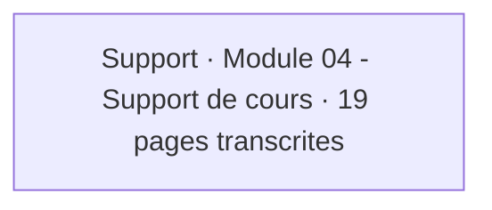
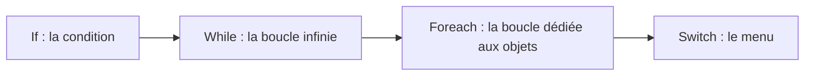
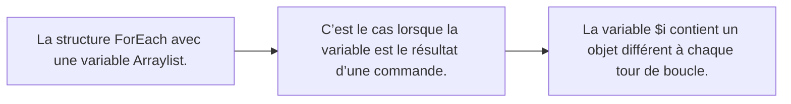

# Module 04 — Les structures et variables

[Travaux pratiques](../../tp/12-initiation-powershell/module-04/index.md)

Les parties ci-dessous reprennent le cours original, dans le même ordre. Les encadrés et les schémas répètent ses formulations.

## Parcours de lecture

1. Support · Module 04 - Support de cours · 19 pages transcrites

**Visuel externe**



SOURCE DRIVE · TRANSCRIPTION DU SUPPORT

Le contenu des documents du dossier TSSR est transcrit ci-dessous, page par page. Les textes et tableaux sont intégrés à la page Web. Aucun fichier PDF, aucune diapositive entière ni aucune reproduction de page n’est affiché. Seuls des croquis ou visuels isolés et vérifiés peuvent accompagner la transcription. Les versions et les consignes restent celles des supports de formation. Les compléments IA sont conservés dans leur onglet distinct.

## Support · Module 04 - Support de cours · 19 pages transcrites

!!! note "À retenir"
    Les formulations historiques et les exemples du document sont conservés.

Transcription du support du Drive. Les formulations historiques et les exemples du document sont conservés. Les valeurs d’accès du laboratoire sont indiquées comme « fourni par le formateur ». Les adresses de messagerie personnelles utilisent example.com.

### Initiation à PowerShell

Module 04 – Les structures et variables

### Objectifs

!!! note "À retenir"
    Utiliser les structures fondamentales dans des scripts simples

- Utiliser les structures fondamentales dans des scripts simples

### Les variables

!!! note "À retenir"
    Les variables stockent des objets ou informations dans la mémoire vive afin de permettre leur réutilisation.

- Les variables stockent des objets ou informations dans la mémoire vive afin de permettre leur réutilisation.
- Pour déclarer ou appeler une variable, on utilise le symbole $

```
PS > $A = 1« La valeur 1 est de type Int donc la variable sera de type Int
```

- Le symbole = assigne une valeur à la variable.

```
PS > $A = « Bonjour » Ici la valeur est de type String
PS > $User = Get-AdUser –Filter * La variable et de type Objet
```

### Les variables

!!! note "À retenir"
    Les variables conservent leurs valeurs et leurs types tant que l’on ne réassigne pas de nouvelle valeur à la variable.

- Les variables conservent leurs valeurs et leurs types tant que l’on ne réassigne pas de nouvelle valeur à la variable.
- À la fermeture de la console, les variables sont supprimées de la mémoire vive.

```
PS > Get-Variable permet d’afficher les variables actuellement déclarées
```

dans la console.

- Pour connaître le type d’une variable, on utilise la fonction GetType()

```
PS > $A.GetType()
```

### Les variables : conseils

!!! note "À retenir"
    Donner des noms explicites aux variables en fonction des valeurs que les variables vont recevoir.

- Donner des noms explicites aux variables en fonction des valeurs que les variables vont recevoir.

```
PS > $LogFile
```

- La commande Read-Host permet de récupérer la saisie utilisateur et de la stocker dans une variable.

```
PS > $a = Read-Host « Veuillez saisir votre choix »
```

- Les variables peuvent être incluses dans la commande Write-Host.

```
PS > Write-Host « Voici votre choix $a »
```

### Démonstration

### Les variables : le type Objet

!!! note "À retenir"
    Quand une variable contient un objet, on peut agir sur celui-ci : • Pour afficher le contenu de la variable, il suffit de saisir le nom de la variable.

Quand une variable contient un objet, on peut agir sur celui-ci : • Pour afficher le contenu de la variable, il suffit de saisir le nom de la variable.

```
PS > $Services
```

- Pour afficher la propriété d’un objet contenu dans une variable, on spécifie le nom de la propriété à la suite de la variable avec un point de concaténation entre les deux.

```
PS > $Services.ServiceName
```

- Si votre variable contient plusieurs objets, vous pouvez spécifier le numéro de l’objet à afficher. La numérotation débute à 0.

```
PS > $AdUser[2] « Affichera le troisième utilisateur »
```

### Les variables : le type Objet

!!! note "À retenir"
    Les objets sont un ensemble de propriétés et de méthodes : Pour utiliser une méthode sur un objet, on spécifie le numéro de l’objet, puis on ajoute la méthode.

Les objets sont un ensemble de propriétés et de méthodes :

- Pour utiliser une méthode sur un objet, on spécifie le numéro de l’objet, puis on ajoute la méthode.
- La commande Get-Member permet de connaître l’ensemble des méthodes.

```
PS > $Services[3].stop() va arrêter le quatrième service.
```

- Beaucoup de méthodes sont des convertisseurs de valeur.

```
PS > $Date = (Get-Date).ToString(« yyyyMMdd »)
```

- La variable $Date contient le résultat de la commande get-date tout en étant de type String.

```
PS > $Date.GetType()
```

### Les variables : le type String

!!! note "À retenir"
    Quand une variable est de type String, on peut utiliser le symbole +.

Quand une variable est de type String, on peut utiliser le symbole +.

```
PS > $a = « abc »
PS > $b = « def »
PS > $c = $a + $b
PS > $c
PS > abcdef
PS > $d = Get-AdUser –Filter *
PS > $e = $d.Name
PS > $f = $d.Surname
PS > $g = $e + $f
PS > $g
PS > Nom Prénom
```

Il faut toujours additionner des variables de type identique.

### Les variables : le type Int

Quand une variable est de type Int, on peut utiliser les symboles + et -.

```
PS > $a = 1
PS > $d = Get-Process
PS > $b = 2
PS > $e = $d[1].Id
PS > $c = $a + $b
PS > $f = $d[2].Id
PS > $c
PS > $g = $e - $f
PS > 3
PS > $g
PS > id  du process 1 - id du process 2
```

### Démonstration

### Les variables : le type Array

- Le type Array représente une variable qui stocke ses valeurs ou objets sous forme de tableau.
- Chaque valeur possède un numéro d’index initié à 0.

```
PS > $array = "PC1","PC2","PC3"
PS > $array[1]
PS > PC2
```

Le séparateur des valeurs est la virgule

Les tableaux Array sont de taille fixe. On ne peut pas supprimer de valeur.

### Les variables : le type Array

- Le type Array permet également de gérer les valeurs présentes avec des méthodes.

```
PS >$array = "PC1","PC2","PC3"
PS >$array = "PC1","PC2","PC3"
PS >$array += "PC4
PS >$array.Replace(« PC1 », « PC11 »)
PS >$array
PS >$array[0]
PS >PC1 PC2 PC3 PC4
PS >PC11
```

La section de l’aide Get-Help about_Array vous indiquera toutes les possibilités d’une variable tableau.

### Les variables : le type ArrayList

```
Alternativement aux tableaux de type Array, il est possible d’utiliser des tableaux à
taille variable, de type ArrayList :
```

- On doit d’abord forcer le type de variable.

```
PS > $machines = New-Object System.Collections.ArrayList
```

- Deuxième méthode pour typer une variable.

```
PS > [System.Collections.ArrayList]$machines = "PC1","PC2"
PS > $machines.Gettype().FullName
```

Les tableaux de type ArrayList ont une taille variable, ce qui simplifie l’ajout et la suppression de contenu.


Capture du support « Module 04 - Support de cours »

### Les variables : le type ArrayList

Les méthodes utilisables sont plus nombreuses que sur une variable de type Array.

```
PS > [System.Collections.ArrayList] $machines
= "PC1","PC2"
PS > $machines.Add("PC3")
PS > $machines
PS > PC1 PC2 PC3
PS > $machines.Remove("PC2")
PS > $machines
PS > PC1 PC3
```

Ces variables vont être dédiées au stockage d’objet.

### Démonstration

### Les structures

**Visuel externe**



```
Il existe plusieurs types de structures couramment utilisées dans les scripts.
Nous allons en explorer quelques-unes :
```

- If : la condition
- While : la boucle infinie
- Foreach : la boucle dédiée aux objets
- Switch : le menu

### Les structures : If

La structure If va tester des valeurs grâce à un ou plusieurs opérateurs de comparaison. • Si la condition est validée, If renvoie le message Boolean $True.

```
If ($x –eq $y)
{
Write-Host ’’
```

Le test est validé $True’’ \}

- Dans ce cas-là, les commandes présentent entre les accolades sont exécutées.
- Si If renvoie $False, la ou les commandes ne seront pas exécutées.

Si ça est égal à ça, alors je fais ça !

### Les structures : Else

Le ELSE permet l’exécution de commandes lorsque le résultat du test est $False.

```
If ($x –eq $y)
{
Write-Host ’’Le test est validé $True’’
}
Else
{
Write-Host ’’Le test n’est pas validé $False’’
}
```

Si le premier test est $False, alors on effectue un second test. Si le second test est $False, alors on affiche la commande contenue dans le Else.

### Les structures : Else If

Les conditions peuvent être imbriquées afin de créer un second test sur une réponse $False.

```
If ($x –eq $y)
{
Write-Host ’’Le test est validé $True’’
}
ElseIf ($x –eq $z)
{
Write-Host ’’Le test est validé’ $True’
}
Else
{
Write-Host ’’Le test n’est pas validé $False’’
}
```

Si le premier test est $False, alors on effectue un second test. Si le second test est $False alors on affiche la commande contenue dans le Else.

### Démonstration

### Les structures : While

La structure While permet de boucler sur un bloc de commandes tant que la condition est $True :

- Dès que la condition est $False, la boucle s’arrête.

```
While ($x –ne « q » )
{
$x = Read-Host « Veuillez faire un choix »
#Si l’utilisateur saisit la lettre « q » la boucle s’arrête.
}
```

### Les structures : While

La boucle while est utilisable à condition que la variable de test ici $x possède une valeur avant le test.

- On doit souvent lui attribuer une valeur manuellement pour que la boucle démarre.
- En effet si $x est égale à $Null, on n’entrera pas dans la boucle.
- Donc il faut initialiser la valeur de la variable de test avant la boucle.

```
PS > $x = « A »
While ($x –ne « q » )
{
$x = Read-Host « Veuillez faire un choix »
#Si l’utilisateur saisit la lettre « q » la boucle s’arrête.
}
```

### Les structures : Do While

Une autre solution consiste à utiliser la boucle Do While.

- Contrairement à While, la condition se fait en fin de boucle et non pas en début de boucle.
- On peut donc accéder à notre boucle et laisser l’utilisateur saisir sa première valeur sans avoir à initier la valeur manuellement avant la boucle.

```
Do {
$x = Read-Host « Veuillez faire un choix »
```

#Si l’utilisateur saisit la lettre « q » la boucle s’arrête.

```
} While ($x –ne « q » )
```

### Les structures : Do Until

```
Il existe une troisième structure de boucle le Do Until.
```

- À la différence du Do While, la sortie se fera lorsque la condition est vraie.
- C’est la seule différence entre les deux structures.

```
Do {
$x = Read-Host « Veuillez faire un choix »
```

#Si l’utilisateur saisit la lettre « q » la boucle s’arrête.

```
} Until ($x –eq « q » )
```

### Démonstration

### Les structures : ForEach

- La structure ForEach ne s’utilise que dans un seul cas.
- Lorsque l’on dispose d’une variable de type Array ou ArrayList.

```
PS > $liste = « PC1 »,
« PC2 », « PC3 »
Foreach ( $i in $liste)
{
Write-Host ’’Le nom de la machine est $i ’’
}
```

- Le nombre de tours de boucle est déterminé par le nombre de valeurs dans la variable.
- À chaque tour de boucle, la variable $i prend la valeur suivante dans le tableau.

### Les structures : Foreach

**Visuel externe**



- La structure ForEach avec une variable Arraylist.
- C’est le cas lorsque la variable est le résultat d’une commande.

```
PS > $liste = Get-AdUser –Filter *
Foreach ( $i in $liste)
{
Write-Host ’’Le nom de l’utilisateur est $i.name ’’
Write-Host ’’Le prénom de l’utilisateur est $i.surname ’’
}
```

- La variable $i contient un objet différent à chaque tour de boucle.
- On utilise le . pour indiquer la valeur de la propriété de l’objet que l’on souhaite afficher.

### Les structures : Foreach

```
Il est possible d’interagir avec la structure de boucle pour prendre une décision sur
l’action à effectuer :
```

- Passer à l’objet suivant sans traiter l’actuel \{continue\}
- Sortir de la boucle \{break\}

```
ForEach ($i in $liste)
```

On teste la valeur de $i. Si elle est égale à

```
{
```

PC2 alors on arrête la boucle, sinon la

boucle continue normalement.

```
If ($i –eq ’’PC2’’)
{Break}
Write-Host ’’ Le nom de la machine est $i’’
}
```

### Les structures : Foreach

```
Foreach et méthode Continue
Foreach ( $i in $liste)
{
```

On teste la valeur de $i. Si elle est égale à PC2 alors on ne traite pas

```
If ($i –eq ’’PC2’’)
```

l’objet et on passe au suivant.

```
{Continue}
Write-Host ’’
```

Le nom de la machine est $i’’ \}

### Démonstration

### Les structures : Switch

```
En fonction de la valeur d’une propriété, le Switch va déclencher la ou les
commandes indiquée(s) pour cette valeur.
```

- Le Switch est la structure permettant de créer des menus à choix multiples.

```
Switch ($AdGroup)
{
’User’
{Write-Host ’’Le groupe est Utilisateur’’}
’Administrator’ {Write-Host ’’Le groupe est Admin’’}
’Default’ {Write-Host ’’ Le groupe n’est pas valide’’}
}
```

Si plusieurs valeurs correspondent au critère, les blocs d’actions correspondants sont appliqués

### Les structures : Switch

Le Switch accepte des méthodes.

- Passer au test suivant sans exécuter la commande \{continue\}
- Sortir du switch \{break\}

```
Switch ($AdGroup)
{
’User’  {CONTINUE}
’Administrator’ {Write-Host ’’Le groupe est Admin’’ } {BREAK}
’Default’ {Write-Host ’’ Le groupe n’est pas valide’’ }
}
```

Si le groupe est user, on teste le groupe suivant sans exécuter de commande. Si le groupe est Administrator, on arrête le switch.

### Démonstration

### Les structures : Imbrication

L’objectif des structures et de permettre leur imbrication. Dans ce cas, la ponctuation permet de définir la portée de chaque structure.

```
Do {
if ($x -gt 10){
Switch($x) {
‘11’ {Write-Host « La valeur est 11 »}
‘12’ {Write-Host « La valeur est 12 »}
}
}else { $x = Read-Host « Veuillez saisir une valeur supérieure à 10 »}
} while ($x –lt 100)
```

### Démonstration

### Conclusion

- Vous savez utiliser les structures fondamentales dans des scripts simples.

Référence du document : 1y95nEmGPpxFgKRHR7ZXQg4CiFW0s43WL · SHA-256 9f223839885de3c1…

| Support · Module 04 - Support de cours · 19 pages transcrites | Les formulations historiques et les exemples du document sont conservés. |
