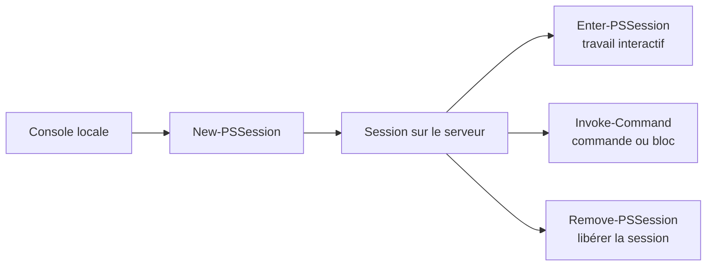

# Module 05 — Réalisation d’un script

## Objectifs

À l’issue du module, vous devez pouvoir préparer un script PowerShell, le tester progressivement, le commenter et organiser les commandes nécessaires à un scénario de laboratoire. Le module présente aussi les IDE, la gestion des erreurs, les fonctions et l’exécution de commandes à distance.

## Préparer un script

Avant d’écrire un script, les sources demandent de déterminer son utilité, de décrire le comportement attendu et de formaliser un algorithme. La mise au point se fait étape par étape : tester les lignes, vérifier le résultat, puis améliorer l’algorithme. Les commentaires servent à expliciter la mission d’un ensemble de commandes et les résultats attendus.

## Écrire dans un IDE

PowerShell ISE est présenté comme un environnement dédié au script PowerShell : zone de script, sortie de console et fenêtre de commandes. Les sources y associent personnalisation, complétion, coloration syntaxique et détection d’erreurs.

Visual Studio Code est présenté comme un environnement multiplateforme, extensible, avec console, thèmes, coloration et complétion. Les versions citées par les documents sont historiques : elles ne constituent pas une recommandation actuelle.

## Commenter et enchaîner

Les formes de commentaire attestées sont :

```powershell
# commentaire
commande # commentaire éventuel
<#
commentaire multiligne
#>
```

Le point-virgule permet d’enchaîner des commandes sur une ligne sans rendre la suivante dépendante du résultat de la précédente. Le caractère backtick permet de répartir une commande ou ses paramètres sur plusieurs lignes.

## Gérer les erreurs

Les erreurs du shell courant sont conservées dans `$Error` ; `$Error[0]` correspond à la dernière erreur indiquée par les sources. Pour une commande ciblée, `-ErrorVariable` permet de désigner une autre variable de consignation. Le comportement est géré par `-ErrorAction` pour une commande ou par `$ErrorActionPreference` pour l’environnement courant.

Les valeurs documentées sont `Continue`, `Ignore`, `Inquire`, `SilentlyContinue`, `Stop` et `Suspend`. `Suspend` est conservé comme valeur historique attestée par les sources, sans être présenté comme une recommandation universelle.

## Try, Catch et Finally

La structure documentée exécute un traitement, gère un échec et exécute une étape finale :

```powershell
Try {
    # traitement source
}
Catch {
    # traitement en cas d’erreur
}
Finally {
    # traitement final
}
```

Les documents montrent l’emploi de `-ErrorAction Stop` pour rendre le traitement `Catch` applicable, ainsi que des exemples de tests dans `ForEach`. Le module ne développe pas une hiérarchie générale d’exceptions.

## Réutiliser avec des fonctions

Une fonction évite de répéter des lignes de commandes et doit être déclarée avant son appel. Les sources montrent une déclaration `Function`, des paramètres avec `Param(...)`, un paramètre obligatoire `[Parameter(Mandatory=$True)]`, le type `[String]` et le retour d’une valeur dans un scénario donné.

```powershell
function Get-DateDuJour {
    Get-Date -Format 'yyyy-MM-dd'
}
Get-DateDuJour
```

## Exécuter à distance dans le scénario de laboratoire

Le remoting PowerShell s’appuie sur WS-Man et WinRM. Les sources attestent `Enable-PSRemoting`, `New-PSSession`, `Enter-PSSession`, `Exit-PSSession`, `Disconnect-PSSession`, `Connect-PSSession`, `Get-PSSession` et `Remove-PSSession`, ainsi que l’import de commandes depuis une session distante.

`Invoke-Command`, `-ComputerName`, `-ScriptBlock` et `$Using:Variable` sont utilisés pour demander l’exécution distante sans session interactive préalable, notamment sur plusieurs machines dans un contexte de laboratoire.

> **Précaution.** L’activation du remoting, l’exécution distante et le scénario d’action sur des postes ont un impact sur un environnement. Ils sont décrits ici uniquement comme manipulations de laboratoire source-faithful : ne les exécutez pas sur une machine réelle sans autorisation, contrôle et valeurs de laboratoire appropriées.

## Vérifier et retenir

- Décrire le comportement attendu avant d’écrire le script.
- Tester progressivement et commenter les intentions du script.
- Choisir le comportement d’erreur documenté pour le scénario.
- Déclarer une fonction avant de l’appeler et expliciter ses paramètres.
- Distinguer session distante, gestion de session et commande distante.

## Écrire, exécuter et contrôler par étapes

Le support part d’un algorithme du quotidien pour distinguer les entrées, les actions, les tests et la boucle. Pour le TP, l’entrée est le nom du service. Le résultat attendu est un objet service si ce nom existe et un message explicite si la recherche échoue. Tester une ligne, puis une fonction, avant de l’intégrer au script complet.

L’ISE du support réunit l’éditeur de script, la console de sortie et le panneau de commandes. Visual Studio Code présente l’éditeur, le terminal, l’explorateur, les extensions et leurs notifications. L’extension PowerShell permet la complétion et l’aide au débogage. Le choix de la console détermine la version du moteur qui exécute le script.

Le caractère `#` commente la fin de ligne et `<# ... #>` délimite un bloc de commentaire. Un commentaire utile précise le rôle d’une condition ou la raison d’un choix. Le caractère `;` sépare deux commandes. Un pipeline `|` transmet les objets. Avec PowerShell 7, `&&` et `||` enchaînent selon le succès ou l’échec de la commande précédente. [Opérateurs d’enchaînement PowerShell](https://learn.microsoft.com/en-us/powershell/module/microsoft.powershell.core/about/about_Pipeline_Chain_Operators).

Le support présente l’accent grave comme continuation de ligne. Un espace après cet accent peut rompre la continuation. Une table de paramètres facilite la lecture des commandes longues.

```powershell
$parametres = @{
    Name = 'Spooler'
    ErrorAction = 'Stop'
}
Get-Service @parametres
```

## Observer les erreurs selon leur effet

`$Error[0]` donne l’erreur la plus récente de la session. `-ErrorVariable erreurs` collecte les erreurs de la commande dans une variable de ce nom. Le paramètre reçoit le nom `erreurs` et `$erreurs` désigne son contenu après l’appel. `$ErrorActionPreference` règle le comportement par défaut dans la portée concernée.

| Valeur du support | Effet à observer |
| --- | --- |
| `Continue` | Affiche l’erreur non bloquante et poursuit le traitement possible |
| `SilentlyContinue` | Poursuit sans afficher cette erreur, qui peut rester dans `$Error` |
| `Ignore` | Ignore cette erreur non bloquante sans l’ajouter à `$Error` |
| `Inquire` | Demande une décision sur la poursuite |
| `Stop` | Transforme une erreur non bloquante de la commande en erreur interceptable |
| `Suspend` | Cas historique des workflows présenté par la table du support |

Une erreur non bloquante ne déclenche pas systématiquement `catch`. `-ErrorAction Stop` convient lorsque l’échec doit passer dans `catch`. `finally` exécute le nettoyage ou le message de fin lors de la sortie de ce bloc. [Gestion des erreurs PowerShell](https://learn.microsoft.com/powershell/module/microsoft.powershell.core/about/about_error_handling).

```powershell
function Find-LabService {
    param(
        [Parameter(Mandatory)]
        [ValidateNotNullOrEmpty()]
        [string]$Name
    )
    try {
        Get-Service -Name $Name -ErrorAction Stop -ErrorVariable erreurs
    } catch {
        Write-Warning "Recherche de $Name impossible. $($_.Exception.Message)"
    } finally {
        Write-Verbose 'Fin de la recherche'
    }
}
Find-LabService -Name Spooler
```

Une fonction définit des paramètres pour éviter de dupliquer la logique. Déclarez-la avant l’appel. Les objets produits peuvent être repris dans une autre commande. `Write-Host` affiche un message à l’utilisateur. L’exemple de la démonstration `FindUsers` cherche un objet puis produit un message si la recherche ne renvoie rien. Vérifier le type de retour avant de l’utiliser dans un pipeline.

## Distinguer une session et une commande distante



*Schéma pédagogique externe au cours.*

Dans la maquette Windows, `Enable-PSRemoting` prépare la réception des connexions WinRM, ce qui configure des services et règles du poste cible. `Enter-PSSession` ouvre une session interactive. `Exit-PSSession` en sort. Une session créée dans une variable peut rester ouverte et servir à plusieurs `Invoke-Command`. L’exemple du support déconnecte puis reconnecte une session WinRM et montre l’import d’un module distant dans la console locale. Les prérequis dépendent du transport et de l’hôte. [Prérequis Microsoft du remoting](https://learn.microsoft.com/en-us/powershell/module/microsoft.powershell.core/about/about_remote_requirements?view=powershell-7.6).

```powershell
$serveur = Read-Host 'Nom du serveur de laboratoire'
$session = New-PSSession -ComputerName $serveur
Invoke-Command -Session $session -ScriptBlock { Get-Service -Name Spooler }
Remove-PSSession -Session $session
```

Le bloc distant s’exécute dans son propre contexte. Passez les valeurs avec `param()` et `-ArgumentList`, ou avec `$using:variable`. `Invoke-Command -ComputerName` accepte plusieurs cibles. Les objets retournés peuvent être désérialisés. L’accès à une troisième machine depuis la session distante représente le second saut, dont les droits dépendent de la méthode d’authentification configurée.

Le TP demande d’identifier les ordinateurs AD avant une opération d’arrêt. Le code source filtre un chemin d’annuaire. Pour vérifier le résultat, dresser d’abord la liste des cibles, vérifier séparément les contrôleurs de domaine et limiter le test aux machines de la maquette prévues à cet effet.

## TP guidé

### Tester les services et garder les erreurs pour le bilan

Dans l’éditeur du TP, tester un service connu puis un nom inexistant. Capturer les erreurs de la commande sans affichage immédiat et afficher un bilan unique après la boucle. Réunir ensuite cette logique dans une fonction qui reçoit les noms.

```powershell
function Test-LabService {
    param([Parameter(Mandatory)][string[]]$Name)
    $erreurs = @()
    $resultats = foreach ($nom in $Name) {
        $service = Get-Service -Name $nom -ErrorAction SilentlyContinue -ErrorVariable +erreurs
        [pscustomobject]@{
            Nom = $nom
            Etat = if ($service) { $service.Status } else { 'Non obtenu' }
        }
    }
    [pscustomobject]@{
        Resultats = @($resultats)
        Erreurs = @($erreurs)
    }
}
$bilan = Test-LabService -Name 'Spooler', 'ServiceInexistantTP'
Write-Host 'Vérification des services terminée.'
$bilan.Resultats
$bilan.Erreurs | Select-Object FullyQualifiedErrorId,CategoryInfo
```

Un résultat « Non obtenu » doit être interprété avec l’erreur conservée. Une commande peut échouer pour une autre raison qu’un service absent. Le préfixe `+` dans `-ErrorVariable +erreurs` ajoute les erreurs des appels successifs dans la même variable.

### Créer, contrôler et libérer une session

Créer une session vers CD01 dans la maquette, la conserver dans une variable et relever son état. Comparer la sortie d’un test local et distant. Libérer la session même si la commande du test échoue.

```powershell
$session = New-PSSession -ComputerName CD01 -ErrorAction Stop
try {
    $session | Select-Object ComputerName,State,Availability
    Invoke-Command -Session $session -ScriptBlock { hostname } -ErrorAction Stop
} finally {
    Remove-PSSession -Session $session
}
```

### Préparer les cibles AD et contrôler le profil de l’éditeur

1. Transformer la recherche des ordinateurs en fonction avec un paramètre de domaine. Définir aussi l’OU autorisée. Établir dans ce même domaine la liste des contrôleurs avec `Get-ADDomainController`. Si cette interrogation échoue, interrompre la préparation.
2. Comparer les noms DNS, exclure les contrôleurs et les objets sans nom DNS, puis confronter la sélection à la liste de machines autorisées. Vérifier les noms courts et les FQDN avant une simulation `Stop-Computer -WhatIf` sur la liste approuvée. Le filtre illustré dans le corrigé s’appuie sur l’organisation d’une maquette. Une OU seule ne prouve pas qu’un ordinateur peut être arrêté.
3. Ouvrir le profil de l’hôte ISE ou de la console concernée après l’avoir sauvegardé. Tester une erreur non bloquante connue avec `$ErrorActionPreference = 'SilentlyContinue'`, puis constater qu’elle reste consultable dans `$Error`. Pour un exercice ciblé, préférer le réglage de la seule commande. Restaurer le profil et vérifier l’effet à la réouverture.

[Paramètres communs et collecte d’erreurs](https://learn.microsoft.com/powershell/module/microsoft.powershell.core/about/about_commonparameters) · [Référence de Get-ADDomainController](https://learn.microsoft.com/powershell/module/activedirectory/get-addomaincontroller)

## À retenir

Une fonction reçoit ses entrées, produit un résultat exploitable et permet de distinguer un échec d’une sortie vide. Une session distante se vérifie et se ferme. La sélection AD et la liste de cibles autorisées précèdent toute simulation d’arrêt.

## Mini-quiz

1. Quel paramètre permet à `catch` d’intercepter une erreur non bloquante ?
2. Où retrouver la dernière erreur de la session ?
3. Quelle commande termine une session ouverte par `New-PSSession` ?
4. Quelle différence entre `;` et `|` ?
5. Comment prouver qu’une erreur masquée reste consultable ?

??? success "Réponses commentées"
    1. `-ErrorAction Stop` sur la commande concernée.
    2. `$Error[0]`.
    3. `Remove-PSSession`.
    4. Le premier sépare des commandes. Le second transmet des objets.
    5. Provoquer une erreur non bloquante connue dans la maquette puis lire l’enregistrement capturé par `-ErrorVariable` ou `$Error[0]`.

## Travaux pratiques et révision

- [TP et correction du module](../../tp/12-initiation-powershell/module-05/index.md)
- [Fiche de révision](../../revision/12-initiation-powershell/module-05.md)
- [Sommaire du cours](index.md)
