# Module 05 — Réalisation d’un script

[Travaux pratiques](../../tp/12-initiation-powershell/module-05/index.md)

Les parties ci-dessous reprennent le cours original, dans le même ordre. Les encadrés et les schémas répètent ses formulations.

## Parcours de lecture

1. Support · Module 05 - Support de cours · 18 pages transcrites

**Visuel externe**


SOURCE DRIVE · TRANSCRIPTION DU SUPPORT

Le contenu des documents du dossier TSSR est transcrit ci-dessous, page par page. Les textes et tableaux sont intégrés à la page Web. Aucun fichier PDF, aucune diapositive entière ni aucune reproduction de page n’est affiché. Seuls des croquis ou visuels isolés et vérifiés peuvent accompagner la transcription. Les versions et les consignes restent celles des supports de formation. Les compléments IA sont conservés dans leur onglet distinct.

## Support · Module 05 - Support de cours · 18 pages transcrites

!!! note "À retenir"
    Les formulations historiques et les exemples du document sont conservés.

Transcription du support du Drive. Les formulations historiques et les exemples du document sont conservés. Les valeurs d’accès du laboratoire sont indiquées comme « fourni par le formateur ». Les adresses de messagerie personnelles utilisent example.com.

### Initiation à PowerShell

Module 05 – Réalisation d’un script

### Objectifs

- Mettre en place un script fonctionnel

### Comment structurer un script

!!! note "À retenir"
    Avant d’entreprendre la rédaction d’un script, il est nécessaire de : Déterminer son utilité Décrire le mode de fonctionnement attendu Formaliser un algorithme de son fonctionnement L’algorithmique est la clé de voûte du Scripting.

**Visuel externe**

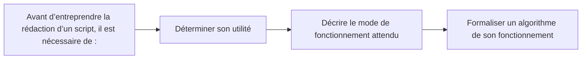

- Avant d’entreprendre la rédaction d’un script, il est nécessaire de :
- Déterminer son utilité
- Décrire le mode de fonctionnement attendu
- Formaliser un algorithme de son fonctionnement
- L’algorithmique est la clé de voûte du Scripting. La diapositive suivante illustre l’approche algorithmique de la préparation des pâtes.

### Comment structurer un script

#### Algorithme 1 — préparation des pâtes

!!! note "À retenir"
    Remplir une casserole d’eau La mettre sur le feu Mettre les pâtes dans la casserole Les laisser cuire 10 à 15 minutes Les égoutter L’eau ne bout pas, le temps de cuisson est faux !

**Visuel externe**

```mermaid
flowchart LR
    N1["Remplir une casserole d’eau"]
    N2["La mettre sur le feu"]
    N3["Mettre les pâtes dans la casserole"]
    N4["Les laisser cuire 10 à 15 minutes"]
    N5["Les égoutter"]
    N6["L’eau ne bout pas, le temps de cuisson est faux !"]
    N7["Elles risquent d’être fades…"]
    N8["Durée exacte en fonction du type de pâtes ?"]
    N1 --> N2
    N2 --> N3
    N3 --> N4
    N4 --> N5
    N5 --> N6
    N6 --> N7
    N7 --> N8
```

1. Remplir une casserole d’eau
2. La mettre sur le feu
3. Mettre les pâtes dans la casserole
4. Les laisser cuire 10 à 15 minutes
5. Les égoutter

- L’eau ne bout pas, le temps de cuisson est faux !
- Elles risquent d’être fades…
- Durée exacte en fonction du type de pâtes ?

#### Proposition de préparation des pâtes

!!! note "À retenir"
    Remplir une casserole d’eau Mettre du sel La mettre sur le feu Laisser bouillir Mettre les pâtes dans la casserole En fonction du type de pâtes, définir la durée de la cuisson Les égoutter

**Visuel externe**

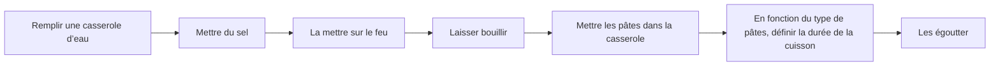

1. Remplir une casserole d’eau
2. Mettre du sel
3. La mettre sur le feu
4. Laisser bouillir
5. Mettre les pâtes dans la casserole
6. En fonction du type de pâtes, définir la durée de la cuisson
7. Les égoutter

### Comment structurer un script

!!! note "À retenir"
    Il est très rare de réaliser dès le premier essai et la première réflexion le script parfait (surtout sur des scripts un peu avancés…).

- Il est très rare de réaliser dès le premier essai et la première réflexion le script parfait (surtout sur des scripts un peu avancés…).
- C’est la phase de tests qui nous permettra d’avancer dans notre réflexion et d’améliorer l’algorithme initial.
- Il faut donc y aller étape par étape et tester ligne par ligne notre script.
- Et surtout, commentez votre script !

### Comment structurer un script

!!! note "À retenir"
    Il est généralement pertinent d’écrire sur papier la structure de notre script : Actions à réaliser Tests à effectuer Vérifications Boucles Le tout dans une logique chronologique Préparer son script avant de l’écrire, c’est tout sauf une perte de temps !

**Visuel externe**

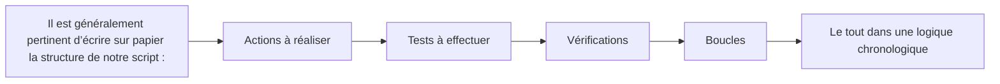

- Il est généralement pertinent d’écrire sur papier la structure de notre script :
- Actions à réaliser
- Tests à effectuer
- Vérifications
- Boucles
- Le tout dans une logique chronologique

Préparer son script avant de l’écrire, c’est tout sauf une perte de temps !

### Comment structurer un script : le départ

!!! note "À retenir"
    La réalisation d’un script peut se faire à l’aide d’un IDE compatible avec PowerShell.

- La réalisation d’un script peut se faire à l’aide d’un IDE compatible avec PowerShell.
- Un IDE est un logiciel dédié à l’écriture de code informatique en y ajoutant des fonctions de correction ou de vérification du code.
- ISE est un logiciel qui propose un environnement d’écriture des commandes PowerShell, et également une console permettant de tester le script en temps réel.

### PowerShell ISE

!!! note "À retenir"
    ISE : Integrated Scripting Environment C’est une application adaptée pour travailler avec PowerShell Présent par défaut depuis PowerShell version 3 Présente de nombreuses fonctionnalités orientées Scripting Capture du support « Module 05 - Support de cours »

ISE : Integrated Scripting Environment

- C’est une application adaptée pour travailler avec PowerShell
- Présent par défaut depuis PowerShell version 3
- Présente de nombreuses fonctionnalités orientées Scripting

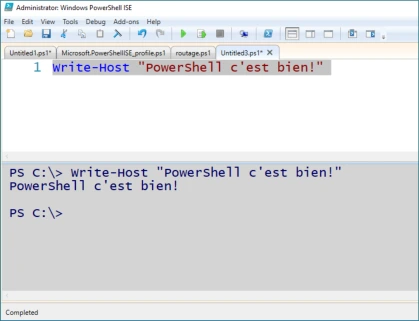

Capture du support « Module 05 - Support de cours »

### PowerShell ISE : fonctionnalités

IntelliSense : complétion graphique Permet de rechercher et utiliser des paramètres plus rapidement

Coloration syntaxique

Snippets : syntaxe des structures de scripting

Détection des erreurs en temps réel

### Démonstration

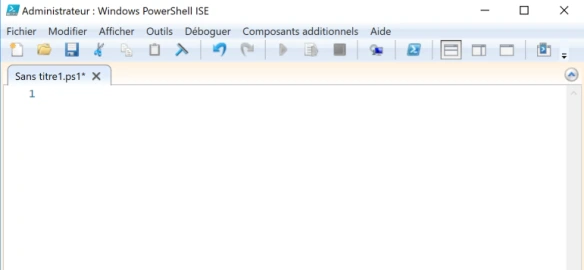

Capture du support « Module 05 - Support de cours »

### Visual Studio Code (VS Code)

- Windows PowerShell ISE n'est disponible que sur les systèmes Windows.
- VS Code : interface de développement open source
- Disponible notamment pour Linux, MacOS et Windows
- Légère et fluide
- Multilingue (Shell, Python, Perl…)
- Possibilité d'ajout d'extensions (nouveaux langages, fonctionnalités, GitHub…)
- Débogueur
- Outil de recherche
- …

### Virtual Studio Code (VSCode)

1

3

3 – Extension PowerShell

1 – Environnement de travail

4 – Navigation

2

2 – Console interactive

5 – Infos et notifications

4

5

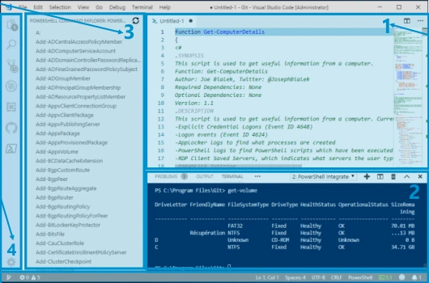

Capture du support « Module 05 - Support de cours »

### Démonstration

### Les commentaires

1 – Commentaire simple

3 – Commentaire après une commande

5 – 7 Il est possible de commenter une

structure ou un ensemble de lignes

en utilisant les chevrons et le dièze.

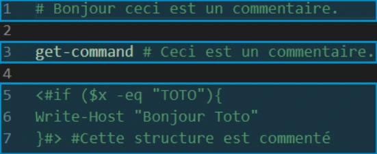

Capture du support « Module 05 - Support de cours »

### Les enchaînements de commande

Lors de la réalisation d’un script, il est utile de pouvoir enchaîner plusieurs commandes sur une seule ligne du script.

- À la différence du Pipe, chaque commande ne sera pas dépendante du résultat de la commande précédente.
- On utilise le caractère ; pour exécuter deux commandes sur une ligne de script.
- Il est également possible de répartir les paramètres d’une commande sur plusieurs lignes.

Le « Backtick » ou « Anti-Quotte »

s’obtient avec « Alt Gr », « 7 »

puis « espace ».

### Démonstration

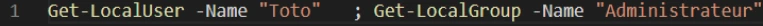

Capture du support « Module 05 - Support de cours »

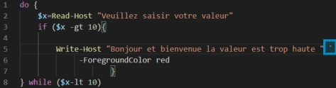

Capture du support « Module 05 - Support de cours »

### La gestion des erreurs

- Toutes les erreurs générées dans le Shell courant sont stockées dans la variable de type tableau $Error.
- Pour obtenir la dernière erreur survenue $Error[0].

Il est possible pour une commande ciblée, à son lancement, de redéfinir le nom de la variable qui consignera ses erreurs

```
PS > Get-ChildItem C:\Dossier –ErrorVariable Erreurs
```

### La gestion des erreurs

- Quand une erreur survient lors de l’exécution d’une commande, deux comportements sont possibles :
- La commande s’interrompt (erreur bloquante)
- L’erreur est remontée au Shell mais la commande poursuit son exécution (erreur non bloquante)
- Le comportement du Shell en cas d’erreurs non bloquantes peut être géré :
- Pour la commande, via le paramètre –ErrorAction
- Pour l’environnement d’exécution courant, via la variable $ErrorActionPreference

### La gestion des erreurs

```
Valeurs pouvant être affectées à la variable $ErrorActionPreference
et au paramètre –ErrorAction
```

Valeur Comportement résultant

Continue Affiche l’erreur mais continue (niveau par défaut)

Ignore Ignore l’erreur (celle-ci n’est pas stockée dans la variable d’erreur)

Inquire Interaction avec l’utilisateur pour savoir l’action a réaliser

SilentlyContinue Ignore l’erreur mais la consigne dans la variable d’erreur

Stop Arrêt de la commande

Suspend Suspend le workflow en cours

### La gestion des erreurs : Try Catch (Finally…)

Couramment appelée Try Catch, la structure Try Catch Finally permet de gérer efficacement les erreurs.

- Si le dossier existe, son contenu sera affiché.
- Si le dossier n’existe pas, le message contenu dans la commande catch s’affichera.
- Dans tous les cas, le message contenu dans la commande finally s’affichera.

L’avantage est qu’en cas de dossier non présent, le script continue son exécution sans arrêter la totalité du script.

| Valeur | Comportement résultant |
| --- | --- |
| Continue | Affichel’erreurmaiscontinue(niveaupardéfaut) |
| Ignore | Ignore l’erreur (celle-ci n’est pas stockée dans la variable d’erreur) |
| Inquire | Interactionavecl’utilisateurpoursavoirl’actionaréaliser |
| SilentlyContinue | Ignorel’erreurmaislaconsignedanslavariabled’erreur |
| Stop | Arrêtdelacommande |
| Suspend | Suspendleworkflowencours |

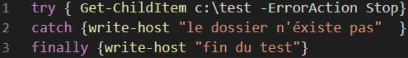

Capture du support « Module 05 - Support de cours »

### Démonstration

### Les fonctions : présentation

- Les fonctions sont des structures très utiles à la réalisation de scripts.
- Elles permettent :
- D’éviter la réécriture de code
- D’alléger et de clarifier la lecture du code
- De simplifier la maintenance
- Créer une fonction revient à créer une nouvelle commande.

### Les fonctions : utilisation

- Une fonction doit être déclarée avant de pouvoir être appelée.
- La déclaration de fonctions est généralement faite en début de script.

Donner des noms explicites à vos fonctions !

```
PS > Function NomDeLaFonction {
    Code à intégrer dans la fonction
}
```

Une fonction est appelée comme une commande.

```
PS > NomDeLaFonction
```

### Les fonctions : les paramètres

- Les fonctions acceptent des paramètres comme n’importe quelle commande.
- Les paramètres de fonction sont à déclarer en même temps que la fonction.

1. Déclaration de la fonction « Adition »
2. Déclaration des paramètres dans la fonction
3. Commande exécutée par la fonction
4. Valeur renvoyée par la fonction
5. Appel de la fonction avec les paramètres à utiliser. Ici 1 est la valeur de $a et 2 et la valeur de $b. La valeur de $c va être renvoyée par la fonction.

```
function adition {
    param ($a,$b)
    $c = $a + $b
    return $c
}
adition 1 2
```

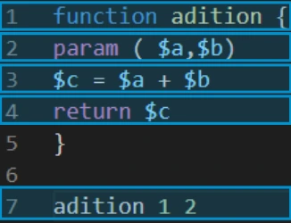

Capture du support « Module 05 - Support de cours »

### Les fonctions : les paramètres avancés

```
Param(
```

Option permettant de rendre

le paramètre obligatoire

```
[Parameter(Mandatory=$True)]
[String]$Monparametre
)
```

Nom du paramètre

Le paramètre utilisera uniquement des chaînes

de caractères

```
PS > ./Monscript.ps1 –Monparametre toto
PS > Ma-Fonction –Monparametre toto
```

### Démonstration

### Le Remoting

- La fonctionnalité PowerShell Remoting permet :
- D’accéder au Shell d’une machine distante
- D’exécuter des commandes sur des machines distantes
- Elle s’appuie sur le protocole WS-MAN pour son fonctionnement.
- Le service WinRM est utilisé.

### Le Remoting

- Pour pouvoir utiliser le Remoting PowerShell, cette fonctionnalité doit être active sur la machine cible (la machine distante)
- C’est le cas (par défaut) sur les OS Serveurs depuis Windows 2012
- Cette fonctionnalité est désactivée (par défaut) sur les postes clients
- La fonctionnalité Remoting est activable
- Au moyen de la commande Enable-PSRemoting
- Par stratégie de groupe

### Démonstration

### PSSession : ouverture de session à distance

- Il est possible d’ouvrir un Shell à distance (similaire à SSH).

```
PS > Enter-PSSession -Computername DC01
PS [DC01] >
```

- Le prompt change, on peut y voir le nom du serveur distant.
- Pour sortir de la session :

```
PS > Exit-PSSession
```

À l’issue de la commande de sortie, la session existe toujours.

### PSSession

- On peut stocker une PSSession dans une variable, afin de la rappeler plus facilement par la suite.
- Une PSSession peut être persistante.

```
PS > $Session = New-PSSession -Computername DC01
PS > Disconnect-PSSession -Session $Session
PS > Get-PSSession -Computername DC01
PS > Get-PSSession -Computername DC01 | Connect-PSSession
PS > $Session
PS > Get-PSSession | Remove-PSSession
```

### MultiHop

Il n’est, par défaut, pas possible d’utiliser une machine pour faire un « rebond » sur une autre avec les PSSessions.

1 2

### PSSession et import de modules

On peut importer des modules d’une session distante pour utiliser ses commandes dans la session locale. Cela permet de limiter l’installation de modules sur le parc.

```
PS > $Session = Enter-PSSession -Computername DC01
PS > Get-Module -PSSession $Session -ListAvailable
PS > Import-Module -PSSession $Session –name ActiveDirectory –Prefix DC
PS > Help Get-DCADUser
PS > Get-DCADUser –Filter *
```

### Invoke-Command

- Commande permettant de demander l’exécution d’une commande à plusieurs machines en même temps :

```
PS > Invoke-Command -Computername DC01,SRV01 –ScriptBlock {
Get-Process PowerShell* }
```

- On peut également passer des variables locales dans une session à distance en utilisant le $Using:Variable

```
$Process = ‘’Powershell*’’
PS > Invoke-Command -Computername DC01,SRV01 –ScriptBlock {
Get-Process $Using:Process}
```

### Démonstration

### Conclusion

- Vous savez mettre en place un script fonctionnel

Référence du document : 1I7waDlSR3_PhRJI-V3XHSUwiioEUt0XU · SHA-256 031f076741f7955e…

| Support · Module 05 - Support de cours · 18 pages transcrites | Les formulations historiques et les exemples du document sont conservés. |
