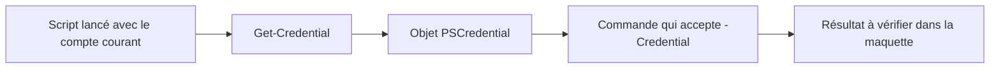

# Module 06 — S’authentifier et écrire des scripts de laboratoire

## Objectifs

- Utiliser un objet d’authentification sans écrire le secret dans le script ou le compte rendu.
- Commenter un script AD et distinguer les erreurs de syntaxe, de commande et de configuration DNS.
- Concevoir puis vérifier le script réseau ou le menu AD demandé par le TP.

Le support montre comment demander une identité pour une action précise depuis un script lancé avec un compte courant. Le TP met ensuite en pratique la lecture d’un script Active Directory, la correction d’un script DNS et l’écriture d’un script au choix.

## Demander une identité avec `Get-Credential`

```powershell
$cred = Get-Credential
$cred.GetType().FullName
$cred.UserName
```

`Get-Credential` renvoie un objet `PSCredential` contenant le nom d’utilisateur et un mot de passe de type `SecureString`. L’affichage du champ est masqué. Utilisez l’objet en argument d’une commande qui accepte `-Credential`. Le processus conserve son identité courante.

```powershell
$compte = Read-Host 'Compte autorisé dans la maquette'
$cred = Get-Credential -UserName $compte -Message 'Authentification du laboratoire'
$serveur = Read-Host 'Serveur de laboratoire'
Invoke-Command -ComputerName $serveur -Credential $cred -ScriptBlock { hostname }
```



*Schéma pédagogique externe au cours.*

Le nom prérempli et le message personnalisent la demande. La protection du secret dépend aussi du traitement qui suit. Pour le compte rendu, conserver l’action, la cible et le résultat. La valeur d’accès est fournie par le formateur et reste distincte du script publié.

## Lire l’archive du TP par activité

| Activité | Ressource fournie | Travail attendu |
| --- | --- | --- |
| 1. Lire et commenter | Script de consigne Active Directory et version commentée de correction | Repérer les OU, groupes, modèles, comptes, rattachements et droits. Expliquer ce que chaque bloc modifie. |
| 2. Corriger les bugs | Script DNS de consigne et correction DNS | Comparer les noms de commandes, paramètres, zones et enregistrements. Distinguer syntaxe PowerShell et disponibilité réelle des commandes. |
| 3. Écrire | Énoncé PDF et énoncé révisé Word | Choisir la configuration réseau ou un menu de gestion d’utilisateurs AD, puis décrire les entrées, actions et contrôles. |

Les quatre scripts et l’énoncé Word de TP6.7z sont consultables dans **Cours Original**. Les versions sont conservées séparément. La correction Active Directory ajoute un partage SMB et des ACL NTFS. C’est une extension du script fourni. La correction DNS crée une zone primaire et prépare des enregistrements pour des serveurs secondaires. La création effective d’une zone secondaire demande une commande distincte et une source de transfert autorisée. [Gestion Microsoft des zones DNS](https://learn.microsoft.com/windows-server/networking/dns/manage-dns-zones).

## Décrire le déroulement avant de modifier une machine

Dans le script AD, commencer par identifier la base LDAP et les OU. Relever ensuite les modèles et comptes créés, les groupes et leurs portées, les propriétés et les rattachements. Après lecture, expliquer quelle étape suppose que la précédente ait réussi.

Dans le script DNS, suivre l’ordre du rôle, de l’interface, des redirecteurs, de la zone directe et de la zone inverse. Un enregistrement `A` associe un nom à une adresse IPv4. Un `PTR` associe une adresse inverse à un nom. Un `NS` désigne un serveur de noms. Les enregistrements de délégation et l’autorisation de transfert répondent à des fonctions différentes.

Un parseur peut accepter une ligne contenant un nom de commande inconnu. Le diagnostic complet compare l’AST, l’aide du module, les paramètres, les droits, la cible et le résultat. Par exemple, `Reboot-Computer` peut être lu comme une commande sans erreur de grammaire, alors que le corrigé emploie `Restart-Computer`.

## TP guidé

### 1. Commenter le script AD fourni

Partir de la transcription de consigne liée dans l’énoncé et relever ce que lit, crée ou modifie chaque bloc. Suivre l’ordre des OU, des modèles, des comptes, des groupes et de leurs appartenances. Distinguer le lien d’un compte avec un groupe de l’attribution d’un droit à ce groupe. Pour les blocs de droits, identifier la ressource, le groupe et le niveau d’accès. La partie SMB et NTFS appartient à l’extension du corrigé.

| Bloc | Ce qu’il faut expliquer | Contrôle de lecture proposé |
| --- | --- | --- |
| OU et modèles | Base de recherche, objets parents et dépendances | Lire les OU et leurs noms distinctifs avec `Get-ADOrganizationalUnit` |
| Utilisateurs et activation | Données sources, compte visé et propriétés modifiées | Relire la fiche d’un compte d’essai avec `Get-ADUser` |
| Groupes et rattachements | Portée du groupe, membres et groupes imbriqués | Comparer `Get-ADGroup` et `Get-ADGroupMember` à la matrice attendue |
| Partage et permissions | Différence entre droits du partage et droits sur les fichiers | Relever les droits effectifs d’un compte de test selon les consignes |

### 2. Corriger puis vérifier le scénario DNS

Analyser syntaxiquement une copie de travail du script. Le parseur lit le fichier et produit les erreurs de grammaire sans lancer les commandes.

```powershell
$chemin = Read-Host 'Chemin de la copie locale du script DNS'
$jetons = $null
$erreurs = $null
$null = [System.Management.Automation.Language.Parser]::ParseFile(
    $chemin, [ref]$jetons, [ref]$erreurs
)
$erreurs | Select-Object ErrorId,Message,@{Name='Ligne'; Expression={$_.Extent.StartLineNumber}}
```

1. Corriger d’abord les erreurs signalées. Vérifier ensuite les noms de commandes et leurs paramètres avec `Get-Command` et `Get-Help` dans la version prévue. `Reboot-Computer` est un nom syntaxiquement lisible. Le corrigé utilise `Restart-Computer`.
2. Relire les dépendances dans l’ordre. Le rôle DNS doit précéder les commandes de zone. Vérifier le DNS client, les redirecteurs, la zone directe, les enregistrements, puis la zone inverse. Identifier les adresses et noms propres à la maquette avant chaque changement.
3. Comparer les deux serveurs. Sur la source, préparer la zone primaire et autoriser le transfert selon la consigne. Sur le serveur cible, la création de la secondaire est une opération distincte, par exemple avec `Add-DnsServerSecondaryZone`, `-MasterServers` et `-ZoneFile`. Le corrigé fourni n’effectue pas cette création.
4. Vérifier la présence et le type de zone sur chaque serveur avec `Get-DnsServerZone`. Interroger les enregistrements A, PTR et SOA sur les serveurs concernés. Un enregistrement NS seul ne suffit pas comme preuve d’un transfert. Relever la source du transfert et comparer les données reçues après le changement autorisé. [Gestion Microsoft des zones DNS](https://learn.microsoft.com/windows-server/networking/dns/manage-dns-zones)

### 3. Écrire le script choisi et établir le bilan

| Variante | Entrées et déroulement | Résultats à tester |
| --- | --- | --- |
| Configuration réseau | Prendre l’interface, l’adresse, le préfixe, la passerelle et les DNS. Lire d’abord l’état existant, valider les valeurs, présenter le changement, puis appliquer seulement sur la machine du TP. | Bonne interface, valeurs avant/après, route, résolution et cas de saisie invalide |
| Menu d’utilisateurs AD | Définir une OU explicite. Valider le choix, lire le compte ciblé et vérifier la présence ou le doublon. Utiliser le mode de simulation quand l’action le permet. | Création simulée dans l’OU attendue, compte existant, action inconnue, refus hors périmètre et sortie du menu |

Présenter les deux scripts sources avec leurs versions exactes, le tableau des écarts trouvés, les actions et preuves de la variante choisie. L’exemple de menu dans la correction est une solution proposée. Les valeurs d’accès restent fournies dans l’environnement de formation.

## À retenir

Distinguer l’identité de la console et l’objet utilisé pour une commande compatible. Diagnostiquer séparément la grammaire du script, les commandes disponibles et le résultat dans le laboratoire. Pour DNS, prouver la zone secondaire avec sa configuration et le transfert de ses données.

## Mini-quiz

1. Quel type renvoie `Get-Credential` ?
2. Stocker `$cred` change-t-il l’identité de la console ?
3. Pourquoi une commande DNS mal orthographiée peut-elle passer l’analyse syntaxique ?
4. Quelle différence entre un enregistrement NS et une zone secondaire ?
5. Quels contrôles effectuer après un résultat vide du parseur ?

??? success "Réponses commentées"
    1. `System.Management.Automation.PSCredential`.
    2. La console conserve son identité. Une commande compatible peut utiliser cet objet pour s’authentifier.
    3. La syntaxe autorise l’appel d’un nom de commande. La résolution de ce nom intervient ensuite.
    4. NS désigne un serveur de noms. Une zone secondaire est une copie reçue par transfert depuis une source autorisée.
    5. Vérifier que chaque commande et paramètre existent dans la version cible, puis contrôler les droits, la machine et l’état obtenu dans la maquette.

## Travaux pratiques et révision

- [TP et correction du module](../../tp/12-initiation-powershell/module-06/index.md)
- [Fiche de révision](../../revision/12-initiation-powershell/module-06.md)
- [Sommaire du cours](index.md)
