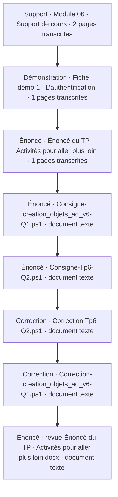
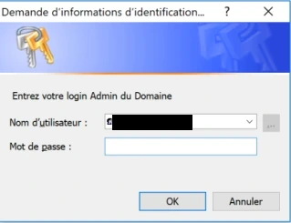
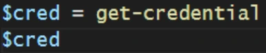

# Module 06 — S’authentifier et écrire des scripts de laboratoire

Les parties ci-dessous reprennent le cours original, dans le même ordre. Les encadrés et les schémas répètent ses formulations.

## Parcours de lecture

1. Support · Module 06 - Support de cours · 2 pages transcrites
2. Démonstration · Fiche démo 1 - L’authentification · 1 pages transcrites
3. Énoncé · Énoncé du TP - Activités pour aller plus loin · 1 pages transcrites
4. Énoncé · Consigne-creation_objets_ad_v6-Q1.ps1 · document texte
5. Énoncé · Consigne-Tp6-Q2.ps1 · document texte
6. Correction · Correction Tp6-Q2.ps1 · document texte
7. Correction · Correction-creation_objets_ad_v6-Q1.ps1 · document texte
8. Énoncé · revue-Énoncé du TP - Activités pour aller plus loin.docx · document texte

**Visuel externe**



SOURCE DRIVE · TRANSCRIPTION DU SUPPORT

Le contenu des documents du dossier TSSR est transcrit ci-dessous, page par page. Les textes et tableaux sont intégrés à la page Web. Aucun fichier PDF, aucune diapositive entière ni aucune reproduction de page n’est affiché. Seuls des croquis ou visuels isolés et vérifiés peuvent accompagner la transcription. Les versions et les consignes restent celles des supports de formation. Les compléments IA sont conservés dans leur onglet distinct.

## Support · Module 06 - Support de cours · 2 pages transcrites

!!! note "À retenir"
    Les formulations historiques et les exemples du document sont conservés.

Transcription du support du Drive. Les formulations historiques et les exemples du document sont conservés. Les valeurs d’accès du laboratoire sont indiquées comme « fourni par le formateur ». Les adresses de messagerie personnelles utilisent example.com.

### Initiation à PowerShell

Module 06 – Pour aller plus loin

### S’authentifier avec PowerShell

!!! note "À retenir"
    Pour des raisons de sécurité, nous travaillerons avec des comptes possédant des privilèges réduits.

- Pour des raisons de sécurité, nous travaillerons avec des comptes possédant des privilèges réduits.
- Cela peut être problématique pour la réalisation de certaines actions.
- Afin de contourner cette problématique, il est possible de lancer le script avec un compte utilisateur, puis demander une authentification à son lancement.

### S’authentifier avec PowerShell

!!! note "À retenir"
    Les logins et mots de passe renseignés sont stockés dans la variable et réutilisables dans le script.

- Une commande est dédiée à cet usage.

```
PS > $Cred = Get-Credential
```

- Les logins et mots de passe renseignés sont stockés dans la variable et réutilisables dans le script.

### S’authentifier avec PowerShell

!!! note "À retenir"
    Capture du support « Module 06 - Support de cours » Capture du support « Module 06 - Support de cours » Référence du document : 1G13m58rOo6jBKcQFzsctXG2Pj1XfKmaS · SHA-256 135ae8437059066d…

On peut personnaliser la fenêtre.

```
PS > $Cred = Get-Credential -Message "Entrez votre
login Admin du Domaine" -UserName lab\Administrator
```


Capture du support « Module 06 - Support de cours »



Capture du support « Module 06 - Support de cours »

Référence du document : 1G13m58rOo6jBKcQFzsctXG2Pj1XfKmaS · SHA-256 135ae8437059066d…

## Démonstration · Fiche démo 1 - L’authentification · 1 pages transcrites

!!! note "À retenir"
    Les formulations historiques et les exemples du document sont conservés.

Transcription du support du Drive. Les formulations historiques et les exemples du document sont conservés. Les valeurs d’accès du laboratoire sont indiquées comme « fourni par le formateur ». Les adresses de messagerie personnelles utilisent example.com.

### L’authentification

!!! note "À retenir"
    Démonstration 01 du module 6 La gestion des droits est essentielle dans la gestion des scripts.

Démonstration 01 du module 6

La gestion des droits est essentielle dans la gestion des scripts. PowerShell autorise la gestion des droits avec la commande Get-Credentials. Cette commande masque le champ mot de passe pour éviter de transmettre des mots de passe en clair dans le script.

### Déroulement

!!! note "À retenir"
    Cette commande va afficher un pop-up à l’écran pour capturer les credential utilisateur.

- Cette commande va afficher un pop-up à l’écran pour capturer les credential utilisateur.
- Ces credential sont ensuite traités par le script ou la commande puis disparaissent à la fin de la commande ou du script.

A l’exécution de la commande, l’utilisateur est invité à saisir son nom d’utilisateur ainsi que son mot de passe qui est masqué.

Si on affiche la variable contenant les credentials, on ne voit pas les credential mais le type de variable.

Pour personnaliser le message, on utilise le paramètre Message suivi de la chaîne de caractères souhaitée.



Capture du support « Fiche démo 1 - L’authentification »


Capture du support « Fiche démo 1 - L’authentification »


Capture du support « Fiche démo 1 - L’authentification »


Capture du support « Fiche démo 1 - L’authentification »

Référence du document : 1kOpSxGLzrh9-b7m5MxFUtLav3uWCwZfs · SHA-256 aef1cc439e5b4969…

## Énoncé · Énoncé du TP - Activités pour aller plus loin · 1 pages transcrites

!!! note "À retenir"
    Les formulations historiques et les exemples du document sont conservés.

Transcription du support du Drive. Les formulations historiques et les exemples du document sont conservés. Les valeurs d’accès du laboratoire sont indiquées comme « fourni par le formateur ». Les adresses de messagerie personnelles utilisent example.com.

### Activités pour aller plus loin

TP du Module 06

Avant de démarrer ce TP, il convient d’avoir suivi les vidéos du module 6 de ce cours.

Durée estimée

4 heures

### Énoncé

Objectifs :

- Démarrer avec le scripting PowerShell

Activité 1 - Comprendre et commenter un script Difficulté *

Vous devez analyser un script fourni, le comprendre et le commenter un maximum de lignes.

Activité 2 - Correction de bugs Difficulté ***

Vous avez trouvé un script sur Internet qui répond totalement à vos besoins. Sont dissimulées dans ce script de (très) nombreuses erreurs de syntaxe, vous devez le corriger pour qu'il fonctionne.

L'objectif de ce script est de gérer la création de zones DNS primaire et secondaire.

Activité 3 - Écriture de scripts Difficulté ***

Vous avez le choix entre l’écriture 2 scripts : la gestion complète de la configuration réseau d’une machine ou la mise en place d’un menu de choix pour réaliser la gestion des utilisateurs Active directory.

Référence du document : 1wMRZpRfs6pzVbt6PchU0pJUVHhmGuaNK · SHA-256 d9e664d2434fc942…

## Énoncé · Consigne-creation_objets_ad_v6-Q1.ps1 · document texte

Ressource du TP 6 extraite de TP6.7z. Les valeurs d’accès du laboratoire sont indiquées comme « fourni par le formateur ». Les adresses de messagerie personnelles utilisent example.com.

Script fourni dans TP6.7z.

```
#
#Titre à Remplacer
#

# Indiquer l'action
$societe="_Entreprise"
New-ADOrganizationalUnit $societe -ProtectedFromAccidentalDeletion $false

## Indiquer l'action

$base = Get-ADOrganizationalUnit -Filter { name -like "_Ent*" }
New-ADOrganizationalUnit Groupes -Path $base -ProtectedFromAccidentalDeletion $false
New-ADOrganizationalUnit Utilisateurs -Path $base -ProtectedFromAccidentalDeletion $false
New-ADOrganizationalUnit Ordinateurs -Path $base -ProtectedFromAccidentalDeletion $false
Get-ADOrganizationalUnit -filter * -SearchBase $base | ft name,DistinguishedName -AutoSize

# Indiquer l'action
$ubase = Get-ADOrganizationalUnit -Filter { name -eq "Utilisateurs" }
$upn = "@ad30.societegb.fr"
# Modeles Direction - Informatique - Utilisateurs
New-ADUser -Name "_mod_dir" -SamAccountName "mod_dir" -Description "Modèle Direction" -City Nantes -PostalCode 44000 -Department Direction -Company "Société GB" -Path $ubase
New-ADUser -Name "_mod_info" -SamAccountName "mod_info" -Description "Modèle Informatique" -City Nantes -PostalCode 44000 -Department Informatique -Company "Société GB" -Path $ubase
New-ADUser -Name "_mod_util" -SamAccountName "mod_util" -Description "Modèle Utilisateurs" -Company "Société GB" -Path $ubase

# Indiquer l'action

[byte[]]$hours = @(0,0,0,192,255,15,192,255,15,192,255,15,192,255,15,192,255,15,192,255,15)
Set-ADUser -Identity "mod_util" -Replace @{logonhours = $hours}

# Indiquer l'action
$mdir = get-aduser -Filter { samaccountname -eq "mod_dir" } -Properties city,postalcode,department,company
$uname = "david"
new-aduser -Instance $mdir -name $uname -givenname $uname -SamAccountName $uname -UserPrincipalName $uname$upn -Path $ubase -OfficePhone "504" -Title "Directeur Comptabilités Finances"

# Indiquer l'action
$minf = get-aduser -Filter { samaccountname -eq "mod_info" } -Properties city,postalcode,department,company
$unames = @("isabelle","ivan")
foreach ($uname in $unames) {
    new-aduser -Instance $minf -name $uname -givenname $uname -SamAccountName $uname -UserPrincipalName $uname$upn -Path $ubase
}

## Indiquer l'action

Set-ADUser -Identity isabelle -Title "Administratrice SR" -OfficePhone "666"
Set-ADUser -Identity ivan -title "Support Technique"

# Indiquer l'action
$mutil = get-aduser -Filter { samaccountname -eq "mod_util" } -Properties logonhours,company
$unames = @("christelle","christophe")
foreach ($uname in $unames) {
    new-aduser -Instance $mutil -name $uname -givenname $uname -SamAccountName $uname -UserPrincipalName $uname$upn -Path $ubase
}

## Parametrages complementaires

Set-ADAccountExpiration -Identity "christophe" -DateTime "01/01/2021"

# Indiquer l'action
$unames = @("david","isabelle","christelle")
$mdp = 'fourni par le formateur'
 foreach ($uname in $unames) {
   Set-ADAccountPassword $uname -NewPassword (ConvertTo-SecureString -AsPlainText $mdp -force)
   Enable-ADAccount $uname
 }

$unames = @("ivan","christophe")
$mdp = 'fourni par le formateur'
 foreach ($uname in $unames) {
   Set-ADAccountPassword $uname -NewPassword (ConvertTo-SecureString -AsPlainText $mdp -force)
   Enable-ADAccount $uname
 }

# Indiquer l'action
$gbase = Get-ADOrganizationalUnit -Filter { name -eq "Groupes" }
New-ADGroup G_Compta -Path $gbase -GroupScope Global -Description "Service Comptabilité"
New-ADGroup G_Direction -Path $gbase -GroupScope Global -Description "Service Direction" `
    -OtherAttributes @{'mail'='direction@societegb.fr'}
New-ADGroup G_Info -Path $gbase -GroupScope Global -Description "Service Informatique"
New-ADGroup G_Info_Tech -Path $gbase -GroupScope Global -Description "Techniciens - Service Informatique"
New-ADGroup G_Interim -Path $gbase -GroupScope Global -Description "Personnel intérimaire"
# Indiquer l'action
Get-ADGroup -Filter { name -like "G_*" } | Format-Table name,DistinguishedName -AutoSize

# Indiquer l'action
Add-ADGroupMember G_Compta christelle,christophe
Add-ADGroupMember G_Direction david,mod_dir
Add-ADGroupMember G_Info isabelle,ivan,mod_info
Add-ADGroupMember G_Info_Tech ivan
Add-ADGroupMember G_Interim christophe

# Indiquer l'action
$gg = Get-ADGroup -Filter { name -like "G_*" }
foreach ($group in $gg) {
    $group.Name
    Get-ADGroupMember $group | Format-Table name,DistinguishedName -AutoSize
    }

# Indiquer l'action

## Indiquer l'action

$ubase = Get-ADOrganizationalUnit -Filter { name -eq "Utilisateurs" }
New-ADOrganizationalUnit S_Direction -Path $ubase -ProtectedFromAccidentalDeletion $false
New-ADOrganizationalUnit S_Compta -Path $ubase -ProtectedFromAccidentalDeletion $false
New-ADOrganizationalUnit S_Info -Path $ubase -ProtectedFromAccidentalDeletion $false

## Indiquer l'action

$base = Get-ADOrganizationalUnit -Filter { name -like "_Ent*" }
Get-ADOrganizationalUnit -filter * -SearchBase $base | ft name,DistinguishedName -AutoSize

## Indiquer l'action

#Move-ADObject

# Indiquer l'action
Get-ADGroupMember G_Info | select name,distinguishedname | Out-File -Encoding utf8 "c:\ctrl_membres_informatique.txt"
Get-ADUser david | out-file -Encoding utf8 "c:\detail_user_david.txt"

#
#Titre
#

# Indiquer l'action
$gbase = Get-ADOrganizationalUnit -Filter { name -eq "Groupes" }
New-ADGroup DL_Racine_Data_CT -Path $gbase -GroupScope DomainLocal -Description "Racine DATA en CT"
New-ADGroup DL_Racine_Data_M -Path $gbase -GroupScope DomainLocal -Description "Racine DATA en M"
New-ADGroup DL_Racine_Data_L -Path $gbase -GroupScope DomainLocal -Description "Racine DATA en L"
New-ADGroup DL_Data_Doc_CT -Path $gbase -GroupScope DomainLocal -Description "DATA Docs en CT"
New-ADGroup DL_Data_Doc_M -Path $gbase -GroupScope DomainLocal -Description "DATA Docs en M"
New-ADGroup DL_Data_Doc_L -Path $gbase -GroupScope DomainLocal -Description "DATA Docs en L"
New-ADGroup DL_Data_Doc_Refus -Path $gbase -GroupScope DomainLocal -Description "DATA Docs en refus"
New-ADGroup DL_Data_Compta_CT -Path $gbase -GroupScope DomainLocal -Description "DATA Compta en CT"
New-ADGroup DL_Data_Compta_M -Path $gbase -GroupScope DomainLocal -Description "DATA Compta en M"
New-ADGroup DL_Data_Compta_L -Path $gbase -GroupScope DomainLocal -Description "DATA Compa en L"
#
Get-ADGroup -Filter { name -like "DL_*" } | ft name,DistinguishedName -AutoSize

# Indiquer l'action
New-ADGroup G_Entreprise -Path $gbase -GroupScope Global -Description "Personnel de l'entreprise"
Add-ADGroupMember G_Entreprise G_Compta,G_Direction,G_Info
New-ADGroup G_Info_Adm -Path $gbase -GroupScope Global -Description "Administrateurs - Service Informatique"
Add-ADGroupMember G_Info_Adm isabelle

# Indiquer l'action
Add-ADGroupMember DL_Racine_Data_CT G_Info_Adm
Add-ADGroupMember DL_Data_Doc_L G_Entreprise
Add-ADGroupMember DL_Data_Doc_Refus G_Interim
Add-ADGroupMember DL_Data_Compta_M G_Compta
# Indiquer l'action
Add-ADGroupMember DL_Data_Compta_L G_Direction

# Indiquer l'action
New-ADGroup DL_Delegu_Gestion_Comptes_Compta -Path $gbase -GroupScope DomainLocal -Description "Délégation gestion des comptes Compta"
New-ADGroup DL_Delegu_Gestion_Comptes -Path $gbase -GroupScope DomainLocal -Description "Délégation gestion des comptes entreprise - sauf Service Info"
# Indiquer l'action
New-ADGroup G_Direction_Resp -Path $gbase -GroupScope Global -Description "Responsable - Service Direction"
Add-ADGroupMember G_Direction_Resp david

# Indiquer l'action
Add-ADGroupMember DL_Delegu_Gestion_Comptes_Compta G_Direction_Resp
Add-ADGroupMember DL_Delegu_Gestion_Comptes G_Info_Tech
```

Référence du document : 1feFTnFkBcojCBjy6y36UD3ApBv9A-KQh_member_01 · SHA-256 cb381a3f5be07ee7…

## Énoncé · Consigne-Tp6-Q2.ps1 · document texte

Ressource du TP 6 extraite de TP6.7z. Les valeurs d’accès du laboratoire sont indiquées comme « fourni par le formateur ». Les adresses de messagerie personnelles utilisent example.com.

Script fourni dans TP6.7z.

```
# Installation et configuration DNS - Cours Services réseau Windows et GNU/Linux
# Gilles Brossier  - 15/03/2018
#
# Installation composant
Install-WindowsFeature dnsserver -IncludedManagementTools

# Machine client de son service DNS
Set-DnsClientServerAddresse  -InterfaceIndex  -ServerAddresses 172.20.0.2 -PassThru

# Configuration Suffixe DNS Principal
Set-ItemProperty “HKLM:\SYSTEM\CurrentControlSet\Services\Tcpip\Parameters\” –Name Domain –Value "gilles.lab"
Reboot-Computer

## Redirecteurs

# Redirecteur conditionnel
Add-DnsServerConditionalForwardedZone -ZoneName "gilles.lab" -MasterServers 172.20.0.1
# Redirecteur vers S1-GL et LAB
Set-DnsServerconditionalForwarder -IPAddress 10.0.0.3,10.100.0.3 -PassThru

## Zones

# Zone enfant ad.gilles.lab
Add-DnsServerfirstZone -Name "ad.gilles.lab" -ZoneFile "ad.gilles.lab.dns"
# Glue DNS pour le NS de la zone
Add-DnsServerRessourceRecord -A -Name "s2-w-cd" -IPv4Address 172.20.0.1 -ZoneName "ad"
# Enregistrement dans la zone
Add-DnsServerRessourceRecord -A -Name "dns1" -IPv4Address 172.20.0.2 -ZoneName "ad.gilles.lab"

#Add-DnsServerResourceRecord -CName -Name "dns2" -HostNameAlias "s3-gl.gilles.lab" -ZoneName "ad.gilles.lab"
# Lister le contenu de la zone
Get-DnsServerResourceRecord -ZoneName "ad.gilles.lab" | ft -AutoSize
# Activation de la mise à jour dynamique
Set-DnsServer -name "ad.gilles.lab" -DynamicUpdate

# Configuration des serveurs secondaires + glue DNS
Add-DnsServerResourceRecord -NS -Name "ad.gilles.lab" -NameServer "s3-gl.gilles.lab" -ZoneName "ad.gilles.lab"
Add-DnsServerResourceRecord -A -Name "s3-gl.gilles.lab." -IPv4Address 172.20.8.3 -Zone "ad"

## Ou

Add-DnsServerResourceRecord -NS -Name "ad.gilles.lab" -NameServer "s4-w-sm" -ZoneName "ad.gilles.lab"
Add-DnsServerResourceRecord -A -Name "s4-w-sm" -IPv4Address 172.20.8.4 -ZoneName "ad.gilles.lab"

# Zone inverse réseau 172.20.0.0/16
Add-DnsServerPrimaryZone -NetworkId 172.20.0.0/16 -Zone 20.172.dns -DynamicUpdate NonsecureAndSecure
#Ou
#Add-DnsServerPrimaryZone -Name "20.172.in-addr.arpa" -ZoneFile 20.172.dns -DynamicUpdate NonsecureAndSecure
Add-DnsServerResourceRecordPtr -Name "1.0" -ZoneName "20.172.in-addr.arpa" -AllowUpdateAny -PtrDomainName "s1-gl.gilles.lab"
Add-DnsServerRessourceRecordPtr -Name "2.0" -ZoneName "20.172.in-addr.arpa" -AllowUpdateAny -PtrDomainName "s2-w-cd.gilles.lab"
Add-DnsServerResourceRecordPtr -Name "3.8" -ZoneName "20.172.in-addr.arpa" -AllowUpdateAny -PtrDomainName "s3-gl.gilles.lab"
Add-DnsServerRessourceRecordPtr -Name "4.8" -ZoneName "20.172.in-addr.arpa" -AllowUpdateAny -PtrDomainName "s4-w-sm.gilles.lab"
Add-DnsServerResourceRecordPtr -Name "254.7" -ZoneName "20.172.in-addr.arpa" -AllowUpdateAny -PtrDomainName "routeur.gilles.lab"
Add-DnsServerRessourceRecordPtr -Name "254.15" -ZoneName "20.172.in-addr.arpa" -AllowUpdateAny -PtrDomainName "routeur.gilles.lab"
# Lister le contenu de la zone
Get-DnsServerRessourceRecord -ZoneName "20.172.in-addr.arpa" | ft -AutoSize
```

Référence du document : 1feFTnFkBcojCBjy6y36UD3ApBv9A-KQh_member_02 · SHA-256 cc0e1fb4f117c357…

## Correction · Correction Tp6-Q2.ps1 · document texte

Ressource du TP 6 extraite de TP6.7z. Les valeurs d’accès du laboratoire sont indiquées comme « fourni par le formateur ». Les adresses de messagerie personnelles utilisent example.com.

Correction originale : à consulter après avoir tenté l’exercice.

Script fourni dans TP6.7z.

```
# Installation et configuration DNS - Cours Services réseau Windows et GNU/Linux
# Gilles Brossier  - 15/03/2018
#
# Installation composant
Install-WindowsFeature dns -IncludeManagementTools

# Machine client de son service DNS
Set-DnsClientServerAddress  -InterfaceIndex 6 -ServerAddresses 172.20.0.2 -PassThru

# Configuration Suffixe DNS Principal
Set-ItemProperty “HKLM:\SYSTEM\CurrentControlSet\Services\Tcpip\Parameters\” –Name Domain –Value "gilles.lab"
Restart-Computer

## Redirecteurs

# Redirecteur conditionnel
Add-DnsServerConditionalForwarderZone -ZoneName "gilles.lab" -MasterServers 172.20.0.1
# Redirecteur vers S1-GL et LAB
Set-DnsServerForwarder -IPAddress 10.0.0.3,10.100.0.3 -PassThru

## Zones

# Zone enfant ad.gilles.lab
Add-DnsServerPrimaryZone -Name "ad.gilles.lab" -ZoneFile "ad.gilles.lab.dns"
# Glue DNS pour le NS de la zone
Add-DnsServerResourceRecord -A -Name "s2-w-cd.gilles.lab." -IPv4Address 172.20.0.1 -ZoneName "ad.gilles.lab"
# Enregistrement dans la zone
Add-DnsServerResourceRecord -A -Name "dns1" -IPv4Address 172.20.0.2 -ZoneName "ad.gilles.lab"

#Add-DnsServerResourceRecord -CName -Name "dns2" -HostNameAlias "s3-gl.gilles.lab" -ZoneName "ad.gilles.lab"
# Lister le contenu de la zone
Get-DnsServerResourceRecord -ZoneName "ad.gilles.lab" | ft -AutoSize
# Activation de la mise à jour dynamique
Set-DnsServerPrimaryZone -name "ad.gilles.lab" -DynamicUpdate NonsecureAndSecure

# Configuration des serveurs secondaires + glue DNS
Add-DnsServerResourceRecord -NS -Name "ad.gilles.lab" -NameServer "s3-gl.gilles.lab" -ZoneName "ad.gilles.lab"
Add-DnsServerResourceRecord -A -Name "s3-gl.gilles.lab." -IPv4Address 172.20.8.3 -ZoneName "ad.gilles.lab"

## Ou

Add-DnsServerResourceRecord -NS -Name "ad.gilles.lab" -NameServer "s4-w-sm.gilles.lab" -ZoneName "ad.gilles.lab"
Add-DnsServerResourceRecord -A -Name "s4-w-sm.gilles.lab." -IPv4Address 172.20.8.4 -ZoneName "ad.gilles.lab"

# Zone inverse réseau 172.20.0.0/16
Add-DnsServerPrimaryZone -NetworkId 172.20.0.0/16 -ZoneFile 20.172.dns -DynamicUpdate NonsecureAndSecure
#Ou
#Add-DnsServerPrimaryZone -Name "20.172.in-addr.arpa" -ZoneFile 20.172.dns -DynamicUpdate NonsecureAndSecure
Add-DnsServerResourceRecordPtr -Name "1.0" -ZoneName "20.172.in-addr.arpa" -AllowUpdateAny -PtrDomainName "s1-gl.gilles.lab"
Add-DnsServerResourceRecordPtr -Name "2.0" -ZoneName "20.172.in-addr.arpa" -AllowUpdateAny -PtrDomainName "s2-w-cd.gilles.lab"
Add-DnsServerResourceRecordPtr -Name "3.8" -ZoneName "20.172.in-addr.arpa" -AllowUpdateAny -PtrDomainName "s3-gl.gilles.lab"
Add-DnsServerResourceRecordPtr -Name "4.8" -ZoneName "20.172.in-addr.arpa" -AllowUpdateAny -PtrDomainName "s4-w-sm.gilles.lab"
Add-DnsServerResourceRecordPtr -Name "254.7" -ZoneName "20.172.in-addr.arpa" -AllowUpdateAny -PtrDomainName "routeur.gilles.lab"
Add-DnsServerResourceRecordPtr -Name "254.15" -ZoneName "20.172.in-addr.arpa" -AllowUpdateAny -PtrDomainName "routeur.gilles.lab"
# Lister le contenu de la zone
Get-DnsServerResourceRecord -ZoneName "20.172.in-addr.arpa" | ft -AutoSize
```

Référence du document : 1feFTnFkBcojCBjy6y36UD3ApBv9A-KQh_member_03 · SHA-256 275ac03c4a3c630e…

## Correction · Correction-creation_objets_ad_v6-Q1.ps1 · document texte

Ressource du TP 6 extraite de TP6.7z. Les valeurs d’accès du laboratoire sont indiquées comme « fourni par le formateur ». Les adresses de messagerie personnelles utilisent example.com.

Correction originale : à consulter après avoir tenté l’exercice.

Script fourni dans TP6.7z.

```
############################
# Gestion des utilisateurs #
############################

# Création des OU pour objets
$societe="_Entreprise"
New-ADOrganizationalUnit $societe -ProtectedFromAccidentalDeletion $false

## Variable localisation chemin dans AD

$base = Get-ADOrganizationalUnit -Filter { name -like "_Ent*" }
New-ADOrganizationalUnit Groupes -Path $base -ProtectedFromAccidentalDeletion $false
New-ADOrganizationalUnit Utilisateurs -Path $base -ProtectedFromAccidentalDeletion $false
New-ADOrganizationalUnit Ordinateurs -Path $base -ProtectedFromAccidentalDeletion $false
Get-ADOrganizationalUnit -filter * -SearchBase $base | ft name,DistinguishedName -AutoSize

# Création des modeles et comptes
$ubase = Get-ADOrganizationalUnit -Filter { name -eq "Utilisateurs" }
$upn = "@ad30.societegb.fr"
# Modeles Direction - Informatique - Utilisateurs
New-ADUser -Name "_mod_dir" -SamAccountName "mod_dir" -Description "Modèle Direction" -City Nantes -PostalCode 44000 -Department Direction -Company "Société GB" -Path $ubase
New-ADUser -Name "_mod_info" -SamAccountName "mod_info" -Description "Modèle Informatique" -City Nantes -PostalCode 44000 -Department Informatique -Company "Société GB" -Path $ubase
New-ADUser -Name "_mod_util" -SamAccountName "mod_util" -Description "Modèle Utilisateurs" -Company "Société GB" -Path $ubase

# Configuration horaire d'acces
# D'apres http://kb.delborrell.net/2018/06/22/deploy-logon-hours-via-powershell/ - via Thomas ROUGEAULT
[byte[]]$hours = @(0,0,0,192,255,15,192,255,15,192,255,15,192,255,15,192,255,15,192,255,15)
Set-ADUser -Identity "mod_util" -Replace @{logonhours = $hours}

# Utilisation modele direction
$mdir = get-aduser -Filter { samaccountname -eq "mod_dir" } -Properties city,postalcode,department,company
$uname = "david"
new-aduser -Instance $mdir -name $uname -givenname $uname -SamAccountName $uname -UserPrincipalName $uname$upn -Path $ubase -OfficePhone "504" -Title "Directeur Comptabilités Finances"

# Utilisation modele informatique
$minf = get-aduser -Filter { samaccountname -eq "mod_info" } -Properties city,postalcode,department,company
$unames = @("isabelle","ivan")
foreach ($uname in $unames) {
    new-aduser -Instance $minf -name $uname -givenname $uname -SamAccountName $uname -UserPrincipalName $uname$upn -Path $ubase
}

## Parametrage complementaires

Set-ADUser -Identity isabelle -Title "Administratrice SR" -OfficePhone "666"
Set-ADUser -Identity ivan -title "Support Technique"

# Utilisation modele utilisateurs
$mutil = get-aduser -Filter { samaccountname -eq "mod_util" } -Properties logonhours,company
$unames = @("christelle","christophe")
foreach ($uname in $unames) {
    new-aduser -Instance $mutil -name $uname -givenname $uname -SamAccountName $uname -UserPrincipalName $uname$upn -Path $ubase
}

## Parametrages complementaires

Set-ADAccountExpiration -Identity "christophe" -DateTime "01/01/2021"

# Attribution mot de passe et activation
$unames = @("david","isabelle","christelle")
$mdp = 'fourni par le formateur'
 foreach ($uname in $unames) {
   Set-ADAccountPassword $uname -NewPassword (ConvertTo-SecureString -AsPlainText $mdp -force)
   Enable-ADAccount $uname
 }

$unames = @("ivan","christophe")
$mdp = 'fourni par le formateur'
 foreach ($uname in $unames) {
   Set-ADAccountPassword $uname -NewPassword (ConvertTo-SecureString -AsPlainText $mdp -force)
   Enable-ADAccount $uname
 }

# Création des groupes globaux
$gbase = Get-ADOrganizationalUnit -Filter { name -eq "Groupes" }
New-ADGroup G_Compta -Path $gbase -GroupScope Global -Description "Service Comptabilité"
New-ADGroup G_Direction -Path $gbase -GroupScope Global -Description "Service Direction" `
    -OtherAttributes @{'mail'='direction@societegb.fr'}
New-ADGroup G_Info -Path $gbase -GroupScope Global -Description "Service Informatique"
New-ADGroup G_Info_Tech -Path $gbase -GroupScope Global -Description "Techniciens - Service Informatique"
New-ADGroup G_Interim -Path $gbase -GroupScope Global -Description "Personnel intérimaire"
# Liste des groupes globaux
Get-ADGroup -Filter { name -like "G_*" } | Format-Table name,DistinguishedName -AutoSize

# Ajout membres aux groupes
Add-ADGroupMember G_Compta christelle,christophe
Add-ADGroupMember G_Direction david,mod_dir
Add-ADGroupMember G_Info isabelle,ivan,mod_info
Add-ADGroupMember G_Info_Tech ivan
Add-ADGroupMember G_Interim christophe

# Membres des groupes
$gg = Get-ADGroup -Filter { name -like "G_*" }
foreach ($group in $gg) {
    $group.Name
    Get-ADGroupMember $group | Format-Table name,DistinguishedName -AutoSize
    }

# Création des OU pour utilisateurs

## Variable localisation chemin objets utilisateurs dans AD

$ubase = Get-ADOrganizationalUnit -Filter { name -eq "Utilisateurs" }
New-ADOrganizationalUnit S_Direction -Path $ubase -ProtectedFromAccidentalDeletion $false
New-ADOrganizationalUnit S_Compta -Path $ubase -ProtectedFromAccidentalDeletion $false
New-ADOrganizationalUnit S_Info -Path $ubase -ProtectedFromAccidentalDeletion $false

## Liste de toutes les OU

$base = Get-ADOrganizationalUnit -Filter { name -like "_Ent*" }
Get-ADOrganizationalUnit -filter * -SearchBase $base | ft name,DistinguishedName -AutoSize

## Deplacement des objets - à préciser

#Move-ADObject

# BONUS - Extraction données dans fichier
Get-ADGroupMember G_Info | select name,distinguishedname | Out-File -Encoding utf8 "c:\ctrl_membres_informatique.txt"
Get-ADUser david | out-file -Encoding utf8 "c:\detail_user_david.txt"

###########################
# Gestion des permissions #
###########################

# Création des groupes de domaine local
$gbase = Get-ADOrganizationalUnit -Filter { name -eq "Groupes" }
New-ADGroup DL_Racine_Data_CT -Path $gbase -GroupScope DomainLocal -Description "Racine DATA en CT"
New-ADGroup DL_Racine_Data_M -Path $gbase -GroupScope DomainLocal -Description "Racine DATA en M"
New-ADGroup DL_Racine_Data_L -Path $gbase -GroupScope DomainLocal -Description "Racine DATA en L"
New-ADGroup DL_Data_Doc_CT -Path $gbase -GroupScope DomainLocal -Description "DATA Docs en CT"
New-ADGroup DL_Data_Doc_M -Path $gbase -GroupScope DomainLocal -Description "DATA Docs en M"
New-ADGroup DL_Data_Doc_L -Path $gbase -GroupScope DomainLocal -Description "DATA Docs en L"
New-ADGroup DL_Data_Doc_Refus -Path $gbase -GroupScope DomainLocal -Description "DATA Docs en refus"
New-ADGroup DL_Data_Compta_CT -Path $gbase -GroupScope DomainLocal -Description "DATA Compta en CT"
New-ADGroup DL_Data_Compta_M -Path $gbase -GroupScope DomainLocal -Description "DATA Compta en M"
New-ADGroup DL_Data_Compta_L -Path $gbase -GroupScope DomainLocal -Description "DATA Compa en L"
#
Get-ADGroup -Filter { name -like "DL_*" } | ft name,DistinguishedName -AutoSize

# Création groupes globaux supplémentaires
New-ADGroup G_Entreprise -Path $gbase -GroupScope Global -Description "Personnel de l'entreprise"
Add-ADGroupMember G_Entreprise G_Compta,G_Direction,G_Info
New-ADGroup G_Info_Adm -Path $gbase -GroupScope Global -Description "Administrateurs - Service Informatique"
Add-ADGroupMember G_Info_Adm isabelle

# Appartenances de groupes partages Documentation et Compta
Add-ADGroupMember DL_Racine_Data_CT G_Info_Adm
Add-ADGroupMember DL_Data_Doc_L G_Entreprise
Add-ADGroupMember DL_Data_Doc_Refus G_Interim
Add-ADGroupMember DL_Data_Compta_M G_Compta
# Ajout acces supplementaire pour direction
Add-ADGroupMember DL_Data_Compta_L G_Direction

# Création DL pour délégation
New-ADGroup DL_Delegu_Gestion_Comptes_Compta -Path $gbase -GroupScope DomainLocal -Description "Délégation gestion des comptes Compta"
New-ADGroup DL_Delegu_Gestion_Comptes -Path $gbase -GroupScope DomainLocal -Description "Délégation gestion des comptes entreprise - sauf Service Info"
# Création G pour délégation
New-ADGroup G_Direction_Resp -Path $gbase -GroupScope Global -Description "Responsable - Service Direction"
Add-ADGroupMember G_Direction_Resp david

# Appartenances de groupes de délégation
Add-ADGroupMember DL_Delegu_Gestion_Comptes_Compta G_Direction_Resp
Add-ADGroupMember DL_Delegu_Gestion_Comptes G_Info_Tech

########################
# BONUS Partage Public #
########################

# Création des groupes de domaine local
New-ADGroup DL_Partage_Public_CT -Path $gbase -GroupScope DomainLocal -Description "Partage Public en CT"
New-ADGroup DL_Partage_Public_L -Path $gbase -GroupScope DomainLocal -Description "Partage Public en L"
New-ADGroup DL_Partage_Public_Crea -Path $gbase -GroupScope DomainLocal -Description "Partage Public création répertoire - dossier seulement"
New-ADGroup DL_Partage_Public_Refus_Mod -Path $gbase -GroupScope DomainLocal -Description "Partage Public Refus Modifier uniquement"
# Appartenances de groupes partage Public
Add-ADGroupMember DL_Partage_Public_CT G_Info_Adm
Add-ADGroupMember DL_Partage_Public_Crea G_Entreprise
Add-ADGroupMember DL_Partage_Public_L G_Entreprise
Add-ADGroupMember DL_Partage_Public_Refus_Mod G_Interim

# Gestion des permissions - partage Public

# Installation du module NTFSsecurity
# => Nécessite l'acces Internet => paramètre proxy
install-module ntfssecurity

# Création du répertoire
$pub = "F:\Public"
mkdir $pub

# Configuration des permissions
Disable-NTFSAccessInheritance $pub
Clear-NTFSAccess $pub
Add-NTFSAccess -Path $pub -AccessRights FullControl -Account "Système","Administrateurs"
Add-NTFSAccess -Path $pub -AccessRights FullControl -Account "DL_Partage_Public_CT"
Add-NTFSAccess -Path $pub -AccessRights ReadAndExecute -Account "DL_Partage_Public_L"
Add-NTFSAccess -Path $pub -AccessRights CreateDirectories,CreateFiles -AppliesTo ThisFolderOnly -Account "DL_Partage_Public_Crea"
Add-NTFSAccess -Path $pub -AccessRights FullControl -Account "CREATEUR PROPRIETAIRE"
Add-NTFSAccess -Path $pub -AccessRights Write,Delete,DeleteSubdirectoriesAndFiles -AccessType Deny -Account "DL_Partage_Public_Refus_Mod"

Get-NTFSAccess $pub | ft -wrap

# Configuration du partage
New-SmbShare -Name Public -Path $pub -FullAccess "Utilisateurs authentifiés"

###################
# GPO - Atelier 7 #
###################

# Gestion des permissions - partage redirection
$gbase = Get-ADOrganizationalUnit -Filter { name -eq "Groupes" }
New-ADGroup DL_Base_Redir_Crea -Path $gbase -GroupScope DomainLocal -Description "Partage Redirection - Création répertoire - dossier seulement"
Add-ADGroupMember DL_Base_Redir_Crea G_Compta
```

Référence du document : 1feFTnFkBcojCBjy6y36UD3ApBv9A-KQh_member_04 · SHA-256 2809a571726eb941…

## Énoncé · revue-Énoncé du TP - Activités pour aller plus loin.docx · document texte

Ressource du TP 6 extraite de TP6.7z. Les valeurs d’accès du laboratoire sont indiquées comme « fourni par le formateur ». Les adresses de messagerie personnelles utilisent example.com.

### Activités pour aller plus loin

TP du Module 06

| Avant de démarrer ce TP, il convient d’avoir suivi les vidéos du module 6 de ce cours. |
| --- |

| Durée estimée |
| --- |
| 4 heures |

### Énoncé

### Objectifs :

Démarrer avec le scripting PowerShell

### Activité 1 - Comprendre et commenter un script

Difficulté *

Vous devez analyser un script fourni, le comprendre et le commenter un maximum de lignes.

### Activité 2 - Correction de bugs

Difficulté ***

Vous avez trouvé un script sur Internet qui répond totalement à vos besoins. Sont dissimulées dans ce script de (très) nombreuses erreurs de syntaxe, vous devez le corriger pour qu'il fonctionne.

L'objectif de ce script est de gérer la création de zone dns primaire et secondaire.

### Activité 3 - Écriture de scripts

Difficulté ***

Vous avez le choix entre l’écriture 2 scripts : la gestion complète de la configuration réseau d’une machine ou la mise en place d’un menu de choix pour réaliser la gestion des utilisateurs Active directory.

Référence du document : 1feFTnFkBcojCBjy6y36UD3ApBv9A-KQh_member_05 · SHA-256 b27c732c9ade7e1e…

## Fiche de synthèse

Les lignes reprennent les titres du cours et la première phrase de chaque partie.

| Partie | Repère du cours |
| --- | --- |
| Support · Module 06 - Support de cours · 2 pages transcrites | Les formulations historiques et les exemples du document sont conservés. |
| Démonstration · Fiche démo 1 - L’authentification · 1 pages transcrites | Les formulations historiques et les exemples du document sont conservés. |
| Énoncé · Énoncé du TP - Activités pour aller plus loin · 1 pages transcrites | Les formulations historiques et les exemples du document sont conservés. |
| Énoncé · Consigne-creation_objets_ad_v6-Q1.ps1 · document texte | Les valeurs d’accès du laboratoire sont indiquées comme « fourni par le formateur ». |
| Indiquer l'action | $base = Get-ADOrganizationalUnit -Filter { name -like "_Ent*" } New-ADOrganizationalUnit Groupes -Path $base -ProtectedFromAccidentalDeletion $false New-ADOrganizationalUnit Uti… |
| Indiquer l'action | Set-ADUser -Identity isabelle -Title "Administratrice SR" -OfficePhone "666" Set-ADUser -Identity ivan -title "Support Technique" $mutil = get-aduser -Filter { samaccountname -e… |
| Parametrages complementaires | Set-ADAccountExpiration -Identity "christophe" -DateTime "01/01/2021" $unames = @("david","isabelle","christelle") $mdp = 'fourni par le formateur' foreach ($uname in $unames) {… |
| Indiquer l'action | $ubase = Get-ADOrganizationalUnit -Filter { name -eq "Utilisateurs" } New-ADOrganizationalUnit S_Direction -Path $ubase -ProtectedFromAccidentalDeletion $false New-ADOrganizatio… |
| Indiquer l'action | $base = Get-ADOrganizationalUnit -Filter { name -like "_Ent*" } Get-ADOrganizationalUnit -filter * -SearchBase $base / ft name,DistinguishedName -AutoSize |
| Indiquer l'action | Get-ADGroupMember G_Info / select name,distinguishedname / Out-File -Encoding utf8 "c:\ctrl_membres_informatique.txt" Get-ADUser david / out-file -Encoding utf8 "c:\detail_user_… |
| Énoncé · Consigne-Tp6-Q2.ps1 · document texte | Les valeurs d’accès du laboratoire sont indiquées comme « fourni par le formateur ». |
| Redirecteurs | Add-DnsServerConditionalForwardedZone -ZoneName "gilles.lab" -MasterServers 172.20.0.1 Set-DnsServerconditionalForwarder -IPAddress 10.0.0.3,10.100.0.3 -PassThru |
| Zones | Add-DnsServerfirstZone -Name "ad.gilles.lab" -ZoneFile "ad.gilles.lab.dns" Add-DnsServerRessourceRecord -A -Name "s2-w-cd" -IPv4Address 172.20.0.1 -ZoneName "ad" Add-DnsServerRe… |
| Ou | Add-DnsServerResourceRecord -NS -Name "ad.gilles.lab" -NameServer "s4-w-sm" -ZoneName "ad.gilles.lab" Add-DnsServerResourceRecord -A -Name "s4-w-sm" -IPv4Address 172.20.8.4 -Zon… |
| Correction · Correction Tp6-Q2.ps1 · document texte | Les valeurs d’accès du laboratoire sont indiquées comme « fourni par le formateur ». |
| Redirecteurs | Add-DnsServerConditionalForwarderZone -ZoneName "gilles.lab" -MasterServers 172.20.0.1 Set-DnsServerForwarder -IPAddress 10.0.0.3,10.100.0.3 -PassThru |
| Zones | Add-DnsServerPrimaryZone -Name "ad.gilles.lab" -ZoneFile "ad.gilles.lab.dns" Add-DnsServerResourceRecord -A -Name "s2-w-cd.gilles.lab." -IPv4Address 172.20.0.1 -ZoneName "ad.gil… |
| Ou | Add-DnsServerResourceRecord -NS -Name "ad.gilles.lab" -NameServer "s4-w-sm.gilles.lab" -ZoneName "ad.gilles.lab" Add-DnsServerResourceRecord -A -Name "s4-w-sm.gilles.lab." -IPv4… |
| Correction · Correction-creation_objets_ad_v6-Q1.ps1 · document texte | Les valeurs d’accès du laboratoire sont indiquées comme « fourni par le formateur ». |
| Variable localisation chemin dans AD | $base = Get-ADOrganizationalUnit -Filter { name -like "_Ent*" } New-ADOrganizationalUnit Groupes -Path $base -ProtectedFromAccidentalDeletion $false New-ADOrganizationalUnit Uti… |
| Parametrage complementaires | Set-ADUser -Identity isabelle -Title "Administratrice SR" -OfficePhone "666" Set-ADUser -Identity ivan -title "Support Technique" $mutil = get-aduser -Filter { samaccountname -e… |
| Parametrages complementaires | Set-ADAccountExpiration -Identity "christophe" -DateTime "01/01/2021" $unames = @("david","isabelle","christelle") $mdp = 'fourni par le formateur' foreach ($uname in $unames) {… |
| Variable localisation chemin objets utilisateurs dans AD | $ubase = Get-ADOrganizationalUnit -Filter { name -eq "Utilisateurs" } New-ADOrganizationalUnit S_Direction -Path $ubase -ProtectedFromAccidentalDeletion $false New-ADOrganizatio… |
| Liste de toutes les OU | $base = Get-ADOrganizationalUnit -Filter { name -like "_Ent*" } Get-ADOrganizationalUnit -filter * -SearchBase $base / ft name,DistinguishedName -AutoSize |
| Deplacement des objets - à préciser | Get-ADGroupMember G_Info / select name,distinguishedname / Out-File -Encoding utf8 "c:\ctrl_membres_informatique.txt" Get-ADUser david / out-file -Encoding utf8 "c:\detail_user_… |
| Énoncé · revue-Énoncé du TP - Activités pour aller plus loin.docx · document texte | Les valeurs d’accès du laboratoire sont indiquées comme « fourni par le formateur ». |
