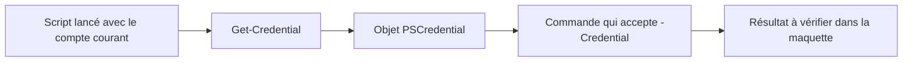

# Module 06 — S’authentifier et écrire des scripts de laboratoire

Le support montre comment demander une identité pour une action précise depuis un script lancé avec un compte courant. Le TP met ensuite en pratique la lecture d’un script Active Directory, la correction d’un script DNS et l’écriture d’un script au choix.

## Demander une identité avec `Get-Credential`

```powershell
$cred = Get-Credential
$cred.GetType().FullName
$cred.UserName
```

`Get-Credential` renvoie un objet `PSCredential` contenant le nom d’utilisateur et un mot de passe de type `SecureString`. L’affichage du champ est masqué. Utilisez l’objet en argument d’une commande qui accepte `-Credential`. Le processus conserve son identité courante.

```powershell
$compte = Read-Host 'Compte autorisé dans la maquette'
$cred = Get-Credential -UserName $compte -Message 'Authentification du laboratoire'
$serveur = Read-Host 'Serveur de laboratoire'
Invoke-Command -ComputerName $serveur -Credential $cred -ScriptBlock { hostname }
```



*Schéma pédagogique externe au cours.*

Le nom prérempli et le message personnalisent la demande. La protection du secret dépend aussi du traitement qui suit. Pour le compte rendu, conserver l’action, la cible et le résultat. La valeur d’accès est fournie par le formateur et reste distincte du script publié.

## Lire l’archive du TP par activité

| Activité | Ressource fournie | Travail attendu |
| --- | --- | --- |
| 1. Lire et commenter | Script de consigne Active Directory et version commentée de correction | Repérer les OU, groupes, modèles, comptes, rattachements et droits. Expliquer ce que chaque bloc modifie. |
| 2. Corriger les bugs | Script DNS de consigne et correction DNS | Comparer les noms de commandes, paramètres, zones et enregistrements. Distinguer syntaxe PowerShell et disponibilité réelle des commandes. |
| 3. Écrire | Énoncé PDF et énoncé révisé Word | Choisir la configuration réseau ou un menu de gestion d’utilisateurs AD, puis décrire les entrées, actions et contrôles. |

Les quatre scripts et l’énoncé Word de TP6.7z sont consultables dans **Cours Original**. Les versions sont conservées séparément. La correction Active Directory ajoute un partage SMB et des ACL NTFS. C’est une extension du script fourni. La correction DNS crée une zone primaire et prépare des enregistrements pour des serveurs secondaires. La création effective d’une zone secondaire demande une commande distincte et une source de transfert autorisée. [Gestion Microsoft des zones DNS](https://learn.microsoft.com/windows-server/networking/dns/manage-dns-zones).

## Décrire le déroulement avant de modifier une machine

Dans le script AD, commencer par identifier la base LDAP et les OU. Relever ensuite les modèles et comptes créés, les groupes et leurs portées, les propriétés et les rattachements. Après lecture, expliquer quelle étape suppose que la précédente ait réussi.

Dans le script DNS, suivre l’ordre du rôle, de l’interface, des redirecteurs, de la zone directe et de la zone inverse. Un enregistrement `A` associe un nom à une adresse IPv4. Un `PTR` associe une adresse inverse à un nom. Un `NS` désigne un serveur de noms. Les enregistrements de délégation et l’autorisation de transfert répondent à des fonctions différentes.

Un parseur peut accepter une ligne contenant un nom de commande inconnu. Le diagnostic complet compare l’AST, l’aide du module, les paramètres, les droits, la cible et le résultat. Par exemple, `Reboot-Computer` peut être lu comme une commande sans erreur de grammaire, alors que le corrigé emploie `Restart-Computer`.

## Mini-quiz

1. Quel type renvoie `Get-Credential` ?
2. Stocker `$cred` change-t-il l’identité de la console ?
3. Pourquoi une commande DNS mal orthographiée peut-elle passer l’analyse syntaxique ?
4. Quelle différence entre un enregistrement NS et une zone secondaire ?

??? success "Réponses"
    1. `System.Management.Automation.PSCredential`.
    2. La console conserve son identité. Une commande compatible peut utiliser cet objet pour s’authentifier.
    3. La syntaxe autorise l’appel d’un nom de commande. La résolution de ce nom intervient ensuite.
    4. NS désigne un serveur de noms. Une zone secondaire est une copie reçue par transfert depuis une source autorisée.

## Travaux pratiques et révision

- [TP et correction du module](../../tp/12-initiation-powershell/module-06/index.md)
- [Fiche de révision](../../revision/12-initiation-powershell/module-06.md)
- [Sommaire du cours](index.md)
