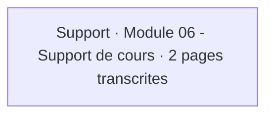
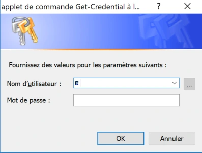

# Module 06 — S’authentifier et écrire des scripts de laboratoire

[Travaux pratiques](../../tp/12-initiation-powershell/module-06/index.md)

Les parties ci-dessous reprennent le cours original, dans le même ordre. Les encadrés et les schémas répètent ses formulations.

## Parcours de lecture

1. Support · Module 06 - Support de cours · 2 pages transcrites

**Visuel externe**



SOURCE DRIVE · TRANSCRIPTION DU SUPPORT

Le contenu des documents du dossier TSSR est transcrit ci-dessous, page par page. Les textes et tableaux sont intégrés à la page Web. Aucun fichier PDF, aucune diapositive entière ni aucune reproduction de page n’est affiché. Seuls des croquis ou visuels isolés et vérifiés peuvent accompagner la transcription. Les versions et les consignes restent celles des supports de formation. Les compléments IA sont conservés dans leur onglet distinct.

## Support · Module 06 - Support de cours · 2 pages transcrites

!!! note "À retenir"
    Les formulations historiques et les exemples du document sont conservés.

Transcription du support du Drive. Les formulations historiques et les exemples du document sont conservés. Les valeurs d’accès du laboratoire sont indiquées comme « fourni par le formateur ». Les adresses de messagerie personnelles utilisent example.com.

### Initiation à PowerShell

Module 06 – Pour aller plus loin

### S’authentifier avec PowerShell

!!! note "À retenir"
    Pour des raisons de sécurité, nous travaillerons avec des comptes possédant des privilèges réduits.

- Pour des raisons de sécurité, nous travaillerons avec des comptes possédant des privilèges réduits.
- Cela peut être problématique pour la réalisation de certaines actions.
- Afin de contourner cette problématique, il est possible de lancer le script avec un compte utilisateur, puis demander une authentification à son lancement.

### S’authentifier avec PowerShell

!!! note "À retenir"
    Les logins et mots de passe renseignés sont stockés dans la variable et réutilisables dans le script.

- Une commande est dédiée à cet usage.

```
PS > $Cred = Get-Credential
```

- Les logins et mots de passe renseignés sont stockés dans la variable et réutilisables dans le script.

### S’authentifier avec PowerShell

!!! note "À retenir"
    Capture du support « Module 06 - Support de cours » Capture du support « Module 06 - Support de cours » Référence du document : 1G13m58rOo6jBKcQFzsctXG2Pj1XfKmaS · SHA-256 135ae8437059066d…

On peut personnaliser la fenêtre.

```
PS > $Cred = Get-Credential -Message "Entrez votre
login Admin du Domaine" -UserName lab\Administrator
```



Capture du support « Module 06 - Support de cours »


Capture du support « Module 06 - Support de cours »

Référence du document : 1G13m58rOo6jBKcQFzsctXG2Pj1XfKmaS · SHA-256 135ae8437059066d…

| Support · Module 06 - Support de cours · 2 pages transcrites | Les formulations historiques et les exemples du document sont conservés. |
| Indiquer l'action | $base = Get-ADOrganizationalUnit -Filter ｛ name -like "_Ent*" ｝ New-ADOrganizationalUnit Groupes -Path $base -ProtectedFromAccidentalDeletion $false New-ADOrganizationalUnit Uti… |
| Indiquer l'action | Set-ADUser -Identity isabelle -Title "Administratrice SR" -OfficePhone "666" Set-ADUser -Identity ivan -title "Support Technique" $mutil = get-aduser -Filter ｛ samaccountname -e… |
| Parametrages complementaires | Set-ADAccountExpiration -Identity "christophe" -DateTime "01/01/2021" $unames = @("david","isabelle","christelle") $mdp = 'fourni par le formateur' foreach ($uname in $unames) ｛… |
| Indiquer l'action | $ubase = Get-ADOrganizationalUnit -Filter ｛ name -eq "Utilisateurs" ｝ New-ADOrganizationalUnit S_Direction -Path $ubase -ProtectedFromAccidentalDeletion $false New-ADOrganizatio… |
| Indiquer l'action | $base = Get-ADOrganizationalUnit -Filter ｛ name -like "_Ent*" ｝ Get-ADOrganizationalUnit -filter * -SearchBase $base / ft name,DistinguishedName -AutoSize |
| Indiquer l'action | Get-ADGroupMember G_Info / select name,distinguishedname / Out-File -Encoding utf8 "c:\ctrl_membres_informatique.txt" Get-ADUser david / out-file -Encoding utf8 "c:\detail_user_… |
| Redirecteurs | Add-DnsServerConditionalForwardedZone -ZoneName "gilles.lab" -MasterServers 172.20.0.1 Set-DnsServerconditionalForwarder -IPAddress 10.0.0.3,10.100.0.3 -PassThru |
| Zones | Add-DnsServerfirstZone -Name "ad.gilles.lab" -ZoneFile "ad.gilles.lab.dns" Add-DnsServerRessourceRecord -A -Name "s2-w-cd" -IPv4Address 172.20.0.1 -ZoneName "ad" Add-DnsServerRe… |
| Ou | Add-DnsServerResourceRecord -NS -Name "ad.gilles.lab" -NameServer "s4-w-sm" -ZoneName "ad.gilles.lab" Add-DnsServerResourceRecord -A -Name "s4-w-sm" -IPv4Address 172.20.8.4 -Zon… |
| Redirecteurs | Add-DnsServerConditionalForwarderZone -ZoneName "gilles.lab" -MasterServers 172.20.0.1 Set-DnsServerForwarder -IPAddress 10.0.0.3,10.100.0.3 -PassThru |
| Zones | Add-DnsServerPrimaryZone -Name "ad.gilles.lab" -ZoneFile "ad.gilles.lab.dns" Add-DnsServerResourceRecord -A -Name "s2-w-cd.gilles.lab." -IPv4Address 172.20.0.1 -ZoneName "ad.gil… |
| Ou | Add-DnsServerResourceRecord -NS -Name "ad.gilles.lab" -NameServer "s4-w-sm.gilles.lab" -ZoneName "ad.gilles.lab" Add-DnsServerResourceRecord -A -Name "s4-w-sm.gilles.lab." -IPv4… |
| Variable localisation chemin dans AD | $base = Get-ADOrganizationalUnit -Filter ｛ name -like "_Ent*" ｝ New-ADOrganizationalUnit Groupes -Path $base -ProtectedFromAccidentalDeletion $false New-ADOrganizationalUnit Uti… |
| Parametrage complementaires | Set-ADUser -Identity isabelle -Title "Administratrice SR" -OfficePhone "666" Set-ADUser -Identity ivan -title "Support Technique" $mutil = get-aduser -Filter ｛ samaccountname -e… |
| Parametrages complementaires | Set-ADAccountExpiration -Identity "christophe" -DateTime "01/01/2021" $unames = @("david","isabelle","christelle") $mdp = 'fourni par le formateur' foreach ($uname in $unames) ｛… |
| Variable localisation chemin objets utilisateurs dans AD | $ubase = Get-ADOrganizationalUnit -Filter ｛ name -eq "Utilisateurs" ｝ New-ADOrganizationalUnit S_Direction -Path $ubase -ProtectedFromAccidentalDeletion $false New-ADOrganizatio… |
| Liste de toutes les OU | $base = Get-ADOrganizationalUnit -Filter ｛ name -like "_Ent*" ｝ Get-ADOrganizationalUnit -filter * -SearchBase $base / ft name,DistinguishedName -AutoSize |
| Deplacement des objets - à préciser | Get-ADGroupMember G_Info / select name,distinguishedname / Out-File -Encoding utf8 "c:\ctrl_membres_informatique.txt" Get-ADUser david / out-file -Encoding utf8 "c:\detail_user_… |
