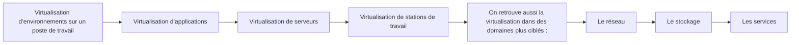
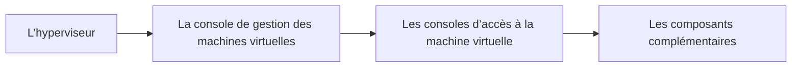
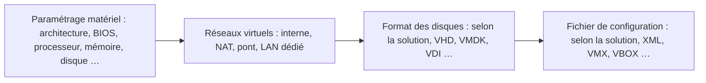

# Module 01 — Des concepts de la virtualisation à leur mise en œuvre

Les parties ci-dessous reprennent le cours original, dans le même ordre. Les encadrés et les schémas répètent ses formulations.

## Parcours de lecture

1. Support · Module 01 - Support de cours · 5 pages transcrites

SOURCE DRIVE · TRANSCRIPTION DU SUPPORT

Le contenu des documents du dossier TSSR est transcrit ci-dessous, page par page. Les textes et tableaux sont intégrés à la page Web. Aucun fichier PDF, aucune diapositive entière ni aucune reproduction de page n’est affiché. Seuls des croquis ou visuels isolés et vérifiés peuvent accompagner la transcription. Les versions et les consignes restent celles des supports de formation. Les compléments IA sont conservés dans leur onglet distinct.

## Support · Module 01 - Support de cours · 5 pages transcrites

#### Module 01 – Présentation

Présentation

#### Objectifs

!!! note "À retenir"
    Définir les termes de mutualisation, consolidation et rationalisation Différencier les hyperviseurs de type 1 et 2 Présentation

- Définir les termes de mutualisation, consolidation et rationalisation
- Différencier les hyperviseurs de type 1 et 2

Présentation

#### La virtualisation en 8 dates

| Date | Repère |
| --- | --- |
| 60/70 | IBM : embryons de la virtualisation en test puis production sur des Mainframes |
| Milieu des années 90 | Les émulateurs font leur apparition en Micro informatique (ils rendent possible l’émulation des machines Atari, Amiga, Amstrad et de consoles) |
| Début des années 2000 | VMware développa et popularisa son système propriétaire de virtualisation logicielle pour les architectures de type x86 |
| 2006 | Prise en charge matérielle par le CPU d’instructions de virtualisation |
| 2007 | XenSource racheté par Citrix |
| 2007 | KVM est intégré au noyau Linux |
| 2007 | Virtual Desktop Infrastructures VMware |
| 2009 | Plus de serveurs virtuels que physiques, KVM est intégré au noyau Linux |

Présentation

#### Utilisations

#### Pour quels usages ?

#### Quels avantages ?

#### Des inconvénients ?

**Visuel externe**

```mermaid
flowchart LR
    N1["Les serveurs d’infrastructure locaux et distants (le Cloud…)"]
    N2["Les environnements de test et les problématiques de compatibilité"]
    N3["Les scénarios de PRA (Plan de Reprise d’Activité)"]
    N4["Optimisation des taux d’utilisation du matériel"]
    N5["Économies sur les coûts matériels et de gestion"]
    N6["Gestion facilitée des systèmes (granularité)"]
    N7["Économies d’énergie (green computing)"]
    N8["Concentration et dépendance vis-à-vis d’une solution"]
    N1 --> N2
    N2 --> N3
    N3 --> N4
    N4 --> N5
    N5 --> N6
    N6 --> N7
    N7 --> N8
```

- Les serveurs d’infrastructure locaux et distants (le Cloud…)
- Les environnements de test et les problématiques de compatibilité
- Les scénarios de PRA (Plan de Reprise d’Activité)
- Optimisation des taux d’utilisation du matériel
- Économies sur les coûts matériels et de gestion
- Gestion facilitée des systèmes (granularité)
- Économies d’énergie (green computing)
- Concentration et dépendance vis-à-vis d’une solution
- Mise en œuvre complexe avec un investissement initial important
- Contraintes d’administration spécifiques (déploiement, sauvegarde, etc.)

Présentation

#### Les acteurs

!!! note "À retenir"
    Les grands éditeurs Des logiciels libres Les acteurs D’autres solutions Présentation

Les grands éditeurs

Des logiciels libres

- Les acteurs

D’autres solutions

Présentation

#### Les secteurs de la virtualisation

!!! note "À retenir"
    La virtualisation est un domaine transverse qui peut être mis en œuvre à plusieurs niveaux au sein d’une infrastructure.

**Visuel externe**

La virtualisation est un domaine transverse qui peut être mis en œuvre à plusieurs niveaux au sein d’une infrastructure.

- Virtualisation d’environnements sur un poste de travail
- Virtualisation d’applications
- Virtualisation de serveurs
- Virtualisation de stations de travail
- On retrouve aussi la virtualisation dans des domaines plus ciblés :
- Le réseau
- Le stockage
- Les services

#### Informations dans les visuels du support

!!! note "À retenir"
    Les logos des grands éditeurs illustrent VMware, Microsoft, Citrix, Red Hat et Oracle.

- Les logos des grands éditeurs illustrent VMware, Microsoft, Citrix, Red Hat et Oracle.
- Les logiciels libres sont représentés par GNU et Linux.
- Les autres solutions illustrées sont Parallels, Proxmox et Docker.

Présentation

#### Les principales solutions

| Pour le poste de travail | Pour les serveurs |
| --- | --- |
| VMware Player, VMware Workstation | vSphere (VMware) |
| Oracle VM VirtualBox | Hyper-V (Windows Serveur) |
| Windows Virtual PC (Windows 7 Mode XP), Hyper-V Client (W8 x64 SLAT) | Xen (utilisé par Citrix avec XenServer) |
| QEMU | KVM (utilisé par Red Hat) |

Présentation

#### Les outils

!!! note "À retenir"
    L’hyperviseur La console de gestion des machines virtuelles Les consoles d’accès à la machine virtuelle Les composants complémentaires

**Visuel externe**

- L’hyperviseur
- La console de gestion des machines virtuelles
- Les consoles d’accès à la machine virtuelle
- Les composants complémentaires

##### Principes de base

**Visuel externe**

- Paramétrage matériel : architecture, BIOS, processeur, mémoire, disque …
- Gestion des médias amovibles : DVD au format ISO, USB « transmis » à la VM et disquette (!) au format FLP ou IMG
- Réseaux virtuels : interne, NAT, pont, LAN dédié
- Format des disques : selon la solution, VHD, VMDK, VDI …
- Fichier de configuration : selon la solution, XML, VMX, VBOX …

Présentation

#### Les types d’hyperviseurs

| Repère du support | L’hyperviseur de type 1 | L’hyperviseur de type 2 |
| --- | --- | --- |
| Couches du schéma | Machines virtuelles → module de translation binaire → hyperviseur → binaire → matériel | Machines virtuelles → hyperviseur (VirtualBox) → applications → OS → matériel |
| Niveaux intermédiaires | 1 niveau intermédiaire | 2 niveaux intermédiaires |
| Implémentation | Fait office de système d’exploitation | Installé en tant qu’application sur un système d’exploitation |
| Solutions | Hyper-V, KVM, VMware ESXi, XenServer | VirtualBox, VirtualPC, VMware Player et Workstation |

Présentation

#### Virtualisation et paravirtualisation

!!! note "À retenir"
    Dans un contexte de virtualisation, les machines virtuelles s’adressent au matériel présenté par l’hyperviseur.

- Dans un contexte de virtualisation, les machines virtuelles s’adressent au matériel présenté par l’hyperviseur. Elles n’ont pas connaissance de sa présence.
- La paravirtualisation est une technique de virtualisation dans laquelle les machines virtuelles sont préparées pour faire appel directement à un hyperviseur. Les appels système sont alors redirigés et non traduits.

| Solution de virtualisation | Solution de paravirtualisation |
| --- | --- |
| Machines virtuelles → module de translation binaire → hyperviseur → binaire → matériel | Machines virtuelles → hypercalls → hyperviseur → binaire → matériel |

Matériel

Référence du document : 1qCsojBU2zSMsawu4PupwZkXbXJSpGSaI · SHA-256 ea6cf1bcebe9ae20…
