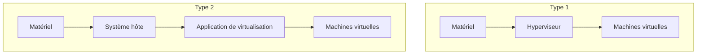

# Module 01 — Des concepts de la virtualisation à leur mise en œuvre

Un poste peut héberger un environnement de test sans changer le système utilisé au quotidien. Une entreprise peut aussi regrouper plusieurs serveurs sur des hôtes physiques partagés. Dans les deux cas, l’hyperviseur présente des ressources virtuelles à chaque système invité.

## Objectifs

- Expliquer ce que l’hyperviseur présente à une machine virtuelle et distinguer virtualisation et paravirtualisation.
- Identifier les hyperviseurs de type 1 et de type 2 dans un schéma.
- Distinguer consolidation, mutualisation et rationalisation.
- Choisir un montage adapté à un poste de test, à un serveur ou à un plan de reprise.

## 1. De la machine physique à l’invité

Une **machine virtuelle (VM)** dispose d’un processeur, de mémoire, d’un disque et d’une ou plusieurs cartes réseau présentés sous forme virtuelle. Son système d’exploitation utilise ces ressources comme les périphériques d’une machine. L’**hôte** fournit les ressources physiques. L’**hyperviseur** alloue ces ressources aux VM et arbitre leur utilisation.

| Élément | Rôle | Exemple |
| --- | --- | --- |
| Hôte | Fournit la capacité physique | Processeur, mémoire vive, stockage et réseau |
| Hyperviseur | Présente et gère les ressources virtuelles | Attribuer deux processeurs virtuels à une VM |
| Console de gestion | Configure ou pilote les VM | Affecter un ISO, modifier la mémoire, démarrer une VM |
| Console d’accès | Affiche la session de la VM | Suivre un assistant d’installation |
| Composants complémentaires | Facilitent l’interaction entre l’hôte et l’invité | Outils invités présentés au module suivant |

Le support oppose deux mécanismes. Dans son schéma de **virtualisation**, l’invité utilise le matériel présenté par l’hyperviseur. Dans celui de **paravirtualisation**, des composants de l’invité sont adaptés pour solliciter directement l’hyperviseur. Un pilote adapté peut illustrer cette coopération sans changer le type d’hyperviseur.

## 2. Où placer l’hyperviseur ?

| Type | Position dans le schéma du cours | Usage illustré | Exemples du support |
| --- | --- | --- | --- |
| 1 | Entre le matériel et les VM | Hôte de virtualisation de serveurs | Hyper-V, KVM, VMware ESXi, XenServer |
| 2 | Application installée sur le système hôte | Laboratoire sur un poste de travail | VirtualBox, Virtual PC, VMware Player, VMware Workstation |

**Illustration IA / externe au cours — position de l’hyperviseur.**

Un bureau graphique ne suffit pas à reconnaître le type. Il faut déterminer ce qui prend en charge la virtualisation entre le matériel et l’invité. Les deux dessins simplifient l’architecture des produits cités.

## 3. Pourquoi virtualiser ?

| Besoin | Apport attendu | Point à vérifier |
| --- | --- | --- |
| Consolider plusieurs serveurs | Regrouper les charges et mieux utiliser les hôtes physiques | Capacité cumulée en période de pointe et capacité de reprise |
| Mutualiser des ressources | Partager du stockage, du réseau ou du calcul entre plusieurs usages | Répartition de l’espace, des accès et de la bande passante |
| Rationaliser les configurations | Réutiliser des modèles, procédures et contrôles cohérents | Versions, critères de mise à jour et restaurations testées |
| Tester ou isoler une application | Fournir un environnement séparé | Connectivité autorisée et emplacement des données |
| Préparer un plan de reprise d’activité | Redémarrer les services avec leurs dépendances | Ordre de redémarrage, délais et accès aux sauvegardes |

**Complément pédagogique.** Le support cite consolidation, mutualisation et rationalisation comme objectifs. Les définitions du tableau permettent d’appliquer ces termes. Quatre serveurs regroupés sur un hôte illustrent la consolidation. Une banque commune illustre la mutualisation. Un modèle standard et une procédure de restauration commune illustrent la rationalisation.

Les bénéfices du cours sont l’utilisation plus efficace du matériel, les économies possibles de coûts et d’énergie et une gestion plus fine des systèmes. En contrepartie, un incident sur l’hôte peut affecter plusieurs services. Il faut prévoir l’investissement initial, l’administration, le déploiement et la sauvegarde.

## 4. Reconnaître les produits et les objets

Le support cite VMware, Microsoft, Citrix, Red Hat et Oracle, puis GNU, Linux et FreeBSD parmi les repères de logiciels libres. Il illustre aussi Parallels, Proxmox et Docker. Ces exemples couvrent plusieurs secteurs, dont le poste de travail, les applications, les serveurs, les stations, le réseau, le stockage et les services. Chaque produit doit être replacé dans le secteur représenté.

| Domaine | Exemples du support |
| --- | --- |
| Virtualisation sur poste | VMware Player et Workstation, Oracle VM VirtualBox, Windows Virtual PC, Hyper-V Client, QEMU |
| Virtualisation de serveurs | VMware vSphere, Hyper-V Windows Server, Xen avec XenServer, KVM |
| Médias présentés à l’invité | DVD, ISO, USB, disquettes FLP ou IMG |
| Réseaux virtuels | Interne, NAT, pont, LAN dédié |
| Fichiers de disque | VHD, VMDK, VDI |
| Fichiers de configuration | XML, VMX, VBOX |

Avant de créer une VM, relever l’architecture, les fonctions du processeur, les paramètres BIOS ou UEFI, la mémoire, le disque et le réseau. Identifier ensuite les médias d’installation et les formats employés par la solution choisie.

## 5. Situer les repères historiques

| Repère du support | Évolution présentée |
| --- | --- |
| Années 1960 et 1970 | IBM explore la virtualisation des mainframes, d’abord pour les tests puis en production. |
| Milieu des années 1990 | Les émulateurs permettent d’exécuter des environnements d’autres micro-ordinateurs et consoles. |
| Début des années 2000 | VMware popularise la virtualisation logicielle x86. |
| 2006 | Des processeurs prennent en charge des instructions destinées à la virtualisation. |
| 2007 | Le cours cite le rachat de XenSource par Citrix, KVM dans le noyau Linux et les infrastructures de postes virtuels VMware. |
| 2009 | Le cours évoque la croissance des serveurs virtuels et cite à nouveau KVM. |

Ces dates donnent le contexte de la présentation. La référence à 2009 dans le support ne sert pas à dater une seconde intégration de KVM.

## 6. Cas d’application — Choisir et vérifier

Une équipe veut essayer un logiciel ancien sur un poste et regrouper ses serveurs sur une infrastructure dédiée.

1. Pour le test, choisir l’hyperviseur de poste et déterminer le besoin d’accès au réseau. Vérifier la mémoire libre sur l’hôte et le périmètre des échanges de la VM.
2. Pour les serveurs, inventorier le calcul, la mémoire, les fichiers et les dépendances réseau. Choisir l’hôte et le stockage en fonction de ces besoins.
3. Prévoir l’ordre de reprise. Si l’application dépend d’un service réseau ou d’une base, tester la disponibilité de ces dépendances avant de déclarer l’application opérationnelle.
4. Documenter les résultats, les capacités restantes et la méthode de restauration.

Ce cas illustre les notions du support. Le dossier du module 1 fournit un support de présentation, sans énoncé de TP.

## À retenir

- Le type d’hyperviseur se reconnaît à sa place dans l’architecture.
- Consolider rapproche les charges sur moins d’hôtes. Mutualiser partage des ressources. Rationaliser harmonise les pratiques.
- La disponibilité se démontre en vérifiant les ressources, les dépendances et la reprise.

## Mini-quiz — 5 questions {#question-de-revision}

1. Quels éléments physiques fournit l’hôte ?
2. Où se trouve l’hyperviseur dans une architecture de type 2 ?
3. Quel mécanisme prévoit un invité adapté à l’hyperviseur ?
4. Une banque partagée illustre quel principe ?
5. Que faut-il vérifier avant d’annoncer que des VM consolidées pourront redémarrer après une panne ?

??? success "Réponses commentées"

    1. Il fournit notamment le processeur, la mémoire, le stockage et les interfaces réseau. L’hyperviseur les présente sous forme de ressources virtuelles.
    2. L’application de virtualisation s’exécute sur le système d’exploitation de l’hôte.
    3. La paravirtualisation. Le support illustre des composants invités qui coopèrent avec l’hyperviseur.
    4. La mutualisation, puisque plusieurs usages accèdent à une capacité commune.
    5. La capacité d’un hôte de secours, l’accès au réseau et aux données, l’ordre de démarrage et le résultat d’un test de reprise.

## Pour pratiquer et réviser

- [Fiche de révision](../../revision/13-virtualisation-serveurs/module-01.md)
- [Module suivant — VMware Workstation](module-02.md)
- [Sommaire de Virtualisation de serveurs](index.md)

## Provenance pédagogique

Le support du module 1 fournit les usages, acteurs, repères historiques, catégories d’hyperviseurs et composants. Le schéma, les définitions de cadrage et le cas d’application sont des aides de synthèse.
