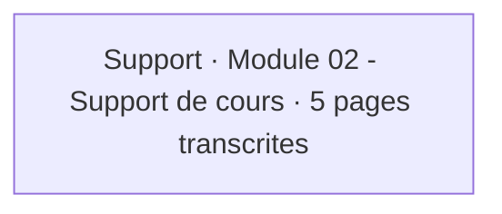
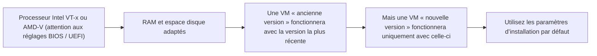
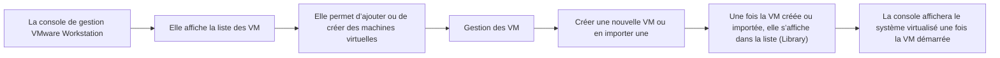
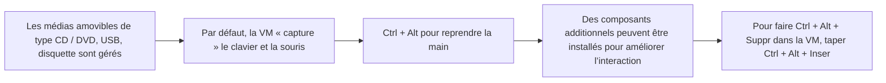
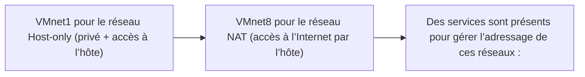

# Module 02 — Les applications de virtualisation d’environnements sur un poste de travail

[Travaux pratiques](../../tp/13-virtualisation-serveurs/module-02/index.md)

Les parties ci-dessous reprennent le cours original, dans le même ordre. Les encadrés et les schémas répètent ses formulations.

## Parcours de lecture

1. Support · Module 02 - Support de cours · 5 pages transcrites

**Visuel externe**

SOURCE DRIVE · TRANSCRIPTION DU SUPPORT

Le contenu des documents du dossier TSSR est transcrit ci-dessous, page par page. Les textes et tableaux sont intégrés à la page Web. Aucun fichier PDF, aucune diapositive entière ni aucune reproduction de page n’est affiché. Seuls des croquis ou visuels isolés et vérifiés peuvent accompagner la transcription. Les versions et les consignes restent celles des supports de formation. Les compléments IA sont conservés dans leur onglet distinct.

## Support · Module 02 - Support de cours · 5 pages transcrites

#### Module 02 – Les applications de virtualisation

#### d’environnements sur un poste de travail

!!! note "À retenir"
    Les applications de virtualisation d’environnements sur un poste de travail

Les applications de virtualisation d’environnements sur un poste de travail

#### Objectifs

!!! note "À retenir"
    Comprendre le fonctionnement d’une application de virtualisation de serveurs Configurer et mettre en place une machine virtuelle sur VMware Workstation

- Comprendre le fonctionnement d’une application de virtualisation de serveurs
- Configurer et mettre en place une machine virtuelle sur VMware Workstation

#### Prérequis et installation

!!! note "À retenir"
    Les applications de virtualisation d’environnements sur un poste de travail

Les applications de virtualisation d’environnements sur un poste de travail

#### Installation

!!! note "À retenir"
    Version actuelle : VMware Workstation 16 Attention, il n’y a pas de rétrocompatibilité :

!!! warning "Attention"
    Version actuelle : VMware Workstation 16 Attention, il n’y a pas de rétrocompatibilité :

- Version actuelle : VMware Workstation 16
- Attention, il n’y a pas de rétrocompatibilité :

#### Prérequis matériel

**Visuel externe**

- Processeur Intel VT-x ou AMD-V (attention aux réglages BIOS / UEFI)
- RAM et espace disque adaptés
- Une VM « ancienne version » fonctionnera avec la version la plus récente
- Mais une VM « nouvelle version » fonctionnera uniquement avec celle-ci
- Utilisez les paramètres d’installation par défaut

La dernière version est préférable, mais il peut y avoir des problèmes de fonctionnement suivant les systèmes hôte (ex. WS 2019 + v16)

Les applications de virtualisation d’environnements sur un poste de travail

#### Outils et composants installés

**Visuel externe**

- La console de gestion VMware Workstation
- Elle affiche la liste des VM
- Elle permet d’ajouter ou de créer des machines virtuelles
- Lors de la sélection d’une VM, elle permet le démarrage ou le réglage des paramètres matériel
- Gestion des VM
- Créer une nouvelle VM ou en importer une
- Une fois la VM créée ou importée, elle s’affiche dans la liste (Library)
- La console affichera le système virtualisé une fois la VM démarrée

Les applications de virtualisation d’environnements sur un poste de travail

#### Interaction avec l’hôte

#### Gestion du matériel

**Visuel externe**

- Les médias amovibles de type CD / DVD, USB, disquette sont gérés
- Par défaut, la VM « capture » le clavier et la souris
- Ctrl + Alt pour reprendre la main
- Des composants additionnels peuvent être installés pour améliorer l’interaction
- La fonction Shared Folder permet de mapper un dossier de l’hôte dans la VM en tant que lecteur réseau
- Pour faire Ctrl + Alt + Suppr dans la VM, taper Ctrl + Alt + Inser

Les applications de virtualisation d’environnements sur un poste de travail

#### Interaction avec l’hôte

#### Gestion du réseau

!!! note "À retenir"
    VMware met en place des cartes réseau virtuelles pour permettre les différents modes de connexion : VMnet1 pour le réseau Host-only (privé + accès à l’hôte) VMnet8 pour le réseau NAT (accès à l’Internet par l’hôte) Des services sont présents pour gérer l’adressage de ces réseaux :

**Visuel externe**

- VMware met en place des cartes réseau virtuelles pour permettre les différents modes de connexion :
- VMnet1 pour le réseau Host-only (privé + accès à l’hôte)
- VMnet8 pour le réseau NAT (accès à l’Internet par l’hôte)
- Des services sont présents pour gérer l’adressage de ces réseaux :

#### VMware DHCP Service pour le réseau privé et VMware NAT

#### Service pour le réseau NAT

!!! note "À retenir"
    Il peut être nécessaire de désactiver ces services si l’on veut utiliser ces réseaux avec son propre adressage dynamique.

Il peut être nécessaire de désactiver ces services si l’on veut utiliser ces réseaux avec son propre adressage dynamique.

Les applications de virtualisation d’environnements sur un poste de travail

#### Étapes de création

- Mode d’installation
- Choisissez « I will install … later »
- Dans le cas contraire, VMware gérera l’installation à votre place avec des paramètres pas nécessairement adaptés
- Choix du système
- Définir l’architecture matérielle selon le système
- Nom de la VM dans l’interface et choix de l’emplacement
- Attention « Mes Documents » est sélectionné par défaut
- Prévoir 1 dossier par VM
- Taille du disque virtuel (et mode de stockage)
- Par défaut, VMware utilise l’espace au fur et à mesure des besoins
- Sélectionner plutôt le mode « Store virtual disk in a single file » pour des besoins de performance
- Paramétrage matériel : « Customize Hardware »
- Pour ajouter ou supprimer des composants
- Pour régler le nombre de CPU et la quantité de RAM
- Pour définir le média d’installation et le mode de connexion réseau

Les applications de virtualisation d’environnements sur un poste de travail

#### Gestion de la VM – Workstation 16

!!! note "À retenir"
    Gestion de base Gestion de la fenêtre, la fermeture avec la X met votre VM en pause Gestion directe du matériel (disques, réseau, médias, etc.) Accès aux paramètres et fonctions complémentaires Les applications de virtualisation d’environnements sur un poste de travail

Gestion de base

Gestion de la fenêtre, la fermeture avec la X met votre VM en pause

Gestion directe du matériel (disques, réseau, médias, etc.)

Accès aux paramètres et fonctions complémentaires

Les applications de virtualisation d’environnements sur un poste de travail

#### Paramétrages matériels

- Après création de la VM, les paramétrages sont accessibles depuis la fonction « Virtual Machine Settings »
- Permet de modifier les paramètres initiaux
- Permet l’ajout et la suppression de matériel
- Certains composants sont paramétrables à chaud (ajout de disques, réseau …)
- Connexion au réseau : 4 modes disponibles
- Bridged : mode pont, équivalent à une connexion au réseau physique
- NAT : utilise la configuration réseau de l’hôte pour accéder à l’Internet
- Host-only : mode interne avec connexion à l’hôte, les VM ne peuvent communiquer qu’entre elles et avec l’hôte
- LAN segment : permet d’utiliser des segments réseau spécifiques et indépendants, à condition de les déclarer avec le bouton LAN Segments

Chacun de ces modes est indépendant des autres. Ils agissent comme des commutateurs permettant d’isoler les VM dans des réseaux spécifiques.

Les applications de virtualisation d’environnements sur un poste de travail

#### Problèmes courants

- Démarrer sur un média CD/DVD une fois le système installé
- S’assurer que la VM a bien « capturé » le clavier et redémarrer
- Appuyer 1 fois sur la touche Échap lorsque le logo VMware s’affiche
- Il est possible de paramétrer la séquence de démarrage dans le BIOS de la VM
- Fonctionnement du réseau aléatoire
- Le fonctionnement du réseau est un point sensible, notamment lors de paramétrages fréquents
- Désactivez et réactivez les cartes réseau de votre machine physique
- Espace disque hôte insuffisant
- Vérifier l’emplacement du dossier de la VM et le déplacer si nécessaire
- Surveiller l’espace disponible dans le volume de données
- Espace disque invité insuffisant
- Ajouter un disque depuis les paramétrages de la VM ou redimensionner (plus fastidieux)
- Le dimensionnement initial est important !

Référence du document : 1_u4oJfvNBUqY8cliTHJxU9IrHtGQ-d8r · SHA-256 82fc8506a1dc77c0…
