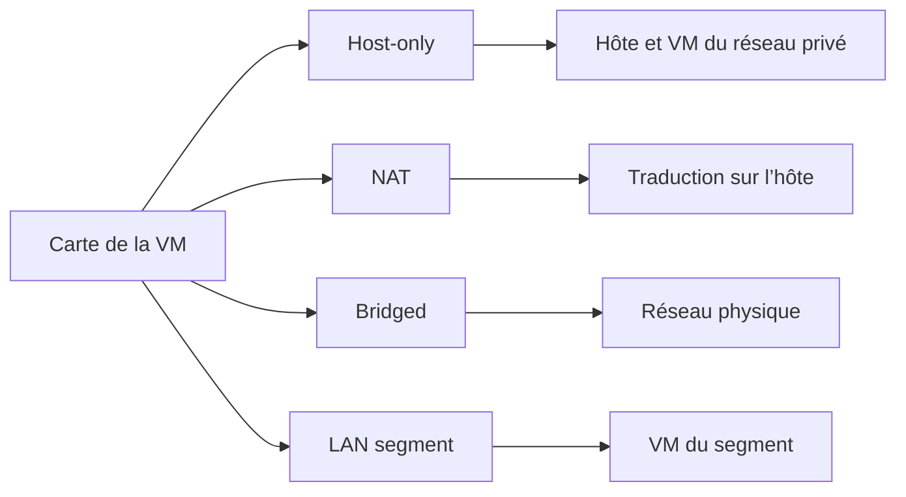

# Module 02 — Les applications de virtualisation d’environnements sur un poste de travail

L’atelier construit une VM Windows Server 2019 dans VMware Workstation 16. Cette VM devient l’hôte Hyper-V du module 4. Vérifier dès maintenant la configuration du processeur, le raccordement au réseau et l’état final de la VM évite de reprendre l’installation plus tard.

## Objectifs

- Repérer les composants de Workstation et les réglages d’une machine virtuelle.
- Choisir entre Host-only, NAT, Bridged et LAN segment selon les échanges recherchés.
- Préparer et installer la VM `SRV_2K19` avec les paramètres de l’atelier.
- Contrôler l’installation, les outils invités et le snapshot final.

## 1. Préparer le poste et lire la console

Le support utilise Workstation 16. La solution illustre aussi Workstation 16 Pro et une compatibilité matérielle 16.2.x. Relever la version du logiciel et celle du matériel virtuel avant de déplacer une VM vers un autre poste. Le document prévoit une installation de Workstation avec les paramètres par défaut.

| Contrôle | Ce qu’il permet de vérifier |
| --- | --- |
| Intel VT-x ou AMD-V | Le processeur dispose des extensions utilisées pour la virtualisation. |
| BIOS ou UEFI | Les extensions sont activées et accessibles au logiciel de virtualisation. |
| Mémoire et espace libre | Le poste peut accueillir la VM et ses futurs snapshots. |
| Bibliothèque Workstation | La VM correcte est enregistrée et sélectionnée avant de changer ses paramètres. |

La **Library** présente les VM enregistrées. Depuis la console, on peut en créer, en ouvrir ou en importer selon le format. Le support indique ces possibilités puis se concentre sur la création. Sélectionner la VM avant de démarrer l’invité ou d’ouvrir **Virtual Machine Settings**.

## 2. Régler le matériel et interagir avec l’invité

Le matériel virtuel comprend processeur, mémoire, disques, CD/DVD, cartes réseau et périphériques. Certains réglages peuvent être modifiés à chaud. Dans l’atelier, préparer le matériel avant le premier démarrage.

| Objet | Action ou repère du support |
| --- | --- |
| Disque virtuel | Choisir la taille maximale et le rangement dans un fichier unique ou en plusieurs fichiers. L’espace d’un disque à allocation progressive augmente avec son utilisation. |
| Lecteur CD/DVD | Connecter le média ou l’image ISO, puis vérifier la connexion au démarrage. |
| Clavier et souris | La VM capture les entrées. `Ctrl` + `Alt` rend la main à l’hôte. |
| Combinaison de sécurité | `Ctrl` + `Alt` + `Inser` envoie `Ctrl` + `Alt` + `Suppr` à l’invité. |
| VMware Tools et dossiers partagés | Les outils facilitent l’interaction avec l’invité. Un Shared Folder peut présenter un dossier de l’hôte sous forme de lecteur réseau. |
| Médias amovibles | Le cours présente CD/DVD, USB et disquette. Contrôler à quelle machine le périphérique est connecté. |

Le choix « fichier unique » est celui de l’exercice. La marge de capacité sur l’hôte reste à contrôler lorsque l’invité écrit ou que l’on crée des snapshots.

## 3. Choisir le mode réseau

| Mode | Communication recherchée | Contrôle immédiat |
| --- | --- | --- |
| Host-only, souvent VMnet1 | Échanges avec l’hôte et les VM du réseau privé | Les VM concernées sont connectées au même réseau virtuel. |
| NAT, souvent VMnet8 | Sortie via l’hôte depuis un réseau privé | L’invité a une adresse du réseau NAT et le service de traduction fonctionne. |
| Bridged | Raccordement de la VM au réseau physique du laboratoire | La carte utilise le pont prévu et l’invité obtient un adressage compatible. |
| LAN segment | Liaison entre les VM du segment déclaré | Chaque carte cible le même segment, avec un adressage cohérent. |

Le service VMware DHCP distribue l’adressage du réseau virtuel privé configuré. Le service VMware NAT assure la traduction sur le réseau NAT. Choisir le mode avant de diagnostiquer une adresse inattendue. [Modes réseau de VMware Workstation](https://knowledge.broadcom.com/external/article/309842/understanding-networking-types-in-hosted.html)

**Illustration IA / externe au cours — chemins de connexion.**

## 4. TP guidé — Installation de Workstation et de la VM

L’atelier dure environ une heure. Le poste de laboratoire utilise Windows Server 2019 et l’adressage du contexte de formation. Préparer Workstation, l’ISO autorisée et les outils invités fournis pour le laboratoire.

### A. Préparer la VM et l’installation

1. Vérifier la version de Workstation et créer un dossier de VM sur le volume de données du laboratoire.
2. Créer une VM Windows Server 2019 nommée `SRV_2K19`. Choisir le dossier de stockage préparé.
3. Régler les paramètres avant de lancer l’installation.

| Réglage du TP | Valeur attendue |
| --- | --- |
| Processeurs | 2 processeurs, 1 cœur par processeur |
| Mémoire | 2 Go |
| Disque | 60 Go dans un fichier unique |
| Virtualisation processeur | Exposer VT-x/EPT ou AMD-V/RVI à l’invité pour l’atelier Hyper-V |
| Réseau final | Bridged |
| Média et système | ISO Windows Server 2019, avec expérience utilisateur |

!!! note "Deux parcours d’assistant"

    Le support montre « I will install the operating system later ». Le corrigé sélectionne l’ISO au départ et montre Easy Install. Dans les deux cas, vérifier le matériel avant de démarrer. Le corrigé passe aussi par un réglage NAT intermédiaire. La consigne finale est Bridged.

### B. Installer et vérifier l’invité

1. Associer l’ISO autorisée au CD/DVD virtuel et vérifier que le lecteur est connecté au démarrage.
2. Démarrer la VM et installer Windows Server 2019 avec expérience utilisateur. Contrôler l’édition proposée à l’écran avant de poursuivre.
3. Installer VMware Tools dans l’invité et vérifier leur présence après le redémarrage si nécessaire.
4. Confirmer le nom du système invité, puis relever son adresse et son réseau. Le nom d’inventaire de Workstation et le nom du système invité sont deux réglages distincts.
5. Arrêter proprement l’invité. Créer le snapshot `Fin Atelier 1` dans Workstation et vérifier que l’état de la VM est arrêté.

### C. Corriger un écart

Après installation, le support présente aussi un démarrage sur média. Donner le clavier à la VM, puis appuyer une fois sur Échap à l’apparition du logo VMware pour choisir le périphérique de démarrage. Le firmware de l’invité permet de vérifier l’ordre d’amorçage. Pour un défaut réseau persistant, isoler d’abord la carte virtuelle et le réseau auquel elle est reliée. Un changement d’état sur la carte physique de l’hôte peut interrompre ses connexions et doit être réservé au poste de laboratoire.

| Symptôme | Premier contrôle | Résultat attendu |
| --- | --- | --- |
| La VM ne démarre pas sur l’ISO | Vérifier le média et le CD/DVD virtuel | L’assistant d’installation de Windows démarre. |
| Adresse du réseau NAT alors que le TP demande le pont | Vérifier la carte virtuelle et la carte physique à laquelle le pont est associé | L’adresse correspond au réseau de laboratoire prévu. |
| Hyper-V échoue ensuite à détecter les extensions processeur | Contrôler VT-x/EPT ou AMD-V/RVI dans Workstation et sur l’hôte | Les fonctions requises sont exposées à la VM hôte. |
| Le disque est plein | Identifier si la saturation concerne le volume hôte ou le disque vu par l’invité | De l’espace est disponible au niveau où la panne est observée. |

**Complément pédagogique.** Le snapshot fournit un point de retour du laboratoire. Une sauvegarde doit rester restaurable après une perte du stockage où la VM et ses snapshots sont conservés.

## À retenir

L’atelier se termine avec une VM nommée et arrêtée, les outils invités installés, le réseau Bridged et un snapshot identifié. Avant de poursuivre avec Hyper-V, conserver les ressources et extensions processeur demandées.

## Mini-quiz — 5 questions {#question-de-revision}

1. Dans quel mode la VM est-elle raccordée au réseau physique de laboratoire ?
2. Quelle différence entre VMware DHCP Service et VMware NAT Service ?
3. Quels paramètres de processeur et de disque sont demandés ?
4. Pourquoi vérifier l’exposition des extensions processeur avant le module Hyper-V ?
5. Dans quel état créer le snapshot final ?

??? success "Réponses commentées"

    1. Bridged. Le mode NAT visible dans le corrigé est une étape intermédiaire.
    2. Le premier distribue les paramètres IP du réseau virtuel configuré. Le second assure la traduction pour les connexions du réseau NAT.
    3. Deux processeurs d’un cœur chacun et un disque virtuel de 60 Go dans un seul fichier.
    4. La prochaine VM hôte doit pouvoir exécuter un hyperviseur imbriqué. Il lui faut les extensions exposées par Workstation.
    5. Après l’arrêt propre de l’invité. Vérifier le snapshot `Fin Atelier 1` dans l’inventaire de la VM.

## Pour pratiquer et réviser

- [Énoncé de l’atelier](../../tp/13-virtualisation-serveurs/module-02/tp-01-workstation.md) et [correction](../../tp/13-virtualisation-serveurs/module-02/correction-tp-01.md)
- [Fiche de révision](../../revision/13-virtualisation-serveurs/module-02.md)
- [Sommaire de Virtualisation de serveurs](index.md)

## Provenance pédagogique

Le support M02 et les deux documents de l’atelier 1 donnent la configuration et les manipulations. Les contrôles proposés, le schéma et la distinction entre snapshot et sauvegarde sont des aides de synthèse.
