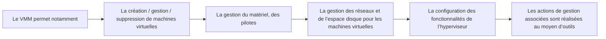
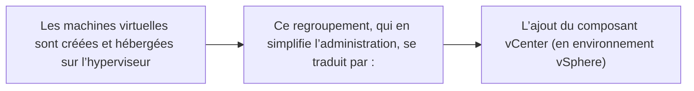

# Module 03 — La virtualisation des serveurs

Les parties ci-dessous reprennent le cours original, dans le même ordre. Les encadrés et les schémas répètent ses formulations.

## Parcours de lecture

1. Support · Module 03 - Support de cours · 5 pages transcrites

SOURCE DRIVE · TRANSCRIPTION DU SUPPORT

Le contenu des documents du dossier TSSR est transcrit ci-dessous, page par page. Les textes et tableaux sont intégrés à la page Web. Aucun fichier PDF, aucune diapositive entière ni aucune reproduction de page n’est affiché. Seuls des croquis ou visuels isolés et vérifiés peuvent accompagner la transcription. Les versions et les consignes restent celles des supports de formation. Les compléments IA sont conservés dans leur onglet distinct.

## Support · Module 03 - Support de cours · 5 pages transcrites

#### Module 03 – La virtualisation des serveurs

La virtualisation des serveurs

#### Objectifs

!!! note "À retenir"
    Lister un ensemble de solutions de virtualisation et de services virtualisés La virtualisation des serveurs

- Lister un ensemble de solutions de virtualisation et de services virtualisés

La virtualisation des serveurs

#### Types de serveurs et concentration

#### Choix du type de serveur et volume occupé

!!! note "À retenir"
    Les schémas comparent des serveurs indépendants, des serveurs rack et des serveurs regroupés dans un châssis.

Les schémas comparent des serveurs indépendants, des serveurs rack et des serveurs regroupés dans un châssis.

La virtualisation des serveurs

#### Les fournisseurs de solutions de virtualisation

#### Informations dans les visuels du support

!!! note "À retenir"
    Les exemples de fournisseurs ou solutions représentés sont VMware, Xen, KVM et Windows Server Hyper-V.

- Les exemples de fournisseurs ou solutions représentés sont VMware, Xen, KVM et Windows Server Hyper-V.

La virtualisation des serveurs

#### Les composantes d’une infrastructure de virtualisation

!!! note "À retenir"
    La machine hôte C’est le serveur physique qui dispose des ressources matérielles Processeurs et technologies de virtualisation La virtualisation des serveurs

La machine hôte

C’est le serveur physique qui dispose des ressources matérielles

Processeurs et technologies de virtualisation

| Processeurs et technologies de virtualisation | Intel | AMD |
| --- | --- | --- |
| Mécanisme de prise en charge de la virtualisation | VT-x | AMD-v |
| Mécanisme de prise en charge de SLAT | EPT | NPT / RVI |

La virtualisation des serveurs

#### Les composantes d’une infrastructure de virtualisation

!!! note "À retenir"
    L’hyperviseur L’hyperviseur correspond à la solution logicielle installée sur la machine hôte et sur laquelle seront hébergées des machines virtuelles Il est chargé de la gestion du matériel de l’hôte et de l’hébergement des machines virtuelles Solution Microsoft

L’hyperviseur

- L’hyperviseur correspond à la solution logicielle installée sur la machine hôte et sur laquelle seront hébergées des machines virtuelles
- Il est chargé de la gestion du matériel de l’hôte et de l’hébergement des machines virtuelles

Solution Microsoft

#### Hyper-V

Solution VMware

#### ESX / ESXi

#### Informations dans les visuels du support

!!! note "À retenir"
    Le premier schéma représente les composants du serveur hôte.

- Le premier schéma représente les composants du serveur hôte. Le second superpose l’hyperviseur à cet hôte et cite Hyper-V et ESX / ESXi.

La virtualisation des serveurs

#### Les composantes d’une infrastructure de virtualisation

**Visuel externe**

L’outil de gestion de la solution

- Le composant de gestion intégré à un hyperviseur est nommé : Virtual Machine Manager (VMM)
- Le VMM permet notamment
- La création / gestion / suppression de machines virtuelles
- La gestion du matériel, des pilotes
- La gestion des réseaux et de l’espace disque pour les machines virtuelles
- La configuration des fonctionnalités de l’hyperviseur
- Les actions de gestion associées sont réalisées au moyen d’outils

| Solution | Hyper-V | vSphere |
| --- | --- | --- |
| Outil de gestion | Gestionnaire Hyper-V | Client Web vSphere |

La virtualisation des serveurs

#### Les composantes d’une infrastructure de virtualisation

Les machines virtuelles

Les machines virtuelles sont créées et hébergées sur l’hyperviseur

VM

Les éléments de constitution d’une VM

Un fichier de caractéristiques matérielles

Un fichier d’image disque par disque dur dans la VM

Des ressources RAM et une image en mémoire vive (RAM)

Des ressources CPU

Une ou plusieurs cartes réseau virtuelles

#### Informations dans les visuels du support

!!! note "À retenir"
    Le schéma relie les cartes et ressources physiques du serveur hôte à l’hyperviseur, qui héberge les machines virtuelles.

- Le schéma relie les cartes et ressources physiques du serveur hôte à l’hyperviseur, qui héberge les machines virtuelles.

La virtualisation des serveurs

#### Les composantes d’une infrastructure de virtualisation

!!! example "Exemple"
    Le second schéma regroupe les hôtes dans le domaine AD, nommé `Domaine.ad` dans l’exemple.

**Visuel externe**

Les machines virtuelles

- Les machines virtuelles sont créées et hébergées sur l’hyperviseur
- Les hyperviseurs peuvent être gérés de manière autonome ou peuvent être regroupés au sein d’un même contexte de gestion
- Ce regroupement, qui en simplifie l’administration, se traduit par :
- L’intégration à un contexte de domaine AD des serveurs sur lesquels le rôle Hyper-V est installé (en environnement Microsoft)
- L’ajout du composant vCenter (en environnement vSphere)

Le schéma de gestion rassemble les hôtes HV1, HV2 et HV3 autour de vCenter. Le second schéma regroupe les hôtes dans le domaine AD, nommé `Domaine.ad` dans l’exemple.

La virtualisation des serveurs

#### Les composantes d’une infrastructure de virtualisation

Récapitulatif visuel des éléments

Ce schéma illustre les principaux éléments nécessaires à une infrastructure de virtualisation

Le schéma place l’hyperviseur entre l’hôte et les machines virtuelles (VM). L’outil d’administration communique avec la partie VMM de l’hyperviseur.

Ô

V

T

I

S

E

V M M

E

U

Outil d’administration

R

Référence du document : 1C2VQDIMlzps9N515P837u_4arX_qYyiD · SHA-256 79ec6dff67e456df…
