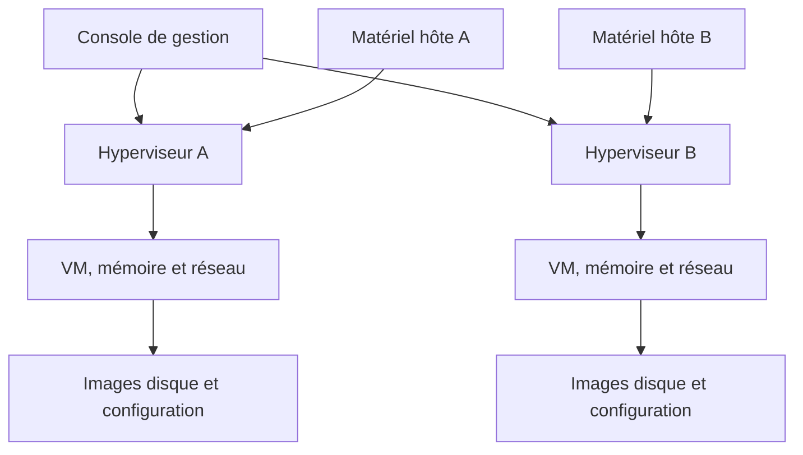

# Module 03 — La virtualisation des serveurs

Lorsque plusieurs services quittent leurs serveurs physiques, il faut identifier où chaque VM s’exécute, où ses fichiers sont stockés et par quel outil elle est administrée. Le module présente les quatre éléments d’une infrastructure virtualisée.

## Objectifs

- Lister les solutions et services virtualisés cités dans le support.
- Identifier la machine hôte, l’hyperviseur, les VM et leur outil de gestion.
- Lire les extensions processeur VT-x, AMD-V et SLAT.
- Distinguer un hôte autonome et un inventaire administré en commun.

## 1. Relier concentration et dimensionnement

Le cours illustre différents serveurs et leur place dans une baie ou un châssis. La concentration réduit l’espace physique occupé, mais le nombre de VM qu’un hôte peut accueillir dépend aussi du CPU, de la mémoire, du stockage, des réseaux et de la charge simultanée.

| Décision | Données à relever |
| --- | --- |
| Choisir un serveur physique | Encombrement, alimentation, capacité CPU et mémoire, connectique et stockage |
| Estimer la charge virtuelle | Nombre de VM, réserves nécessaires et usages en période de pointe |
| Préparer la maintenance | Services concernés par un arrêt, autre hôte disponible et accès à leurs ressources |

**Complément pédagogique.** Une implantation dense laisse davantage de place dans la baie. Pour une maintenance d’hôte, vérifier en plus qu’un autre hôte dispose d’une capacité suffisante.

## 2. Identifier le matériel et l’hyperviseur

La **machine hôte** fournit les composants physiques. L’**hyperviseur** gère ces ressources et héberge les machines virtuelles. Le support cite notamment Hyper-V et ESX/ESXi, et illustre VMware, Xen et KVM.

| Famille de processeur | Extensions de virtualisation citées | Traduction d’adresses de second niveau |
| --- | --- | --- |
| Intel | VT-x | EPT |
| AMD | AMD-V | NPT ou RVI |

La traduction de second niveau, ou **SLAT**, permet à l’hyperviseur d’utiliser une assistance matérielle pour la correspondance entre les adresses mémoire de l’invité et celles de l’hôte. Pour une virtualisation imbriquée, vérifier aussi quelles fonctions sont exposées par l’hyperviseur extérieur.

## 3. Décomposer une VM

| Composant | Ce qu’il représente dans l’infrastructure |
| --- | --- |
| Fichier de caractéristiques | Décrit le matériel et les paramètres de la VM. |
| Image disque | Porte les données d’un disque virtuel. Une VM peut avoir plusieurs images. |
| Mémoire | RAM allouée à l’invité pendant l’exécution. |
| CPU | Ressources d’exécution présentées sous forme de processeurs virtuels. |
| Cartes réseau | Interfaces qui relient l’invité aux réseaux virtuels sélectionnés. |

Identifier la configuration, les images disque et les dépendances réseau avant de déplacer une VM. Les formats, modèles, snapshots et migrations sont étudiés dans d’autres modules. Le support M03 établit le rôle de ces objets.

## 4. Administrer un hôte ou plusieurs

Le support emploie **Virtual Machine Manager (VMM)** comme désignation de l’outil de gestion. Celui-ci sert à créer, configurer ou supprimer des VM, à régler leur matériel, leur réseau et leur espace disque, et à administrer certaines fonctions de l’hyperviseur.

| Plateforme du support | Exemple d’outil | Exemple d’organisation |
| --- | --- | --- |
| Hyper-V | Gestionnaire Hyper-V | Administrer les serveurs Hyper-V dans le contexte d’un domaine AD. |
| vSphere | Client Web vSphere | Regrouper les hôtes de l’inventaire avec vCenter. |

Un inventaire central facilite les tâches de gestion. La reprise d’une VM dépend en plus des mécanismes de disponibilité, de la capacité restante et des accès réseau et stockage. L’intégration au domaine et l’ajout d’un outil de gestion sont des exemples d’organisation cités par le support.

**Illustration IA / externe au cours — composants et plan de gestion.**

## 5. Cas d’application — Inventorier deux hôtes

Deux serveurs sont visibles dans la même console. Une VM héberge une application de test et une autre contient ses données.

1. Relever le nom des deux hôtes, le rôle de l’hyperviseur et la console qui les administre.
2. Pour chaque VM, repérer CPU, mémoire, cartes réseau et images disque. Identifier sur quel hôte elle s’exécute et quels services en dépendent.
3. Identifier les accès nécessaires à l’application. Vérifier où sont stockés les fichiers et quels réseaux seraient disponibles après un changement d’hôte.
4. En cas de maintenance, distinguer le constat « les hôtes sont visibles ensemble » de la preuve « la VM fonctionne sur le second hôte avec les accès attendus ». La preuve demande un scénario testé et des ressources disponibles.

Il s’agit d’un exemple de lecture d’infrastructure. Le dossier du module 3 fournit un support de cours, sans énoncé de TP.

## À retenir

L’hôte fournit des ressources. L’hyperviseur les présente aux VM. La console administre les objets. Pour évaluer la reprise d’un service, suivre également ses disques, ses réseaux et ses dépendances.

## Mini-quiz — 5 questions {#question-de-revision}

1. Où se trouve la capacité CPU réellement disponible ?
2. Quelle fonction SLAT est citée côté Intel et côté AMD ?
3. Quels fichiers distinguer avant de déplacer une VM ?
4. À quoi sert l’outil désigné VMM dans le support ?
5. La console centrale voit deux hôtes. Que faut-il contrôler pour justifier une reprise ?

??? success "Réponses commentées"

    1. Sur l’hôte physique. L’hyperviseur répartit la capacité entre les VM.
    2. EPT chez Intel et NPT/RVI chez AMD. VT-x et AMD-V désignent les extensions de virtualisation associées.
    3. Le fichier de caractéristiques et les images de chaque disque. Vérifier aussi le réseau et les ressources attendues.
    4. À créer et configurer les VM et à administrer le matériel, les réseaux et les fonctions de l’hyperviseur.
    5. Le mécanisme de disponibilité, la capacité de secours et l’accès de l’autre hôte aux fichiers et réseaux nécessaires. Un essai confirme le résultat.

## Pour pratiquer et réviser

- [Fiche de révision](../../revision/13-virtualisation-serveurs/module-03.md)
- [Kahoot existant](../../kahoot/13-virtualisation-serveurs-module-03.md)
- [Sommaire de Virtualisation de serveurs](index.md)

## Provenance pédagogique

Le support M03 présente le matériel, les hyperviseurs, les VM et les outils de gestion dans leur contexte de 2022. Le schéma et le cas d’inventaire rendent leurs relations explicites.
