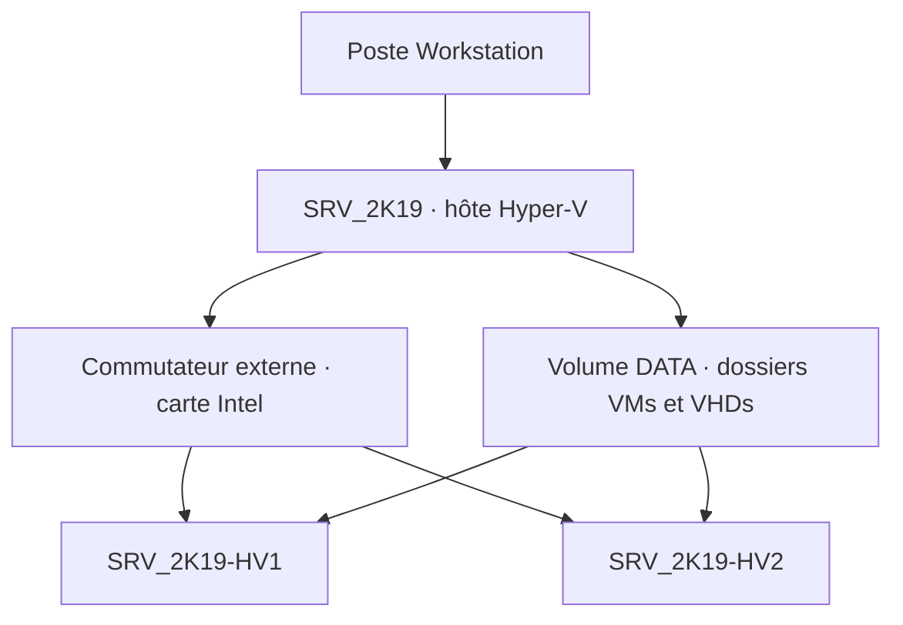

# Module 04 — Découverte d’Hyper-V

L’atelier reprend la VM Windows Server 2019 du module 2 et y installe Hyper-V. Dans cette maquette, Workstation héberge la VM Windows, qui héberge à son tour deux invités Hyper-V.

## Objectifs

- Préparer les ressources et installer le rôle Hyper-V.
- Repérer la console, les réglages d’une VM et les types de commutateurs virtuels.
- Créer une VM de génération 2, puis produire une seconde VM par export et import.
- Vérifier la communication entre les invités et identifier le snapshot final.

## 1. Préparer l’hôte Hyper-V

Le support présente les extensions Intel VT-x ou AMD-V, les réglages BIOS/UEFI, la mémoire, le processeur et l’espace disque. Les rappels Hyper-V v2 sous Windows Server 2008 R2, Hyper-V v3 sous Windows 8 ou Windows Server 2012 et SLAT situent les exemples du support. Le TP travaille sous Windows Server 2019.

| Environnement | Installation présentée |
| --- | --- |
| Windows Server | Ajouter le rôle Hyper-V depuis le Gestionnaire de serveur. |
| Client Windows cité dans le support | Activer Hyper-V dans les fonctionnalités du système. |
| Atelier imbriqué | Préparer la VM Workstation et vérifier que ses extensions de virtualisation sont exposées avant d’ajouter le rôle. |

Le support mentionne deux redémarrages dans son scénario historique. Dans le laboratoire, suivre l’assistant puis vérifier que le rôle démarre et que la console gère l’hôte. Si l’installation échoue pour cause de fonctionnalités processeur, vérifier la virtualisation imbriquée sur l’hôte extérieur. [Dépannage de la virtualisation imbriquée Hyper-V](https://learn.microsoft.com/en-us/troubleshoot/windows-server/high-availability/hyper-v-nested-virtualization)

## 2. Lire la console et choisir le commutateur

Le **Gestionnaire Hyper-V** réunit les hôtes, la liste et l’état des VM, les réglages et les actions. La **connexion à la machine virtuelle** ouvre sa console. Fermer cette fenêtre laisse la VM dans son état d’exécution. Le support cite `Ctrl` + `Alt` + `Gauche` pour la bascule et `Ctrl` + `Alt` + `Fin` pour envoyer `Ctrl` + `Alt` + `Suppr` à l’invité.

Le cours décrit le matériel, les services d’intégration, les points de contrôle, l’import et l’export. Il situe la limite sur l’USB amovible dans le contexte de Hyper-V v2.

| Type présenté | Portée |
| --- | --- |
| Privé | Entre les VM du commutateur. |
| Interne | Entre ces VM et leur hôte Hyper-V. |
| Externe | Liaison au réseau physique via une carte choisie. |
| Externe dédié | Carte physique réservée à ce raccordement dans le montage présenté. |

Le support aborde l’identification VLAN pour les réseaux internes et externes. Dans l’atelier, le commutateur externe est associé à la carte Intel du serveur imbriqué. La migration à chaud reste désactivée.

**Illustration IA / externe au cours — montage du laboratoire.**

## 3. Choisir génération, disque et mode d’import

Le support évoque le disque d’amorçage IDE d’une VM de première génération. L’atelier choisit une **génération 2**, avec amorçage UEFI et disque virtuel SCSI. Vérifier la compatibilité du système invité au moment de la création. [Choisir la génération d’une VM Hyper-V](https://learn.microsoft.com/en-us/windows-server/virtualization/hyper-v/plan/Should-I-create-a-generation-1-or-2-virtual-machine-in-hyper-v)

Un export rassemble la configuration et les fichiers nécessaires au déplacement ou à la duplication. Le support historique décrit un import sans duplication des fichiers dans son exemple. Le TP demande **Copy the virtual machine**. Ce mode crée une nouvelle identité de VM, avec des emplacements à contrôler pour éviter de réutiliser le disque de la première. [Exporter et importer une VM Hyper-V](https://learn.microsoft.com/en-us/windows-server/virtualization/hyper-v/deploy/export-and-import-virtual-machines)

## 4. TP guidé — Installer Hyper-V et dupliquer un invité

**Durée du support.** Environ une heure. Prendre la VM `SRV_2K19` préparée au module 2 et l’ISO Windows Server 2019 de laboratoire.

### A. Préparer le serveur

1. Dans Workstation, porter la mémoire de `SRV_2K19` à **8 Go** et ajouter un second disque SCSI de **100 Go**.
2. Démarrer la VM hôte. Identifier le disque ajouté avant de créer le volume `DATA`.
3. Installer le rôle Hyper-V. Sélectionner l’interface Intel pour le commutateur externe et laisser la migration à chaud désactivée.
4. Placer les configurations dans `<VOLUME_DATA>\VMs` et les disques dans `<VOLUME_DATA>\VHDs`. Préparer l’ISO sur le bureau de la VM hôte.
5. Après redémarrage, ouvrir le Gestionnaire Hyper-V. Vérifier l’hôte, le commutateur et les chemins avant la création de l’invité.

### B. Créer et installer `SRV_2K19-HV1`

| Paramètre | Valeur du TP |
| --- | --- |
| Génération | 2 |
| Mémoire | 2 Go fixes |
| Réseau | Commutateur externe associé à la carte Intel |
| Disque | VHDX de 32 Go |
| Média | ISO Windows Server 2019 de laboratoire |

Créer l’ordinateur virtuel, lancer sa console et installer Windows Server 2019. Contrôler le premier démarrage et la présence des fichiers sur le volume prévu.

### C. Généraliser et créer la copie

1. Dans **HV1**, lancer Sysprep. Choisir **Generalize** et **Shutdown**.
2. Quand l’invité est arrêté, l’exporter dans le dossier `EXPORT` prévu sous `VMs`. Attendre que les fichiers de l’export soient disponibles.
3. Ouvrir **Import Virtual Machine**. Pointer vers le répertoire contenant l’export, puis choisir **Copy the virtual machine**.
4. Donner à la copie des dossiers propres sous `VMs` et `VHDs`. La renommer `SRV_2K19-HV2`.
5. Vérifier que les deux VM figurent dans l’inventaire, utilisent des fichiers distincts et démarrent.

### D. Prouver la communication et garder l’état final

Relever l’adresse de chaque invité dans sa console, puis envoyer un `ping` vers l’adresse **de l’autre invité**. En cas d’échec, vérifier d’abord le commutateur, l’adressage et le pare-feu Windows du laboratoire. La capture de la solution montre un ping vers une adresse affichée aussi comme passerelle. Cette preuve ne suffit pas pour valider la communication demandée.

Créer ensuite le snapshot **`Fin atelier 2` de la VM hôte Workstation** `SRV_2K19`, comme le demande l’énoncé. La solution ne montre pas cette dernière étape. Le snapshot demandé se trouve dans Workstation. Un point de contrôle d’un invité Hyper-V porte sur un autre objet.

## À retenir

- Le commutateur externe relie les invités au segment prévu.
- L’export produit les fichiers nécessaires à l’import. Le mode copie et les dossiers séparés permettent de garder deux VM.
- La preuve réseau vise l’adresse de l’autre invité, et le snapshot final concerne la VM hôte Workstation.

## Mini-quiz — 5 questions {#question-de-revision}

1. À quel niveau contrôler les extensions de virtualisation si Hyper-V ne s’installe pas dans `SRV_2K19` ?
2. Quel type de commutateur relie les invités au réseau physique choisi ?
3. Quelle génération et quel disque utilise le premier invité du TP ?
4. Quel mode d’import permet de garder l’original et la copie ?
5. Quelles deux preuves permettent de conclure l’atelier ?

??? success "Réponses commentées"

    1. Sur le processeur de l’hôte physique et dans les réglages d’exposition des extensions à la VM Workstation.
    2. Un commutateur externe associé à la carte Intel prévue.
    3. Génération 2 et VHDX de 32 Go, avec 2 Go de mémoire fixe dans ce laboratoire.
    4. Copy the virtual machine. Vérifier aussi les emplacements de configuration et de disque de la seconde VM.
    5. Un ping entre les adresses relevées sur les deux invités et le snapshot de la VM hôte Workstation demandé par l’énoncé.

## Pour pratiquer et réviser

- [Énoncé de l’atelier Hyper-V](../../tp/13-virtualisation-serveurs/module-04/tp-01-hyper-v.md) et [correction](../../tp/13-virtualisation-serveurs/module-04/correction-tp-01.md)
- [Fiche de révision](../../revision/13-virtualisation-serveurs/module-04.md)
- [Kahoot existant](../../kahoot/13-virtualisation-serveurs-module-04.md)
- [Sommaire de Virtualisation de serveurs](index.md)

## Provenance pédagogique

Le support M04 et l’atelier 2 donnent les réglages, consignes et captures. Le schéma de la maquette et les vérifications intermédiaires explicitent le scénario. Les précisions sur les générations et l’import sont documentées par Microsoft.
