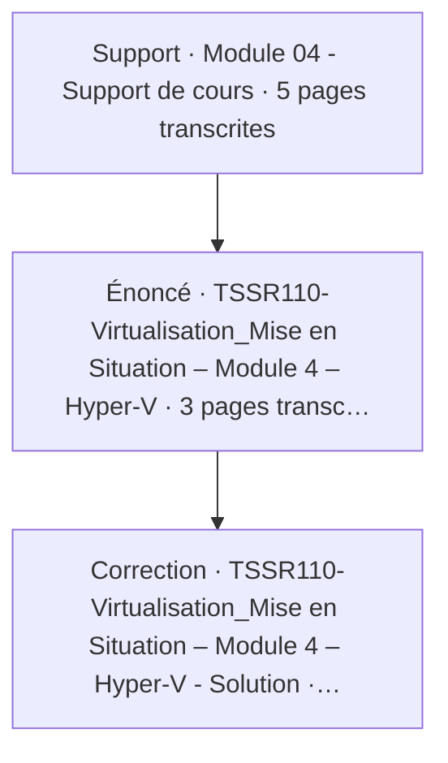
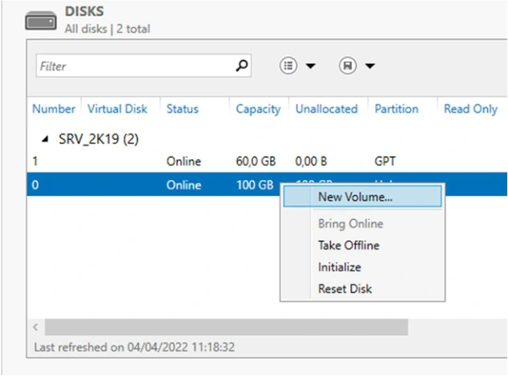
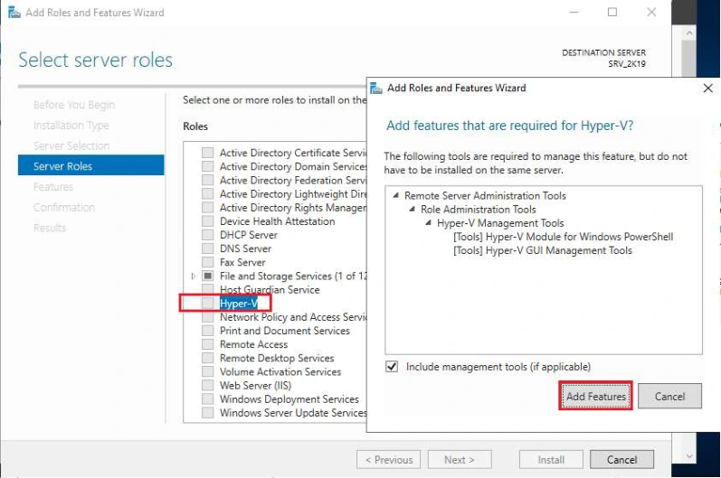
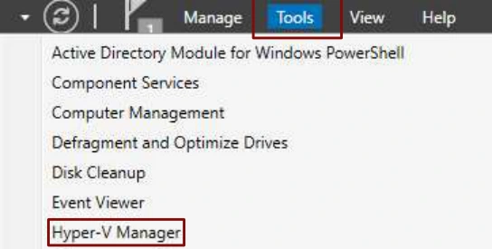

# Module 04 — Découverte d’Hyper-V

Les parties ci-dessous reprennent le cours original, dans le même ordre. Les encadrés et les schémas répètent ses formulations.

## Parcours de lecture

1. Support · Module 04 - Support de cours · 5 pages transcrites
2. Énoncé · TSSR110-Virtualisation_Mise en Situation – Module 4 – Hyper-V · 3 pages transcrites
3. Correction · TSSR110-Virtualisation_Mise en Situation – Module 4 – Hyper-V - Solution · 15 pages transcrites

**Visuel externe**

SOURCE DRIVE · TRANSCRIPTION DU SUPPORT

Le contenu des documents du dossier TSSR est transcrit ci-dessous, page par page. Les textes et tableaux sont intégrés à la page Web. Aucun fichier PDF, aucune diapositive entière ni aucune reproduction de page n’est affiché. Seuls des croquis ou visuels isolés et vérifiés peuvent accompagner la transcription. Les versions et les consignes restent celles des supports de formation. Les compléments IA sont conservés dans leur onglet distinct.

## Support · Module 04 - Support de cours · 5 pages transcrites

#### Module 04 – Découverte d’Hyper-V

Découverte d’Hyper-V

#### Objectifs

- Découvrir Hyper-V 2019

#### Prérequis et installation

Découverte d’Hyper-V

#### Prérequis matériel

#### Installation

!!! note "À retenir"
    Versions : Hyper-V v2 (W2008 R2), Hyper-V v3 (W8, W2012) Pour les serveurs, rôle intégré à installer avec le

- Versions : Hyper-V v2 (W2008 R2), Hyper-V v3 (W8, W2012)
- Pour les serveurs, rôle intégré à installer avec le

#### gestionnaire de serveur

!!! note "À retenir"
    Pour le client Windows 8, fonctionnalité intégrée à activer Processeur 64 bits Intel VT-x ou AMD-V (attention aux réglages BIOS / UEFI) CPU, RAM et espace disque adaptés

!!! warning "Attention"
    Pour le client Windows 8, fonctionnalité intégrée à activer Processeur 64 bits Intel VT-x ou AMD-V (attention aux réglages BIOS / UEFI) CPU, RAM et espace disque adaptés

**Visuel externe**

- Pour le client Windows 8, fonctionnalité intégrée à activer
- Processeur 64 bits Intel VT-x ou AMD-V (attention aux réglages BIOS / UEFI)
- CPU, RAM et espace disque adaptés

#### Prérequis logiciel

!!! note "À retenir"
    Un système Windows Serveur (W2008 et supérieur) Ou un système Windows 8 Pro 64bits (+SLAT Second Level Address Translation) Lors de l’installation du rôle, 2 redémarrages sont nécessaires pour permettre le démarrage de l’hyperviseur en mode natif (type 1) Découverte d’Hyper-V

- Un système Windows Serveur (W2008 et supérieur)
- Ou un système Windows 8 Pro 64bits (+SLAT Second Level Address Translation)

Lors de l’installation du rôle, 2 redémarrages sont nécessaires pour permettre le démarrage de l’hyperviseur en mode natif (type 1)

Découverte d’Hyper-V

#### Utilisation et mise en œuvre

**Visuel externe**

- Interaction avec le système hôte
- Les médias amovibles USB ne sont pas gérés avec la v2 (W2008 R2)
- Touche de bascule : Ctrl + Alt + Gauche
- Services d’intégration (selon la compatibilité des systèmes hôtes)
- Fonctionnalités
- Chaque VM peut être affichée dans une console séparée
- Gestion poussée des paramètres matériels (BIOS, mémoire …)
- Capture instantanée
- Importation et exportation (obligatoire avec la v2 pour la copie ou le transfert)
- Spécificités
- Outil « serveur » orienté administrateur, moins convivial
- Fichiers des VM difficilement manipulables manuellement
- Pour faire « Ctrl + Alt + Suppr » dans la VM, taper Ctrl + Alt + Fin

Découverte d’Hyper-V

#### Paramétrages réseau

**Visuel externe**

Types de réseau virtuel

- Identification des LAN pour les réseaux internes et externes (VLAN)
- Réseau privé : réseau entre les invités uniquement
- Interne uniquement : réseau interne avec connexion à l’hôte, les VM ne peuvent communiquer qu’entre elles et avec l’hôte (Host-only)
- Externe : équivalent à une connexion au réseau physique (Bridged)
- Externe dédié : la carte réseau externe est associée de manière exclusive à une carte physique de l’hôte

Découverte d’Hyper-V

#### Étapes de configuration

!!! note "À retenir"
    Définition des réseaux virtuels Avec l’outil gestionnaire de

- Définition des réseaux virtuels
- Avec l’outil gestionnaire de

#### réseau virtuel (volet de droite de

!!! note "À retenir"
    la console) Non définis par défaut, à créer selon les besoins Un seul réseau externe est possible par carte réseau hôte (Hyper-V « s’approprie » la carte réseau physique) Création des machines virtuelles Avec l’assistant Nouveau >

**Visuel externe**

la console)

- Non définis par défaut, à créer selon les besoins
- Un seul réseau externe est possible par carte réseau hôte
- (Hyper-V « s’approprie » la carte réseau physique)
- Création des machines virtuelles
- Avec l’assistant Nouveau >

#### Ordinateur virtuel

!!! note "À retenir"
    Définir l’emplacement de stockage et les paramètres matériels Le disque d’amorçage d’une machine virtuelle de première génération est obligatoirement sur une interface de type IDE.

- Définir l’emplacement de stockage et les paramètres matériels

Le disque d’amorçage d’une machine virtuelle de première génération est obligatoirement sur une interface de type IDE.

Découverte d’Hyper-V

#### Console de gestion

!!! note "À retenir"
    Liste des serveurs Liste et état des VM Gestion du serveur Informations sur la VM sélectionnée Gestion de la VM Découverte d’Hyper-V

Liste des serveurs

Liste et état des VM

Gestion du serveur

Informations sur la VM sélectionnée

Gestion de la VM

Découverte d’Hyper-V

#### Console d’ordinateur virtuel

Gestion de base

Gestion de la fenêtre, la fermeture n’arrête pas la VM

Gestion des paramètres et du matériel

Découverte d’Hyper-V

#### Exportation et importation

- Des manipulations plus contraignantes (avec Hyper-V v3)
- Pour pouvoir être dupliquée ou déplacée, une VM doit être exportée
- Pour pouvoir importer, il faut disposer des fichiers de configuration
- L’importation sans « Dupliquer tous les fichiers … » empêche de réimporter la même VM
- L’option « Dupliquer tous les fichiers … » permet d’utiliser plusieurs fois la même VM exportée, MAIS les disques VHD sont alors copiés dans un même emplacement
- Exemple de procédure
- Exporter la VM dans un emplacement dédié
- Copier le répertoire contenant la VM à l’emplacement voulu
- Importer la VM sans « Dupliquer les fichiers … »

Attention à bien sélectionner le dossier contenant tous les fichiers

Référence du document : 1aneTKvR2P5nHtruMxJcArjnBcQSBnWoJ · SHA-256 3077cf07986b4a78…

## Énoncé · TSSR110-Virtualisation_Mise en Situation – Module 4 – Hyper-V · 3 pages transcrites

#### Énoncé :

#### Atelier N°2

TP du Module 04 – Découverte d’Hyper-V

Avant de démarrer ce TP, il convient d’avoir suivi les prérequis du Module 4.

Durée estimée

1 heure

#### Objectif :

Mise en place et découverte d’un hyperviseur Microsoft Hyper-V, appréhender les menus de configuration.

#### Prérequis :

Disposer de la machine virtuelle « SRV_2K19 » créée au module 2.

#### Énoncé :

Sous VMware Workstation

- Augmenter la taille de la mémoire vive à 8 Go de la VM « SRV_2K19 ».
- Lui ajouter un 2ème disque dur de type SCSI de 100 Go.
- Démarrer « SRV_2K19 ».

Remarque

Pour des raisons inhérentes au fonctionnement des machines mises à disposition par l’centre de formation, la mise en œuvre de l’outil de virtualisation Hyper-V sera réalisée exclusivement dans la machine virtuelle « SRV_2K19 ». Dans une « vraie » situation d’entreprise, cet hyperviseur serait déployé sur un serveur physique.

Dans la VM SRV_2K19

- A partir du nouveau disque, créer un volume appelé « DATA ».
- Installer le rôle Hyper-V et utiliser la carte réseau « ethernet0 » comme switch virtuel. Vous ne permettrez pas l’usage de la migration à chaud des VMs.
- Définir l’emplacement de stockage des VMs sur le volume « DATA » dans un dossier « VMs ».
- Stocker les disques durs des VMs dans le dossier « VHDs ».
- Placer l’image ISO du système Windows Server 2019 sur le bureau de la VM.
- Créer une VM avec Hyper-V nommée « SRV_2K19-HV1 » et modifier les paramètres comme suit :
- « Generation 2 »
- 2 Go de mémoire non dynamique
- carte réseau connecté à la carte Intel
- disque dur virtuel VHDx de 32 Go

- Installer un système d’exploitation en indiquant l’image ISO du système Windows Server 2019 placée précédemment sur le bureau.
- Démarrer la VM Hyper-V, s’y placer et lancer l’installation du système.
- Une fois l’installation terminée, exécuter le programme SYSPREP. Y cocher la case « generalize » et sélectionner « shutdown ».
- Exporter la machine virtuelle dans le dossier que vous créerez pour l’occasion « VMs/EXPORT/Machines virtuelles » du volume DATA.
- Attendre la fin de l’export (cela peut prendre 5 mn, même si on ne voit aucune information sur l’avancement), puis déployer une nouvelle VM à l’aide du menu « Import Virtual Machine » en indiquant le chemin contenant la VM exportée précédemment.
- Sélectionner « Copy the virtual machine » et indiquer les nouveaux emplacements pour les fichiers de la VM, toujours à partir des dossiers par défaut (VMs et VHDs), mais dans des sous-dossiers nommés « SRV_2K19-HV2).
- Renommer cette nouvelle VM en « SRV_2K19-HV2 ».
- Démarrer les deux machines virtuelles, relever leurs adresses IPs et effectuer un test de liaison ping entre elles. La liaison doit être fonctionnelle. Si ce n’est pas le cas, vérifier les pare-feux Windows.
- Effectuer un snapshot avec VMware Workstation de la VM « SRV_2K19 » à nommer « Fin

#### atelier 2 ».

Schéma

Référence du document : 1uxZIcSvTmR1tcXuuol2PnKzKJggAnMLf · SHA-256 f4d4ade5ba101682…

## Correction · TSSR110-Virtualisation_Mise en Situation – Module 4 – Hyper-V - Solution · 15 pages transcrites

Correction originale : à consulter après avoir tenté l’exercice.

Solutions

#### Atelier N°2

TP du Module 04 – Découverte d’Hyper-V

Avant de démarrer ce TP, il convient d’avoir suivi les prérequis du Module 4.

Durée estimée

1 heure

#### Objectif :

Mise en place et découverte d’un hyperviseur Microsoft Hyper-V, appréhender les menus de configuration.

#### Prérequis :

Disposer de la machine virtuelle « SRV_2K19 » créée au module 2.

#### Énoncé :

Sous VMware Workstation

- Augmenter la taille de la mémoire vive à 8 Go de la VM « SRV_2K19 ».
- Lui ajouter un 2ème disque dur de type SCSI de 100 Go.

- Démarrer « SRV_2K19 ».

Dans la VM SRV_2K19

- A partir du nouveau disque, créer un volume appelé « DATA ».

Capture isolée du support, page 3

- Installer le rôle Hyper-V et utiliser la carte réseau « ethernet0 » comme switch virtuel. Vous ne permettrez pas l’usage de la migration à chaud des VMs.

- Installer le rôle Hyper-V et utiliser la carte réseau « ethernet0 » comme switch virtuel. Vous ne permettrez pas l’usage de la migration à chaud des VMs.

Capture isolée du support, page 5

- Définir l’emplacement de stockage des VMs sur le volume « DATA » dans un dossier « VMs ».
- Stocker les disques durs des VMs dans le dossier « VHDs ».

#### Informations dans les visuels du support

- Dans Default Stores, indiquer D:\VHDs pour les disques virtuels et D:\VMs pour la configuration des machines virtuelles.
- Dans Confirm installation selections, vérifier Hyper-V et les outils d’administration. Cocher le redémarrage automatique si nécessaire, puis confirmer et lancer l’installation.

- Placer l’image ISO du système Windows Server 2019 sur le bureau de la VM
- Créer une VM avec Hyper-V nommée « SRV_2K19-HV1 » et modifier les paramètres comme suit :
- « Generation 2 »
- 2 Go de mémoire non dynamique
- carte réseau connecté à la carte Intel
- disque dur virtuel VHDx de 32 Go

Capture isolée du support, page 8

#### Informations dans les visuels du support

- Dans le Gestionnaire Hyper-V, choisir New puis Virtual Machine. Avancer depuis Before You Begin.
- Dans Specify Generation, sélectionner Generation 2. L’assistant précise que la génération reste fixée après la création de la machine.

#### Informations dans les visuels du support

- Dans Assign Memory, allouer 2048 Mo et laisser Use Dynamic Memory désactivé.
- Dans Configure Networking, choisir le commutateur virtuel associé à l’adaptateur Intel(R) 82574L Gigabit Network Connection.

- Installer un système d’exploitation en indiquant l’image ISO du système Windows Server 2019 placée précédemment sur le bureau.

- Démarrer la VM Hyper-V, s’y placer et lancer l’installation du système.
- Une fois l’installation terminée, exécuter le programme SYSPREP. Y cocher la case « generalize » et sélectionner « shutdown ».

L’application est située dans C:\Windows\System32\Sysprep

- Exporter la machine virtuelle dans le dossier que vous créerez pour l’occasion « VMs/EXPORT/Machines virtuelles » du volume DATA.

- Attendre la fin de l’export (cela peut prendre 5 mn, même si on ne voit aucune information sur l’avancement), puis déployer une nouvelle VM à l’aide du menu « Import Virtual Machine » en indiquant le chemin contenant la VM exportée précédemment.
- Sélectionner « Copy the virtual machine » et indiquer les nouveaux emplacements pour les fichiers de la VM, toujours à partir des dossiers par défaut (VMs et VHDs), mais dans des sous-dossiers nommés « SRV_2K19-HV2).

- Renommer cette nouvelle VM en « SRV_2K19-HV2 »

- Démarrer les deux machines virtuelles, relever leurs adresses IPs et effectuer un test de liaison ping entre elles. La liaison doit être fonctionnelle. Si ce n’est pas le cas, vérifier les pare-feux Windows.

Référence du document : 1142XOvU2ghSaqE4CYnISjPMk-fTJ-r5J · SHA-256 72b258309cf45e03…

## Fiche de synthèse

Les lignes reprennent les titres du cours et la première phrase de chaque partie.

| Partie | Repère du cours |
| --- | --- |
| Correction · TSSR110-Virtualisation_Mise en Situation – Module 4 – Hyper-V - Solution · 15 pages transcrites | Correction originale : à consulter après avoir tenté l’exercice. |
