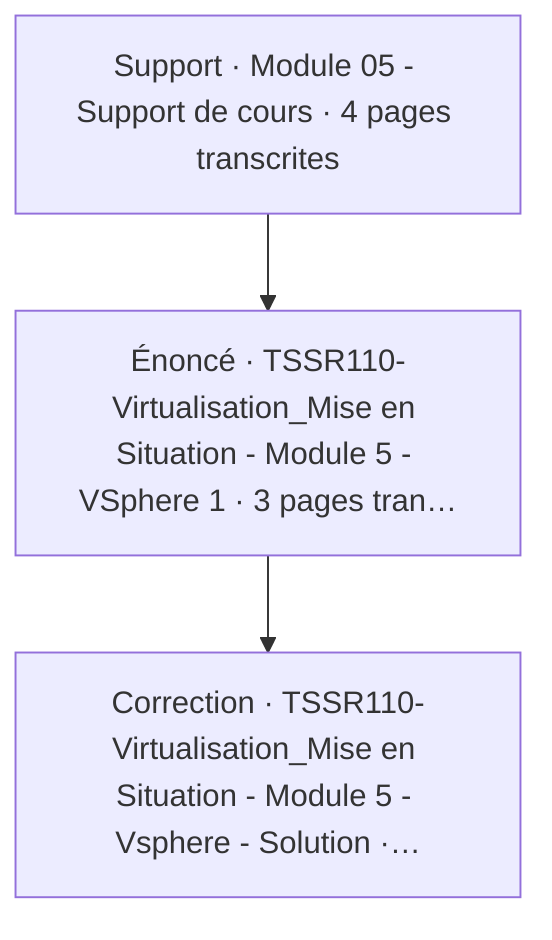
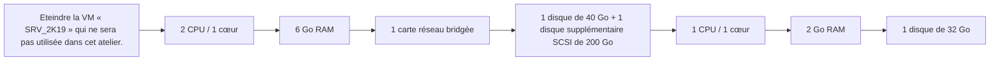
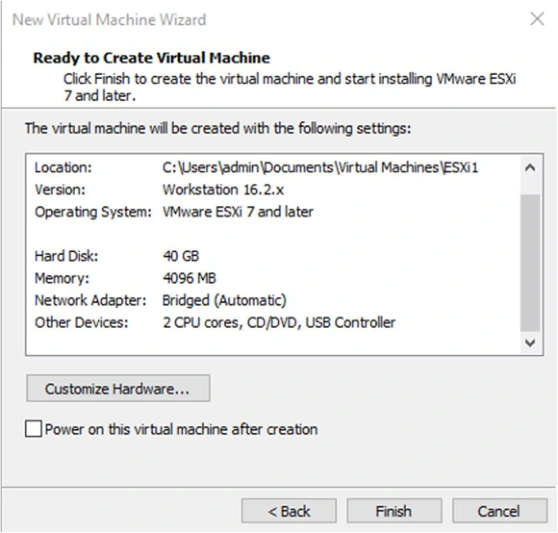
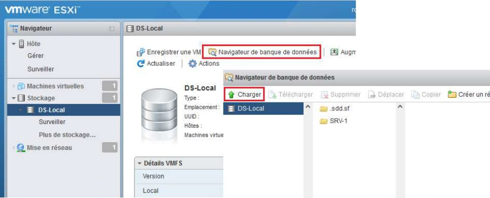
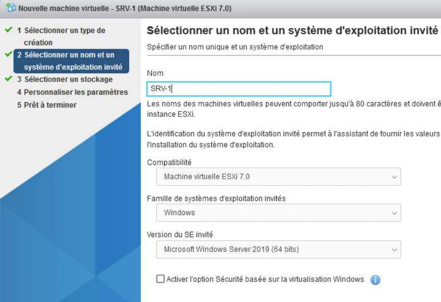

```mermaid
flowchart LR
    N1["Eteindre la VM « SRV_2K19 » qui ne sera pas utilisée dans cet atelier."]
    N2["2 CPU / 1 cœur"]
    N3["6 Go RAM"]
    N4["1 carte réseau bridgée"]
    N5["1 disque de 40 Go + 1 disque supplémentaire SCSI de 200 Go"]
    N6["Sélection de l’image ISO d’ESXi récupérée depuis le serveur « distrib »"]
    N7["Choix du nom et de l’emplacement de stockage de la VM"]
    N8["Définition de la taille du disque dur principal (40 Go)"]
    N1 --> N2
    N2 --> N3
    N3 --> N4
    N4 --> N5
    N5 --> N6
    N6 --> N7
    N7 --> N8
```

# Module 05 — Les composantes d’une infrastructure vSphere

Les parties ci-dessous reprennent le cours original, dans le même ordre. Les encadrés et les schémas répètent ses formulations.

## Parcours de lecture

1. Support · Module 05 - Support de cours · 4 pages transcrites
2. Énoncé · TSSR110-Virtualisation_Mise en Situation - Module 5 - VSphere 1 · 3 pages transcrites
3. Correction · TSSR110-Virtualisation_Mise en Situation - Module 5 - Vsphere - Solution · 15 pages transcrites

**Visuel externe**

SOURCE DRIVE · TRANSCRIPTION DU SUPPORT

Le contenu des documents du dossier TSSR est transcrit ci-dessous, page par page. Les textes et tableaux sont intégrés à la page Web. Aucun fichier PDF, aucune diapositive entière ni aucune reproduction de page n’est affiché. Seuls des croquis ou visuels isolés et vérifiés peuvent accompagner la transcription. Les versions et les consignes restent celles des supports de formation. Les compléments IA sont conservés dans leur onglet distinct.

## Support · Module 05 - Support de cours · 4 pages transcrites

#### Module 05 – Les composantes d’une infrastructure vSphere

!!! note "À retenir"
    Les composantes d’une infrastructure vSphere

Les composantes d’une infrastructure vSphere

#### Objectifs

!!! note "À retenir"
    Décrire les composantes d’une infrastructure vSphere 6.x Les composantes d’une infrastructure vSphere

- Décrire les composantes d’une infrastructure vSphere 6.x

Les composantes d’une infrastructure vSphere

#### De vSphere 5 à vSphere 6

!!! note "À retenir"
    Disparition de l’ESX et du Service Console Disparition du client Lourd vSphere Client vCenter disponible sous forme d'Appliance virtuelle Apparition du Web client vSphere (lié à vCenter) Machines virtuelles Service console VM de gestion Hyperviseur Matériel Les composantes d’une infrastructure vSphere

**Visuel externe**

- Disparition de l’ESX et du Service Console
- Disparition du client Lourd vSphere Client
- vCenter disponible sous forme d'Appliance virtuelle
- Apparition du Web client vSphere (lié à vCenter)

Machines virtuelles

Service console

VM de gestion

Hyperviseur

Matériel

Les composantes d’une infrastructure vSphere

#### Composantes d’une solution vSphere

!!! note "À retenir"
    vCenter ESXi VM VM Attention : les versions des différents éléments d’une infrastructure vSphere doivent concorder !

!!! warning "Attention"
    vCenter ESXi VM VM Attention : les versions des différents éléments d’une infrastructure vSphere doivent concorder !

vCenter

| Élément | Nom de l’élément dans la solution VMware |
| --- | --- |
| Solution de virtualisation | vSphere |
| Hyperviseur | ESXi / ESX |
| Client d’administration | Client vSphere / vSphere Web Client |
| Solution de regroupement d’hyperviseurs | vCenter |

ESXi

VM

VM

Attention : les versions des différents éléments d’une infrastructure vSphere doivent concorder !

Les composantes d’une infrastructure vSphere

#### Les principales fonctionnalités

!!! note "À retenir"
    Fonctionnalités abordées dans le module 8 Les composantes d’une infrastructure vSphere

| Fonctionnalité | Utilité |
| --- | --- |
| vMotion* | Déplacement de machine virtuelle d’un hôte vers un autre hôte. |
| Storage vMotion* | Déplacement du stockage d’une machine virtuelle d’une banque de donnée vers une autre banque de donnée. |
| DRS | Automatisation du déplacement de machines virtuelles d’un hôte vers un autre hôte disposant de plus de ressources. |
| Storage DRS | Automatisation du déplacement de machines virtuelles d’un datastore vers un autre disposant de plus de ressources. |
| DPM | Fonctionnalité permettant d’automatiser l’entrée et la sortie de veille d’hyperviseurs en fonction de la charge d’activité du cluster. |
| HA | High Availability : fonctionnalité de haute disponibilité. Lors de la défaillance d’un hôte, les machines virtuelles ciblées seront redémarrées sur un autre hôte du cluster. |
| FT | Fault Tolerance : fonctionnalité de très haute disponibilité protégeant des machines virtuelles ciblées de la défaillance d’un hôte. Aucune interruption de service n’affectera les VM ciblées. |

* Fonctionnalités abordées dans le module 8

Les composantes d’une infrastructure vSphere

#### Tableau comparatif des coûts

!!! note "À retenir"
    Les composantes d’une infrastructure vSphere

| Comparatif des solutions | Description | Coût au 16/08/2021 |
| --- | --- | --- |
| ESXi seul | Gratuit. Nécessite simplement la création d’un compte VMware. | 0 € |
| Suite Essentials | Les licences vSphere Essentials Kit sont illimitées et n’ont pas de date d’expiration. Ce kit comprend 6 licences CPU de vSphere Essentials (pour 3 serveurs dotés de 2 processeurs chacun maximum) et 1 licence de vCenter Server Essentials. | 574,13 € TTC |
| vSphere Standard | Les licences vSphere Standard sont illimitées et n’ont pas de date d’expiration. Ce logiciel comprend 1 licence CPU de vSphere Standard et 1 licence de vCenter Server Standard. | 1262,14 € TTC |
| vSphere Entreprise Plus | VMware vSphere Enterprise Plus intègre l’ensemble des fonctionnalités de vSphere. Aucune date d’expiration et cette licence permet l’utilisation pour un CPU de vCenter Server. | 4326,23 € TTC |

Les composantes d’une infrastructure vSphere

#### Les licences

!!! note "À retenir"
    Licences et contextes d’utilisation Les VRAM pool permettant de cumuler la quantité de mémoire des licences de chaque ESXi pour les attribuer ensuite aux VM n’est plus en vigueur sur vSphere 5.5 Référence du document : 1tdcsvzSoNvyfFnpkUmiWGNjUTYMY3yRj · SHA-256 03057ae5aa768679…

- Licences et contextes d’utilisation

| Cible | Édition | Coût | La licence couvre |
| --- | --- | --- | --- |
| PME | Essentials | 574,13 € TTC | Elle inclut vCenter Foundation |
| PME | Essentials Plus | 2525,00 € TTC | Elle inclut vCenter Foundation |
| Grandes entreprises | Standard | 1262,14 € TTC | Quantité maximale de RAM par hôte |
| Grandes entreprises | Enterprise Plus | 4326,23 € TTC | Quantité maximale de RAM par hôte |
| Grandes entreprises | Platinum | NC | Quantité maximale de RAM par hôte |

Les VRAM pool permettant de cumuler la quantité de mémoire des licences de chaque ESXi pour les attribuer

ensuite aux VM n’est plus en vigueur sur vSphere 5.5

Référence du document : 1tdcsvzSoNvyfFnpkUmiWGNjUTYMY3yRj · SHA-256 03057ae5aa768679…

## Énoncé · TSSR110-Virtualisation_Mise en Situation - Module 5 - VSphere 1 · 3 pages transcrites

#### Énoncé :

#### Atelier N°3

TP du Module 05 – Découverte de vSphere

Avant de démarrer ce TP, il convient d’avoir suivi les prérequis du Module 5.

Durée estimée

1 heure

#### Objectif :

Installer des hyperviseurs VMware ESXi.

Configurer les accès à l’hyperviseur.

#### Prérequis :

Posséder la solution de virtualisation VMware Workstation 16.

#### Énoncé :

**Visuel externe**

L’objectif de l’atelier est de mettre en œuvre des hyperviseurs VMware ESXi. Du fait de la configuration des machines qui sont mises à votre disposition par l’centre de formation Ecole Informatique, nous utiliserons VMware Workstation pour simuler l’existence de deux serveurs physiques servant à héberger des machines virtuelles.

Sous VMware Workstation

- Eteindre la VM « SRV_2K19 » qui ne sera pas utilisée dans cet atelier.
- Créer une machine virtuelle nommée « ESXi1 » de type « ESXi 7 ». Utiliser le dossier « D:\Machines virtuelles\ESXi1 » pour stocker celle-ci.

Caractéristiques matérielles :

- 2 CPU / 1 cœur
- 6 Go RAM
- 1 carte réseau bridgée
- 1 disque de 40 Go + 1 disque supplémentaire SCSI de 200 Go
- Récupérer l’image ISO « VMware-VMvisor-Installer-7.0U3-18644231.x86_64» depuis le partage "iso\virtualisation” du serveur “distrib”, puis l’utiliser comme image du CDROM de la machine virtuelle.

Création de l’hyperviseur ESXi1

- Procéder à l’installation d’ESXi dans la VM créée précédemment sur le disque dur de 40 Go.
- Choisir la langue française et configurer le mot de passe de « root » en respectant les exigences de complexité.
- Une fois l’installation achevée, relever l’adresse IP obtenue par la VM ESXi1, puis la laisser en l’état. Il est inutile pour le moment de se connecter à la console locale.

Création de l’hyperviseur ESXi2

- Créer une seconde machine « ESXi2 » avec les mêmes caractéristiques que celles d’ESXi1, qui sera stockée dans le dossier « D:\Machines virtuelles\ESXi2 »

Depuis l’hôte Windows centre de formation

- A l’aide d’un navigateur Internet (Firefox, Chrome ou Edge), accéder à la console vSphere Client Web d’ESXi1 avec l’adresse IP relevée précédemment. Fournir les identifiants configurés pendant l’installation.
- Se diriger tout d’abord dans le menu « Stockage » et y créer une nouvelle « banque de données VMFS » afin d’intialiser l’espace offert par le disque dur de 200 Go ajouté précédemment. Elle sera nommée « DS-Local » et utilisera l’intégralité de l’espace fourni.
- Cliquer sur « DS-Local », puis sur « Navigateur de banque de données » et charger l’ISO de Windows Server 2019.
- Se placer dans le menu « Machines virtuelles » pour créer une nouvelle machine virtuelle Windows Serve 2019 nommée « SRV-1 » avec les caractéristiques suivantes :
- 1 CPU / 1 cœur
- 2 Go RAM
- 1 disque de 32 Go
- Lecteur de CD/DVD => Image ISO depuis la banque de données
- Mettre sous tension la VM, prendre rapidement la main via une console, puis lancer l’installation de Windows Server 2019.
- Une fois l’installation terminée, installer les VMware Tools dans la VM « SRV-1 ».
- Fin de l’atelier ! Vous disposez désormais de 2 hyperviseurs ESXi dont l’un héberge une VM en cours de fonctionnement.

Schéma récapitulatif:

Référence du document : 1wfXlD-ZcCOlt8m6kkSwvuhFPMJO0k6bK · SHA-256 c6b38949a17c34a8…

## Correction · TSSR110-Virtualisation_Mise en Situation - Module 5 - Vsphere - Solution · 15 pages transcrites

Correction originale : à consulter après avoir tenté l’exercice.

Solution :

#### Atelier N°3

TP du Module 05 – Découverte de vSphere

Avant de démarrer ce TP, il convient d’avoir suivi les prérequis du Module 5.

Durée estimée

1 heure

#### Objectif :

Installer des hyperviseurs VMware ESXi.

Configurer les accès à l’Hyperviseur.

#### Prérequis :

Posséder la solution de virtualisation VMware Workstation 16.

#### Énoncé :

**Visuel externe**

L’objectif de l’atelier est de mettre en œuvre des hyperviseurs VMware ESXi. Du fait de la configuration des machines qui sont mises à votre disposition par l’centre de formation Ecole Informatique, nous utiliserons VMware Workstation pour simuler l’existence de deux serveurs physiques servant à héberger des machines virtuelles.

Sous VMware Workstation

- Eteindre la VM « SRV_2K19 » qui ne sera pas utilisée dans cet atelier.
- Créer une machine virtuelle nommée « ESXi1 » de type « ESXi 7 ». Utiliser le dossier « D:\Machines virtuelles\ESXi1 » pour stocker celle-ci.

Caractéristiques matérielles :

- 2 CPU / 1 cœur
- 6 Go RAM
- 1 carte réseau bridgée
- 1 disque de 40 Go + 1 disque supplémentaire SCSI de 200 Go

- Sélection de l’image ISO d’ESXi récupérée depuis le serveur « distrib »
- Choix du nom et de l’emplacement de stockage de la VM

- Définition de la taille du disque dur principal (40 Go)
- Résumé de la configuration, ne pas choisir « Power On this virtual… » et valider.

Capture isolée du support, page 4

- Ouvrir les paramètres de la machine virtuelle, afin de modifier la quantité de

mémoire vive (6 Go)

- Et ajouter 1 nouveau disque supplémentaire SCSI de 200 Go

- Pour enfin obtenir cette configuration :

Création de l’hyperviseur ESXi1

- Procéder à l’installation d’ESXi dans la VM créée précédemment sur le disque dur de 40 Go.
- Ecran de bienvenue de l’installeur

- Choix du disque dur d’installation (40 Go)
- Choisir la langue française et configurer le mot de passe de « root » en respectant les exigences de complexité.

- Appuyer sur la touche F11 pour lancer l’installation
- Une fois l’installation achevée, relever l’adresse IP obtenue par la VM ESXi1, puis la laisser en l’état. Il est inutile pour le moment de se connecter à la console locale.
- Dans l’exemple ci-dessous, l’adresse IP 10.5.105.128 a été récupérée

Création de l’hyperviseur ESXi2

- Créer une seconde machine « ESXi2 » avec les mêmes caractéristiques que celles d’ESXi1, qui sera stockée dans le dossier « D:\Machines virtuelles\ESXi2 »
- Hormis le nom de la VM, son point de stockage et son adresse IP, les étapes de

configuration sont identiques à celles de la création d’ESXi1.

Depuis l’hôte Windows centre de formation

- A l’aide d’un navigateur Internet (Firefox, Chrome ou Edge), accéder à la console vSphere Client Web d’ESXi1 avec l’adresse IP relevée précédemment. Fournir les identifiants configurés pendant l’installation.

- Accepter le « risque de sécurité » pour arriver à cet écran
- Décocher la case « Joindre le programme d’amélioration… ». Voici l’écran qui

s’affiche par défaut

- Se diriger tout d’abord dans l’élément « Stockage » et y créer une nouvelle « banque de données VMFS » afin d’intialiser l’espace offert par le disque dur de 200 Go ajouté précédemment. Elle sera nommée « DS-Local » et utilisera l’intégralité de l’espace fourni.
- Voici les étapes de l’assistant d’ajout du datastore :

- Cliquer sur « DS-Local », puis sur « Navigateur de banque de données » et charger l’ISO de Windows Server 2019.

Capture isolée du support, page 11

- Se placer dans le menu « Machines virtuelles » pour créer une nouvelle machine virtuelle Windows Serve 2019 nommée « SRV-1 » avec les caractéristiques suivantes :
- 1 CPU / 1 cœur
- 2 Go RAM
- 1 disque de 32 Go
- Lecteur de CD/DVD => Image ISO depuis la banque de données

- Faire les mêmes choix que dans les captures ci-dessous :

Capture isolée du support, page 13

- Mettre sous tension la VM, prendre rapidement la main via une console, puis lancer l’installation de Windows Server 2019.
- Une fois l’installation terminée, installer les VMware Tools dans la VM « SRV-1 ».

Schéma récapitulatif:

#### Informations dans les visuels du support

- Le schéma montre un poste Windows Server 2019 accédant en HTTP à ESXi1 dans VMware Workstation.
- ESXi1 héberge SRV-1 (Windows Server 2019), avec 2 Go de RAM et un disque de 32 Go. Le schéma indique 8 Go de RAM et les disques de 40 et 200 Go pour ESXi1.
- ESXi2 apparaît à côté dans VMware Workstation. Le schéma indique aussi 8 Go de RAM et les disques de 40 et 200 Go. L’énoncé indique 6 Go de RAM pour chacun des hôtes.

Référence du document : 15ZVZI1fN2-TSIr6Ilbhp03m5FWwVn-ww · SHA-256 83825a6a815bff9c…

## Fiche de synthèse

Les lignes reprennent les titres du cours et la première phrase de chaque partie.

| Partie | Repère du cours |
| --- | --- |
| Correction · TSSR110-Virtualisation_Mise en Situation - Module 5 - Vsphere - Solution · 15 pages transcrites | Correction originale : à consulter après avoir tenté l’exercice. |
