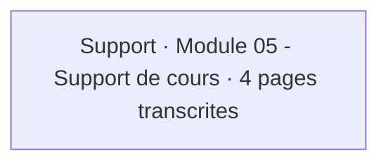
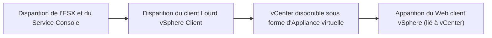

# Module 05 — Les composantes d’une infrastructure vSphere

[Travaux pratiques](../../tp/13-virtualisation-serveurs/module-05/index.md)

Les parties ci-dessous reprennent le cours original, dans le même ordre. Les encadrés et les schémas répètent ses formulations.

## Parcours de lecture

1. Support · Module 05 - Support de cours · 4 pages transcrites

**Visuel externe**

SOURCE DRIVE · TRANSCRIPTION DU SUPPORT

Le contenu des documents du dossier TSSR est transcrit ci-dessous, page par page. Les textes et tableaux sont intégrés à la page Web. Aucun fichier PDF, aucune diapositive entière ni aucune reproduction de page n’est affiché. Seuls des croquis ou visuels isolés et vérifiés peuvent accompagner la transcription. Les versions et les consignes restent celles des supports de formation. Les compléments IA sont conservés dans leur onglet distinct.

## Support · Module 05 - Support de cours · 4 pages transcrites

#### Module 05 – Les composantes d’une infrastructure vSphere

!!! note "À retenir"
    Les composantes d’une infrastructure vSphere

Les composantes d’une infrastructure vSphere

#### Objectifs

!!! note "À retenir"
    Décrire les composantes d’une infrastructure vSphere 6.x Les composantes d’une infrastructure vSphere

- Décrire les composantes d’une infrastructure vSphere 6.x

Les composantes d’une infrastructure vSphere

#### De vSphere 5 à vSphere 6

!!! note "À retenir"
    Disparition de l’ESX et du Service Console Disparition du client Lourd vSphere Client vCenter disponible sous forme d'Appliance virtuelle Apparition du Web client vSphere (lié à vCenter) Machines virtuelles Service console VM de gestion Hyperviseur Matériel Les composantes d’une infrastructure vSphere

**Visuel externe**

- Disparition de l’ESX et du Service Console
- Disparition du client Lourd vSphere Client
- vCenter disponible sous forme d'Appliance virtuelle
- Apparition du Web client vSphere (lié à vCenter)

Machines virtuelles

Service console

VM de gestion

Hyperviseur

Matériel

Les composantes d’une infrastructure vSphere

#### Composantes d’une solution vSphere

!!! note "À retenir"
    vCenter ESXi VM VM Attention : les versions des différents éléments d’une infrastructure vSphere doivent concorder !

!!! warning "Attention"
    vCenter ESXi VM VM Attention : les versions des différents éléments d’une infrastructure vSphere doivent concorder !

vCenter

| Élément | Nom de l’élément dans la solution VMware |
| --- | --- |
| Solution de virtualisation | vSphere |
| Hyperviseur | ESXi / ESX |
| Client d’administration | Client vSphere / vSphere Web Client |
| Solution de regroupement d’hyperviseurs | vCenter |

ESXi

VM

VM

Attention : les versions des différents éléments d’une infrastructure vSphere doivent concorder !

Les composantes d’une infrastructure vSphere

#### Les principales fonctionnalités

!!! note "À retenir"
    Fonctionnalités abordées dans le module 8 Les composantes d’une infrastructure vSphere

| Fonctionnalité | Utilité |
| --- | --- |
| vMotion* | Déplacement de machine virtuelle d’un hôte vers un autre hôte. |
| Storage vMotion* | Déplacement du stockage d’une machine virtuelle d’une banque de donnée vers une autre banque de donnée. |
| DRS | Automatisation du déplacement de machines virtuelles d’un hôte vers un autre hôte disposant de plus de ressources. |
| Storage DRS | Automatisation du déplacement de machines virtuelles d’un datastore vers un autre disposant de plus de ressources. |
| DPM | Fonctionnalité permettant d’automatiser l’entrée et la sortie de veille d’hyperviseurs en fonction de la charge d’activité du cluster. |
| HA | High Availability : fonctionnalité de haute disponibilité. Lors de la défaillance d’un hôte, les machines virtuelles ciblées seront redémarrées sur un autre hôte du cluster. |
| FT | Fault Tolerance : fonctionnalité de très haute disponibilité protégeant des machines virtuelles ciblées de la défaillance d’un hôte. Aucune interruption de service n’affectera les VM ciblées. |

* Fonctionnalités abordées dans le module 8

Les composantes d’une infrastructure vSphere

#### Tableau comparatif des coûts

!!! note "À retenir"
    Les composantes d’une infrastructure vSphere

| Comparatif des solutions | Description | Coût au 16/08/2021 |
| --- | --- | --- |
| ESXi seul | Gratuit. Nécessite simplement la création d’un compte VMware. | 0 € |
| Suite Essentials | Les licences vSphere Essentials Kit sont illimitées et n’ont pas de date d’expiration. Ce kit comprend 6 licences CPU de vSphere Essentials (pour 3 serveurs dotés de 2 processeurs chacun maximum) et 1 licence de vCenter Server Essentials. | 574,13 € TTC |
| vSphere Standard | Les licences vSphere Standard sont illimitées et n’ont pas de date d’expiration. Ce logiciel comprend 1 licence CPU de vSphere Standard et 1 licence de vCenter Server Standard. | 1262,14 € TTC |
| vSphere Entreprise Plus | VMware vSphere Enterprise Plus intègre l’ensemble des fonctionnalités de vSphere. Aucune date d’expiration et cette licence permet l’utilisation pour un CPU de vCenter Server. | 4326,23 € TTC |

Les composantes d’une infrastructure vSphere

#### Les licences

!!! note "À retenir"
    Licences et contextes d’utilisation Les VRAM pool permettant de cumuler la quantité de mémoire des licences de chaque ESXi pour les attribuer ensuite aux VM n’est plus en vigueur sur vSphere 5.5 Référence du document : 1tdcsvzSoNvyfFnpkUmiWGNjUTYMY3yRj · SHA-256 03057ae5aa768679…

- Licences et contextes d’utilisation

| Cible | Édition | Coût | La licence couvre |
| --- | --- | --- | --- |
| PME | Essentials | 574,13 € TTC | Elle inclut vCenter Foundation |
| PME | Essentials Plus | 2525,00 € TTC | Elle inclut vCenter Foundation |
| Grandes entreprises | Standard | 1262,14 € TTC | Quantité maximale de RAM par hôte |
| Grandes entreprises | Enterprise Plus | 4326,23 € TTC | Quantité maximale de RAM par hôte |
| Grandes entreprises | Platinum | NC | Quantité maximale de RAM par hôte |

Les VRAM pool permettant de cumuler la quantité de mémoire des licences de chaque ESXi pour les attribuer

ensuite aux VM n’est plus en vigueur sur vSphere 5.5

Référence du document : 1tdcsvzSoNvyfFnpkUmiWGNjUTYMY3yRj · SHA-256 03057ae5aa768679…
