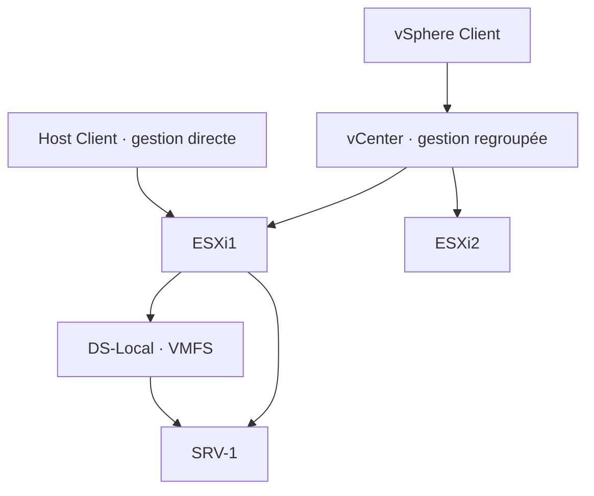

# Module 05 — Les composantes d’une infrastructure vSphere

Le cours présente l’architecture vSphere et les fonctions de gestion de plusieurs hôtes. Le laboratoire commence par deux ESXi imbriqués, puis crée une VM invitée sur le stockage local du premier hôte.

## Objectifs

- Relier vSphere, ESXi, le client d’administration et vCenter.
- Distinguer migration, équilibrage et continuité de service.
- Installer les deux hôtes ESXi du laboratoire et vérifier leur accès.
- Créer une banque VMFS et installer une VM Windows Server 2019.

## 1. Séparer la plateforme, les hôtes et l’administration

| Élément | Rôle | Où l’observer dans le parcours |
| --- | --- | --- |
| vSphere | Plateforme de virtualisation présentée dans le cours | Ensemble des fonctions étudiées aux modules 5 à 8 |
| ESXi | Hyperviseur qui exécute les VM | Les deux hôtes de l’atelier 3 |
| Host Client | Interface web d’un hôte ESXi | Création de la banque locale et de `SRV-1` |
| vCenter | Service de gestion qui regroupe les hôtes | Inventaire commun et fonctions étudiées au module 8 |
| vSphere Client | Interface d’administration de l’inventaire vCenter | Gestion du datacenter et suivi des tâches |

Le support décrit la transition de vSphere 5 à 6 en évoquant la disparition d’ESX et de sa *Service Console*, le passage du client lourd au client web et vCenter sous forme d’appliance virtuelle. Le cours vise vSphere 6.x. L’atelier utilise ESXi 7 sous Workstation 16. Avant de mettre en œuvre un ensemble de composants, vérifier leur compatibilité plutôt que mélanger les versions des captures.

**Illustration IA / externe au cours — gestion d’un hôte et gestion regroupée.**

Le Host Client suffit pour installer le premier invité sur ESXi1. Le lien de gestion vCenter du schéma situe l’étape ultérieure, au module 8.

## 2. Choisir une fonction selon le besoin

| Fonction | Action présentée dans le support | Ce qui change |
| --- | --- | --- |
| vMotion | Déplacer une VM en fonctionnement vers un autre hôte | L’hôte qui exécute la VM |
| Storage vMotion | Déplacer ses fichiers d’une banque de données à une autre | La banque qui héberge les fichiers |
| DRS | Rééquilibrer les VM selon les ressources des hôtes du cluster | Le placement du calcul |
| Storage DRS | Répartir les fichiers des VM selon les ressources des datastores | Le placement du stockage |
| DPM | Adapter le nombre d’hôtes actifs à la charge | La mise en veille ou la remise en service d’hôtes |
| HA | Redémarrer les VM protégées sur un autre hôte après une panne | La reprise de la VM, avec une phase de redémarrage |
| FT | Maintenir la continuité pour des VM compatibles et configurées à cet effet | Le mécanisme de protection d’une VM |

!!! note "Reconnaître la bonne réponse"

    Une maintenance planifiée amène à examiner les options de migration. Une panne d’hôte amène à examiner le mécanisme de reprise. Le support oppose le redémarrage avec HA à la continuité visée par FT. Le résultat dépend des conditions de la plateforme et de la VM.

## 3. Lire le comparatif des licences dans son contexte

Le tableau du **16 août 2021** présente ESXi seul avec un compte VMware, puis les offres Essentials, Essentials Plus, Standard, Enterprise Plus et Platinum. Le support associe au kit Essentials six licences CPU pour trois serveurs de deux processeurs au maximum et vCenter Server Essentials. Il situe la fin des pools vRAM à vSphere 5.5.

Les prix et conditions sont ceux du comparatif historique. Les cases peu lisibles sur la couverture des licences, vCenter Foundation ou la RAM maximale ne permettent pas de conclure. Pour lire le support, relever la date et l’édition à côté de la fonction citée.

## 4. TP guidé — Construire les hôtes ESXi et installer `SRV-1`

**Durée du support.** Environ une heure. Workstation 16 représente les deux serveurs physiques de l’entreprise sous forme de VM. La VM Windows Server préparée à l’atelier 1 est arrêtée pour libérer ses ressources. Préparer les ISO et paramètres d’accès fournis pour la salle.

### A. Créer deux hyperviseurs imbriqués

| Réglage | Valeur de l’atelier |
| --- | --- |
| VM Workstation | Deux VM distinctes, `ESXi1` et `ESXi2`, avec leurs propres dossiers |
| CPU | Deux processeurs d’un cœur par hôte |
| RAM | 6 Go dans le texte et les captures de préparation, 8 Go dans les schémas récapitulatifs |
| Réseau | Une carte Bridged |
| Disque d’installation | 40 Go |
| Disque de données | Un second disque SCSI de 200 Go |
| Média | ISO ESXi 7 de laboratoire, l’énoncé cite la build 18644231 |

1. Créer la première VM et désactiver son lancement automatique à la fin de l’assistant pour terminer les réglages. Régler le réseau, la RAM et les deux disques. Faire confirmer la mémoire à appliquer avant de démarrer.
2. Démarrer sur l’ISO, choisir le disque de **40 Go**, sélectionner la langue française et définir le secret d’administration du laboratoire. Vérifier le disque ciblé avant de confirmer l’installation.
3. Relever l’adresse de gestion et l’état de la console. Répéter sur le second hôte avec un nom, un emplacement et une adresse distincts.
4. Depuis le navigateur Windows, ouvrir le **Host Client** d’ESXi1. Identifier l’hôte et examiner le certificat attendu dans le laboratoire. La solution montre un avertissement de navigateur, qui ne prouve pas l’identité de l’hôte.

### B. Préparer la banque de données

1. Dans **Stockage**, identifier le disque SCSI de **200 Go**. Le disque système de 40 Go a un autre rôle.
2. Créer la banque **`DS-Local`** en VMFS et utiliser l’espace prévu par le TP.
3. Ouvrir son navigateur de fichiers et charger l’ISO Windows Server 2019.
4. Vérifier que le fichier ISO est visible au bon emplacement et que la capacité restante permet de créer le disque de l’invité.

### C. Créer et tester le serveur invité

1. Depuis **Machines virtuelles**, créer `SRV-1` avec un CPU d’un cœur, **2 Go** de mémoire et un disque de **32 Go**.
2. Choisir l’invité Windows Server 2019 64 bits dans la compatibilité ESXi indiquée par la solution. Relier le CD/DVD à l’ISO de la banque.
3. Démarrer la VM, ouvrir la console et installer Windows Server 2019, puis VMware Tools.
4. Contrôler le démarrage, la présence des outils dans le système invité, le datastore utilisé et les ressources de la VM.

| Si le résultat diffère | Contrôle à faire |
| --- | --- |
| L’hôte ne répond pas | Vérifier l’adresse relevée sur sa console et le raccordement Bridged de sa VM Workstation. |
| Le disque VMFS attendu est absent | Vérifier le second disque dans Workstation et son identification dans le Host Client avant tout formatage. |
| L’installation Windows ne démarre pas | Vérifier le fichier ISO, son association au CD/DVD virtuel et l’état de la console. |
| Le menu des VMware Tools est présent | Vérifier ensuite leur installation dans l’invité. Le menu seul atteste que l’action est proposée. |

## À retenir

ESXi exécute les VM. Le Host Client administre un hôte. vCenter organise plusieurs hôtes. Dans le TP, le disque de 40 Go sert au système ESXi et celui de 200 Go à la banque VMFS.

## Mini-quiz — 5 questions {#question-de-revision}

1. Quel outil utiliser pour administrer ESXi1 avant de déployer vCenter ?
2. Que déplace Storage vMotion ?
3. Quelle différence le cours fait-il entre HA et FT ?
4. Quels disques utiliser pour ESXi et pour `DS-Local` ?
5. Quelles preuves montrent que `SRV-1` est prêt pour les ateliers suivants ?

??? success "Réponses commentées"

    1. Le Host Client de l’hôte. Il donne accès au stockage, aux réglages de l’hôte et aux VM locales.
    2. Les fichiers de la VM entre banques de données. vMotion porte sur le déplacement du calcul entre hôtes.
    3. HA vise un redémarrage de la VM sur un autre hôte. FT vise la continuité d’une VM lorsque les conditions techniques le permettent.
    4. Installer ESXi sur 40 Go et créer la banque VMFS sur le disque SCSI de 200 Go.
    5. La VM démarre dans sa console, utilise la banque et les ressources prévues, et VMware Tools est installé dans l’invité.

## Pour pratiquer et réviser

- [Énoncé de l’atelier vSphere](../../tp/13-virtualisation-serveurs/module-05/tp-01.md) et [correction](../../tp/13-virtualisation-serveurs/module-05/correction-tp-01.md)
- [Fiche de révision](../../revision/13-virtualisation-serveurs/module-05.md)
- [Kahoot existant](../../kahoot/13-virtualisation-serveurs-module-05.md)
- [Sommaire de Virtualisation de serveurs](index.md)

## Provenance pédagogique

Le support M05 et l’atelier 3 donnent les composants, fonctions, exemples de licences et réglages. Le schéma et les contrôles intermédiaires expliquent les relations entre ces éléments.
