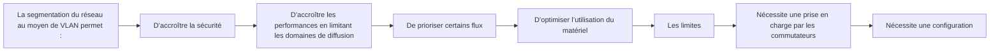
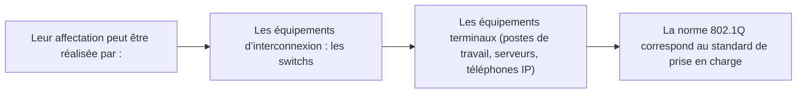
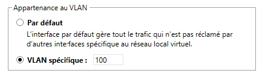

# Module 06 — Gestion du réseau vSphere

[Travaux pratiques](../../tp/13-virtualisation-serveurs/module-06/index.md)

Les parties ci-dessous reprennent le cours original, dans le même ordre. Les encadrés et les schémas répètent ses formulations.

## Parcours de lecture

1. Support · Module 06 - Support de cours · 11 pages transcrites

**Visuel externe**

SOURCE DRIVE · TRANSCRIPTION DU SUPPORT

Le contenu des documents du dossier TSSR est transcrit ci-dessous, page par page. Les textes et tableaux sont intégrés à la page Web. Aucun fichier PDF, aucune diapositive entière ni aucune reproduction de page n’est affiché. Seuls des croquis ou visuels isolés et vérifiés peuvent accompagner la transcription. Les versions et les consignes restent celles des supports de formation. Les compléments IA sont conservés dans leur onglet distinct.

## Support · Module 06 - Support de cours · 11 pages transcrites

#### Module 06 – Gestion du réseau

Gestion du réseau

#### Objectifs

!!! note "À retenir"
    Configurer le réseau d’un ESXi afin de répondre à des besoins ciblés Gestion du réseau

- Configurer le réseau d’un ESXi afin de répondre à des besoins ciblés

Gestion du réseau

#### Les VLAN

#### Définition

!!! note "À retenir"
    Un VLAN (Virtuel LAN) est un réseau logique indépendant.

- Un VLAN (Virtuel LAN) est un réseau logique indépendant.
- Les commutateurs (ou switch) permettent l’interconnexion réseau d’un ensemble d’éléments. Tous les éléments raccordés à un même switch peuvent ainsi communiquer entre eux.
- La mise en œuvre de VLAN permet de définir des contextes isolés afin que seuls les éléments d’un même VLAN puissent communiquer ensemble.

| Équipements | Ports |
| --- | --- |
| Postes clients | 1 à 12 |
| Serveurs | 13 à 18 |
| Téléphones | 19 à 24 |

Les VLAN

#### Intérêt de mise en œuvre

!!! note "À retenir"
    La segmentation du réseau au moyen de VLAN permet : D’accroître la sécurité D’accroître les performances en limitant les domaines de diffusion De prioriser certains flux D’optimiser l’utilisation du matériel Les limites Nécessite une prise en charge par les commutateurs Nécessite une configuration Les VLAN

**Visuel externe**

- La segmentation du réseau au moyen de VLAN permet :
- D’accroître la sécurité
- D’accroître les performances en limitant les domaines de diffusion
- De prioriser certains flux
- D’optimiser l’utilisation du matériel
- Les limites
- Nécessite une prise en charge par les commutateurs
- Nécessite une configuration

Les VLAN

#### Prise en charge 802.1Q

!!! note "À retenir"
    Les VLAN peuvent être mis en œuvre à différents niveaux du modèle OSI :

- Les VLAN peuvent être mis en œuvre à différents niveaux du modèle OSI :

#### VLAN de niveau 1

!!! note "À retenir"
    L’affectation à un VLAN est liée au port de raccordement du switch

L’affectation à un VLAN est liée au port de raccordement du switch

#### VLAN de niveau 2

!!! note "À retenir"
    L’affectation du VLAN est liée à l’adresse MAC de l’équipement

L’affectation du VLAN est liée à l’adresse MAC de l’équipement

#### VLAN de niveau 3

!!! note "À retenir"
    L’affectation du VLAN est liée à l’adresse IP de l’équipement Leur affectation peut être réalisée par : Les équipements d’interconnexion : les switchs Les équipements terminaux (postes de travail, serveurs, téléphones IP) La norme 802.1Q correspond au standard de prise en charge Les VLAN

**Visuel externe**

L’affectation du VLAN est liée à l’adresse IP de l’équipement

- Leur affectation peut être réalisée par :
- Les équipements d’interconnexion : les switchs
- Les équipements terminaux (postes de travail, serveurs, téléphones IP)
- La norme 802.1Q correspond au standard de prise en charge

Les VLAN

#### Intégration d’un identifiant de VLAN

!!! note "À retenir"
    L’ajout d’informations d’identification de VLAN se matérialise par la modification de l’en-tête Ethernet des trames IP Adresse MAC Destination → Adresse MAC Source → TAG VLAN 802.1Q (4 octets) → Type / longueur → Données → CRC.

- L’ajout d’informations d’identification de VLAN se matérialise par la modification de l’en-tête Ethernet des trames IP

Adresse MAC Destination → Adresse MAC Source → TAG VLAN 802.1Q (4 octets) → Type / longueur → Données → CRC.

| Champ | Longueur | Valeur ou information du schéma |
| --- | --- | --- |
| TPID (Tag Protocole Identifier) | 16 bits | 0x8100 |
| TCI (Tag Control Identifier) | 3 bits | Priorité utilisateur |
| TCI (Tag Control Identifier) | 1 bit | Canonical Format Indicator |
| TCI (Tag Control Identifier) | 12 bits | VLAN ID |

- Parmi les informations ajoutées figurent :
- Une priorité (valeur de 0 à 7) permettant de mettre en place de la qualité de service 802.1 P
- L’identifiant de VLAN (valeur de 1 à 4094)

Les VLAN

#### Le trunking

- Généralement, les réseaux d’entreprises intègrent une multitude de switchs. Les ports utilisés pour le raccordement entre les switchs doivent être identifiés comme « port trunk ».
- Lors de la configuration d’un port en « port trunk », on indique les trames de quels VLAN doivent se propager.

Le schéma représente trois commutateurs à Nantes. Les ports de chacun sont numérotés de 1 à 24.

| Commutateur | Groupes de ports représentés | Port Trunk |
| --- | --- | --- |
| Nantes - RDC | Postes clients – vlan3 (ports 1 à 12) · téléphones – vlan2 (ports 13 à 21) | 23 ↔ port 23 du cœur de réseau |
| Nantes Cœur de réseau | Les ports 23 et 24 relient le cœur aux deux commutateurs d’accès | 23 ↔ RDC · 24 ↔ étage 1 |
| Nantes – Étage 1 | Postes clients – vlan3 (ports 1 à 7) · téléphones – vlan2 (ports 8 à 13) · serveurs – vlan5 (ports 14 à 19) | 24 ↔ port 24 du cœur de réseau |

Le repère Port Trunk du dessin montre vlan3 et vlan2.

Les VLAN

#### Critères de configuration sur les switchs

**Visuel externe**

- Sur les commutateurs, la configuration à mettre en œuvre doit prendre en considération les aspects suivants :
- Le type d’utilisation du port

| Type de port | Utilisation |
| --- | --- |
| Port Access | Port utilisé pour communiquer avec un équipement terminal, un seul VLAN peut lui être affecté |
| Port Trunk | Port utilisé pour la liaison vers d’autres commutateurs, un ensemble de VLAN peut lui être affecté |

- L’état d’activation du marquage

| Marquage | Effet |
| --- | --- |
| Marquage actif | Le marquage des paquets (champ TAG VLAN) est propagé à leur sortie du switch |
| Marquage inactif | Le champ TAG VLAN est supprimé avant la remise de la trame |

- Le(s) VLAN(s) à affecter aux ports : à chaque port sera associé

| Affectation | VLAN |
| --- | --- |
| Le VLAN par défaut | VLAN1 |
| D’autre(s) VLAN(s) | Le(s) VLAN(s) choisis |

Les VLAN

#### Configuration sur les équipements terminaux

**Visuel externe**

- Certains équipements terminaux sont compatibles avec la norme 802.1Q, leur affectation à un VLAN est gérée depuis leur configuration. Ces équipements doivent être connectés à des ports configurés en mode trunk du switch.
- Quelques exemples de type d’équipements terminaux pouvant prendre en charge la norme 802.1Q :
- Des pilotes de carte réseau
- Des systèmes d’exploitation
- Des téléphones IP

#### Informations dans les visuels du support

- La capture d’un réglage d’appartenance au VLAN propose Par défaut ou VLAN spécifique. L’exemple choisit le VLAN spécifique 100.

Capture isolée du support, page 5

Gestion du réseau

Les composantes vSphere du

réseau

Les composantes vSphere du réseau

#### Le vSphere Standard Switch - VSS

- C’est le composant central de gestion du réseau de l’ESXi
- Il est géré indépendamment pour chaque ESXi de l’infrastructure

VMware

vSwitch0

- Liaison
- Un VSS est lié à un ou plusieurs groupements de ports
- Un VSS peut être raccordé à une ou plusieurs cartes réseau

Par défaut le vSwitch0 est créé, il est utilisable :

- Pour les tâches de gestion de l’ESXi
- Par les machines virtuelles Il est lié à la carte réseau de l’ESXi présente à l’installation.

Les composantes vSphere du réseau

#### Le vSwitch distribué - VDS

- À la différence des vSwitch standard, le vSwitch distribué est un

objet commun aux éléments d’une même infrastructure vSphere.

- Un même VDS est utilisable par un ensemble d’hôtes.
- Sa gestion se réalise depuis le vCenter de l’infrastructure.
- L’utilisation de VDS permet d’éviter toute interruption de service en cas de migration de VM.

Cette fonctionnalité requiert le niveau de licence Enterprise plus.

Les composantes vSphere du réseau

#### Les groupements de ports

ESXi

VMware

- Ils définissent un type d’utilisation du réseau pour l’ESXi parmi les suivants :

Networking

Type

#### Utilisation

vSwitch0

#### VM Network

Création de réseau à destination des

machines virtuelles

#### VMkernel

Création de réseau à destination des besoins de

l’infrastructure de virtualisation

Port group de

type Virtual

- Des machines liées à des groupements de ports distincts d’un même vSwitch ne peuvent pas communiquer entre elles.

machine

Port group de type VMkernel

#### La segmentation en VLAN peut être configurée

depuis les groupements de ports.

Les composantes vSphere du réseau

#### Les VMNIC ou pNIC

ESXi

- Ce sont les cartes réseau physiques de l’ESXi

pNIC

Objet vSphere associé à une

VMware

VMNIC

#### Carte physique de l’hôte

VMNIC

pNIC

- Deux dénominations s’appliquent aux cartes réseau physiques des hôtes
- Les contraintes de liaison vmnic <=> vSwitch

Networking

VMNIC

- Chaque carte peut être liée à un seul vSwitch
- Plusieurs cartes peuvent être liées au même vSwitch

vSwitch0

Les composantes vSphere du réseau

#### Le regroupement de cartes réseau (Teaming)

- Il est possible de regrouper un ensemble de cartes réseau d’un ESXi.
- Cela se traduit par :

Un adressage unique

Si les cartes sont liées à un groupement de port typé

VMkernel

Un débit cumulé

Mode de configuration actif - actif

Un gain de tolérance de pannes

Mode de configuration actif - passif

- Prérequis de mise en œuvre :
- Disposer au minimum de 2 VMNIC raccordés à un switch virtuel
- Mise en œuvre, la configuration peut se faire :
- Par la sélection d’un ensemble de cartes, lors de la création d’un switch virtuel
- Par l’ajout de carte(s) au groupement de ports d’un switch virtuel existant

Les composantes vSphere du réseau

#### Teaming – répartition de charge

- La configuration du teaming permet de déterminer le mode de fonctionnement de la répartition de

charge :

- Par VM : chaque port du vSwitch (soit indirectement chaque carte réseau de VM) est lié à un VMNIC
- Par adresse matérielle (MAC) de la source du paquet
- Par paquet : en fonction des adressages de source et destination, un algorithme détermine la VMNIC à utiliser

13 14 15 16 17 18

19 20 21 22 23 24

Par ordonnancement des cartes : pas de répartition de charge, seule la défaillance d’une carte entraîne l’utilisation de la suivante

Les composantes vSphere du réseau

#### Les vNIC

ESXi

pNIC

VMware

- Ce sont les cartes réseau présentées aux machines virtuelles

VMNIC

Networking

vSwitch0

- Elles peuvent être connectées ou non à un groupement de ports de type Virtual machine existant

vNIC

Port group de

type Virtual

vNIC

machine

La segmentation en VLAN peut être configurée au niveau des vNIC

Port group de type VMkernel

Les composantes vSphere du réseau

#### Lien entre les VMNIC et les besoins réseau

- Un hôte dispose généralement d’un ensemble de cartes réseau
- Ces cartes permettent de couvrir les multiples besoins réseau de l’infrastructure vSphere

Réseau pour

Gestion de l’infrastructure

Déplacement

de VM

Flux iSCSI

Très haute disponibilité

les VM

- Il est important de recenser les besoins, d’identifier ceux que l’on souhaite regrouper et ceux que l’on souhaite isoler

Réseau pour

Gestion de l’infrastructure

Déplacement

de VM

Flux iSCSI

Très haute disponibilité

les VM

VMNIC1

VMNIC

2

VMNIC3

VMNIC4

Les composantes vSphere du réseau

#### Illustration de raccordement réseau global

SW3 SW2 SW1

Physique

#### Hôte

Stockage baie

de disques

vSwitch 1

vSwitch 2

Groupement de ports

Groupement de ports GESTION (VMkernel)

vMotion (VMkernel)

STOCKAGE

(VMkernel)

Logique

vSwitch 0

VM

Groupement de ports

VM PROD (VM Network)

Les composantes vSphere du réseau

#### Les VLAN en environnement virtualisé

Switch

ESXi

pNIC

VMware

- En environnement vSphere, les VLAN peuvent affectés :

VMNIC

Networking

- Au niveau du switch (un seul VLAN ciblera alors tout le trafic)
- Sur des groupements de ports
- Sur des vNIC
- Si les VLAN sont affectés par l’hyperviseur, le switch doit être configuré en mode trunk et lié à tous les VLAN nécessaires aux composantes d’infrastructure vSphere et aux VM.

vSwitch0

vNIC

Port group de

type Virtual

vNIC

machine

Port group de type VMkernel

Référence du document : 1No0xQoKZ0i6p59XLY7nhFdyXYZHFW-wH · SHA-256 89509a521e376c8b…
