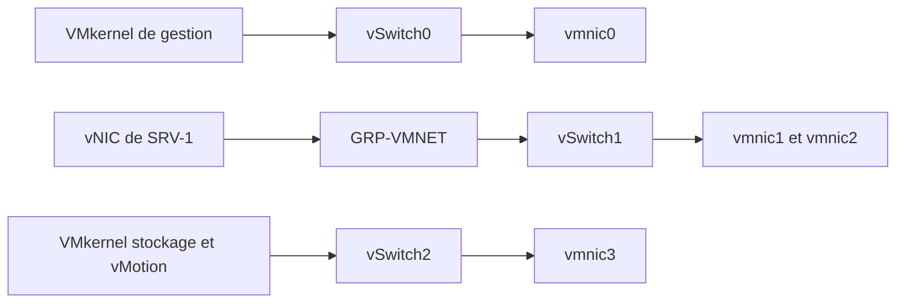

# Module 06 — Gestion du réseau vSphere

Le laboratoire dispose de deux ESXi. On sépare les flux de gestion, des VM et de stockage ou de vMotion en configurant les commutateurs virtuels et les interfaces des hôtes.

## Objectifs

- Lire un VLAN et comprendre le marquage 802.1Q.
- Identifier un VSS, un VDS, un groupe de ports, une vNIC et un VMkernel.
- Répartir les quatre cartes du laboratoire en gardant l’accès de gestion.
- Déplacer la vNIC invitée et vérifier les réseaux des deux hôtes.

## 1. Segmentation et marquage

Un **VLAN** organise une partie du réseau Ethernet en domaine de diffusion distinct. Le support classe les modes d’affectation par port, par adresse MAC ou par adresse IP. La configuration de l’infrastructure doit transporter les VLAN nécessaires jusqu’aux équipements qui les utilisent.

Le marquage **IEEE 802.1Q** ajoute quatre octets à la trame. Le support distingue le TPID `0x8100`, la priorité sur trois bits, le bit appelé CFI dans ce document et l’identifiant VLAN sur douze bits. Le tableau cite les identifiants de VLAN 1 à 4094 et les niveaux de priorité 0 à 7 liés à 802.1p.

| Port ou réglage | Rôle dans les exemples |
| --- | --- |
| Access | Rattacher un équipement à un VLAN, généralement avec remise de trames non marquées. |
| Trunk | Transporter plusieurs VLAN autorisés entre équipements. |
| Marquage actif | Conserver le tag lorsque le destinataire de la liaison doit lire le VLAN. |
| Marquage inactif | Livrer une trame sans tag à l’équipement terminal selon le réglage de port. |

Le support mentionne VLAN 1 comme valeur par défaut dans son environnement. Il illustre des équipements capables de traiter un tag, tels que des téléphones IP, pilotes et systèmes d’exploitation. Dans l’atelier, les identifiants VLAN existants restent en place.

## 2. Relier une interface au réseau physique

| Objet | Fonction |
| --- | --- |
| VSS | Commutateur standard configuré localement sur un ESXi. |
| VDS | Commutateur distribué géré avec vCenter pour plusieurs hôtes. |
| Groupe de ports | Ensemble de réglages de connexion, dont le VLAN selon le scénario. |
| vNIC | Carte présentée au système invité. Elle se raccorde à un groupe de ports de VM. |
| VMkernel | Interface réseau de l’hôte pour un service d’infrastructure, comme la gestion ou vMotion. |
| VMNIC ou pNIC | Carte physique de l’ESXi employée comme liaison montante. |

Un VSS peut porter plusieurs groupes et plusieurs VMNIC. Dans le scénario du support, une VMNIC appartient à un seul commutateur virtuel. Les VLAN peuvent être traités au niveau du commutateur physique, des groupes de ports ou des équipements qui marquent leurs propres trames. Vérifier le chemin de bout en bout avant de conclure à l’isolation.

!!! note "Portée du groupe de ports et du VDS"

    Deux noms de groupes distincts ne garantissent pas une séparation si leur réseau effectif est le même. Vérifier le VLAN, les liaisons montantes et le filtrage. Le VDS centralise la configuration de plusieurs hôtes. Les autres conditions d’une migration restent à vérifier.

## 3. Comprendre le regroupement de cartes

Le **teaming** combine plusieurs liaisons montantes. Le support distingue le mode actif-actif, associé à la distribution de flux, et le mode actif-passif, associé au secours en cas de panne. Il présente la sélection par port de VM, le hachage MAC source, le hachage IP et l’ordre de bascule.

| Besoin | Vérification |
| --- | --- |
| Distribuer plusieurs flux | Identifier la politique et observer la répartition sur les uplinks. |
| Assurer un secours | Définir l’ordre des cartes actives et de secours, puis vérifier la bascule dans le cadre prévu. |
| Utiliser IP hash | Vérifier que le commutateur physique est configuré selon les exigences de cette politique. |

Le débit total d’un ensemble de liaisons n’indique pas le débit d’une session unique. Le support associe aussi le VDS à Enterprise Plus dans son contexte historique. [Politiques de teaming VMware](https://knowledge.broadcom.com/external/article?legacyId=1004088) · [Répartition IP hash](https://knowledge.broadcom.com/external/article/321396/understanding-ip-hash-load-balancing.html)

## 4. TP guidé — Séparer les flux sur deux ESXi

**Durée du support.** Environ une heure. Utiliser les deux ESXi préparés à l’atelier 3. Arrêter proprement l’invité puis les hôtes avant d’ajouter chacun trois cartes Bridged dans Workstation. La terminaison forcée illustrée dans le corrigé ne correspond pas à l’arrêt propre demandé par l’énoncé.

### A. Établir le plan du premier hôte

| Flux | Commutateur et groupe | Liaison montante | Interface ou réglage |
| --- | --- | --- | --- |
| Gestion | `vSwitch0` et `GRP-GESTION` | `vmnic0` | VMkernel et adresse déjà en service |
| Machines virtuelles | `vSwitch1` et `GRP-VMNET` | `vmnic1` et `vmnic2` | Groupe de ports pour les vNIC invitées |
| Stockage et vMotion | `vSwitch2` et `GRP-STORAGE-VMOTION` | `vmnic3` | VMkernel du réseau de laboratoire en /24, service vMotion activé |

**Illustration IA / externe au cours — chemin de chaque flux sur un ESXi.**

### B. Créer les groupes et déplacer l’invité

1. Démarrer ESXi1. Vérifier les quatre cartes et noter celle utilisée par l’accès actuel.
2. Garder le commutateur de gestion et renommer son groupe selon le laboratoire. Vérifier que le Host Client reste accessible.
3. Créer le commutateur des VM avec deux liaisons montantes. Y créer le groupe `GRP-VMNET`.
4. Créer le commutateur de stockage avec la quatrième carte. Ajouter son VMkernel, renseigner l’adresse /24 prévue et activer vMotion sur cette interface.
5. Dans les réglages de la VM invitée, déplacer sa vNIC vers `GRP-VMNET`. Contrôler le rattachement avant de retirer l’ancien groupe des VM. Le groupe de gestion reste en service.
6. Laisser les VLAN inchangés, conformément à l’énoncé.

### C. Reproduire sur ESXi2 et contrôler

1. Configurer les mêmes rôles de commutateurs et de groupes sur ESXi2.
2. Donner au second VMkernel de stockage une autre adresse du même /24. Les repères du cours sont `192.168.XX.1/24` et `192.168.XX.2/24`, à remplacer selon le laboratoire.
3. Contrôler l’accès de gestion sur chacun des deux hôtes. Comparer les groupes, les cartes et le service vMotion.
4. En complément, tester la connectivité IP depuis le VMkernel concerné avec `vmkping -I <vmk-stockage> <ip-vmkernel-pair>`. Adapter les deux paramètres au laboratoire. Le résultat porte sur l’accès IP. La mise en service du stockage iSCSI et la migration vMotion seront testées dans leurs ateliers. [Vérifier un accès depuis un VMkernel](https://knowledge.broadcom.com/external/article/440803/troubleshooting-network-access-from-esxi.html)

## À retenir

La vNIC d’une VM utilise un groupe de ports. Le VMkernel fournit une connexion à l’hôte pour un service d’infrastructure. Dans l’atelier, garder l’accès de gestion, déplacer la VM sur le nouveau groupe et retirer l’ancien groupe dans cet ordre.

## Mini-quiz — 5 questions {#question-de-revision}

1. Que transporte le tag 802.1Q ?
2. Où gérer un VSS et un VDS ?
3. Quelles cartes portent le trafic des VM et le trafic du stockage dans le TP ?
4. Sur quel objet activer le service vMotion ?
5. La VM utilise encore le groupe que vous allez supprimer. Quel ordre suivre ?

??? success "Réponses commentées"

    1. Le marquage permet notamment d’identifier le VLAN de la trame et sa priorité.
    2. Le VSS se gère sur l’hôte. Le VDS se gère dans le contexte vCenter.
    3. `vmnic1` et `vmnic2` pour les VM, `vmnic3` pour le réseau de stockage et de vMotion. `vmnic0` reste dédiée à la gestion de la maquette.
    4. Sur le VMkernel du réseau prévu, après vérification de son adresse et du commutateur associé.
    5. Déplacer la vNIC, contrôler la connexion, puis supprimer l’ancien groupe des VM. Garder le groupe de gestion.

## Pour pratiquer et réviser

- [Énoncé de l’atelier réseau](../../tp/13-virtualisation-serveurs/module-06/tp-01.md) et [correction](../../tp/13-virtualisation-serveurs/module-06/correction-tp-01.md)
- [Fiche de révision](../../revision/13-virtualisation-serveurs/module-06.md)
- [Kahoot existant](../../kahoot/13-virtualisation-serveurs-module-06.md)
- [Sommaire de Virtualisation de serveurs](index.md)

## Provenance pédagogique

Le support M06 et l’atelier 4 donnent la segmentation, les composants et la répartition des cartes. Le schéma de synthèse et le contrôle `vmkping` sont des compléments pédagogiques identifiés.
