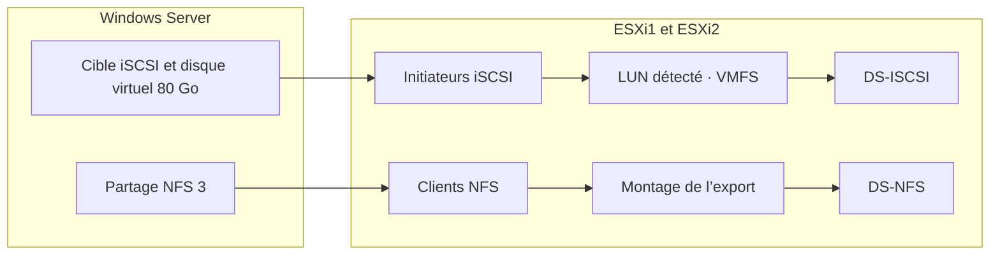

# Module 07 — Gestion du stockage

Le même serveur Windows fournit deux chemins de stockage aux ESXi. En iSCSI, les hôtes voient un disque présenté à travers le réseau et utilisent une banque VMFS. En NFS, ils montent directement un partage de fichiers.

## Objectifs

- Distinguer accès bloc, accès fichier, SAN et NAS.
- Identifier initiateur, cible, LUN, système de fichiers et datastore.
- Choisir les repères de provisionnement d’un disque de VM.
- Configurer les deux banques partagées du TP et vérifier leur accès depuis les deux hôtes.

## 1. Partir du mode d’accès

| Notion | Ce qu’elle désigne |
| --- | --- |
| Accès bloc | Accès à des blocs de données, notamment avec des commandes SCSI. |
| SAN | Réseau qui fournit des unités de stockage en mode bloc, par exemple en Fibre Channel ou iSCSI. |
| NAS | Service de fichiers partagé sur le réseau, notamment en NFS ou CIFS/SMB. |
| iSCSI | Transport de commandes SCSI et de données sur IP. |
| Initiateur iSCSI | Adaptateur ou logiciel qui demande l’accès au stockage. |
| Cible iSCSI | Service qui expose le stockage aux initiateurs autorisés. |
| LUN | Unité logique de stockage présentée par la cible ou la baie. |
| HBA ou CNA | Adaptateurs matériels de stockage ou convergents cités par le cours. |

Le stockage local dépend de la capacité et de la tolérance aux pannes de chaque serveur. Les opérations de sauvegarde peuvent peser sur ses performances. La mutualisation facilite l’accès de plusieurs hôtes à une capacité commune. Le protocole, le réseau, le matériel et le système de fichiers déterminent ensuite le chemin d’accès.

Pour iSCSI, le support conseille un réseau dédié et, si possible, redondant. Le MTU de 9000 n’a de sens que si les équipements et les interfaces du chemin le supportent. Le TP réutilise le réseau configuré à l’atelier précédent.

## 2. Du périphérique à la banque de données

Un stockage **DAS** est directement rattaché à l’hôte. Le support montre notamment des connexions SAS, SCSI et SATA. Sur un stockage mutualisé, comparer Fibre Channel, FCoE, iSCSI et NFS selon le support physique, la connectique et le mode d’accès. L’inventaire des adaptateurs d’un ESXi regroupe les disques raccordés, les espaces accessibles via HBA ou CNA matériels et ceux accessibles via des adaptateurs logiciels. Les exemples du cours comprennent des adaptateurs logiciels FCoE et iSCSI. Leur traitement consomme des ressources de l’hôte, à prendre en compte dans le dimensionnement.

Une **banque de données**, ou *datastore*, est un espace géré par vSphere pour les fichiers de VM, modèles et images ISO. Dans l’atelier, la banque VMFS est créée au-dessus du LUN iSCSI. La banque NFS référence un export de fichiers. Deux hôtes qui accèdent au même LUN doivent retrouver la même banque VMFS, sans initialiser deux fois le périphérique.

**Illustration IA / externe au cours — les deux chemins du laboratoire.**

Le cours cite VMFS, NFS et le mappage RDM associé à VMFS. VMFS prévoit l’accès simultané de plusieurs hôtes à une banque partagée. Le tableau historique compare VMFS 2, 3, 5 et 6, avec VMFS 6 associé à vSphere 6.5 et supérieur. Les limites dépendent de la version et du type d’objet mesuré. [Capacités VMFS](https://knowledge.broadcom.com/external/article/410951/vmfs-datastore-maximum-supported-capacit.html)

## 3. Choisir et surveiller l’espace

| Choix | Fonctionnement | Contrôle |
| --- | --- | --- |
| VMDK | Les données d’un disque de VM sont stockées dans des fichiers | Vérifier la capacité maximale du disque virtuel et la place sur la banque. |
| RDM | La VM utilise un mappage vers un périphérique de stockage | Vérifier le besoin, notamment pour un scénario SAN ou cluster. |
| Thick | L’espace demandé est réservé lors de la création | Vérifier la capacité restante et le mode d’initialisation choisi. |
| Thin | L’espace physique consommé progresse jusqu’à la limite définie | Suivre le taux de remplissage et prévoir une extension avant saturation. |

La limite de 2 To mentionnée dans le support est un repère historique. Vérifier la version et le contexte avant d’appliquer une limite ou une conclusion de performance. [VMDK de plus de 2 To](https://knowledge.broadcom.com/external/article?legacyId=2058287)

Pour administrer une banque, prévoir les tâches décrites dans le support. Créer ou formater, surveiller l’utilisation, étendre si la configuration le permet, parcourir les fichiers, importer, exporter puis démonter lorsque la banque n’est plus utilisée. Le support cite `ls` dans la console ou après une connexion SSH pour certains fichiers masqués dans le navigateur. Réserver l’accès à la console au cadre d’administration prévu.

## 4. TP guidé — Partager une banque iSCSI et une banque NFS

**Durée du support.** Deux à trois heures. Prévoir les deux ESXi et leurs interfaces VMkernel de stockage, ainsi que la VM `SRV_2K19`.

### A. Préparer le serveur Windows et vérifier le réseau

1. Revenir au snapshot de fin d’atelier 1 de `SRV_2K19`. Cette opération remplace son état courant dans le laboratoire.
2. Démarrer la VM et attribuer l’adresse de stockage prévue, représentée par `192.168.XX.12/24`. Les deux VMkernel ont des adresses distinctes du même sous-réseau.
3. Tester le ping depuis Windows vers chacun des deux VMkernel. Une absence de réponse impose de vérifier le réseau, l’adressage et le filtrage avant de configurer les partages.
4. Ajouter le disque de **150 Go** et créer le volume `STOCKAGE`. Préparer des dossiers distincts pour iSCSI et NFS, dans l’arborescence `DS`.

### B. Présenter le disque par iSCSI

1. Dans le premier ESXi, activer l’adaptateur iSCSI logiciel. Le lier au VMkernel de stockage et ajouter Windows comme cible dynamique.
2. Sur Windows Server, ajouter **Serveur cible iSCSI** et créer un **disque virtuel de 80 Go** sous `DS\iSCSI`. L’associer à une cible et autoriser les deux initiateurs ESXi aux adresses prévues.
3. Revenir sur ESXi1, valider et réanalyser les adaptateurs. Vérifier le périphérique **MSFT iSCSI** côté ESXi et l’état connecté sur Windows.
4. Identifier le LUN de 80 Go. Créer la banque **`DS-ISCSI`** en VMFS en utilisant l’espace prévu.
5. Configurer le second ESXi vers la même cible et réanalyser. Vérifier la banque existante et son accès. Cette étape ne demande pas un second formatage.

### C. Monter le partage de fichiers

1. Dans Windows, ajouter **Serveur pour NFS** et partager le dossier `DS\NFS`.
2. Reproduire les paramètres de laboratoire de l’énoncé. NFS 3, accès des utilisateurs non mappés, lecture et écriture pour les deux adresses ESXi, sans authentification serveur dans ce scénario.
3. Sur chacun des ESXi, ajouter un **montage NFS** vers l’export du serveur Windows et nommer la banque `DS-NFS`.
4. Vérifier le même serveur, le même export et l’accès aux fichiers depuis les deux hôtes.

!!! warning "Différencier les conditions de laboratoire"

    Les permissions NFS de l’atelier et l’absence de CHAP montrée dans le corrigé décrivent une maquette. En production, les règles d’authentification et d’accès dépendent du service et de son environnement. Le document appelle aussi « cible de 80 Go » l’ensemble de la cible et de son disque. Dans l’interface, vérifier ces deux objets séparément.

### D. Lire les preuves de résultat

| Constat attendu | Vérification |
| --- | --- |
| Le réseau stockage est disponible | Les trois adresses du /24 sont distinctes et les chemins vers les VMkernel répondent selon le test. |
| Les deux ESXi voient le même LUN | Relever le périphérique, l’identité de la cible et le résultat de la réanalyse. |
| `DS-ISCSI` est commune | La banque créée sur ESXi1 apparaît sur ESXi2. Le LUN n’est initialisé qu’une fois. |
| `DS-NFS` est montée | Les deux hôtes voient le même export et disposent des droits de laboratoire prévus. |

Le bandeau de solution indique module 6 tandis que l’énoncé indique module 7. La mention finale « Bonus » ne contient pas de consigne supplémentaire.

## À retenir

En iSCSI, la cible présente un LUN et les hôtes utilisent VMFS pour la banque du TP. En NFS, ils montent un export de fichiers. Vérifier l’identité du stockage partagé avant de le formater ou de le reconfigurer.

## Mini-quiz — 5 questions {#question-de-revision}

1. Qui initie la connexion iSCSI dans le TP ?
2. À quoi correspondent les 80 Go ?
3. ESXi2 voit le LUN mais pas la banque. Quels contrôles effectuer avant de modifier le disque ?
4. Quels paramètres comparer sur les deux montages NFS ?
5. Pourquoi surveiller un datastore qui contient des disques thin ?

??? success "Réponses commentées"

    1. Les adaptateurs logiciels des deux hôtes ESXi contactent la cible du serveur Windows.
    2. À la taille du disque virtuel iSCSI présenté par la cible. Le volume Windows de stockage fait 150 Go dans le scénario.
    3. Vérifier le LUN, l’autorisation de l’initiateur, la connectivité et la réanalyse. Rechercher la banque existante avant toute opération d’initialisation.
    4. Le serveur, le chemin de l’export, la version NFS et les droits de chaque hôte.
    5. L’espace utilisé augmente avec les écritures. La capacité réellement disponible peut devenir insuffisante avant d’atteindre la somme des tailles annoncées aux VM.

## Pour pratiquer et réviser

- [Énoncé de l’atelier stockage](../../tp/13-virtualisation-serveurs/module-07/tp-01.md) et [correction](../../tp/13-virtualisation-serveurs/module-07/correction-tp-01.md)
- [Fiche de révision](../../revision/13-virtualisation-serveurs/module-07.md)
- [Kahoot existant](../../kahoot/13-virtualisation-serveurs-module-07.md)
- [Sommaire de Virtualisation de serveurs](index.md)

## Provenance pédagogique

Le support M07 et l’atelier 5 fondent les modes d’accès, les réglages et les vérifications. Le schéma clarifie les deux chemins. Les références Broadcom précisent la portée des limites historiques.
