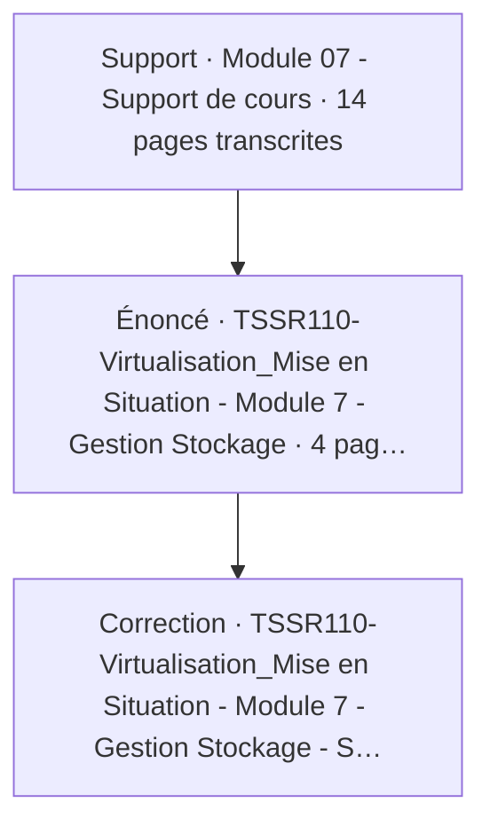
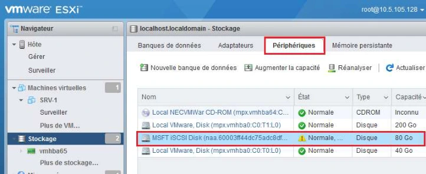
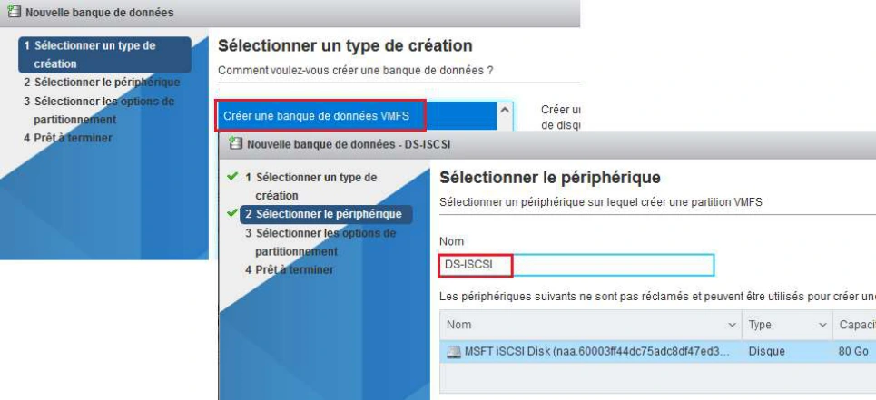
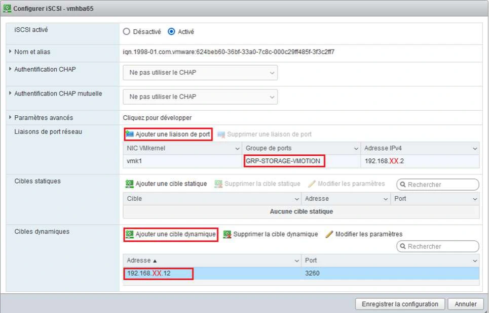

# Module 07 — Gestion du stockage

Les parties ci-dessous reprennent le cours original, dans le même ordre. Les encadrés et les schémas répètent ses formulations.

## Parcours de lecture

1. Support · Module 07 - Support de cours · 14 pages transcrites
2. Énoncé · TSSR110-Virtualisation_Mise en Situation - Module 7 - Gestion Stockage · 4 pages transcrites
3. Correction · TSSR110-Virtualisation_Mise en Situation - Module 7 - Gestion Stockage - Solution · 17 pages transcrites

**Visuel externe**



SOURCE DRIVE · TRANSCRIPTION DU SUPPORT

Le contenu des documents du dossier TSSR est transcrit ci-dessous, page par page. Les textes et tableaux sont intégrés à la page Web. Aucun fichier PDF, aucune diapositive entière ni aucune reproduction de page n’est affiché. Seuls des croquis ou visuels isolés et vérifiés peuvent accompagner la transcription. Les versions et les consignes restent celles des supports de formation. Les compléments IA sont conservés dans leur onglet distinct.

## Support · Module 07 - Support de cours · 14 pages transcrites

#### Module 07 – Gestion du stockage

Gestion du stockage

#### Objectifs

!!! note "À retenir"
    Configurer le stockage local ou partagé Gestion du stockage Les solutions de stockage Les solutions de stockage

- Configurer le stockage local ou partagé

Gestion du stockage

Les solutions de stockage

Les solutions de stockage

#### Terminologie

| Terme | Définition et exemple(s) de solution(s) |
| --- | --- |
| Mode bloc | Le stockage en mode bloc rassemble les données en blocs qui sont stockés en tant qu’éléments séparés. Chaque bloc de données se voit attribuer un identifiant unique, qui permet au système de stockage de conserver les petits éléments à l’emplacement le plus pratique. |
| SAN | Un réseau de stockage ou SAN (Storage Area Network) est un réseau spécifiquement dédié à l’interconnexion de ressources de stockage en mode bloc avec des serveurs. Il permet à un serveur d’accéder à des ressources de stockage distantes comme s’il s’agissait d’un disque dur local. Lorsqu’un hôte désire accéder à des données sur une baie de stockage SAN, il lui suffit d’envoyer la commande SCSI appropriée et les informations lui seront retournées via le réseau. |
| NAS | L’acronyme NAS, pour Network Attached Storage, désigne un périphérique de stockage utilisé pour le stockage et le partage de fichiers via un réseau (Ethernet ou de type WAN la plupart du temps). Il s’agit d’un serveur de fichiers capable de fonctionner de façon autonome. |

Les solutions de stockage

#### Services et données

!!! note "À retenir"
    Une infrastructure regroupe un ensemble de services fournis Ceux-ci sont dépendants de données pour leur fonctionnement Question Service Requête Contenu Donnée Réponse MIB Les données sont au cœur du fonctionnement de chaque service Et les services au cœur des infrastructures réseau Les solutions de stockage

**Visuel externe**


- Une infrastructure regroupe un ensemble de services fournis
- Ceux-ci sont dépendants de données pour leur fonctionnement

Question

Service

Requête

Contenu

Donnée

Réponse

MIB

- Les données sont au cœur du fonctionnement de chaque service
- Et les services au cœur des infrastructures réseau

Les solutions de stockage

#### Stockage local et accès aux données

!!! note "À retenir"
    Lorsqu’une machine dispose d’un périphérique de stockage local, l’accès aux données sur ce périphérique est lié : À la connectique associée au périphérique Au protocole de stockage pris en charge Au mode d’accès Ces trois éléments sont généralement liés entre eux.

**Visuel externe**


- Lorsqu’une machine dispose d’un périphérique de stockage local, l’accès aux données sur ce périphérique est lié :
- À la connectique associée au périphérique
- Au protocole de stockage pris en charge
- Au mode d’accès

Ces trois éléments sont généralement liés entre eux.

Périphérique Hôte

Application

OS

Protocole – Lien Transport

Connectique - Physique

Les solutions de stockage

#### Périphériques disques et modes d’accès

!!! note "À retenir"
    Les périphériques de type disque stockent les données sous forme d’ensembles ou blocs.

- Les périphériques de type disque stockent les données sous forme d’ensembles ou blocs.

Périphérique Hôte

Écriture

OS

Lecture

Les solutions de stockage

#### Le protocole SCSI

**Visuel externe**


- Le mode bloc s’applique au protocole SCSI

Périphérique Hôte

Périphérique Hôte

Application

Pilote disque SCSI

OS

OS

Protocole – Lien Transport

Protocole – SCSI

Connectique - Physique

Contrôleur SCSI

- Les données échangées par les couches liaison / transport comportent :

Périphérique Hôte

- Des commandes SCSI
- Des blocs de données

Données

Commandes SCSI

Les solutions de stockage

#### Les limites du stockage local

**Visuel externe**


- Le stockage local présente des limites :
- Chaque serveur allouera de l’espace disque à la tolérance de panne
- Les volumes disques sont créés en fonction des besoins et des contraintes matérielles
- Les sauvegardes impactent les performances de toutes les machines qui y sont soumises
- Une distance limitée entre un serveur et son stockage
- La réponse aux problématiques précédentes : mise en place de solution de stockage centralisé / mutualisé
- Une solution de stockage réseau est caractérisée par :
- Son type d’accès : mode bloc ou mode fichier
- Le(s) protocole(s) d’accès pris en charge

Les solutions de stockage

#### SAN / NAS

#### SAN

#### NAS

!!! note "À retenir"
    Les baies SAN utilisent des protocoles d’accès comme Fibre Channel ou iSCSI et partagent leur capacité sous la forme de volumes logiques.

Les baies SAN utilisent des protocoles d’accès comme Fibre Channel ou iSCSI et partagent leur capacité sous la forme de volumes logiques. Ces derniers sont utilisables comme des disques locaux par les serveurs et sont donc accessibles en mode bloc. Les baies NAS mettent quant à elles leur capacité disponible à disposition des serveurs sous la forme d’un partage réseau accessible via un protocole de partage de fichiers en réseau comme NFS ou CIFS (le protocole de partage de fichiers en réseau de Windows aussi connu sous le nom SMB). Un réseau de stockage se différencie des autres systèmes de stockage tels que le NAS (Network Attached Storage) par un accès bas niveau aux disques. Pour simplifier. C'est une mutualisation des ressources de stockage.

Dans le cas du NAS, la ressource de stockage est directement connectée au réseau IP de l'entreprise. Le serveur NAS intègre le support de multiples systèmes de fichiers réseau, tels que Common Internet File System (CIFS), protocole de partage de Microsoft et de Samba, Network File System (NFS), qui est un protocole de partage de fichiers Unix, ou encore AFP (AppleShare File Protocol), qui est l'équivalent pour la technologie Apple. Une fois connecté au réseau, il peut jouer le rôle de plusieurs serveurs de fichiers partagés.

Les solutions de stockage

#### L’iSCSI

!!! note "À retenir"
    Le protocole iSCSI est utilisé par des solutions de stockage centralisées rendant accessible de l’espace disque en mode bloc par un réseau.

- Le protocole iSCSI est utilisé par des solutions de stockage centralisées rendant accessible de l’espace disque en mode bloc par un réseau.

Périphérique Hôte

Données

TCP-

Réseau

iSCSI Initiator

IP

iSCSI

Commandes SCSI

iSCSI Target

Réseau de

stockage

Adaptateur iSCSI

iSCSI Initiator

iSCSI Target

#### D’autres protocoles

#### (présentés

#### ultérieurement) ont une

#### approche similaire.

!!! note "À retenir"
    Gestion du stockage vSphere et le stockage vSphere et le stockage

Gestion du stockage

vSphere et le stockage

vSphere et le stockage

#### Les composantes de stockage

Dans une infrastructure vSphere, on distingue deux composantes de configuration du stockage :

- Les adaptateurs de stockage servent à lier des solutions de stockage aux hôtes amenés à les utiliser
- Les banques de données ou datastores correspondent aux conteneurs « virtuels » dans lesquels sont hébergées les données

vSphere et le stockage

#### Les composantes de stockage

- De nombreuses possibilités sont prises en charge pour l’hébergement des machines virtuelles dans l’environnement vSphere
- Les points suivants vous permettront de cibler la solution de stockage la plus adaptée à une situation donnée :
- Stockage dédié à un hôte ou mutualisé
- Quel protocole d’accès à la solution de stockage
- Quel support
- Quel mode d’accès
- Quel système de fichiers utiliser

La diapositive suivante

illustre ces différents

aspects

vSphere et le stockage

#### Choix d’une solution de stockage

!!! note "À retenir"
    Stockage dédié Stockage mutualisé FC FCOE iSCSI NFS DAS Protocole SAS SCSI SATA HBA CNA FCOE Adaptateur virtuel FCOE HBA iSCSI Adaptateur virtuel iSCSI Réseau Connectique FC Support fibre cuivre Réseau VMFS3 VMFS5 Formatage par l’hôte Gestion du stockage Les adaptateurs de stockage Les adaptateurs de stockage

Stockage dédié

Stockage mutualisé

FC

FCOE

iSCSI

NFS

DAS

Protocole

SAS

SCSI SATA

HBA

CNA FCOE

Adaptateur virtuel FCOE

HBA iSCSI

Adaptateur virtuel iSCSI

Réseau

Connectique

FC

Support

fibre

cuivre

Réseau

VMFS3

VMFS5

Formatage par l’hôte

Gestion du stockage

Les adaptateurs de stockage

Les adaptateurs de stockage

#### Raccordement de la solution de stockage

- La solution de stockage retenue est raccordée à l’infrastructure vSphere via la configuration des adaptateurs de stockage
- Sont affichés dans les adaptateurs de stockage :
- Les disques physiques raccordés directement à l’hyperviseur
- Les espaces disques accessibles via des adaptateurs HBA ou CNA physiques configurés sur l’hyperviseur
- Les espaces disques accessibles via des adaptateurs logiciels de l’hyperviseur
- L’environnement vSphere fournit des adaptateurs virtuels FCoE et iSCSI pour les hôtes.
- L’utilisation de ces adaptateurs se traduit par un impact sur les performances des hôtes, les adaptateurs matériels sont donc à privilégier.
- Dans le cas d’utilisation d’une solution nécessitant un adaptateur de stockage virtuel, celui-ci est à configurer depuis l’hôte.

Les adaptateurs de stockage

#### Zoom sur l’iSCSI

- L’utilisation de solutions de stockage basées sur le protocole iSCSI est fréquente dans des environnements virtualisés. Les performances du réseau associé sont alors directement liées au bon fonctionnement de la solution.
- Il est recommandé d’utiliser un réseau dédié à ses besoins (et de préférence des mécanismes de redondance).
- Le ciblage d’une carte réseau pour le protocole iSCSI permet de dédier cette carte à ce besoin. Celui-ci se configure depuis les propriétés de l’adaptateur iSCSI. La résultante de cette configuration est visible dans les propriétés du vSwitch lié à la carte sélectionnée.

#### Hôtes et MTU

L’utilisation de trames Ethernet pour véhiculer des flux liés au stockage nécessite une adaptation de la configuration du réseau afin de limiter la charge CPU et d’améliorer les performances globales de la solution.

Si les équipements de réseau utilisés pour les flux iSCSI le permettent (prise en charge de bout en bout), il est recommandé d’augmenter la valeur du MTU à 9000.

Les adaptateurs de stockage

#### iSCSI en environnement vSphere

iSCSI Initiator

iSCSI Target

SAN iSCSI

Illustration des éléments constitutifs d’une solution de stockage iSCSI

ESXi

HBA logiciel

#### +

Carte réseau

Réseau

LUN0

de stockage

LUN1

HBA physique

#### SAN

Storage Area Network : le réseau de stockage qui est caractérisé par son (ses) protocole(s) d’accès et connectivité, sa volumétrie, ses fonctionnalités associées, ses performances

#### LUN

Logical Unit Number : unité de stockage d’une baie de disques

#### HBA

Host Bus Adapter : adaptateur de stockage qui (une fois configuré) permettra l’accès à un ou plusieurs espaces disques

#### iSCSI Target

L’élément qui met à disposition de l’espace disque physique

#### iSCSI Initiator

L’élément qui accède à de l’espace disque mis à sa disposition

Gestion du stockage

Les banques de données

Les banques de données

#### Les datastores

- On dispose généralement de plusieurs espaces disques disponibles et accessibles depuis leur adaptateur de stockage associé.
- Les banques de données (ou datastores) vont rendre utilisables ces espaces disques.
- Avant leur création, il est important de recenser les besoins en termes de stockage et les caractéristiques attendues pour les espaces correspondants.

| Besoins | VM_PROD | VM_TESTS | MODELES | ISO |
| --- | --- | --- | --- | --- |
| Performances | 3 | 2 | 1 | 1 |
| Tolérance aux pannes | 3 | 2 | 2 | 1 |
| Criticité | 3 | 2 | 2 | 1 |

- Des valeurs élevées pour les différents indices sont généralement associées à un coût élevé de l’hébergement.

Les banques de données

#### La configuration des banques de données

- On distingue 3 types de banques de données :
- VMFS
- RDM avec VMFS
- NFS
- Caractéristiques et versions de systèmes de fichiers VMFS :

|  | VMFS 2 | VMFS3 | VMFS5 | VMFS6 |
| --- | --- | --- | --- | --- |
| Versions de vSphere prises en charge | ESX 2 | Virtual Infrastructure 3, vSphere 4.x et vSphere 5.x | vSphere 5 et supérieur | vSphere 6.5 et supérieur |
| Volume maximal | 2 To | 2 To | 64 To / Defrag Manu | 64 To / Defrag Auto |
| Format de la table de partitions | MBR | MBR | GPT | GPT |
| Taille des blocs | 1/2/4/8 Mo | 1/2/4/8 Mo | 1 Mo | 1 Mo |

- VMFS est un système de fichier qui permet un accès concurrentiel en lecture et écriture à un ensemble d’hôtes.

Les banques de données

#### Gestion des banques de données

Les principales tâches de gestion des banques de données sont :

- Création et formatage
- Suivi de son taux d’utilisation
- Extension dynamique
- Parcours, import et export de données
- Démontage

#### Affichage des fichiers masqués

Tous les fichiers ne sont pas visibles depuis l’outil d’exploration, ils peuvent l’être depuis la console de l’ESXi ou après s’y être connecté via ssh, au moyen de la commande ls

Gestion du stockage

Les disques de VM

Les banques de données

#### VMDK ou RDM

- Dans la plupart des cas, les disques présentés aux machines virtuelles sont au format VMDK qui apporte plus de simplicité de gestion et de sauvegarde. Ce format limite cependant à 2 To la taille maximale d’un espace disque.
- Le format RDM peut être nécessaire dans certains contextes :
- Utilisation de solutions liées au SAN pour répondre à certains besoins (sauvegarde…)
- Utilisation des services de cluster Microsoft
- L’écart de performance entre les 2 formats est peu significatif

Les banques de données

#### La mise à disposition d’espace disque aux VM

- L’espace disque accessible aux hôtes est principalement destiné à être utilisé par les machines virtuelles qu’il héberge
- Deux possibilités permettent de fournir de l’espace disque à une machine virtuelle :

#### VM

#### SAN

Disque virtuel

- L’utilisation de disques au format VMDK
- Le mappage d’espace disque en accès direct (Raw Device Mapping)

RDM

LUN0

Disque virtuel

VMDK

LUN1

Datastore

Storage Adapters

Les banques de données

#### Création d’un disque VMDK

Lors de la création d’un disque virtuel au format VMDK, 2 types de provisionnements sont proposés :

- Thick provision
- Thin provision

|  | Thick provisioning | Thin provisioning |
| --- | --- | --- |
| Provisionnement | Définitif / statique | À la demande / dynamique |
| Espace disque occupé | Le disque créé occupera dès sa création tout l’espace indiqué | La taille réelle du disque correspond à l’espace maximum occupé sur le disque. Le disque pourra au maximum atteindre l’espace indiqué |
| Avantages | Performances supérieures | Création du disque instantanée. L’espace non utilisé n’est pas bloqué et peut être utilisé |
| Inconvénients | Temps de création du disque | Risque de surallocation d’un datastore |

Référence du document : 1hTZrrkSiiZZbh4X_Nn8i3Awkhjy--_N3 · SHA-256 bf5cf430bbe885c2…

## Énoncé · TSSR110-Virtualisation_Mise en Situation - Module 7 - Gestion Stockage · 4 pages transcrites

#### Énoncé :

#### Atelier N°5

TP du Module 07 – Gestion du stockage d’une infrastructure vSphere

Avant de démarrer ce TP, il convient d’avoir suivi les prérequis du Module 7.

Durée estimée

2 à 3 heures

#### Objectif :

Mettre en œuvre et configurer les services NFS et iSCSI

Gérer des banques de données

#### Prérequis :

Disposer de deux hyperviseurs ESXi fonctionnels, avec la configuration réseau adéquate (Atelier 3 et 4 réalisés)

Disposer de la machine virtuelle « SRV_2K19 », le système d’exploitation Windows Server 2019 doit y être déployé (Atelier 1 réalisé)

#### Énoncé :

Cet atelier nécessitera les 2 hyperviseurs ESXi ainsi que la machine virtuelle « SRV_2K19 ». Cette dernière jouera le rôle de serveur NAS, et fournira à la fois les services de partage de fichiers NFS et de cible iSCSI.

Sur la machine virtuelle SRV_2K19

- Revenir impérativement au snapshot « Fin Atelier 1 ».
- Démarrer la VM.
- Passer en adressage IP statique la carte « ethernet0 » et lui affecter : 192.168.XX.12 / 24.
- Contrôler la connectivité réseau avec les VMkernel des hyperviseurs ESXi :

```
ping 192.168.XX.1
```

```
ping 192.168.XX.2
```

I-Mise en œuvre du protocole iSCSI (accès espace stockage en mode bloc)

Sur l’hyperviseur ESXi1

- A partir du menu « Stockage », activer l’adaptateur de stockage iSCSI logiciel.
- En modifier la configuration afin de le lier au groupement de port GRP-STORAGE- VMOTION créé dans l’atelier précédent et ajouter l’adresse IP de SRV_2K19 dans « Cible Dynamique ».

Sur la machine virtuelle SRV_2K19

- Ajouter un 2ème disque dur de 150 Go, le formater et le nommer « STOCKAGE ».
- Créer un point d’arborescence sur le volume « STOCKAGE » de la sorte :
- Ajouter le sous-service de rôle « Services de fichiers » nécessaire à la création de la cible (Serveur cible iSCSI).
- Dans le menu adéquat du Gestionnaire de serveurs, procéder à l’ajout d’une cible iSCSI de 80 Go, nommée « LUN1 ».

- Déclarer l’initiator ESXi1et ESXi2 par leurs adresses IP, pour leur permettre de se connecter à la cible iSCSI.

Sur l’hyperviseur ESXi1

- Valider, si cela n’est pas déjà fait, la configuration de l’adaptateur iSCSI.
- Pour terminer la configuration, lancer une réanalyse des adaptateurs de stockage afin de détecter la cible iSCSI.
- Dans l’onglet « Périphériques », si la configuration a bien été opérée, un nouveau périphérique « MSFT iSCSI » doit faire son apparition. Sur SRV_2K19, le mot « connecté » doit apparaitre sur la cible iSCSI.
- Créer une nouvelle banque de données VMFS nommée : « DS-ISCSI » basée sur LUN1 dont vous utiliserez l’intégralité de l’espace de stockage.

Sur l’hyperviseur ESXi2

- Configurer l’adaptateur iSCSI logiciel afin qu’il accède à LUN1.
- Vérifier que le datastore « DS-ISCSI » est bien accessible à l’issue de la configuration.

II-Mise en œuvre du partage de fichiers NFS (accès espace stockage en mode fichiers)

Sur la machine virtuelle SRV_2K19

- Créer un sous-dossier nommé « NFS » dans le dossier « DS » sur le volume « STOCKAGE ».
- Ajouter le service de rôle nécessaire à la mise en œuvre de partages NFS (Serveur pour NFS).
- Dans le menu adéquat du Gestionnaire de serveurs, procéder à la configuration d’un partage NFS du dossier « DS\NFS » avec les paramètres suivants :
- Pas d’authentification serveur
- Activer l’accès des utilisateurs non mappés
- Autoriser les hyperviseurs avec leurs adresses IP en lecture et écriture
- Version NFS3

Sur les hyperviseurs ESXi1 et 2

- Configurer un nouveau datastore nommé « DS-NFS » de type « Montage NFS » pointant vers le partage précédemment créé.
- Constater l’apparition d’un nouvel élément dans l’inventaire des banques de données.

Schéma récapitulatif :

Référence du document : 1x7evCXIUC0fFnd-eL-8XY-Er1xPU54J2 · SHA-256 e89ce872e1ddb757…

## Correction · TSSR110-Virtualisation_Mise en Situation - Module 7 - Gestion Stockage - Solution · 17 pages transcrites

Correction originale : à consulter après avoir tenté l’exercice.

Solutions :

#### Atelier N°5

TP du Module 07 – Gestion du stockage d’une infrastructure vSphere

Avant de démarrer ce TP, il convient d’avoir suivi les prérequis du Module 6.

Durée estimée

2 à 3 heures

#### Objectif :

Mettre en œuvre et configurer les services NFS et iSCSI

Gérer des banques de données

#### Prérequis :

Disposer de deux hyperviseurs ESXi fonctionnels, avec la configuration réseau adéquate (Atelier 4 réalisé)

Disposer de la machine virtuelle « SRV_2K19 », le système d’exploitation Windows Server 2019 doit y être déployé (Atelier 1 réalisé)

#### Énoncé :

Cet atelier nécessitera les 2 hyperviseurs ESXi ainsi que la machine virtuelle « SRV_2K19 ». Cette dernière jouera le rôle de serveur NAS, et fournira à la fois les services de partage de fichiers NFS et de cible iSCSI.

Sur la machine virtuelle SRV_2K19

- Revenir impérativement au snapshot « Fin Atelier 1 ».
- Démarrer la VM
- Passer en adressage IP statique la carte « ethernet0 » et lui affecter : 192.168.XX.12 / 24
- Contrôler la connectivité réseau avec les VMkernel des hyperviseurs ESXi :

```
ping 192.168.XX.1
```

```
ping 192.168.XX.2
```

I-Mise en œuvre du protocole iSCSI (accès espace stockage en mode bloc)

Sur l’hyperviseur ESXi1

- A partir du menu « Stockage », activer l’adaptateur de stockage iSCSI logiciel
- En modifier la configuration afin de le lier au groupement de port GRP-STORAGE- VMOTION créé dans l’atelier précédent. Ajouter l’adresse IP de SRV_2K19 dans « Cible Dynamique ».
- Configurer l’adaptateur logiciel iSCSI comme suit :

Sur la machine virtuelle SRV_2K19

- Ajouter un 2ème disque dur de 150 Go, le formater et le nommer « STOCKAGE ».
- Créer un point d’arborescence sur le volume « STOCKAGE » de la sorte :
- Utiliser la solution de l’atelier 2 pour configurer un nouveau volume sur un système

Windows Server 2019

- Ajouter le sous-service de rôle « Services de fichiers » nécessaire à la création de la cible (Serveur cible iSCSI)

- Dans le menu adéquat du Gestionnaire de serveurs, procéder à l’ajout d’une cible iSCSI de 80 Go, nommée « LUN1 ».
- Une fois cliqué le lien en bleu « To create an iSCSI… », un assistant s’éxécute.

Commencer par déclarer l’emplacement du disque virtuel :

- Donner un nom au disque virtuel

- Indiquer la taille du disque (80 Go)
- Assigner le disque virtuel à une nouvelle cible iSCSI

- Donner un nom à la cible iSCSI
- Déclarer l’initiator ESXi1et ESXi2 par leurs adresses IP, pour leur permettre de se connecter à la cible iSCSI.
- Conserver tous les autres paramètres par défaut jusqu’à créer la cible iSCSI.
- Ajouter ESXi2 comme deuxième initiator sur la cible iSCSI si vous ne l’avez pas fait

auparavant.

Sur l’hyperviseur ESXi1

- Valider, si cela n’est pas déjà fait, la configuration de l’adaptateur iSCSI.
- Pour terminer, lancer une réanalyse des adaptateurs de stockage afin de détecter la cible iSCSI.
- Dans l’onglet « Périphériques », si la configuration a bien été opérée, un nouveau périphérique « MSFT iSCSI » doit faire son apparition. Sur SRV_2K19, le mot « connecté » doit apparaitre sur la cible iSCSI.

- Cela donne dans l’onglet « Périphériques » :
- Cela donne ceci sur la VM SRV_2K19 :
- Créer une nouvelle banque de données VMFS nommée : « DS-ISCSI » basée sur LUN1 dont vous utiliserez l’intégralité de l’espace de stockage.



Capture isolée du support, page 9

- Un assistant de création s’ouvre, faire les choix suivants :
- Conserver les choix par défaut jusqu’à la fin de l’assistant
- Vous devez obtenir ceci dans « Banques de données » :



Capture isolée du support, page 10

Sur l’hyperviseur ESXi2

- Ajouter et configurer un adaptateur iSCSI logiciel afin qu’il accède à LUN1
- Configurer l’adaptateur logiciel iSCSI comme suit :
- Vérifier que le datastore DS-ISCSI est bien accessible



Capture isolée du support, page 11

#### Informations dans les visuels du support

- Dans Stockage, onglet Banques de données, vérifier que DS-ISCSI et DS-Local sont présents.
- La capture affiche des périphériques Non-SSD, avec des capacités respectives de 79,75 Go et 199,75 Go et un espace provisionné de 1,41 Go et 37,92 Go.

I-Mise en œuvre du partage de fichiers NFS (accès espace stockage en mode fichiers)

Sur la machine virtuelle SRV_2K19

- Créer un sous-dossier nommé « NFS » dans le dossier « DS » sur le volume « STOCKAGE ».
- Ajouter le service de rôle nécessaire à la mise en œuvre de partages NFS (Serveur pour NFS)
- Dans le menu adéquat du Gestionnaire de serveurs, procéder à la configuration d’un partage NFS du dossier « DS\NFS » avec les paramètres suivants :
- Pas d’authentification serveur
- Activer l’accès des utilisateurs non mappés
- Autoriser les hyperviseurs avec leurs adresses IP en lecture et écriture
- Version NFS3
- Depuis le Gestionnaire de fichiers, se rendre dans le menu « Shares »

- Lancer l’assistant en cliquant sur le lien bleu en plein milieu « To create a file

share… »

- Indiquer l’emplacement du point de partage NFS

- Indiquer les paramètres d’autorisation de connexion comme suit :

- Autoriser les hyperviseurs à se connecter en lecture/écriture
- Conserver les autres paramètres par défaut et créer le partage.

Sur les hyperviseurs ESXi1 et 2

- Configurer un nouveau datastore nommé « DS-NFS » de type « Montage NFS » pointant vers le partage précédemment créé.

- Nous obtenons ceci au final :

Bonus

Référence du document : 1bWt1c8_qTFwZyz7loW2ak55FPKbG44m4 · SHA-256 854e1126b15bc9ce…

## Fiche de synthèse

Les lignes reprennent les titres du cours et la première phrase de chaque partie.

| Partie | Repère du cours |
| --- | --- |
| Correction · TSSR110-Virtualisation_Mise en Situation - Module 7 - Gestion Stockage - Solution · 17 pages transcrites | Correction originale : à consulter après avoir tenté l’exercice. |
