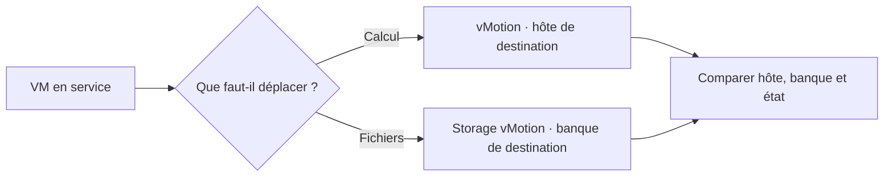

# Module 08 — Gestion du datacenter

Ce module rassemble les deux ESXi sous vCenter. Il utilise leurs réseaux et banques partagées pour travailler sur les modèles, les autorisations et deux types de migrations.

## Objectifs

- Distinguer réservation, limite et parts d’un pool de ressources.
- Utiliser un modèle et reconnaître les objets de l’inventaire vCenter.
- Associer une identité, un rôle et un objet pour attribuer une permission.
- Préparer le DNS, intégrer les hôtes à un datacenter et vérifier le résultat des migrations.

## 1. Distribuer les ressources et organiser l’inventaire

Le cours présente la possibilité d’attribuer aux VM plus de ressources que la capacité physique totale. Si plusieurs charges les demandent au même moment, une VM prioritaire peut manquer de capacité. Un pool regroupe les ressources CPU et RAM de VM ou d’autres pools.

| Réglage | Rôle | Contrôle |
| --- | --- | --- |
| Réservation | Garantir une quantité de ressources | Vérifier la capacité réellement disponible pour la garantir. |
| Limite | Fixer le maximum utilisable | Confirmer que la charge peut fonctionner dans ce plafond. |
| Parts | Donner une priorité relative en cas de contention | Comparer des objets qui se disputent les mêmes ressources. |

Dans son contexte, le support propose d’héberger vCenter sur une VM hautement disponible. Certaines tâches sont accessibles sur un hôte autonome, tandis que les opérations portant sur l’inventaire regroupé utilisent vCenter.

Un **datacenter** vCenter regroupe des objets d’inventaire, notamment hôtes, réseaux, VM et banques de données. Le support situe aussi les clusters et la haute disponibilité. Une gestion regroupée facilite les tâches et la délégation. La disponibilité demande des ressources et mécanismes adaptés à la charge.

Le comparatif historique met en regard une appliance VCSA et une installation Windows 64 bits. Il indique cinq hôtes et cinquante VM d’un côté, mille hôtes et dix mille VM de l’autre. Ces chiffres caractérisent les colonnes et versions du support. Le TP utilise HTTPS **5480** pour administrer l’appliance, puis HTTPS **443** pour vSphere. Le support cite également 9443 dans son contexte historique.

## 2. Préparer et déployer les modèles

| Objet ou action | Résultat |
| --- | --- |
| OVF | Décrit une VM et les éléments à transporter entre environnements compatibles. |
| OVA | Regroupe le contenu du paquet OVF dans une archive. L’archive peut être empaquetée sans compression. |
| VMTX | Modèle de VM utilisé dans l’inventaire du datacenter vSphere. |
| Conversion | Transforme la VM en modèle ou le modèle en VM. |
| Clonage ou déploiement | Produit un autre objet en conservant le modèle ou la VM de référence. |

La VM de référence peut contenir le système, les outils invités, les pilotes, les applications et les correctifs. Le support illustre sa conversion en modèle VMTX. La personnalisation lors du déploiement peut changer le nom, l’adresse et, selon le système invité, certains identifiants avec les outils prévus. Le support cite VMware Tools et Sysprep dans son contexte de versions.

Avant d’utiliser une copie, contrôler son identité, son réseau et les ressources qui lui sont propres. Pour un export OVF, vérifier la présence des fichiers et les références du descripteur avant l’import.

## 3. Attribuer les droits au bon niveau

Une **permission** réunit une identité, un rôle et un objet d’inventaire. Le rôle regroupe des **privilèges**. Le support distingue les comptes d’un ESXi autonome et les comptes gérés dans le contexte vCenter, qui peut utiliser un domaine d’authentification et le SSO.

1. Créer ou choisir les groupes correspondant aux fonctions de l’équipe.
2. Définir un rôle avec les privilèges nécessaires. Si un rôle existant est trop large, le dupliquer et l’ajuster.
3. Associer le groupe au rôle sur l’objet à gérer, par exemple une VM ou une banque.
4. Vérifier la portée d’héritage, puis tester l’action avec un compte membre du groupe.

## 4. Identifier ce que la migration déplace

| Action | Objet déplacé | Vérification |
| --- | --- | --- |
| vMotion | L’exécution de la VM vers un autre hôte | L’hôte change et la VM reste utilisable dans le scénario. |
| Storage vMotion | Les fichiers vers une autre banque | La banque change et la capacité évolue comme attendu. |

Le support demande d’activer vMotion sur les hôtes concernés. Dans la maquette, le réseau VMkernel relie les hôtes et le stockage doit être accessible selon la migration choisie. Vérifier aussi les instructions CPU, le groupe de ports disponible à destination et l’état du lecteur virtuel. Une ISO encore attachée peut faire partie des obstacles indiqués dans le support.

**Illustration IA / externe au cours — isoler la variable qui change.**

## 5. TP guidé — Exporter en OVF et importer sur ESXi2

**Durée du support.** Environ une heure. Utiliser les deux ESXi des ateliers précédents, `SRV-1` et la banque iSCSI partagée.

1. Sur ESXi1, sélectionner `SRV-1` et choisir **Exporter**. Dans le scénario, garder les fichiers `.ovf`, `.mf` et `.vmdk`, en excluant `.nvram`.
2. Vérifier la présence de tous les fichiers demandés. Le descripteur décrit la VM, le manifeste liste ses empreintes et le VMDK contient ses données.
3. Sur ESXi2, choisir **Créer/Enregistrer une machine virtuelle**, puis déployer à partir d’un fichier OVF ou OVA. Donner le nom `SRV-2` et choisir `DS-ISCSI`.
4. Examiner le récapitulatif et suivre les **Tâches récentes**. Contrôler que la VM importée apparaît dans l’inventaire et démarre.
5. Si l’import indique qu’un disque requis manque, vérifier le jeu de fichiers, la cohérence du descripteur et la cause de l’erreur. Le corrigé affiche cette erreur puis propose de poursuivre sans justifier ce contournement.

## 6. TP guidé — Déployer vCenter et vérifier les migrations

**Durée du support.** Deux à trois heures. Reprendre les deux hôtes, leurs réseaux et banques partagées, la VM Windows de l’atelier 1 et les deux invités de l’atelier OVF.

### A. Préparer le DNS et les hôtes

1. Ajouter une seconde carte à `SRV_2K19`, lui donner l’adresse statique /16 prévue et installer le rôle DNS.
2. Créer la zone `vmwareXX.lab` et les enregistrements A des deux ESXi et de `vcenter.vmwareXX.lab`.
3. Depuis la configuration locale des deux ESXi, renseigner le résolveur et le suffixe de la salle.
4. Vérifier chaque nom depuis un poste utilisant ce résolveur. Le document alterne `10.5.XX.21/16` et `10.YY.XX.21/16` pour l’adresse Windows. Choisir avec le formateur un plan cohérent pour DNS, ESXi et vCenter avant de configurer l’appliance.

### B. Déployer l’appliance et créer le datacenter

1. Ouvrir dans Workstation l’appliance OVA du laboratoire. Le scénario historique demande **Tiny server with embedded PSC**. Renseigner le FQDN, l’adresse, le /16, la passerelle et le DNS fournis pour la salle.
2. Attendre la fin du déploiement, puis accéder à l’appliance en HTTPS sur **5480**. Configurer le SSO de laboratoire, représenté par `vsphere.local`. Le document signale un clavier QWERTY lors de la saisie du secret.
3. Ouvrir vSphere en HTTPS sur **443** avec le compte SSO prévu. Créer `DCPROD`, puis ajouter les deux ESXi avec leurs identifiants d’administration propres.
4. Vérifier l’identité des hôtes et les certificats, la présence des VM et l’accès aux banques depuis l’inventaire.

### C. Distinguer les deux parcours de migration du support

| Source | Déplacement demandé ou montré | Mesure à relever |
| --- | --- | --- |
| Énoncé | La VM `W7-CL-003`, absente des prérequis, doit changer de stockage vers iSCSI, puis d’hôte vers le premier ESXi. | VM à retenir, banque et capacité avant et après, état et hôte cible. |
| Corrigé, calcul | La seconde VM reste démarrée et son calcul est déplacé vers le premier ESXi. | Hôte source, hôte cible, état et résultat de la tâche. |
| Corrigé, stockage | La première VM reste démarrée et ses fichiers passent de la banque locale à NFS. | Datastores et espace avant et après, état et résultat de la tâche. |

Faire préciser le scénario à reproduire avant de lancer la migration. Pour chaque opération, contrôler le réseau de destination, l’état de la VM et la ressource qui doit changer. Examiner la tâche, puis vérifier l’inventaire et l’accès au service.

## À retenir

Les modèles facilitent un déploiement répétable. Les permissions relient identité, rôle et objet. Pour prouver une migration, comparer l’hôte, la banque, l’état et la tâche avant et après l’opération.

## Mini-quiz — 5 questions {#question-de-revision}

1. Que garantit une réservation et que fixe une limite ?
2. Que vérifier avant d’importer un export OVF ?
3. Quels trois éléments composent une permission vCenter ?
4. À quoi servent les ports 5480 et 443 dans le TP ?
5. La VM doit garder son hôte et changer de datastore. Quelle opération sélectionner ?

??? success "Réponses commentées"

    1. La réservation garantit une capacité disponible à l’objet. La limite fixe sa capacité maximale d’utilisation.
    2. Le descripteur, le manifeste et chaque VMDK requis. Les références du descripteur doivent correspondre aux fichiers disponibles.
    3. Un utilisateur ou groupe, un rôle et l’objet auquel la permission s’applique. Vérifier aussi sa propagation éventuelle.
    4. 5480 sert à l’administration de l’appliance. 443 sert à l’interface de gestion vSphere dans ce scénario.
    5. Une migration de stockage. Contrôler le datastore de destination, sa capacité, le résultat de la tâche et le fonctionnement de la VM.

## Pour pratiquer et réviser

- [Atelier export OVF](../../tp/13-virtualisation-serveurs/module-08/tp-01.md) et [correction](../../tp/13-virtualisation-serveurs/module-08/correction-tp-01.md)
- [Atelier datacenter et migrations](../../tp/13-virtualisation-serveurs/module-08/tp-02.md) et [correction](../../tp/13-virtualisation-serveurs/module-08/correction-tp-02.md)
- [Fiche de révision](../../revision/13-virtualisation-serveurs/module-08.md)
- [Kahoot existant](../../kahoot/13-virtualisation-serveurs-module-08.md)
- [Sommaire de Virtualisation de serveurs](index.md)

## Provenance pédagogique

Le support M08 et les ateliers 6 et 7 fondent les procédures, versions et contrôles. Le schéma de synthèse et la comparaison des scénarios servent à distinguer les opérations sans modifier leurs consignes.
