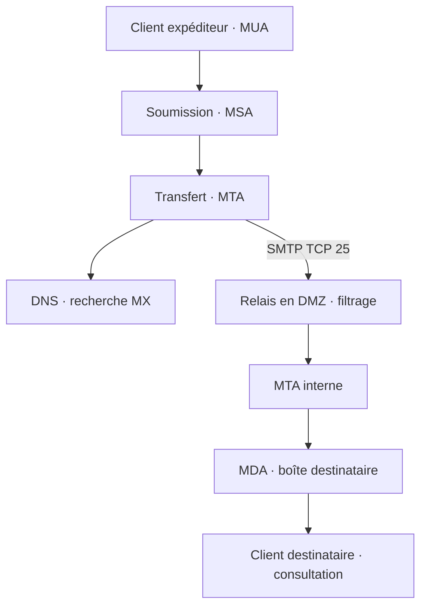

# Module 01 — Les composantes du Cloud et de Microsoft 365

Déplacer une application dans le cloud change la répartition des responsabilités. Avant de choisir une offre ou de créer un tenant, il faut savoir ce que l’équipe doit continuer à administrer et comment ses utilisateurs accèdent au service.

## Objectifs

- Comparer SaaS, PaaS et IaaS, puis distinguer hébergement interne, cloud public, privé et hybride.
- Relier les composants de Microsoft 365 aux usages de l’organisation.
- Suivre l’envoi d’un courriel interne et interdomaines en identifiant le DNS, les relais et les ports.
- Préparer et vérifier le tenant et son domaine dans le laboratoire.

## 1. Choisir un niveau de service

Le support représente le cloud comme la fourniture à la demande de calcul, de stockage, de réseau et d’applications. Le modèle SPI aide à situer la frontière entre le fournisseur et le client, depuis le datacenter jusqu’à l’application.

| Modèle | Ce que fournit le service | Ce que l’organisation gère dans un exemple |
| --- | --- | --- |
| SaaS | Application exploitable, infrastructure et plateforme gérées | Comptes, droits, données et réglages de l’application. Une application métier ou de bureautique peut être fournie de cette manière. |
| PaaS | Plateforme d’exécution avec système et composants gérés | Code, configuration et données de l’application. Le développeur s’appuie sur les services de la plateforme. |
| IaaS | Ressources de calcul, stockage et réseau virtualisées | Système invité, correctifs, logiciels, sauvegardes et configuration de ses VM. |

Plus le service prend en charge de couches, plus l’équipe dépend de ses conditions de fonctionnement et de ses changements. Pour chaque cas, comparer le temps d’administration, les possibilités de personnalisation, la dépendance au réseau, la confidentialité, les coûts récurrents et la réversibilité. Les exemples économiques du support dépendent du cas étudié.

## 2. Comparer les modes d’hébergement

| Mode | Atout mis en avant | Point à vérifier |
| --- | --- | --- |
| Cloud public | Ressources disponibles auprès d’un fournisseur et capacité extensible | Contrat, localisation et circulation des données, accès Internet et réversibilité. |
| Cloud privé | Environnement dédié à l’organisation | Coût de la capacité dédiée, administration et reprise. |
| Hybride | Combinaison de services publics et d’un environnement interne ou privé | Répartition des données et des responsabilités, liens entre les environnements et comportement en cas de coupure. |
| Hébergement interne | Maîtrise directe du matériel, de l’OS et des montées de version | Garantie et renouvellement du matériel, salle sécurisée, climatisation, poids des baies, onduleur et sécurité réseau. |

Le support associe des disponibilités attendues de **99,67 %**, **99,75 %**, **99,982 %** et **99,995 %** à ses niveaux de datacenter 1 à 4. Ce sont les chiffres de son tableau. Pour une décision, lire le périmètre de l’engagement, la période de mesure et les clauses du service. La disponibilité de l’application dépend aussi de l’accès Internet, de l’exploitation et des procédures de reprise.

## 3. Comprendre l’écosystème Microsoft 365

| Besoin | Service présenté |
| --- | --- |
| Boîtes et transport de courrier | Exchange Online |
| Documents personnels et synchronisation | OneDrive |
| Sites, listes et bibliothèques partagées | SharePoint Online |
| Échanges, canaux et réunions | Teams |
| Applications bureautiques installées | Microsoft 365 Apps, appelé Office 365 ProPlus dans le support |
| Identités et accès | Microsoft Entra ID, appelé Azure AD dans le support |

Le support présente des offres pour des profils différents, dont les entreprises, les employés de terrain et les associations. Le plan définit les services auxquels l’abonnement donne accès. Une licence s’attribue à l’identité qui doit les utiliser. Le support cite aussi Planner, OneNote, Yammer, Visio et Project pour la planification, la prise de notes, les échanges ou les projets. Examiner les services inclus avant d’établir un choix.

## 4. Suivre le trajet du courrier

Le support situe les premiers échanges avec Ray Tomlinson en 1971, puis l’évolution de MS Mail vers Exchange 4.0, Outlook Web Access et l’intégration à Active Directory avec Exchange 2000. Les versions suivantes montrent la séparation des rôles et l’évolution jusqu’aux services hébergés. La lecture d’un schéma de courrier repose sur les fonctions suivantes.

| Agent | Fonction |
| --- | --- |
| MUA | Client de messagerie utilisé pour rédiger ou consulter. |
| MSA | Service qui reçoit un message soumis par le client ou l’application. |
| MTA | Agent qui transfère le message vers le serveur ou relais suivant. |
| MDA | Agent qui remet le message dans la boîte destinataire. |

Un message interne peut être remis au système qui héberge la boîte sans sortie vers Internet. Pour un message interdomaines, le MTA cherche le **MX** destinataire dans le DNS, puis contacte le serveur ou le relais. Dans le scénario du support, le pare-feu applique un DNAT vers le relais SMTP en DMZ. Le relais vérifie notamment les expéditeurs autorisés par SPF, le contenu et la réputation, puis transmet le courrier au MTA interne. Le schéma illustre une recherche LDAP vers AD avant la remise à la boîte.

**Illustration IA / externe au cours — chemin d’un courriel interdomaines.**

| Repère | Usage à vérifier |
| --- | --- |
| MX | Indique quel serveur reçoit le courrier pour le domaine, avec une priorité. |
| A / AAAA | Associe un nom d’hôte à une adresse IP. |
| CNAME | Définit un alias de nom, par exemple pour Autodiscover si demandé. |
| TXT | Porte notamment une vérification de domaine ou la politique SPF. |
| SRV | Décrit un service par priorité, poids, port et cible. |
| SMTP TCP 25 | Transport entre serveurs dans la maquette. |
| DNS 53 et LDAP 389 | Recherche DNS et consultation d’annuaire dans le schéma du support. |
| POP 110 et IMAP 143 | Exemples historiques de consultation. Pour un déploiement, relever le protocole sécurisé et le mode d’authentification attendu. |

## 5. TP guidé — Adapter une réponse à des contraintes

1. Pour chaque contexte, relever la criticité, les délais de reprise, les besoins de confidentialité, la charge et la qualité réelle du lien.
2. Comparer l’hébergement interne, privé, public et hybride en décrivant qui intervient sur le matériel et qui exploite les services.
3. Choisir une solution et une variante. Associer à chaque choix un test réaliste et une hypothèse de coût.

| Cas du TP | Pistes du corrigé | Contrôle de décision |
| --- | --- | --- |
| Client à l’étranger, lien garanti, données confidentielles | Cloud privé avec réplication et intervention de proximité, ou maintien interne associé à un PRA et à un partenaire local | Mesurer le délai de reprise, la localisation des données et la capacité d’intervention. |
| 25 magasins, liaisons ADSL et rendus 3D | SaaS, stations graphiques locales avec sauvegarde ou session distante/VDI. RDS ou Citrix figurent parmi les pistes pour les applications centralisées. | Faire un essai depuis un magasin avec transfert et calcul représentatifs. Examiner la fiabilité et le secours du lien. |
| Deux hyperviseurs, 40 VM, 5 To et applications exigeantes | Renouvellement local, hébergement d’une partie dans le cloud ou archivage pour réduire la capacité facturée | Mesurer les débits, la capacité utile, le coût du stockage et le temps nécessaire pour restaurer les données. |

## 6. TP guidé — Créer un tenant et vérifier le courrier

Le support montre la commande d’un domaine chez un hébergeur et un essai Microsoft 365. Préparer un tenant et une zone DNS de laboratoire autorisés. Les tarifs, offres et écrans de création du support sont historiques.

1. Identifier le **tenant** de laboratoire, son domaine initial et l’identité d’administration. Suivre l’assistant avec les données de formation. Garder les accès dans le moyen de stockage prévu, hors du compte rendu.
2. Ajouter le domaine personnalisé dans l’administration Microsoft 365. Relever le TXT de validation demandé par l’assistant et le publier dans la zone externe correspondante.
3. Vérifier la réponse TXT sur la zone publique, puis lancer la vérification du domaine. La maîtrise de la zone est une étape avant la configuration de la messagerie.
4. Ajouter les valeurs DNS demandées pour les services choisis, dont le MX et l’alias Autodiscover si l’assistant les fournit. Consolider SPF en tenant compte des émetteurs autorisés, sans créer une seconde politique concurrente. [Enregistrements DNS pour Microsoft 365](https://learn.microsoft.com/microsoft-365/admin/get-help-with-domains/information-for-dns-records)
5. Modifier le suffixe de l’utilisateur de test pour utiliser le domaine validé. Contrôler son identité et l’adresse de sa boîte. Envoyer puis recevoir un message avec une adresse externe au tenant.
6. Relever la réponse DNS, l’heure, l’expéditeur, le destinataire et l’issue des deux essais. En cas d’échec, vérifier le domaine et l’adresse, puis séparer un problème de connexion, de routage MX et de remise dans la boîte.

## À retenir

Le modèle SPI répond à la question des responsabilités. Le mode d’hébergement situe l’infrastructure. Dans le TP, le TXT prouve la maîtrise du domaine, le MX oriente le courrier et les tests de bout en bout prouvent le service.

## Mini-quiz — 5 questions {#mini-quiz}

1. Quel modèle laisse l’administration du système invité au client ?
2. Pour les magasins du TP, pourquoi tester la liaison avant de choisir une solution 3D ?
3. Quelles fonctions assurent le MTA et le MDA ?
4. Quel enregistrement vérifie la maîtrise du domaine ?
5. Les envois réussissent mais les courriers externes arrivent sur l’ancien serveur. Où chercher en premier ?

??? success "Réponses commentées"

    1. IaaS. Le fournisseur expose l’infrastructure et l’organisation gère les systèmes invités et les applications.
    2. Les transferts et les sessions graphiques peuvent saturer une liaison faible. Un essai sur site mesure l’effet sur l’usage réel.
    3. Le MTA transfère le message. Le MDA le remet dans la boîte destinataire.
    4. Le TXT demandé par l’assistant de vérification. Le MX sert ensuite au routage du courrier entrant.
    5. Vérifier la réponse MX publique, sa priorité et son TTL, puis le routage depuis la cible vers le service attendu.

## Pour pratiquer et réviser {#travaux-pratiques-et-revisions}

- [TP 1 — Adapter une réponse](../../tp/14-messagerie-cloud/module-01/tp-01.md) et [correction](../../tp/14-messagerie-cloud/module-01/correction-tp-01.md)
- [TP 2 — Créer un tenant](../../tp/14-messagerie-cloud/module-01/tp-02.md) et [correction](../../tp/14-messagerie-cloud/module-01/correction-tp-02.md)
- [Fiche de révision](../../revision/14-messagerie-cloud/module-01.md)
- [Kahoot existant](../../kahoot/14-messagerie-cloud-module-01.md)
- [Sommaire de Messagerie Cloud](index.md)

## Provenance pédagogique

Le support M01 et les quatre documents des deux TP fondent les modèles, les exemples de messagerie et la création du tenant. Le schéma et la grille de comparaison sont des aides de synthèse.
