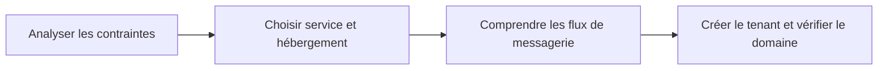

# Module 01 — Les composantes du Cloud et de Microsoft 365

## Objectifs

Distinguer les composantes du Cloud, les modèles SaaS/PaaS/IaaS et les modes d’hébergement ; comprendre les flux de messagerie ; créer un tenant Microsoft 365.

## Se repérer dans le support

| Pages PDF | Notions du support |
| --- | --- |
| 1–3 | Objectifs, définition du Cloud, disponibilité et questions de sécurité/localisation |
| 4–8 | Modèle SPI : SaaS, PaaS, IaaS et exemples |
| 9–13 | Cloud public, privé, hybride et hébergement interne ; critères de choix |
| 14–16 | Licences, écosystème Microsoft 365 et premier TP |
| 17–21 | Historique de la messagerie, MUA/MSA/MDA/MTA et schémas d’échanges internes |
| 22–26 | DNS et transport des messages, résolution et routage entre domaines |
| 27–32 | Création du tenant, domaine personnalisé et vérification DNS |

## Comprendre avant de configurer

Le support relie le choix d’hébergement aux besoins de l’entreprise : localisation, accès Internet, disponibilité, maintenance matérielle et coûts. Comparer un modèle de service (SaaS, PaaS ou IaaS) et un mode d’hébergement (public, privé, hybride ou interne) constitue deux choix distincts dans le cours.

Pour la messagerie, repérer les rôles des composants avant de suivre le déplacement du message dans les schémas d’origine. Dans les pages DNS, distinguer le rôle de l’enregistrement MX de celui des enregistrements utilisés pour vérifier le domaine et configurer les services du tenant.

La création du tenant et l’ajout d’un domaine personnalisé sont deux étapes du parcours original. Les valeurs DNS et les identifiants de démonstration sont des données de laboratoire ; les captures montrent le parcours du support et ne garantissent pas que l’interface actuelle soit identique.

## Illustration IA / externe au cours — parcours de lecture

## Pour réviser

Expliquer les différences entre les trois modèles SPI, justifier un choix d’hébergement à partir d’une contrainte, suivre un message sur les schémas originaux et retrouver les étapes de vérification du domaine.

## Travaux pratiques du module

[Ateliers, énoncés et corrections](../../tp/14-messagerie-cloud/module-01/index.md).

## Provenance

Les documents originaux sont présentés séparément de cette aide IA / externe au cours. Les pages indiquées sont les pages PDF, et non les numéros de diapositives.

- [Module 01 - Support de cours.pdf](https://drive.google.com/file/d/1Se_Xcs1zz1yiD0x5WAi_ALNW5AgJFklA/view?usp=drivesdk) · SHA-256 `94b0952ee81d37c6afd441c29534d56caf345e86409091611deb08a467f16686`
- [M1 - Solution du TP 2 - Création d'un tenant.pdf](https://drive.google.com/file/d/1EdB6rg9Dog8Kp6dAibrm5m2IztOAIZUk/view?usp=drivesdk) · SHA-256 `2cb2d8eafc3031355e556481539e8669e4b4f08fac78e7c6ec3b3e138dbd427e`
- [M1 - Solution du TP 1 - Adapter une reponse à des contraintes.pdf](https://drive.google.com/file/d/1CksxEZCgZClGQ3G9H-Tbrmd-ukungFQ9/view?usp=drivesdk) · SHA-256 `38bb0de222264a0db6256640d01b53ec133ce5cdce735149294122d0f70c9b61`
- [M1 - Enoncé du TP 2 - Création d'un tenant.pdf](https://drive.google.com/file/d/1M6R8Vim0BbF_C6NwdGVZN-_rP4Kcqe7B/view?usp=drivesdk) · SHA-256 `27df445441ffef9a3e5fba7052d60d4ac8ed7de67a8627eaf53a4225ed04ab4a`
- [M1 - Enoncé du TP 1 - Adapter une reponse à des contraintes.pdf](https://drive.google.com/file/d/1KHoMXQ5ewU7dWdgyt13PCcwHk6HmODS5/view?usp=drivesdk) · SHA-256 `14ad46ef6aaf622ffe038e688eb6ae22fff81c28a97199d96eb7c3567635455c`
