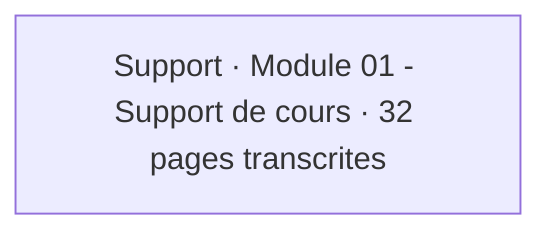
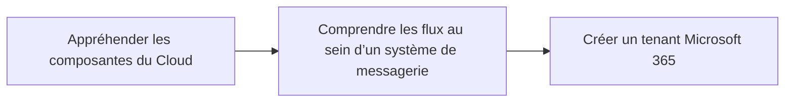
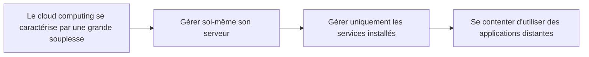
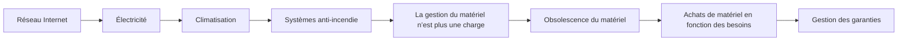
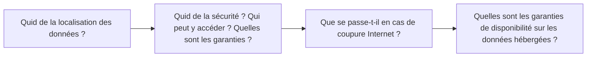
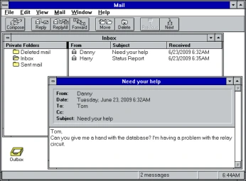
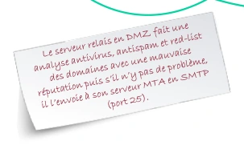

# Module 01 — Les composantes du Cloud et de Microsoft 365

[Travaux pratiques](../../tp/14-messagerie-cloud/module-01/index.md)

Les parties ci-dessous reprennent le cours original, dans le même ordre. Les encadrés et les schémas répètent ses formulations.

## Parcours de lecture

1. Support · Module 01 - Support de cours · 32 pages transcrites

**Visuel externe**

SOURCE DRIVE · TRANSCRIPTION DU SUPPORT

Le contenu des documents du dossier TSSR est transcrit ci-dessous, page par page. Les textes et tableaux sont intégrés à la page Web. Aucun fichier PDF, aucune diapositive entière ni aucune reproduction de page n’est affiché. Seuls des croquis ou visuels isolés et vérifiés peuvent accompagner la transcription. Les versions et les consignes restent celles des supports de formation. Les compléments IA sont conservés dans leur onglet distinct.

## Support · Module 01 - Support de cours · 32 pages transcrites

!!! note "À retenir"
    Les parcours et libellés historiques sont conservés.

Transcription du document source. Les parcours et libellés historiques sont conservés. Les mots de passe, codes de validation et coordonnées nominatives sont neutralisés. Les noms de domaine d’accès des exemples utilisent des domaines réservés à la documentation.

### Module 01 – Les composantes du Cloud et de Microsoft 365

### Objectifs

!!! note "À retenir"
    Appréhender les composantes du Cloud Connaître les différents types d’infrastructures dans le cloud SaaS, PaaS et IaaS Comprendre les flux au sein d’un système de messagerie Créer un tenant Microsoft 365

**Visuel externe**

- Appréhender les composantes du Cloud
- Connaître les différents types d’infrastructures dans le cloud SaaS, PaaS et IaaS
- Comprendre les flux au sein d’un système de messagerie
- Créer un tenant Microsoft 365

### Qu’est-ce que le Cloud ?

### Définition

**Visuel externe**

- Cloud – nuage en français – vient du symbole utilisé pour désigner le réseau Internet dans un schéma d’architecture système ou réseau
- Le Cloud fournit de la puissance de calcul (processeurs, RAM, GPU…), du stockage, des logiciels…
- Le cloud computing se caractérise par une grande souplesse
- Les compétences de l'utilisateur et le besoin de l'entreprise seront des critères de choix entre les différents modes :
- Gérer soi-même son serveur
- Gérer uniquement les services installés
- Se contenter d'utiliser des applications distantes

### Qu’est-ce que le Cloud ?

### Définition

!!! note "À retenir"
    Le Cloud apporte de la sécurité du point de vue de la disponibilité des données : Réseau Internet Électricité Climatisation Systèmes anti-incendie … La facturation des services est dimensionnée en fonction de son utilisation, donnant plus de visibilité financière aux entreprises.

**Visuel externe**

- Le Cloud apporte de la sécurité du point de vue de la disponibilité des données :
- Réseau Internet
- Électricité
- Climatisation
- Systèmes anti-incendie
- …
- La facturation des services est dimensionnée en fonction de son utilisation, donnant plus de visibilité financière aux entreprises.
- La gestion du matériel n’est plus une charge
- Obsolescence du matériel
- Achats de matériel en fonction des besoins
- Gestion des garanties
- Accès à du matériel haute performance

### Qu’est-ce que le Cloud ?

### Définition

!!! note "À retenir"
    L’hébergement de données sensibles comme les données médicales est soumis à des normes.

**Visuel externe**

- Quid de la localisation des données ?
- Quid de la sécurité ? Qui peut y accéder ? Quelles sont les garanties ?
- L’hébergement de données sensibles comme les données médicales est soumis à des normes. Un datacenter doit être certifié « HDS » pour héberger ce type de données.
- Que se passe-t-il en cas de coupure Internet ?
- Quelles sont les garanties de disponibilité sur les données hébergées ?

### Le modèle SPI – SaaS / PaaS / IaaS

### Qu’est-ce que le modèle SPI ?

!!! note "À retenir"
    Le cloud computing correspond à la mise à disposition de ressources ou d’applications au travers de l’Internet par différents modèles (SPI) SaaS – Software as a Service PaaS – Platform as a Service IaaS – Infrastructure as a Service Il faut bien choisir son niveau de service !

- Le cloud computing correspond à la mise à disposition de ressources ou d’applications au travers de l’Internet par différents modèles (SPI)

- SaaS – Software as a Service
- PaaS – Platform as a Service
- IaaS – Infrastructure as a Service

| Modèle | Couches |
| --- | --- |
| SaaS | Applications |
| PaaS | Middleware |
| IaaS | OS, virtualisation, serveurs / stockage, réseau et datacenter |

Il faut bien choisir son niveau de service !

### Le modèle SPI – SaaS / PaaS / IaaS

### Qu’est-ce que le modèle SPI ?

### SaaS

### PaaS

### IaaS

!!! note "À retenir"
    Serveur et stockage Sécurité/pare-feu réseau Bâtiment/installation physique de centre de données Applications hébergées Systèmes d’exploitation Outils de développement, Gestion de base de données, Analyse marketing

Serveur et stockage Sécurité/pare-feu réseau Bâtiment/installation physique de centre de données

Applications hébergées Systèmes d’exploitation Outils de développement, Gestion de base de données, Analyse marketing

### Le modèle SPI – SaaS / PaaS / IaaS

### Qu’est-ce que le SaaS (Software as a Service) ?

!!! note "À retenir"
    Le SaaS permet la mise à disposition d’applications aux utilisateurs finaux L’utilisateur est déchargé de la partie configuration des logiciels ce qui présente des avantages, mais aussi des inconvénients

- Le SaaS permet la mise à disposition d’applications aux utilisateurs finaux
- L’utilisateur est déchargé de la partie configuration des logiciels ce qui présente des avantages, mais aussi des inconvénients

### Inconvénient Avantages

!!! note "À retenir"
    Idéal pour de petites entreprises n’ayant pas de SI Totalement tributaire de l’éditeur (changement de version, arrêt du service, indisponibilités) Disponibilité proche du 100% Dépendance à l’accès Internet Évolution des produits dans le temps Que penser de la confidentialité des données ?

- Pas d’administration. Idéal pour de petites entreprises n’ayant pas de SI
- Totalement tributaire de l’éditeur (changement de version, arrêt du service, indisponibilités)
- Disponibilité proche du 100%
- Dépendance à l’accès Internet
- Évolution des produits dans le temps
- Que penser de la confidentialité des données ?
- Pas de contraintes matérielles (stockage, obsolescence, performance)
- Le ROI croise à environ 4 ans
- Coût maîtrisé et à aligner sur la consommation

|  | Inconvénient |
| --- | --- |
| • Totalement tributaire de l’éditeur (changement de version, arrêt du service, indisponibilités) • Dépendance à l’accès Internet • Que penser de la confidentialité des données ? • Le ROI croise à environ 4 ans |  |

### Le modèle SPI – SaaS / PaaS / IaaS

### Exemples de SaaS

### Applications métiers

### Le modèle SPI – SaaS / PaaS / IaaS

### Qu’est-ce que le PaaS (Platform as a Service) ?

- Le PaaS permet la mise à disposition d’environnements et de plateformes informatiques
- On peut mettre à disposition des OS ou des applications spécifiques sur des infrastructures mutualisées

### Inconvénient Avantages

- Dépendance à l’accès Internet
- Économies de licences logicielles à l’achat
- Flexibilité
- Que penser de la confidentialité des données ?
- Sécurité assurée par le fournisseur
- Facilité de mise en œuvre

|  | Inconvénient |
| --- | --- |
| • Dépendance à l’accès Internet • Que penser de la confidentialité des données ? |  |

### Le modèle SPI – SaaS / PaaS / IaaS

### Exemples de PaaS

### Le modèle SPI – SaaS / PaaS / IaaS

### Qu’est-ce que l’IaaS (Infrastructure as a Service) ?

- L'IaaS permet la mise à disposition d’infrastructures aux administrateurs
- Les administrateurs n’ont plus besoin de se préoccuper des problématiques liées à l’hébergement interne des serveurs, le matériel est mis à disposition par le fournisseur

### Inconvénient Avantages

- Totalement tributaire de l’hébergeur
- Il n’est pas nécessaire d’aménager une salle serveur
- Dépendance à l’accès Internet
- La sécurité du matériel est assurée par le fournisseur
- Que penser de la confidentialité des données ?
- Garanties de disponibilité
- Pas d’obsolescence du matériel
- Évolutivité à la demande

|  | Inconvénient |
| --- | --- |
| • Totalement tributaire de l’hébergeur • Dépendance à l’accès Internet • Que penser de la confidentialité des données ? |  |

### Le modèle SPI – SaaS / PaaS / IaaS

#### Exemples de fournisseurs d’IaaS

- Amazon Web Services
- Google
- Microsoft
- OVH.com

### Le modèle SPI – Types de Cloud

### Le modèle SPI – Types de Cloud

#### Différences entre Cloud public, privé et hybride

##### Cloud public

- Le matériel (serveurs, stockage…) est la propriété du fournisseur de services
- Matériel partagé avec d’autres clients du fournisseur de services
- Extensibilité pratiquement illimitée
- Fiabilité
- Coûts relativement faibles
- Pas de matériel à maintenir, le fournisseur s’en charge
- Attention aux volumes de données qui circulent et aux temps d’allumage des VM

##### Cloud privé

- Intégration du matériel dans un datacenter tiers ou interne à l’entreprise
- La fiabilité, la sécurité et l’extensibilité sont à la charge de l’entreprise
- La sécurité est considérée comme accrue, car le matériel n’est pas mutualisé
- Évolutivité sous réserve d’investissements (souvent coûteux)

### Le modèle SPI – Types de Cloud

### Différences entre Cloud public, privé et hybride

Cloud hybride • C’est la combinaison de l’hébergement local ou d'un Cloud privé avec un Cloud public • Permet de gérer les coûts, de maîtriser la sécurité et d’optimiser les performances en prenant le meilleur des différents types de Cloud • Permet de fiabiliser les services en les « éclatant » sur les différents types de Cloud

- Expansion facile grâce au Cloud public, performance et sécurité grâce au Cloud privé
- Rapport coût / efficacité

### Le modèle SPI – Types de Cloud

### Les garanties proposées par le Cloud

Les plateformes hébergées dans les datacenter proposent des niveaux de garantie de disponibilité différents :

### Type de Datacenter Niveau de garantie

Niveau 1 Le temps de disponibilité attendu est de 99,67 % (28,8 heures d'arrêt par an).

Niveau 2 Le temps de disponibilité attendu est de 99,75 % (22 heures d'arrêt par an).

Niveau 3 Le temps de disponibilité attendu est de 99,982 % (1,6 heure d'arrêt par an).

Niveau 4 Le temps de disponibilité attendu est de 99,995 % (26,3 minutes d'arrêt par an).

| Type de Datacenter | Niveau de garantie |
| --- | --- |
| Niveau 1 | Le temps de disponibilité attendu est de 99,67% (28,8heures d'arrêt par an). |
| Niveau 2 | Le temps de disponibilité attendu est de 99,75% (22heures d'arrêt par an). |
| Niveau 3 | Le temps de disponibilité attendu est de 99,982% (1,6heure d'arrêt par an). |
| Niveau 4 | Le temps de disponibilité attendu est de 99,995% (26,3minutes d'arrêt par an). |

### Le modèle SPI – Types de Cloud

### Hébergement interne ou Cloud ?

- Faut-il héberger son infrastructure en local ou dans le Cloud ?
- À l’image d’un grand nombre de décisions prises sur les infrastructures informatiques, tout dépend des cas d’usage
- En cas d'hébergement cloud, il faut noter que l’entreprise sera fortement dépendante de la qualité de son accès à Internet tant sur le plan du débit que de la fiabilité
- Avant de prendre une décision, il faudra analyser précisément les besoins

### Le modèle SPI – Types de Cloud

### Hébergement interne (On-Premise)

- Héberger son infrastructure en interne présente certains avantages :
- Maîtrise totale de l’environnement matériel et OS
- Montées de version contrôlées
- Investissement initial et pas de notion de « location » pour la mise à disposition des services
- Ajout de nouveaux services « gratuitement » sous réserve de disponibilité du matériel
- Cependant, bon nombre de points sont à prendre en compte…

### Le modèle SPI – Types de Cloud

### Hébergement interne

- Héberger son infrastructure en interne présente également des contraintes :
- Obsolescence du matériel (en termes de puissance, d'usure et de périodes de garanties)
- Disposer d’une salle serveur
- Fermée à clé
- Disposant de climatisation
- Disposant de système pare-feu adapté
- Disposer d’un onduleur pour compenser d’éventuelles coupures électriques
- Prendre en compte le poids de la baie chargée
- La sécurité est assurée par le service informatique
- Sécurité applicative (pare-feu)
- Mais aussi physique (électricité, refroidissement, accès Web)

### Le modèle SPI – Types de Cloud

### Les offres Cloud – modèle SPI

- Quelles questions se poser pour faire son choix ?
- Quelle est la criticité assumée ?
- Quel est le niveau de disponibilité demandé pour les serveurs et applications ?
- Quelles sont les exigences de performance des applications ?
- Disposons-nous d’une salle serveur ?
- Avons-nous du matériel ?
- Est-il encore sous garantie ?
- Prenons-nous le risque de travailler avec du matériel hors garantie (budget maintenant difficile à quantifier) ?
- Quels sont la fiabilité acceptée et le débit de notre ligne Internet ?
- Avons-nous des garanties (GTR) sur notre ligne Web ?
- Serait-ce suffisant pour supporter un hébergement Cloud ?
- Sommes-nous soumis à des réglementations sur la confidentialité des données ?
- Avons-nous les compétences ?

### Le modèle SPI – Types de Cloud

### Les offres Cloud – modèle SPI – hébergement interne

- C’est en fonction des réponses apportées à aux questions précédentes qu’on pourra choisir le mode d’hébergement de notre infrastructure :
- On-Premise
- Cloud privé
- Cloud public
- Cloud hybride

### Licences et écosystème

### Microsoft 365

Baies de serveurs dans un centre de données

Licences et écosystème Microsoft 365 Les éléments de base de Microsoft 365

### OneDrive

### Exchange Online

### Office 365 ProPlus

### SharePoint Online

### Microsoft Teams

### Azure AD

### Licences et écosystème Microsoft 365

### Plans et licences

### Microsoft Office 365

### Entreprise

### Employés de terrain

### Association

### Gouvernement

### Particuliers

### Education

### PME

### Famille

### A1

### Entreprise E3

### Business Basic

### F3

### Business Basic Pour les associations

### E1 Secteur public

### Personnel

### A3

### Entreprise E5

### Business Standard

### Business Standard Pour les associations

### E3 Secteur public

### Famille et étudiant

### A5

### Apps for Enterprise

### Business Premium

### E1 Pour les associations

### E5 Secteur public

### Apps for Business

### E3 Pour les associations

### E5 Pour les associations

### Licences et écosystème Microsoft 365

#### Les services principaux

- Exchange Online
- SharePoint Online
- Microsoft Teams

#### Les services additionnels

| Service | Libellé du support |
| --- | --- |
| Yammer | Réseau social d’entreprise |
| OneNote |  |
| Planner | Outil de planification |
| Project | Gestion de projet |
| Visio | Création de schéma et diagrammes |

…

### Licences et écosystème Microsoft 365

### TP

### Démo

Les offres Cloud – modèle SPI Adapter une réponse à des contraintes

### Historique de la messagerie

### Historique de la messagerie

### Apparition de la messagerie

- Apparition de la messagerie dans les années 1970
- Premier mail par Ray Tomlinson à l’automne 1971
- Invention du @ dans une adresse e-mail

### Message du premier

### e-mail QWERTYUIOP

### tomlinson@bbn-tenexa

### Historique de la messagerie

### Apparition de la messagerie

- MS Mail 3.5 au début des années 1990 au tout premier Exchange 4.0 en 1996 basé sur le protocole de messagerie X.400 (le principal héritage de X.400 est le vocabulaire, MTA (Mail Transport Agent) ou MUA (Mail User Agent), toujours utilisé aujourd'hui), mais déjà compatible SMTP.

Ray Tomlinson

Interface historique de messagerie

### Historique de la messagerie

### Apparition de la messagerie

- En mai 1997, la version Exchange 5.0 permet l’apparition du tout premier client Web qui s’appelle Outlook Web Access.
- En 2000 apparaît Exchange 2000 qui n’héberge plus son propre annuaire LDAP, mais s’appuie sur Active-Directory de Windows 2000.

### Historique de la messagerie

### Les différentes versions Exchange jusqu’à Microsoft 365

- Apparu trois ans plus tard, Exchange 2003
- On voit arriver RPC/HTTPS et ActiveSync.
- Exchange 2007
- Apparaissent de nouvelles fonctionnalités de HA (LCR, CCR, SCR) ainsi que la gestion via PowerShell.
- Exchange 2010
- Marque l’abandon des versions 32 bits.
- Il permet une meilleure intégration avec l’AD, l’administration se fait avec une console MMC, la console Exchange PowerShell ou le panneau ECP.
- Les nouveautés sont le DAG, OWA (Outlook Web App) et la messagerie vocale sur IP.
- Office 365
- Naissance en juin 2011.

### Vocabulaire et serveur de messagerie interne

#### MUA, MSA, MDA et MTA

- MUA Mail User Agent
- Client de messagerie (Gmail, Outlook, client web, application de smartphone…).
- MSA Mail Submission Agent
- Identifie, contrôle et transmet les courriers vers le MTA
- MDA Mail Delivery Agent
- Service du serveur de messagerie qui stocke les mails dans les boîtes aux lettres des utilisateurs.
- MTA Mail Transfer Agent
- Service du serveur de messagerie qui reçoit les mails d’un MSA ou d’un autre MTA.

##### Trajet présenté dans le schéma

Le client de messagerie Outlook (MUA) remet le courrier au MSA du serveur Exchange. Le MSA le transmet par SMTP au MTA d’Exchange, qui l’envoie par SMTP au MTA du serveur Gmail. Côté Gmail, le MTA remet le courrier par SMTP au MDA, associé à la boîte de l’utilisateur.

Le client de messagerie Firefox (MUA) consulte cette boîte. Le dessin indique POP3, IMAP4, ActiveSync, HTTPS et MAPI parmi les protocoles clients.

### Vocabulaire et serveur de messagerie interne

### Envoi de Mail en interne

### Crêpes.lcl

### 213.186.33.20

### MTA serveur SMTP

### MDA serveur Mailbox

### Exchange

### Serveur AD Serveur DNS

### Exchange

### MUA ou client de messagerie

### Vocabulaire et serveur de messagerie interne

### Envoi de Mail en interne

### Crêpes.lcl

### MTA serveur SMTP

### MDA serveur Mailbox

### Exchange

### Serveur AD Serveur DNS

### Exchange

### MUA ou client de messagerie

#### Séquence représentée dans les schémas

- Jean-Pierre écrit un mail à Micheline sur son logiciel de messagerie et le place dans sa boîte d’envoi.
- Le client de Jean-Pierre envoie son mail à son serveur de messagerie et en fait une copie dans sa boîte de réception.

Rédaction et mise en boîte d’envoi

Envoi au serveur et copie du message

### Vocabulaire et serveur de messagerie interne

### Envoi de Mail en interne

### Crêpes.lcl

### JP Micheline

### MTA serveur SMTP

### MDA serveur Mailbox

### Exchange

### Serveur AD Serveur DNS

### Exchange

### MUA ou client de messagerie Jean-Pierre@domaine-labo-3.example

### MUA ou client de messagerie Micheline@domaine-labo-3.example

### Vocabulaire et serveur de messagerie interne

### Envoi de Mail en interne

### Crêpes.lcl

### MTA serveur SMTP

### MDA serveur Mailbox

### Exchange

### Serveur AD Serveur DNS

### Exchange

### MUA ou client de messagerie

### Jean-Pierre

### Micheline

#### Séquence représentée dans les schémas

- Le serveur de messagerie MDA cherche la boîte aux lettres de Micheline et y pose le mail.
- Le serveur de messagerie MDA contacte le client de Micheline afin qu’il télécharge le mail suivant son protocole client (POP3:110, IMAP4:143, HTTPS:443, ActiveSync:443…).

Dépôt dans la boîte du destinataire

Accès au message par le client

### DNS et transport des messages

### Enregistrement DNS

- Les différents enregistrements DNS nécessaires
- SOA (start of authority)
- Indique le serveur maître (primaire) de la zone DNS
- L'adresse mail de la personne que l'on doit contacter en cas de problème sur la zone
- Les paramètres d'expiration
- NS (name serveur)
- Indique le(s) serveur(s) qui fait(font) autorité(s) sur le domaine
- A ou AAAA (Hôte)
- Indique la correspondance entre un nom et une adresse IP
- Chaque contrôleur de domaine, serveur et ordinateur client doivent en posséder un
- SRV (Service)
- Identifie le ou les serveurs qui fournissent des services spécifiques

### Exemple d'enregistrement SRV

### DNS et transport des messages

### Domaine DNS externe et routage

- MX (Mail eXchange)
- Identifie le ou les serveurs qui fournissent les services de messagerie pour ce domaine.
- Cet enregistrement ne vous sert que pour la réception des messages.
- Pointe généralement vers l’adresse IP publique de votre routeur.
- SPF (Sender Policy Framework)
- Type d'enregistrement TXT.
- Identifie le ou les serveurs qui ont le droit d'envoyer un courriel pour ce domaine.
- Cet enregistrement ne vous sert que pour l'envoi des messages.
- SNAT
- Règle de post-routage qui transforme une adresse IP privée en adresse IP publique.
- DNAT
- Règle de pré-routage qui, généralement, renvoie un paquet qui arrive sur une adresse IP publique vers une adresse IP d’un réseau privé (souvent dans une DMZ).

### DNS et transport des messages

### Domaine DNS externe

### Zone domaine-labo.example

### 192.0.2.25 213.186.33.20 DNS de l’hébergeur

domaine-labo.example. IN MX relais.domaine-labo.example domaine-labo.example. IN A 192.0.2.25

### MTA, MSA et

### MTA et MSA serveur SMTP

### MDA serveur Mailbox

### Serveur AD Serveur DNS

### MDA serveur SMTP Serveur AD Serveur DNS

### Exchange

### Crêpes.pdl

### MUA ou client de messagerie

### Micheline

### Galettes.lcl

### Jean-Pierre

### MTA relais SMTP

### DMZ

#### Départ du message

- Jean-Pierre écrit un mail à Micheline avec Outlook et le place dans la boîte d’envoi. Notifié, MSA récupère et transmet le message au MTA et au MDA qui effectue une copie du message dans les éléments envoyés.

Soumission du message au système de messagerie

### DNS et transport des messages

### Domaine DNS externe

### Zone domaine-labo.example

### 192.0.2.25 213.186.33.20 DNS de l’hébergeur

domaine-labo.example. IN MX relais.domaine-labo.example domaine-labo.example. IN A 192.0.2.25

### MTA, MSA et

### MTA et MSA serveur SMTP

### MDA serveur Mailbox

### Serveur AD Serveur DNS

### MDA serveur SMTP Serveur AD Serveur DNS

### Exchange

### Crêpes.pdl

### MUA ou client de messagerie

### Micheline

### Galettes.lcl

### Jean-Pierre

### MTA relais SMTP

### DMZ

### DNS et transport des messages

### Domaine DNS externe

### DNS de l’hébergeur

### Zone domaine-labo.example

domaine-labo.example. IN MX relais.domaine-labo.example domaine-labo.example. IN A 192.0.2.25

### 192.0.2.25 213.186.33.20

### MTA, MSA et

### MTA et MSA serveur SMTP

### SMTP DNAT SNAT

### MDA serveur Mailbox

### Serveur AD Serveur DNS

### MDA serveur SMTP Serveur AD Serveur DNS

### Exchange

### Crêpes.pdl

### MUA ou client de messagerie

### Micheline

### Galettes.lcl

### Jean-Pierre

### MTA relais SMTP

### DMZ

#### Recherche et remise au relais

- Le serveur MTA fait une requête DNS (port 53) afin de trouver l’enregistrement MX sur le serveur DNS externe du domaine du destinataire.
- Le serveur MTA obtient en réponse l’IP publique du routeur pare-feu. Il lui envoie le mail en SMTP (port 25) et le DNAT du routeur pare-feu le renvoie au relais SMTP (port 25) en DMZ.

### DNS et transport des messages

### Domaine DNS externe

### DNS de l’hébergeur

### Zone domaine-labo.example

domaine-labo.example. IN MX relais.domaine-labo.example domaine-labo.example. IN A 192.0.2.25

### 192.0.2.25 213.186.33.20

### MTA, MSA et

### MTA et MSA serveur SMTP

Zone crêpes.pdl Crêpes.pdl IN SPF "v=spf1 ipv4:213.186.33.20/27 –all" Crêpes.pdl IN A 213.186.33.20

### MDA serveur Mailbox

### Serveur AD Serveur DNS

### MDA serveur SMTP Serveur AD Serveur DNS

### Exchange

### Crêpes.pdl

### MUA ou client de messagerie

### Micheline

### Galettes.lcl

### Jean-Pierre

### MTA relais SMTP

### DMZ

### DNS et transport des messages

### Domaine DNS externe

### DNS de l’hébergeur

### Zone domaine-labo.example

domaine-labo.example. IN MX relais.domaine-labo.example domaine-labo.example. IN A 192.0.2.25

### 192.0.2.25 213.186.33.20

### MTA, MSA et

### MTA et MSA serveur SMTP

Zone crêpes.pdl Crêpes.pdl IN SPF "v=spf1 ipv4:213.186.33.20/27 –all" Crêpes.pdl IN A 213.186.33.20

### MDA serveur Mailbox

### Serveur AD Serveur DNS

### MDA serveur SMTP Serveur AD Serveur DNS

### Exchange

### Crêpes.pdl

### MUA ou client de messagerie

### Micheline

### Galettes.lcl

### Jean-Pierre

### MTA relais SMTP

### DMZ

#### Contrôles à l’arrivée

- Le serveur relais en DMZ vérifie dans la zone DNS (port 53) de Jean-Pierre si le serveur est autorisé à envoyer un mail pour le domaine en lisant l’enregistrement SPF.
- Le serveur relais en DMZ fait une analyse antivirus, antispam et réputation des domaines. S’il n’y a pas de problème, il l’envoie à son serveur MTA en SMTP (port 25).

Contrôles du relais en DMZ

### DNS et transport des messages

### Domaine DNS externe

### DNS de l’hébergeur

### Zone domaine-labo.example

domaine-labo.example. IN MX relais.domaine-labo.example domaine-labo.example. IN A 192.0.2.25

### LDAP 389

### 192.0.2.25 213.186.33.20

### MTA, MSA et

### MTA et MSA serveur SMTP

Zone crêpes.pdl Crêpes.pdl IN SPF "v=spf1 ipv4:213.186.33.20/27 –all" Crêpes.pdl IN A 213.186.33.20

### MDA serveur Mailbox

### Serveur AD Serveur DNS

### MDA serveur SMTP Serveur AD Serveur DNS

### Exchange

### Crêpes.pdl

### MUA ou client de messagerie

### Micheline

### Galettes.lcl

### Jean-Pierre

### MTA relais SMTP

### DMZ

### DNS et transport des messages

### Domaine DNS externe

### DNS de l’hébergeur

### Zone domaine-labo.example

domaine-labo.example. IN MX relais.domaine-labo.example domaine-labo.example. IN A 192.0.2.25

### LDAP 389

### 192.0.2.25 213.186.33.20

### MTA, MSA et

### MTA et MSA serveur SMTP

Zone crêpes.pdl Crêpes.pdl IN SPF "v=spf1 ipv4:213.186.33.20/27 –all" Crêpes.pdl IN A 213.186.33.20

### MDA serveur Mailbox

### Serveur AD Serveur DNS

### MDA serveur SMTP Serveur AD Serveur DNS

### DNS et transport des messages

### Exchange

### Crêpes.pdl

### MUA ou client de messagerie

### Jean-Pierre

### MUA ou client de messagerie

### Micheline MTA relais SMTP Galettes.lcl DMZ

#### Remise dans la boîte et accès client

- Le serveur MTA fait une requête LDAP au serveur AD (port 389) afin de trouver le serveur qui héberge la boîte aux lettres de Micheline, puis pose le mail dedans et avertit le client.
- Le client de messagerie de Micheline utilise son protocole client afin de récupérer le mail (POP3:110, IMAP4:143, HTTPS:443, ActiveSync:443 ou MAPI sur HTTP:443), puis elle peut lire le mail.

Recherche de la boîte destinataire dans l’annuaire

Consultation du message remis

### Création du Tenant

### Création du Tenant Créer un Tenant Microsoft 365

### 1 2

### Fournissez une

### Sélectionnez

### adresse mail

### un plan

### valide

### Sélectionnez

### 3

### Essai gratuit

### Entrez les données de votre entreprise Validez

### 5 4

### Création du Tenant

### Votre tenant

- Vous allez avoir un tenant du type :
- @locataire-labo.onmicrosoft.example
- Vous pouvez désormais envoyer ou recevoir des courriels pour ce domaine
- Ce tenant n'est pas modifiable
- Donc, si vous voulez avoir une adresse mail en @votreentreprise.fr, il vous faudra louer un domaine Internet et créer un domaine personnalisé

### Création du Tenant

### Domaine DNS externe

- Il existe beaucoup de sites qui permettent de louer un domaine DNS

### Création du Tenant

### Louer un domaine et trouver les prix

- Étude des hébergeurs
- Vérifiez si un domaine à votreprenom.com, votreprenom.net et votrenom.fr est disponible
- Notez quelques acteurs disponibles
- Notez les prix du marché

### Création du Tenant

### Domaine personnalisé Microsoft 365

- Ajouter un domaine 1. Centre d’administration 2. … Afficher tout 3. Sous-menu Domaines 4. + Ajouter un domaine

### Création du Tenant

### Domaine personnalisé Microsoft 365

### 5. Donnez le nom de son domaine externe

### Création du Tenant

### Domaine personnalisé Microsoft 365

### 6. Renseignez l’enregistrement TXT de vérification

### Création du Tenant

### Domaine personnalisé Microsoft 365

### 7. Ajoutez les enregistrements spécifiques à Exchange Online

### Création du Tenant

### Domaine personnalisé Microsoft 365

1. Nettoyez votre zone DNS et créez les enregistrements spécifiés

### Création du Tenant

### Domaine personnalisé Microsoft 365

### 9. Testez la bonne configuration de votre domaine

### 6

### TP

### Démo

### Création d’un tenant

Référence du document : 1Se_Xcs1zz1yiD0x5WAi_ALNW5AgJFklA · SHA-256 94b0952ee81d37c6…

| Support · Module 01 - Support de cours · 32 pages transcrites | Les parcours et libellés historiques sont conservés. |
