# Module 02 — Administration Microsoft 365

Les parties ci-dessous reprennent le cours original, dans le même ordre. Les encadrés et les schémas répètent ses formulations.

## Parcours de lecture

1. Support · Module 02 - Support de cours · 45 pages transcrites
2. Énoncé · M2 - Énoncé du TP 1 - Utilisateurs et groupes · 3 pages transcrites
3. Énoncé · M2 - Énoncé du TP 2 - Azure AD Connect · 2 pages transcrites
4. Correction · M2 - Solution du TP 1 - Utilisateurs et groupes · 4 pages transcrites
5. Correction · M2 - Solution du TP 2 - Azure AD Connect · 19 pages transcrites

**Visuel externe**

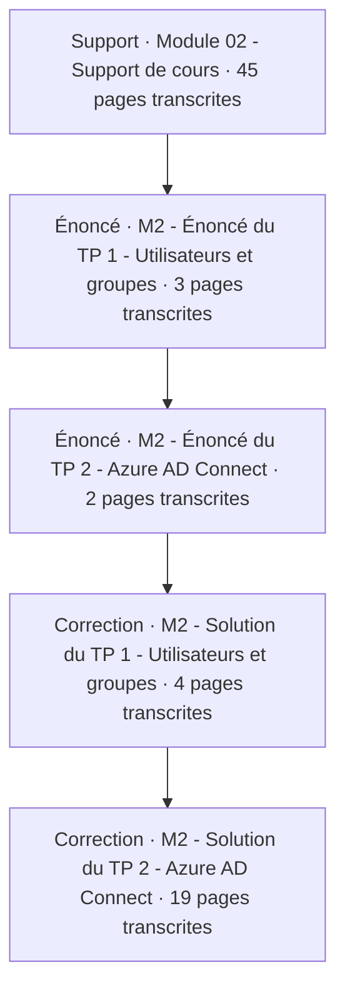

SOURCE DRIVE · TRANSCRIPTION DU SUPPORT

Le contenu des documents du dossier TSSR est transcrit ci-dessous, page par page. Les textes et tableaux sont intégrés à la page Web. Aucun fichier PDF, aucune diapositive entière ni aucune reproduction de page n’est affiché. Seuls des croquis ou visuels isolés et vérifiés peuvent accompagner la transcription. Les versions et les consignes restent celles des supports de formation. Les compléments IA sont conservés dans leur onglet distinct.

## Support · Module 02 - Support de cours · 45 pages transcrites

!!! note "À retenir"
    Les parcours et libellés historiques sont conservés.

Transcription du document source. Les parcours et libellés historiques sont conservés. Les mots de passe, codes de validation et coordonnées nominatives sont neutralisés. Les noms de domaine d’accès des exemples utilisent des domaines réservés à la documentation.

### Module 02 – Administration Microsoft 365

### Objectifs

!!! note "À retenir"
    Créer et gérer des objets dans la console Microsoft 365 Gérer des licences Microsoft 365 Comprendre les connexions clientes Synchroniser un annuaire local vers le Cloud

**Visuel externe**

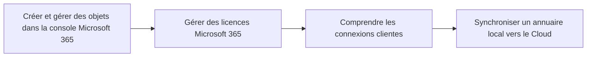

- Créer et gérer des objets dans la console Microsoft 365
- Gérer des licences Microsoft 365
- Comprendre les connexions clientes
- Synchroniser un annuaire local vers le Cloud

### Groupes et utilisateurs

### Microsoft 365

### Groupes et utilisateurs Microsoft 365

### La console web Microsoft 365

### L’écran d’accueil

### Groupes et utilisateurs Microsoft 365

### L’Admin Center

### Dashboard

### Groupes et utilisateurs Microsoft 365

### Les différents types de comptes

!!! note "À retenir"
    Utilisateur Microsoft 365 L’utilisateur n’existe que dans Microsoft 365

- Utilisateur Microsoft 365
- L’utilisateur n’existe que dans Microsoft 365

### Galettes.lcl

!!! note "À retenir"
    Un utilisateur synchronisé Créé dans un AD DS local Géré par un AD DS local Mot de passe peut être synchronisé

**Visuel externe**

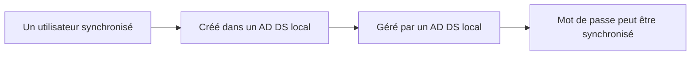

- Un utilisateur synchronisé
- Créé dans un AD DS local
- Géré par un AD DS local
- Mot de passe peut être synchronisé

### Serveur AD Serveur DNS

### Azure AD

### Groupes et utilisateurs Microsoft 365

### Les différents types de comptes

!!! note "À retenir"
    Méthode de création • Un par un dans l'Admin Center • Plusieurs utilisateurs avec un fichier .csv • En PowerShell • Synchronisé via Azure AD Connect

Méthode de création • Un par un dans l'Admin Center • Plusieurs utilisateurs avec un fichier .csv • En PowerShell • Synchronisé via Azure AD Connect

### Groupes et utilisateurs Microsoft 365

### Création d’un utilisateur O365

!!! note "À retenir"
    Bonne idée de s'envoyer le nouveau compte avec le nouveau mot de passe !

**Visuel externe**

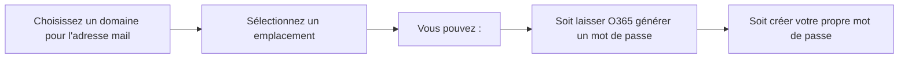

Bonne idée de s'envoyer le nouveau compte avec le nouveau mot de passe !

- Choisissez un domaine pour l'adresse mail
- Sélectionnez un emplacement
- Plus vous renseignerez d'informations sur le contact et plus votre gestion sera granulaire
- Vous pouvez :
- Soit laisser O365 générer un mot de passe
- Soit créer votre propre mot de passe

### Groupes et utilisateurs Microsoft 365

### Création d’un utilisateur O365

!!! note "À retenir"
    Différents rôles peuvent être attribués à un nouvel utilisateur Utilisateur simple Administrateur général Administrateur personnalisé Délégation via les RBAC (Role Based Access Control)

**Visuel externe**

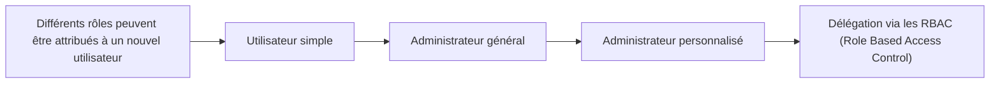

- Différents rôles peuvent être attribués à un nouvel utilisateur
- Utilisateur simple
- Administrateur général
- Administrateur personnalisé
- Délégation via les RBAC (Role Based Access Control)

### Groupes et utilisateurs Microsoft 365

### Création d’un utilisateur O365

### Administrateur personnalisé

!!! note "À retenir"
    Une stratégie de délégation doit être bien pensée.

Une stratégie de délégation doit être bien pensée.

### Groupes et utilisateurs Microsoft 365

### Se connecter en PowerShell

### 1. Installer le module nécessaire MSOnline

### 2. Vérifier que le module est bien installé

### Groupes et utilisateurs Microsoft 365

### Se connecter en PowerShell

$acctName="<UPN of the account, such as belindan@domaine-labo-9.example>" $orgName="<for example, litwareinc for locataire-labo.onmicrosoft.example>" #Azure Active Directory Connect-MsolService #SharePoint Online Connect-SPOService -Url https://$locataire-labo.sharepoint.com #Skype for Business Online Import-Module MicrosoftTeams Connect-MicrosoftTeams #Exchange Online Import-Module ExchangeOnlineManagement Connect-ExchangeOnline -UserPrincipalName $acctName -ShowProgress $true #Security & Compliance Center Connect-IPPSSession -UserPrincipalName $acctName #Teams Import-Module MicrosoftTeams Connect-MicrosoftTeams

#### Commandes de connexion affichées

```
Install-PackageProvider -Name NuGet -MinimumVersion 2.8.5.201 -Force
Connect-MsolService
Connect-SPOService -Url "https://locataire-labo.sharepoint.com"
Import-Module MicrosoftTeams
Connect-MicrosoftTeams
Import-Module ExchangeOnlineManagement
Connect-ExchangeOnline -UserPrincipalName $acctName -ShowProgress $true
Connect-IPPSSession -UserPrincipalName $acctName
```

### Groupes et utilisateurs Microsoft 365

### Se connecter en PowerShell

### 3. Se connecter à Microsoft 365

Cette fenêtre s'ouvre. Renseigner nom d'utilisateur : votreprénom@locataire-labo.onmicrosoft.example

### 4. Vérifier si vous êtes connecté

### Groupes et utilisateurs Microsoft 365

### Création d’un utilisateur O365

- Créer un nouvel utilisateur

New-MsolUser -UserPrincipalName jpetit@domaine-labo-4.example -DisplayName Jean Petit -FirstName Jean - LastName Petit -Password fourni par le formateur -ForceChangePassword $true -UsageLocation fr

- Supprimer un utilisateur, il sera gardé dans la corbeille Azure AD pendant 30 jours

Remove-MsolUser –UserPrincipalName "jpetit@domaine-labo-4.example"

- Restaurer un utilisateur de la corbeille

Restore-MsolUser –UserPrincipalName "jpetit@domaine-labo-4.example"

#### Création, suppression et restauration dans la capture

```
New-MsolUser -UserPrincipalName jpetit@example.com -DisplayName "Jean Petit" -FirstName Jean -LastName Petit
Remove-MsolUser -UserPrincipalName "jpetit@example.com"
Restore-MsolUser -UserPrincipalName "jpetit@example.com"
```

### Gestion des licences

### Les fonctionnalités Exchange Online

- Boîtes aux lettres et archivage
- Calendrier
- Visualisation et modification de pièces jointes online
- Dossiers publics
- Stratégie de message et de conformité
- Antivirus et antispam
- Configuration du flux de messagerie
- Gestion d'appareils mobile
- Déploiement hybride
- Outils de migration

### Gestion des licences Les plans Exchange Online

### M365 Business

### Fonctionnalité Exchange Online

### Exchange Online Plan 1

### Exchange Online Plan 2

### Basic

### Standard

### Premium M365 E3 M365 E5

### Boîte aux lettres

### 100 Go + Archivage

### 50 Go + 50 Go d’archivage

### 100 Go + Archivage illimité

### 50 Go + 50 Go d’archivage

### illimité

### Idem Business

### Pack Office Idem Business

### Premium

### Moins de sécurité que

### Ensemble des fonctionnalités

### Services supplémentaires

### M365 + VOIP

### Business Premium

### inclus

Coût 3,40 € /m 6,70 € /m 4,20 € /m 10,50 € /m 16,90 € /m 31,50 € /m 53,70 € /m

### Gestion des licences

- Vous pouvez :
- Ajouter une licence
- Remplacer une licence
- Nombre de licences restantes :
- Nombre de licences utilisées
- Nombre d'utilisateurs sans licence

### Vous devez sélectionner obligatoirement un emplacement !

| Fonctionnalité Exchange Online | Exchange Online Plan 1 | Exchange Online Plan 2 | M365 Business Basic | M365 Business Standard | M365 Business Premium | M365 E3 | M365 E5 |
| --- | --- | --- | --- | --- | --- | --- | --- |
| Boîteaux lettres | 50 Go + 50 Go d’archivage | 100 Go + Archivage illimité | 50 Go + 50 Go d’archivage | 50 Go + 50 Go d’archivage | 50 Go + 50 Go d’archivage | 100 Go + Archivage illimité | 100 Go + Archivage illimité |
| Pack Office |  |  |  |  |  | Idem Business Premium | Idem Business Premium |
| Services supplémentaires |  |  |  |  |  | Moins de sécurité que Business Premium | Ensemble des fonctionnalités M365 + VOIP inclus |
| Coût | 3,40 € /m | 6,70 € /m | 4,20 € /m | 10,50 € /m | 16,90 € /m | 31,50 € /m | 53,70 € /m |

### Gestion des licences

### La gestion Exchange Online

- Vous pouvez gérer Exchange Online
- Dans le menu Centres d'administration / Exchange Online
- En PowerShell
- Pour vous connecter en PowerShell à Exchange Online

Find-module ExchangeOnlineManagement | install-module Connect-ExchangeOnline

### Gestion des licences

- Vérifier son nombre de licences totales et consommées

L’accountSkuId est nécessaire pour toutes les manipulations de licences.

- Assigner une licence à un utilisateur

Set-MsolUserLicense –UserPrincipalName "jpetit@domaine-labo-4.example" –AddLicenses "locataire-labo:ENTERPRISEPREMIUM"

- Enlever une licence à un utilisateur

Set-MsolUserLicense –UserPrincipalName "jpetit@domaine-labo-4.example" –RemoveLicenses "locataire-labo:ENTERPRISEPREMIUM"

- Assigner une licence à tous les comptables suisses

Get-MsolUser -all -Department Account -UsageLocation CH -UnlicensedUsersOnly | ForEach- Object \{Set-MsolUserLicense -UserPrincipalName $PSITEM.UserPrincipalName -AddLicenses " locataire-labo:ENTERPRISEPREMIUM "\}

#### Commandes de gestion des licences dans les captures

```
Find-Module ExchangeOnlineManagement | Install-Module
Connect-ExchangeOnline
Get-MsolAccountSku
Set-MsolUserLicense -UserPrincipalName "jpetit@example.com" -AddLicenses "locataire-labo:ENTERPRISEPREMIUM"
Set-MsolUserLicense -UserPrincipalName "jpetit@example.com" -RemoveLicenses "locataire-labo:ENTERPRISEPREMIUM"
Get-MsolUser -All -Department Account -UsageLocation CH -UnlicensedUsersOnly | ForEach-Object { Set-MsolUserLicense -UserPrincipalName $PSItem.UserPrincipalName -AddLicenses "locataire-labo:ENTERPRISEPREMIUM" }
```

### Destinataires et permissions

### Exchange Online

Destinataires et permissions Exchange Online La console Exchange Online ECP (Exchange Control Panel)

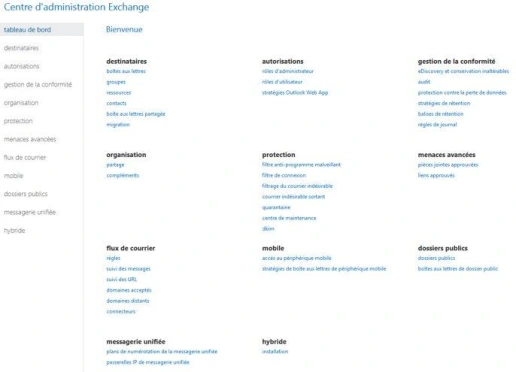

Fonctions du centre d’administration Exchange

### Destinataires et permissions Exchange Online

### Les différents types de destinataires

### lucie@domaine-labo-4.example

Boîtes aux lettres Utilisateur • Envoi / Réception de mails • Attribution de stratégies • Gestion des restrictions • Gestion des redirections • Délégations

### Destinataires et permissions Exchange Online

### Les fonctionnalités d’une boîte aux lettres

Options de remise • Ces options sont applicables à tous les types de destinataires

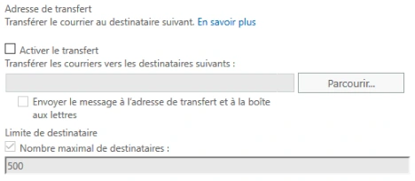

Paramètres de transfert et de destinataires

### Destinataires et permissions Exchange Online

### Les fonctionnalités d’une boîte aux lettres

Restriction de taille des messages et de remise de message.

### Destinataires et permissions Exchange Online

### Les fonctionnalités d’une boîte aux lettres

### Les adresses de courrier

- Éviter de les modifier ici

Les Infos courrier apparaissent lors de la création d'un nouveau message

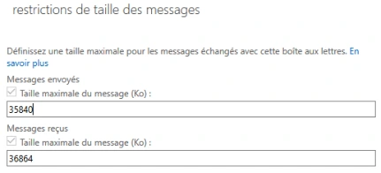

Limites de taille des messages

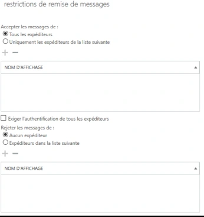

Restrictions de remise

### Destinataires et permissions Exchange Online

### Les fonctionnalités d’une boîte aux lettres

Gestion IMAP4 et POP3 • Cela veut dire que vous autorisez ou non l'accès à vos utilisateurs par n'importe quel programme prend en charge les protocoles POP et IMAP • Type : Outlook, Outlook Express, Thunderbird, Eudora • Si vous utilisez ces protocoles, vous ne pourrez plus accéder à : • Vos calendriers • La gestion des contacts • … • Dans le cadre de messagerie M365 ou Exchange, peu d’intérêt d’utiliser ces protocoles

### Destinataires et permissions Exchange Online

### Les fonctionnalités d’une boîte aux lettres

Quota • Contrairement à un Exchange sur site, la gestion des quotas se fait uniquement en PowerShell

### Get-Mailbox jpetit@domaine-labo-4.example | fl *quota*

- Paramétrer un avertissement à 49 Gb, un arrêt des envois de courriel à 49,5 Gb et un arrêt des envois/réceptions à 50 Gb

Set-Mailbox –Identity "Jean Petit" –IssueWarningQuota 49gb –ProhibitSendQuota 49.5gb –ProhibitSendReceiveQuota 50gb –UseDatabaseQuotaDefaults $false

#### Lecture et paramétrage des quotas dans la capture

```
Get-Mailbox jpetit@example.com | fl *quota*
Set-Mailbox -Identity "Jean Petit" -IssueWarningQuota 49gb -ProhibitSendQuota 49.5gb -ProhibitSendReceiveQuota 50gb -UseDatabaseQuotaDefaults $false
```

### Destinataires et permissions Exchange Online

### Les fonctionnalités d’une boîte aux lettres

- Durée de rétention des éléments supprimés pour une boîte aux lettres

### Get-Mailbox jpetit@domaine-labo-4.example | fl *retain*

- Paramétrer la durée de rétention des éléments supprimés pour 30 jours

### Set-Mailbox –Identity "Jean Petit" –RetainDeletedItemsFor 30

- Lister les boîtes aux lettres supprimées présentes dans la corbeille

### Get-Mailbox -SoftDeletedMailbox

### Destinataires et permissions Exchange Online

### Les différents types de destinataires

- Boîte aux lettres de ressources
- Boîte aux lettres de salle
- Permet de gérer les demandes de réservation d'un emplacement physique

New-Mailbox –Name "votre nom de salle" –DiplayName "votre nom de salle" -Room

- Boîte aux lettres d'équipement
- Permet de gérer les demandes de réservation d'un matériel physique

New-Mailbox –Name "vidéoproj_1" –DiplayName "vidéoproj_1" -equipment

#### Rétention et boîtes de ressources dans les captures

```
Set-Mailbox -Identity "Jean Petit" -RetainDeletedItemsFor 30
Get-Mailbox -SoftDeletedMailbox
New-Mailbox -Name "votre nom de salle" -DisplayName "votre nom de salle" -Room
New-Mailbox -Name "vidéoproj_1" -DisplayName "vidéoproj_1" -Equipment
```

### Destinataires et permissions Exchange Online

### Les différents types de destinataires

#### Demande de réunion

- Boîte aux lettres de salle
- Boîte aux lettres de ressource
- Option d’invitation

### Destinataires et permissions Exchange Online

### Les différents types de destinataires

- Boîte aux lettres partagées
- Plusieurs utilisateurs peuvent accéder à une Boîte aux lettres partagée
- Gain de licence (attention à bien respecter les CGU…)
- Possibilité de fixer un mot de passe (accès smartphone)
- Attention aux délégations
- « Accès total » permet aux utilisateurs de voir les messages
- « Envoyer en tant que » permet d'envoyer des messages en tant que cette boîte aux lettres
- Attention à la gestion des mails (éléments envoyés)

New-Mailbox –Shared –Name "support" –DiplayName "support" –Alias "support" | Set-Mailbox –GrantSendOnBehalfTo jpetit@domaine-labo-4.example | Add-MailboxPermission –User "Jean Petit" –AccesRights FullAccess –InheritanceType All

#### Exemples de boîte partagée et de délégation dans la capture

```
New-Mailbox -Shared -Name "support" -DisplayName "support" -Alias "support"
Set-Mailbox -GrantSendOnBehalfTo jpetit@example.com
Add-MailboxPermission -User "Jean Petit" -AccessRights FullAccess -InheritanceType All
```

Les deux fragments de délégation affichés dans la capture omettent l’identité de la boîte cible.

### Destinataires et permissions Exchange Online

### Les différents types de destinataires

- Les contacts
- C'est un type de boîte aux lettres avec une adresse de messagerie externe
- Cela permet d'enregistrer, des fournisseurs par exemple, dans les carnets d'adresses
- Les utilisateurs de messagerie
- Tout comme les contacts, ils ont une adresse de messagerie externe
- Contrairement aux contacts, ils peuvent s'authentifier sur une session (par exemple, une société de service)

### Destinataires et permissions Exchange Online

### Les fonctionnalités d’une boîte aux lettres

- Conservation pour litige
- Désactivé par défaut
- Liée à un aspect juridique, elle permet de conserver les éléments d'une boîte aux lettres et enregistre les modifications apportées à ces éléments
- Archivage
- Permet d'activer une boîte aux lettres d'archive

Destinataires et permissions Exchange Online Résumé : les différents types de destinataires

### Boîte aux lettres d’utilisateur Fonction

Boîte aux lettres Exchange Online Boîte aux lettres créée avec tout compte Microsoft 365 ayant une licence.

Boîte aux lettres de ressource Boîte aux lettres de salle ou d’équipement qui permet de gérer un calendrier.

Boîte aux lettres partagées Plusieurs utilisateurs peuvent accéder à une Boîte aux lettres (une seule copie du mail).

Boîte aux lettres de contact C'est un type de boîte aux lettres avec une adresse de messagerie externe (ex : pour un fournisseur).

### Boîte aux lettres d’utilisateurs de messagerie

C'est un type de boîte aux lettres avec une adresse de messagerie externe mais contrairement aux contacts, ils peuvent s'authentifier sur une session (par exemple, une société de service).

### Boîte aux lettres de groupe Fonction

Liste de distribution ou groupe Outlook Permet d'envoyer des messages à un groupe de destinataires (plusieurs copies du mails).

Liste de distribution dynamique Comme la liste de distribution, permet d'envoyer des messages à un groupe de destinataires (plusieurs copies du mails) mais ce groupe est créé suivant une requête LDAP.

Groupe de sécurité à extension de courrier Il permet d'accorder des accès à des ressources tout en ayant une adresse de messagerie.

### Les groupes

| Boîte aux lettres d’utilisateur | Fonction |
| --- | --- |
| Boîte aux lettres Exchange Online | Boîte aux lettres créée avec tout compte Microsoft 365 ayant une licence. |
| Boîte aux lettres de ressource | Boîte aux lettres de salle ou d’équipement qui permet de gérer un calendrier. |
| Boîte aux lettres partagées | Plusieurs utilisateurs peuvent accéder à une Boîte aux lettres (une seule copie du mail). |
| Boîte aux lettres de contact | C'est un type de boîte aux lettres avec une adresse de messagerie externe (ex : pour un fournisseur). |
| Boîte aux lettres d’utilisateurs de messagerie | C'est un type de boîte aux lettres avec une adresse de messagerie externe mais contrairement aux contacts, ils peuvent s'authentifier sur une session (par exemple, une société de service). |

| Boîte aux lettres de groupe | Fonction |
| --- | --- |
| Liste de distribution ou groupe Outlook | Permet d'envoyer des messages à un groupe de destinataires (plusieurs copies du mails). |
| Liste de distribution dynamique | Comme la liste de distribution, permet d'envoyer des messages à un groupe de destinataires (plusieurs copies du mails) mais ce groupe est créé suivant une requête LDAP. |
| Groupe de sécurité à extension de courrier | Il permet d'accorder des accès à des ressources tout en ayant une adresse de messagerie. |

### Gestion des licences

### Les différents groupes dans Microsoft 365

- Groupe Microsoft 365
- Collaboration entre utilisateurs
- Gestion dynamique possible par une règle LDAP Azure AD
- Boîte de réception Outlook partagée
- Un calendrier partagé
- Une bibliothèque de documents SharePoint
- Un planificateur
- Un bloc-notes OneNote
- Groupe de distribution
- Envoi de mail à un groupe de personnes
- Groupe de sécurité
- Gestion de droit sur des ressources SharePoint

### Les groupes Les différents types de groupes

### La création d’un groupe Microsoft 365 créé un site SharePoint

### Les groupes

### Les différents types de groupes

- Groupe Microsoft 365

### Les groupes

### Les différents types de groupes

- Liste de distribution

### Les groupes

### Les différents types de groupes

- Liste de distribution dynamique

### Administrer Exchange Online

### Administrer Exchange Online

### Les domaines acceptés

- Il s'agit d'un domaine dans le sens DNS.
- Il permet aux utilisateurs de ce domaine d'envoyer et recevoir des messages pour ce domaine DNS.
- Il en existe 2 types :
- Faisant autorité : c'est un domaine géré par votre office 365.
- Relais interne : le courrier peut être relayé par vos serveurs, mais vous aurez alors besoin des connecteurs de réception et d'envoi.

### Administrer Exchange Online

### Le suivi des messages

- En tant qu'administrateur, il peut vous être demandé d'effectuer un suivi des messages

### Administrer Exchange Online

### Les règles de transport

- Vous pouvez implémenter des stratégies et de la conformité de messagerie en appliquant des règles de transport aux messages
- Les règles de transport :
- Limitent les flux de messages
- Modifient le contenu des messages en transit
- Empêchent les utilisateurs spécifiés d'échanger des courriers électroniques avec d'autres utilisateurs définis
- Bloquent tout contenu inapproprié entrant ou sortant
- Peuvent contourner les règles de filtrage antispam
- Permettent de suivre ou journaliser les messages échangés avec certaines personnes
- Redirigent les messages entrants ou sortants pour les examiner avant leur remise

### Administrer Exchange Online

### Les règles de transport

- Leurs caractéristiques :
- Appliquées par les serveurs de boîte aux lettres
- Appliquer les exigences de conformité
- Leurs configurations :
- Conditions (les attributs, en-têtes, destinataires, expéditeurs ou autres parties du message électronique)
- Actions
- Exceptions

### Administrer Exchange Online

### Les règles de transport

- Les conditions et exceptions peuvent se chevaucher et ainsi créer des règles que vous ne souhaitez pas (modifier ou supprimer des messages)
- La priorité et l’ordre des règles sont capitaux à la bonne application de vos contraintes de conformité
- La règle en haut de liste est traitée en premier (priorité 0)
- Utiliser les expressions régulières pour vérifier le contenu des messages
- Recherche d’un numéro de téléphone du type « \d\d\d(-|.)\d\d\d\d »

### Administrer Exchange Online

### Les connecteurs

- Par défaut, aucun connecteur ne sera à créer, votre messagerie est fonctionnelle.
- Les connecteurs auront de multiples fonctions :
- Faire le lien avec un serveur Exchange On Premise
- Autoriser des sites web, copieurs, logiciels à envoyer de mails à partir de votre entreprise
- D’appliquer un comportement différent en fonction du ou des domaines cibles (application de chiffrement par exemple)
- Accepter du courrier entrant d’une organisation partenaire

### Administrer Exchange Online

### Les connecteurs

- L’une des utilisations les plus communes est d’utiliser un relais SMTP en interne :

- Simplifier la configuration des équipements (authentification non obligatoire en interne)
- Limiter le nombre de machines pouvant exploiter le protocole SMTP et ainsi limiter la surface d’attaque
- Établir une configuration sécurisée entre votre relais SMTP interne et Microsoft 365 (pas toujours possible sur les équipements)
- Limiter le nombre d’entrées dans le SPF

#### Relais SMTP illustré

| Emplacement | Éléments ou indications |
| --- | --- |
| Réseau de votre organisation | Imprimante multifonction ou périphérique (par exemple, numérisation vers la messagerie), service Web hébergé localement (par exemple, un service de paie), site Web hébergé localement (par exemple, un site intranet des RH) |
| Internet | Smtp.office365.com sur le port 587. Authentification à l’aide des informations d’identification de boîte aux lettres Office 365. |
| Destinataires | Vos boîtes aux lettres Office 365. Message envoyé à des destinataires externes, extérieurs à votre société. |

### Connectivité des clients de messagerie

### Connectivité des clients de messagerie

### Prérequis pour l’infrastructure réseau

- Ports et protocoles
- Assurez-vous que tous les ports sont bien ouverts

Le port 25 (SMTP) est très souvent bloqué par les FAI (Fournisseur d’Accès Internet).

Protocole Port non sécurisé Port TLS/SSL HTTP 80 443 POP3 110 995 IMAP4 143 993 MAPI / HTTPS 443 ActiveSync / HTTPS 443 SMTP 25 Soumission client SMTP 2525 587 / 465

### Connectivité des clients de messagerie

### Quelles connexions choisir ?

- Les connexions IMAP et POP sont de plus en plus rarement utilisées avec Microsoft 365 mais restent possibles.
- Les clients Outlook utiliseront MAPI/HTTPS.
- Les clients mobiles utiliseront ActiveSync.

| Protocole | Port non sécurisé | Port TLS/SSL |
| --- | --- | --- |
| HTTP | 80 | 443 |
| POP3 | 110 | 995 |
| IMAP4 | 143 | 993 |
| MAPI / HTTPS |  | 443 |
| ActiveSync / HTTPS |  | 443 |
| SMTP | 25 |  |
| Soumission client SMTP | 2525 | 587 / 465 |

### Connectivité des clients de messagerie

### Autodiscover

- Découverte automatique du serveur de messagerie
- « Tester la configuration automatique de la messagerie » permet de valider vos paramètres Autodiscover pour la configuration automatique des profils.
- Vous pouvez aussi utiliser le Remote Connectivity Analyser Tool.
- Il doit exister des enregistrements dans votre zone DNS publique pour les clients externes.

### Pour Outlook

### Enregistrement DNS Valeur

### CNAME Alias : Autodiscover Cible : autodiscover.outlook.com

### En cas d'utilisation de AD

### Alias : Autodiscover.service.domaine-labo-4.example

### FS (optionnel)

### Cible : autodiscover.outlook.com

### CNAME

### Connectivité des clients de messagerie

### Rappel Autodiscover

- Processus de la découverte automatique
- L'utilisateur entre son adresse mail à l'ouverture d'Outlook
- Outlook cherche puis se connecte au serveur de messagerie de l’utilisateur
- Le client envoie son adresse SMTP pour avoir les options de configuration de cette adresse
- Un fichier .xml est téléchargé par le client avec les paramètres du serveur
- Outlook se connecte au serveur Exchange Online dans Office 365 et peut recevoir ses mails

### SMTP

### Internet

### web.xml

### Micheline@domaine-labo-1.example MAPI/HTTPS

### Serveur de messagerie de Micheline

| Enregistrement DNS | Valeur |
| --- | --- |
| CNAME | Alias : Autodiscover Cible : autodiscover.outlook.com |
| En cas d'utilisation de AD FS (optionnel) CNAME | Alias : Autodiscover.service.domaine-labo-4.example Cible : autodiscover.outlook.com |

| Micheline@domaine-labo-1.example |  |
| --- | --- |
|  | Micheline@domaine-labo-1.example |

### Connectivité des clients de messagerie

### Les fichiers Outlook .pst, .ost et spscoll.dat

- .pst « Personal Storage Table » : fichier contenant les informations pour un compte POP3 par exemple.
- .ost « Offline Storage Table » : fichier contenant vos données lorsque vous êtes hors connexion pour les comptes IMAP4 et Exchange.
- .nst est l’extension des fichiers GST « Group Storage Table » : fichier contenant les conversations de groupe.
- spscoll.dat « Outlook Social Connector » : fichier qui contient les adresses mail suggérées lors de l’écriture d’une adresse (ouverture possible avec notepad).

### Connectivité des clients de messagerie

### Réparer les fichiers .pst, .nst et .ost

- Utilisation de l’outil natif au système pour les .pst : scanpst.exe
- Supprimer le .ost afin qu’il soit régénéré
- Utilisation d’outil tiers comme :

### Gestion des mobiles

### EMM (Enterprise Managing Mobile)

- Gestion des appareils mobiles de l’entreprise
- Représente une suite de service qui permet de gérer les appareils mobiles et la sécurité des données
- Différents acteurs du marché :

### Gestion des mobiles

### Managing Mobile Devices

- MDM
- Ce service représente 16,29 milliards de dollars de CA en 2020.
- Module de gestion des appareils mobiles.
- Mobile
- Tablette
- Smartphone
- Permet de gérer :
- Les applications
- Le réseau
- Les données
- La sécurité

### Gestion des mobiles

### BYOD, CYOD et COPE

- BYOD (Bring Your Own Device)
- Les utilisateurs peuvent utiliser les matériels personnels pour le travail.
- Permet une meilleure productivité puisqu’ils connaissent déjà le fonctionnement.
- Diminution des coûts pour l’entreprise (possibilité de prise en charge de tout ou partie des coûts d’achat et de maintenance).
- CYOD (Choose Your Own Device)
- Les utilisateurs peuvent choisir un modèle parmi une liste préétablie par l’entreprise.
- Permet d’éviter un parc de matériels trop hétérogène.
- COPE (Corporate Owned Personally Enabled)
- Les utilisateurs utilisent le matériel choisi par l’entreprise, mais ils peuvent l’utiliser à des fins personnelles.
- Ils peuvent installer les applications qu’ils veulent, mais la gestion reste à l’entreprise.

### Gestion des mobiles

### Managing Mobile Devices dans Microsoft 365

- MDM pour Microsoft 365 permet de gérer des appareils mobiles.
- Windows phone
- Android
- iPhone et iPad
- Pour une gestion avancée des appareils mobiles pour un domaine personnalisé, des enregistrements DNS sont nécessaires.

### Enregistrement DNS Valeur

CNAME Hôte : EnterpriseEnrollment Adresse : EnterpriseEnrollment.manage.microsoft.com

CNAME Hôte : EnterpriseRegistration Adresse : EnterpriseRegistration.windows.net

### Gestion des mobiles

### Managing Mobile Devices dans Microsoft 365

- Activer la gestion mobile

https://admin.microsoft.com/EAdmin/Device/IntuneInventory.aspx

| Enregistrement DNS | Valeur |
| --- | --- |
| CNAME | Hôte : EnterpriseEnrollment Adresse : EnterpriseEnrollment.manage.microsoft.com |
| CNAME | Hôte : EnterpriseRegistration Adresse : EnterpriseRegistration.windows.net |

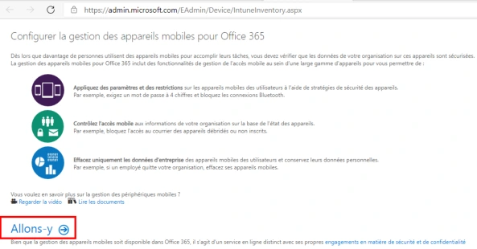

Paramètres de gestion des appareils mobiles

### Gestion des mobiles

### Managing Mobile Devices

- Une fois activé, vous pouvez créer une stratégie

### Gestion des mobiles

### Managing Mobile Devices

- Options de stratégie
- Empêcher les mots de passe simples
- Longueur minimale de mot de passe
- Nombre d'échecs avant effacement de l'appareil
- Temps d'inactivité avant verrouillage
- Expiration du mot de passe et historique
- Exiger le chiffrement de l'appareil
- Bloquer ou autoriser l'accès à un appareil

### Gestion des mobiles

### Managing Mobile Devices

- Options de stratégie
- Bloquer la synchronisation de photos
- Bloquer la capture d'écran
- Bloquer ou gérer l'accès au magasin d'application
- Bloquer la connexion au stockage amovible

### Gestion des mobiles

### Managing Mobile Devices

- Appliquez la stratégie au groupe de sécurité

### Azure AD

### Présentation

- C'est un service cloud de gestion des identités et des annuaires
- Il est utilisé par Microsoft 365 pour identifier les utilisateurs
- Vous pourrez :
- Gérer des utilisateurs
- Gérer des appareils
- Vous connecter à un domaine Active Directory local

### Azure AD

### Authentification

- Indépendant de votre Active Directory local
- Nécessite 2 mots de passe gérés dans 2 annuaires différents :
- 1 compte Active directory local
- 1 compte Azure AD dans Office 365

### Galettes.lcl

### Serveur AD Serveur DNS

### Azure AD

### Azure AD Connect

- Azure AD Connect va permettre de faire une synchronisation entre Microsoft 365 et votre AD DS On-Premise
- Tous les attributs utilisateurs, groupes ou contacts modifiés, désactivés ou supprimés dans votre AD sur site seront modifiés dans Microsoft 365
- Vous pouvez filtrer sur votre forêt, un domaine, une OU, un attribut…

### Azure AD Azure AD Connect

Après avoir installé Azure AD Connect, les utilisateurs de votre AD local

sont synchronisés avec Azure AD dans le cloud.

### Serveur AD Serveur DNS

### Azure AD

### Connect

### Azure AD

### Galettes.lcl

### Azure AD Authentification Cloud avec mot de passe hashé

Azure AD Connect récupère les mots de passe hashés puis les envoie dans Azure AD en SHA256 afin de les synchroniser. Un utilisateur peut ainsi s’identifier dans le cloud avec son mot de passe AD local

Avec la méthode d’authentification Cloud, la synchronisation ne se fait que de l’AD local vers Azure AD Office 365.

### Serveur AD Serveur DNS

### Azure AD

### Connect

### Mot de passe hashé en SHA256

### Azure AD

### Galettes.lcl

### Azure AD Azure AD Writeback (réécriture du mot de passe)

Avec Azure Ad Writeback, la synchronisation se fait dans les deux sens.

Nécessite Azure AD premium P1 ou Business Premium.

### Serveur AD Serveur DNS

### Azure AD

### Connect

### Mot de passe hashé en SHA256

### Azure AD

### Galettes.lcl

### Azure AD

### Azure AD Connect

- La synchronisation entre votre Office 365 et votre AD DS se fait toutes les 30 minutes par défaut

#### Planificateur affiché dans PowerShell

```
Import-Module ADSync
Get-ADSyncScheduler

AllowedSyncCycleInterval          : 00:30:00
CurrentlyEffectiveSyncCycleInterval : 00:30:00
NextSyncCyclePolicyType           : Delta
```

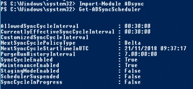

Intervalle et état du planificateur de synchronisation

### Azure AD

### Azure AD Connect

### 1. Créez un nouveau suffixe UPN dans votre Active Directory

1. Puis remplacez le suffixe UPN pour chaque utilisateur dans votre AD DS

### Azure AD

### Azure AD Connect

1. Créez un compte de service pour la synchronisation • Il est indispensable de dédier un compte à la synchronisation AD, comme pour tout service. • L’utilisation de comptes génériques ou des comptes administrateur est à bannir des pratiques

- Limite la possibilité de réinitialisation de mots de passe (impacts larges et souvent mal maîtrisés qui entraîneront des interruptions de service)
- Permet d’avoir un mot de passe dédié par service et donc de renforcer la sécurité : un compte compromis ne donnera pas accès à l’ensemble des services de l’entreprise
- Pour une délégation fine, référez-vous à cet article :

https://docs.microsoft.com/fr-fr/azure/active-directory/hybrid/reference-connect-accounts-permissions

### Azure AD

### Azure AD Connect

### 4. Utilisez l’assistant d’installation

### 5. Utilisez l'utilisateur créé avec votre tenant

1. Utilisez un compte de service administrateur de l’entreprise

### Azure AD Azure AD Connect

### Début de la synchronisation

### Azure AD vérifie si votre domaine est routable sur internet

### Azure AD

### Azure AD Connect

- Vérifiez dans votre Admin Center que vos utilisateurs sont bien synchronisés
- Attention, vos utilisateurs n'ont pas encore de licences assignées

### Azure AD

### Azure AD Connect

- Des outils de gestion sont mis à votre disposition dans les applications du serveur sur lequel vous avez installé AzureADConnect.msi
- Azure AD Connect
- Relancer la configuration
- Synchronization Rules Editor
- Gérer les règles de synchronisation
- Synchronization Service
- Vérifier l'état de votre synchronisation
- Synchronization Service Web
- Lancer la console Web Service Configuration Tool

### Azure AD

### Synchronization Service Manager

- Opérations
- Vous pouvez voir le statut de vos dernières synchronisations

### Azure AD

### Synchronization Rules Editor

- Cette console permet de créer des règles de synchronisation spécifiques
- Vous pouvez modifier ou créer de nouvelles règles
- Attention lorsque vous modifiez les règles par défaut

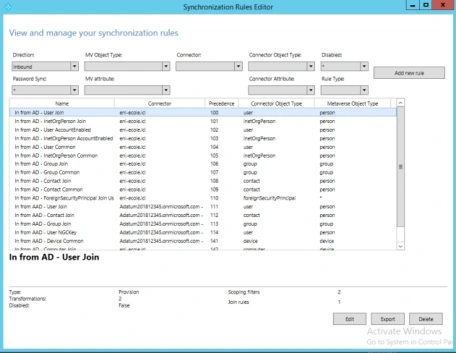

Règles de synchronisation

### Azure AD

### Forcer une synchronisation AD Connect

- Lancer la réplication initiale

### Start-ADSyncSyncCycle -PolicyType Initial

- Lancer une réplication différentielle

### Start-ADSyncSyncCycle -PolicyType Delta

### RBAC

#### Commandes de synchronisation affichées

```
Start-ADSyncSyncCycle -PolicyType Initial
Start-ADSyncSyncCycle -PolicyType Delta
```

### RBAC

### Délégation de privilèges

- Pour une gestion fine de l’attribution de droits d’administration Exchange, il existe une console nommée RBAC (Role Based Access Control)
- Basé sur des rôles prédéfinis, vous pourrez attribuer à des utilisateurs ou techniciens des privilèges pour administrer la partie Exchange Online de Microsoft 365
- L’affectation de permissions devra se faire au travers de comptes administrateurs spécifiques et avec le principe du privilège minimum

### Gestion des licences

| Nom dans l’admin center de Office365 | Nom dans PowerShell | Rôle |
| --- | --- | --- |
| Administrateur général | Company administrator | Il a accès à toutes les fonctionnalités. Celui qui a acheté Microsoft 365 a ce rôle par défaut. Ne donnez pas ce rôle à tout le monde. |
| Administrateur de facturation | Billing administrator | Il effectue les achats, gère les abonnements et les tickets support. Il surveille l'état des services. |
| Administrateur de mot de passe | Helpdesk administrator | Il réinitialise les mots de passe. Il gère les tickets support et surveille l'état des services. |
| Administrateur de service | Service support administrator | Il gère les tickets support et surveille l'état des services. |
| Administrateur de gestion des utilisateurs | User account administrator | Il créé et supprime des utilisateurs et des groupes, réinitialise les mots de passe, gère les tickets support et surveille l'état des services. |

### Gestion des licences

### Les différents rôles administrateur Microsoft 365

### Quelques commandes PowerShell

### Quels sont les rôles

### Get-MsolRole

### Quels sont les rôles assignés à un utilisateur

### Get-MsolUserRole

### Add-MsolRoleMember

### Ajouter des membres à un rôle

### remove- MsolRoleMember

### Supprimer des membres à un rôle

### RBAC

### Délégation de privilèges

- Chaque rôle possède une liste d’actions

### RBAC

### Rôles personnalisés

Créez vos propres rôles

1. Dans le centre d’administration Exchange, ouvrir Rôles, puis Rôles d’administrateur.
2. Choisir Ajouter un groupe de rôles.
3. Dans Configurer les informations de base, renseigner le nom. Le support montre « Rôle personnalisé ».
4. Dans Autorisation, sélectionner les rôles à attribuer au groupe.
5. Dans Affecter des administrateurs, rechercher les membres par nom ou par adresse de courriel.

Référence du document : 1D_WQ8CSn6GRFx1z-cJiwJT2TLAV6_Y4y · SHA-256 2d6cbe49ac253b8c…

## Énoncé · M2 - Énoncé du TP 1 - Utilisateurs et groupes · 3 pages transcrites

Transcription du document source. Les parcours et libellés historiques sont conservés. Les mots de passe, codes de validation et coordonnées nominatives sont neutralisés. Les noms de domaine d’accès des exemples utilisent des domaines réservés à la documentation.

### Utilisateurs et groupes

TP 01 du Module 02 – Administration Microsoft 365

Avant de démarrer ce TP, il convient d’avoir suivi les vidéos des modules 1 et 2 et d’avoir réalisé les TP proposés.

### Enoncé

### Objectifs

Créer des utilisateurs et des groupes dans Microsoft 365 suivant l’annexe 1 Prérequis

- Avoir une connexion internet Principales tâches à réaliser

Créez des utilisateurs Microsoft 365 sans affecter de licence.

- Créez un utilisateur Zachary Ramablag avec comme nom de connexion Zachary et comme pays le Canada, fonction Formateur, service Pédagogie.

Notez son mot de passe temporaire.

- Créez un utilisateur Vishnou Lapaix avec comme nom de connexion Vishnou et comme pays les USA, fonction Formateur, service Pédagogie.

Notez son mot de passe temporaire.

- Créez un utilisateur Oussama Lairbon avec comme nom de connexion Oussama et comme pays la France, fonction Cuisinier, service Restauration.

Notez son mot de passe temporaire.

- Créez un utilisateur en PowerShell Sacha Touille avec comme nom de connexion Sacha et comme pays le Japon, fonction Cuisinier, service restauration, comme mot de passe fourni par le formateur et il doit changer son mot de passe à la prochaine connexion.
- Connectez-vous avec cet utilisateur.

Que constatez-vous ?

Comment pourriez-vous régler ce problème ? Faites-le.

- Connectez-vous avec cet utilisateur.

Notez son nouveau mot de passe.

- Créez un utilisateur en PowerShell Lab Lab avec comme nom de connexion lablab et comme pays la France, fonction Administrateur, service Informatique, comme mot de

passe fourni par le formateur, lui ajouter le rôle administrateur global.

- Changez la fonction de Oussama Lairbon en chef cuisinier
- Supprimer Vishnou Lapaix.
- Vérifiez qu’il est bien dans les utilisateurs supprimés puis restaurez-le.
- Supprimez Sacha Touille en PowerShell puis restaurez-le en PowerShell.
- Assignez une licence complète à Oussama Lairbon.
- Assignez une licence complète en PowerShell à Zachary Ramablag
- En PowerShell assignez une licence à Sacha sans Sway, Power BI, Azure Rights Management.
- Assignez une licence à Vishnou Lapaix sans Office Online.
- Vérifiez en vous connectant à son compte.
- Réactivez Office Online pour Vishnou Lapaix.
- Créez les groupes Microsoft 365 GO_Restauration, GO_Commercial, GO_Infirmerie, GO_Informatique, GO_RH, GO_CE, GO_Pedagogie, GO_Moyens_Generaux, GO_Comptabilite, GO_Commercial, GO_Communication, GO_Secretaire, GO_Service_Achats, GO_Adminstratifs et GO_Direction avec une description pour chaque groupe.
- Mettez chaque utilisateur dans son groupe de service et votre compte de tenant dans le service et le groupe informatique et administrateur comme fonction.
- Mettez Vishnou Lapaix membre de Pédagogie, Deration Mo dans le groupe CE , Yves Remord dans le groupe commercial.
- Créez un groupe de sécurité nommé jedemolet avec comme membres : Zachary Ramablag, Vishnou Lapaix, Oussama Lairbon, Sacha Touille.
- Ajoutez le rôle « administrateur de mot de passe » à Vishnou Lapaix.
- Connectez-vous en tant que Vishnou Lapaix et envoyez un mail au groupe Pédagogie.

Vérifiez que vous le recevez bien.

- Restez connecté en tant que Vishnou Lapaix et réinitialisez le mot de passe de Zachary Ramablag.
- Réinitialisez le mot de passe de Oussama Lairbon en PowerShell.
- Ajoutez le rôle « Administrateur de licence » à Oussama Lairbon en PowerShell.

### Annexe 1

| nom | Prénom | GROUPES | login | service | fonction | pays |
| --- | --- | --- | --- | --- | --- | --- |
| Durand | Micheline | GO_Informatique |  | Informatique | Administrateur |  |
| Ramablag | Zachary | GO_Pédagogie, GDS_Jedemolet | Zachary | Pédagogie | Formateur | Canada |
| Lapaix | Vishnou | GO_Pédagogie, GDS_Jedemolet | Vishnou | Pédagogie | Formateur | USA |
| Lairbon | Oussama | GO_Restauration, GDS_Jedemolet | Oussama | Restauration | Cuisinier | France |
| Touille | Sacha | GO_Restauration, GDS_Jedemolet | Sacha | Restauration | Cuisinier | Japon |
| Lab | Lab | GO_Informatique | lablab | Informatique | Administrateur | France |
| Terieur | Alain | GO_Moyens_Généraux | aTerieur | Moyens Generaux | Architecte | France |
| Diot | Kailee | GO_Commercial | kDiot | Commercial | Commercial | Japon |
| Commandement | Lydie | GO_Service_Achats, GO_Direction | lCommandement | Achats | Directrice | France |
| Fonfec | Sophie | GO_Direction, GO_Restauration | sFonfec | Restauration | Directrice | France |
| Entrengare | Micheline | GO_Pédagogie | mEntrengare | Pedagogie | Formateur | France |
| Femal | Aicha | GO_Infirmerie | aFemal | Infirmerie | Infirmiere | France |
| Dorsa | Elsa | GO_Administratifs | eDorsa | Administratif | Receptionniste | France |
| Femal | Usama | GO_Infirmerie | uFemal | Infirmerie | Responsable | France |
| Vadeboncoeur | Elie | GO_RH, GO_secretaire | eVadeboncoeur | RH | Secretaire | France |
| Ateur | Nordine | GO_Informatique | nAteur | Informatique | Technicien | France |
| Deration | Mo | GO_Communication, GO_CE | mderation | Communication | Community Manager | France |
| Hawk | Thomas | GO_Comptabilite, GO_secretaire | thawk | Comptabilite | secretaire | France |

Référence du document : 1LC5uqVZGBDGEtpTF3BWw0woL2fjgAqL9 · SHA-256 16589f599d6f5c87…

## Énoncé · M2 - Énoncé du TP 2 - Azure AD Connect · 2 pages transcrites

Transcription du document source. Les parcours et libellés historiques sont conservés. Les mots de passe, codes de validation et coordonnées nominatives sont neutralisés. Les noms de domaine d’accès des exemples utilisent des domaines réservés à la documentation.

### Azure AD

TP 02 du Module 02 – Administration Microsoft 365

Avant de démarrer ce TP, il convient d’avoir suivi les vidéos des modules 1 et 2 et d’avoir réalisé les TP proposés.

### Enoncé

### Objectifs

Synchroniser les utilisateurs de votre Active Directory local avec Microsoft 365 Prérequis

Disposer de l’ISO Windows Server 2019 en anglais. Principales tâches à réaliser

- Installez un serveur, contrôleur de domaine avec comme domaine domaine-labo-2.example où XX est votre numéro de stagiaire.

OS Windows Serveur 2019

Nom CD-2k19-XX

RAM 4 Go

HDD 60 Go

Services ADDS, DNS

domaine-labo-2.example

Nom de domaine

IP 10.65.0.1 /24 Connexion VMWare NAT

- Créez l’arborescence d’OU et les utilisateurs ci-dessous dans votre Active directory, en respectant les bonnes pratiques (renseignez les attributs fonction et service dans l’AD).

Nom et prénom Fonction Service Nom de connexion

Vous Administrateur Informatique prenom-admin@domaine-labo-2.example

Lucie Fer Comptable Comptabilité lfer@domaine-labo-2.example

Ella Danlos Responsable

Comptabilité edanlos@domaine-labo-2.example

comptable

Paul Amploi Directeur Général Direction pamploi@domaine-labo-2.example

Cécile Encieu Commercial Commercial cencieu@domaine-labo-2.example

| Paramètre | Valeur | Précision |
| --- | --- | --- |
| OS | Windows Serveur 2019 |  |
| Nom | CD-2k19-XX |  |
| RAM | 4 Go |  |
| HDD | 60 Go |  |
| Services | ADDS, DNS |  |
| Nom de domaine | domaine-labo-2.example |  |
| IP | 10.65.0.1 /24 | Connexion VMWare NAT |

| Nom et prénom | Fonction | Service | Nom de connexion |
| --- | --- | --- | --- |
| Vous | Administrateur | Informatique | prenom-admin@domaine-labo-2.example |
| Lucie Fer | Comptable | Comptabilité | lfer@domaine-labo-2.example |
| Ella Danlos | Responsable comptable | Comptabilité | edanlos@domaine-labo-2.example |
| Paul Amploi | Directeur Général | Direction | pamploi@domaine-labo-2.example |
| Cécile Encieu | Commercial | Commercial | cencieu@domaine-labo-2.example |

### Pour rappel, les bonnes pratiques sont

```
1 UO _labo-XX
    1 OU Utilisateurs
        1 OU Comptes de service
        1 OU par lieu
            1 OU par service
            1 modèle par type de compte
    1 OU Groupes
        1 OU Domaine Local
        1 OU Groupe Global
            1 GG par service
    1 OU Archives
```

- Préparez l’Active Directory à utiliser la Synchronisation AD Connect
- Installez AzureADConnect.msi en mode express setting pour votre domaine domaine-labo-2.example.
- Faites une procédure et vérifiez que vos utilisateurs sont bien synchronisés.
- Vérifiez, en PowerShell, l’intervalle de temps entre deux synchronisations.
- Modifiez votre connecteur afin de ne synchroniser que les OU groupes et utilisateurs.
- Créez un nouvel utilisateur et forcez immédiatement la synchronisation.
- Ajoutez un alias à cet utilisateur, forcez à nouveau la synchronisation si besoin.

Référence du document : 1vSub2duRw5x9hrV1yGtTmUPwZScLf_u0 · SHA-256 67cd7d118de46260…

## Correction · M2 - Solution du TP 1 - Utilisateurs et groupes · 4 pages transcrites

Transcription du document source. Les parcours et libellés historiques sont conservés. Les mots de passe, codes de validation et coordonnées nominatives sont neutralisés. Les noms de domaine d’accès des exemples utilisent des domaines réservés à la documentation.

Correction originale : à consulter après avoir tenté l’exercice.

### Utilisateurs et groupes

TP 01 du Module 02 – Administration Microsoft 365

Avant de démarrer ce TP, il convient d’avoir suivi les vidéos des modules 1 et 2 et d’avoir réalisé les TP proposés.

### Solution

### Objectifs

Créer des utilisateurs et des groupes dans Microsoft 365 suivant l’annexe 1 Prérequis

- Avoir une connexion internet Principales tâches à réaliser

Créez des utilisateurs Microsoft 365 sans affecter de licence.

- Créez un utilisateur Zachary Ramablag avec comme nom de connexion Zachary et comme pays le Canada, fonction Formateur, service Pédagogie.

Notez son mot de passe temporaire.

- Créez un utilisateur Vishnou Lapaix avec comme nom de connexion Vishnou et comme pays les USA, fonction Formateur, service Pédagogie.

Notez son mot de passe temporaire.

- Créez un utilisateur Oussama Lairbon avec comme nom de connexion Oussama et comme pays la France, fonction Cuisinier, service Restauration.

Notez son mot de passe temporaire.

- Créez un utilisateur en PowerShell Sacha Touille avec comme nom de connexion Sacha et comme pays le Japon, fonction Cuisinier, service restauration, comme mot de passe fourni par le formateur et il doit changer son mot de passe à la prochaine connexion.

```
New-MsolUser -UserPrincipalName SachaTouille@domaine-labo-5.example -DisplayName SachaTouille -FirstName Sacha -LastName Touille –department restauration –title cuisinier -Password 'fourni par le formateur' -ForceChangePassword $true -UsageLocation jp
```

- Connectez-vous avec cet utilisateur.

Que constatez-vous ? Impossible de se connecter sans licence.

Comment pourriez-vous régler ce problème ? Faites-le.

Il faut lui assigner une licence, soit au travers de la console graphique, soit avec PowerShell.

Pour avoir l'info :

```
Get-MsolAccountSku
```

```
Get-MsolUser -all -Department restauration -UsageLocation jp -UnlicensedUsersOnly | ForEach-Object {Set-MsolUserLicense -UserPrincipalName $_.userprincipalname -AddLicenses "locataire-labo:ENTERPRISEPREMIUM"}
```

- Connectez-vous avec cet utilisateur.

Notez son nouveau mot de passe.

- Créez un utilisateur en PowerShell Lab Lab avec comme nom de connexion lablab et comme pays la France, fonction Administrateur, service Informatique, comme mot de passe fourni par le formateur, lui ajouter le rôle administrateur global.

```
New-MsolUser -UserPrincipalName lablab@domaine-labo-5.example -DisplayName lablab -FirstName lab -LastName lab –department Informatique –title Administrateur -Password 'fourni par le formateur' -UsageLocation fr
```

```
Add-MsolRoleMember -RoleName "Company Administrator" -RoleMemberEmailAddress "lablab@domaine-labo-7.example"
```

- Changez la fonction de Oussama Lairbon en chef cuisinier

```
Set-MsolUser -UserPrincipalName Oussama@domaine-labo-6.example -title "Chef Cuisinier"
```

- Supprimer Vishnou Lapaix.
- Vérifiez qu’il est bien dans les utilisateurs supprimés puis restaurez-le.
- Supprimez Sacha Touille en PowerShell puis restaurez-le en PowerShell.

```
Remove-MsolUser –UserPrincipalName "Sacha@domaine-labo-5.example"
```

```
Restore-MsolUser –UserPrincipalName "Sacha@domaine-labo-5.example"
```

- Assignez une licence complète à Oussama Lairbon.
- Assignez une licence complète en PowerShell à Zachary Ramablag

```
Set-MsolUserLicense –UserPrincipalName "Zachary@domaine-labo-5.example" –AddLicenses "locataire-labo:ENTERPRISEPREMIUM"
```

- En PowerShell assignez une licence à Sacha sans Sway, Power BI, Azure Rights Management.

```
(Get-MsolUser -UserPrincipalName Sacha@domaine-labo-6.example).Licenses.ServiceStatus
```

```
SWAY = SWAY, Power BI = BI_AZURE_P2, Azure Managment Right = RMS_S_ENTREPRISE
```

```
$LOW = New-MsolLicenseOptions -AccountSkuId "locataire-labo:ENTERPRISEPREMIUM" -disabledplans "SWAY", "BI_AZURE_P2", "RMS_S_ENTERPRISE"
```

```
Set-MsolUserlicense -UserPrincipalName Sacha@domaine-labo-6.example -LicenseOptions $LOW
```

- Assignez une licence à Vishnou Lapaix sans Office Online.
- Vérifiez en vous connectant à son compte.
- Réactivez Office Online pour Vishnou Lapaix.
- Créez les groupes Microsoft 365 GO_Restauration, GO_Commercial, GO_Infirmerie, GO_Informatique, GO_RH, GO_CE, GO_Pedagogie, GO_Moyens_Generaux, GO_Comptabilite, GO_Commercial, GO_Communication, GO_Secretaire, GO_Service_Achats, GO_Adminstratifs et GO_Direction avec une description pour chaque groupe.
- Mettez chaque utilisateur dans son groupe de service et votre compte de tenant dans le service et le groupe informatique et administrateur comme fonction.
- Mettez Vishnou Lapaix membre de Pédagogie, Deration Mo dans le groupe CE , Yves Remord dans le groupe commercial.
- Créez un groupe de sécurité nommé jedemolet avec comme membres : Zachary Ramablag, Vishnou Lapaix, Oussama Lairbon, Sacha Touille.
- Ajoutez le rôle « administrateur de mot de passe » à Vishnou Lapaix.
- Connectez-vous en tant que Vishnou Lapaix et envoyez un mail au groupe Pédagogie.

Vérifiez que vous le recevez bien.

- Restez connecté en tant que Vishnou Lapaix et réinitialisez le mot de passe de Zachary Ramablag.
- Réinitialisez le mot de passe de Oussama Lairbon en PowerShell.

```
Set-MsolUserPassword -UserPrincipalName "oussama@domaine-labo-8.example" -NewPassword 'fourni par le formateur'
```

- Ajoutez le rôle « Administrateur de licence » à Oussama Lairbon en PowerShell.

```
Add-MsolRoleMember -RoleName "Billing Administrator" -RoleMemberEmailAddress "oussama@domaine-labo-5.example"
```

### Annexe 1

| nom | Prénom | GROUPES | login | service | fonction | pays |
| --- | --- | --- | --- | --- | --- | --- |
| Durand | Micheline | GO_Informatique |  | Informatique | Administrateur |  |
| Ramablag | Zachary | GO_Pédagogie, GDS_Jedemolet | Zachary | Pédagogie | Formateur | Canada |
| Lapaix | Vishnou | GO_Pédagogie, GDS_Jedemolet | Vishnou | Pédagogie | Formateur | USA |
| Lairbon | Oussama | GO_Restauration, GDS_Jedemolet | Oussama | Restauration | Cuisinier | France |
| Touille | Sacha | GO_Restauration, GDS_Jedemolet | Sacha | Restauration | Cuisinier | Japon |
| Lab | Lab | GO_Informatique | lablab | Informatique | Administrateur | France |
| Terieur | Alain | GO_Moyens_Généraux | aTerieur | Moyens Generaux | Architecte | France |
| Diot | Kailee | GO_Commercial | kDiot | Commercial | Commercial | Japon |
| Commandement | Lydie | GO_Service_Achats, GO_Direction | lCommandement | Achats | Directrice | France |
| Fonfec | Sophie | GO_Direction, GO_Restauration | sFonfec | Restauration | Directrice | France |
| Entrengare | Micheline | GO_Pédagogie | mEntrengare | Pedagogie | Formateur | France |
| Femal | Aicha | GO_Infirmerie | aFemal | Infirmerie | Infirmiere | France |
| Dorsa | Elsa | GO_Administratifs | eDorsa | Administratif | Receptionniste | France |
| Femal | Usama | GO_Infirmerie | uFemal | Infirmerie | Responsable | France |
| Vadeboncoeur | Elie | GO_RH, GO_secretaire | eVadeboncoeur | RH | Secretaire | France |
| Ateur | Nordine | GO_Informatique | nAteur | Informatique | Technicien | France |
| Deration | Mo | GO_Communication, GO_CE | mderation | Communication | Community Manager | France |
| Hawk | Thomas | GO_Comptabilite, GO_secretaire | thawk | Comptabilite | secretaire | France |

Référence du document : 1pRrCblXivh0TaW_p6JN-OSvGiDZn8zdu · SHA-256 5aa0bc1641f5fddd…

## Correction · M2 - Solution du TP 2 - Azure AD Connect · 19 pages transcrites

Transcription du document source. Les parcours et libellés historiques sont conservés. Les mots de passe, codes de validation et coordonnées nominatives sont neutralisés. Les noms de domaine d’accès des exemples utilisent des domaines réservés à la documentation.

Correction originale : à consulter après avoir tenté l’exercice.

### Azure AD

TP 02 du Module 02 – Administration Microsoft 365

Avant de démarrer ce TP, il convient d’avoir suivi les vidéos des modules 1 et 2 et d’avoir réalisé les TP proposés.

### Solution

Il faut maintenant préparer l’Active Directory ; une liste d’étapes sera à effectuer :

1. Ajouter un suffixe DNS.
2. Remapper le suffixe DNS des utilisateurs existants (attention aux impacts sur les logins utilisateurs selon le mode de connexion).
3. Renseigner l’adresse mail dans les comptes utilisateurs.
4. Créer une OU spécifique pour le compte de service et créer un compte de service administrateur de l’entreprise pour la synchronisation AD.
5. Créer un compte Microsoft 365 administrateur général.

- Ouvrez la console Domaines et approbations Active Directory
- Sur Domaines et approbations, effectuez un clic droit / Propriétés et ajoutez le nom de domaine public utilisé dans votre tenant Microsoft 365 et cliquez sur Ajouter puis OK.
- Ouvrez la console Utilisateurs et ordinateurs Active Directory.
- Sélectionnez les utilisateurs qui seront à synchroniser et effectuez un clic droit / Propriétés. Dans l’onglet compte, cochez la case Suffixe UPN et sélectionnez le suffixe UPN que vous venez d’ajouter. Cliquez sur OK.

NB : cette opération peut avoir de forts impacts sur la production si les utilisateurs se connectent avec le format UPN. Assurez-vous de la méthode de connexion avant de réaliser cette action.

- Modifiez l’adresse mail des deux comptes :
- Créez une nouvelle OU Comptes de services et créez le compte qui sera utilisé pour la synchronisation AD.

- Allez dans les propriétés du compte Active Directory et dans l’onglet Membre de, ajoutez le groupe Administrateurs de l’entreprise.

### Création d’un compte administrateur général dans la console Microsoft 365

- Ajoutez un nouvel utilisateur.
- Renseignez les champs nécessaires et n’affectez pas de licence.

- Ajoutez le rôle administrateur général.

#### Écrans du nouvel utilisateur

- Configurer les éléments de base affiche les champs Prénom, Nom complet, Nom d’utilisateur, Domaines et Mot de passe.
- La démonstration crée un utilisateur sans licence de produit, puis lui affecte le rôle Administrateur général.

### Installation d’Azure AD Connect

- Dans votre console Microsoft 365, allez dans Paramètres / Paramètres de l’organisation et cherchez Synchronisation d’annuaires.

- Téléchargez ensuite l’outil Azure AD Connect.
- Exécutez le fichier MSI téléchargé précédemment.

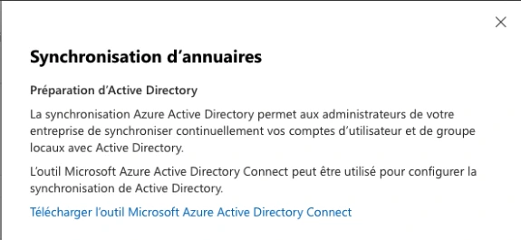

Préparation de la synchronisation des annuaires

- Cliquez sur Personnaliser.
- Cochez Utiliser un compte de service existant et entrez le compte administrateur de l’entreprise créé précédemment (AD). Cliquez sur Installer.

- Cochez Synchronisation de hachage du mot de passe et cliquez sur Suivant.
- Entrez le compte administrateur général créé précédemment (Compte Azure).

- Cliquez sur Ajout d’un domaine.
- Laissez Créer un compte AD coché et entrez les identifiants du compte de service et

entrez à nouveau les identifiants du compte administrateur de l’entreprise créé précédemment (AD).

- Cliquez sur Suivant.

- Laissez l’UPN comme attribut à utiliser comme nom d’utilisateur AD, cochez Continuer sans faire correspondre tous les suffixes UPN à des domaines vérifiés et cliquez sur Suivant.
- Filtrez les Unités d’organisation en cochant Synchroniser les domaines et les unités

d’organisation sélectionnés, cochez uniquement les utilisateurs et les groupes. Ces OU nous seront nécessaires pour la suite de ce cours.

- Cliquez sur Suivant.

#### Choix affichés pour les unités d’organisation

- « Synchroniser les domaines et les unités d’organisation sélectionnés » et les conteneurs Utilisateurs et Groupes.
- L’assistant poursuit avec l’identification unique des utilisateurs et l’attribut source utilisé pour les rapprocher.

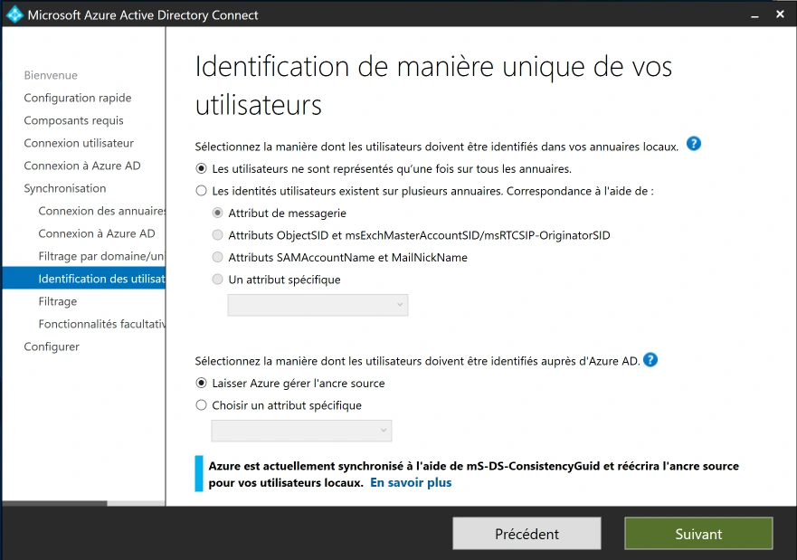

Identification unique des utilisateurs

- Cliquez sur Suivant.
- Cliquez sur Suivant puis Installer.

- Dans un contexte de production, pensez à activer la corbeille Active Directory.
- Dans la console Microsoft 365, notez l’apparition des deux utilisateurs créés précédemment et affectez-leur une licence.

- Tentez ensuite de vous connecter avec user1 et user2 et vérifiez qu’ils accèdent bien aux services Microsoft 365.
- Forcer la synchronisation AD Connect.

Import-module "C:\Program Files\Microsoft Azure AD Sync\Bin\ADSync\ADSync"

- Installer le module PowerShell AzureAD

Install-Module AzureAD

- Ajoutez des groupes de sécurité dans l’unité d’organisation créée précédemment
- Créez un groupe de sécurité que vous nommerez GG_ServiceIT

- Lancez la commande

Start-ADSyncSyncCycle Delta

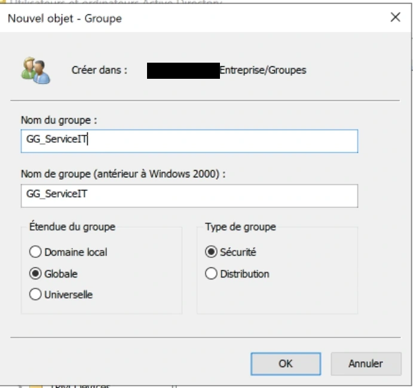

Création du groupe global de sécurité

- Patientez quelques secondes, le groupe de sécurité va remonter dans la liste des groupes de la console Microsoft 365.
- Ajoutez par la suite user1 dans le groupe GG_ServiceIT et relancez une synchronisation.
- Ajoutez un alias à la boîte mail.
- Faites un clic droit / Propriétés sur l’utilisateur 1, allez dans l’éditeur d’attributs puis allez à la valeur proxyAddresses.
- Entrez l’adresse principale avec SMTP : et les secondaires avec smtp :
- Forcez une synchronisation et vérifiez le bon fonctionnement.

Référence du document : 1LpKVUBTMLiB-W1wEAUDHgEs_-hjOvStg · SHA-256 b0ef5fef8cee558e…

## Fiche de synthèse

Les lignes reprennent les titres du cours et la première phrase de chaque partie.

| Partie | Repère du cours |
| --- | --- |
| Support · Module 02 - Support de cours · 45 pages transcrites | Les parcours et libellés historiques sont conservés. |
| Énoncé · M2 - Énoncé du TP 1 - Utilisateurs et groupes · 3 pages transcrites | Les parcours et libellés historiques sont conservés. |
| Énoncé · M2 - Énoncé du TP 2 - Azure AD Connect · 2 pages transcrites | Les parcours et libellés historiques sont conservés. |
| Correction · M2 - Solution du TP 1 - Utilisateurs et groupes · 4 pages transcrites | Les parcours et libellés historiques sont conservés. |
| Correction · M2 - Solution du TP 2 - Azure AD Connect · 19 pages transcrites | Les parcours et libellés historiques sont conservés. |
