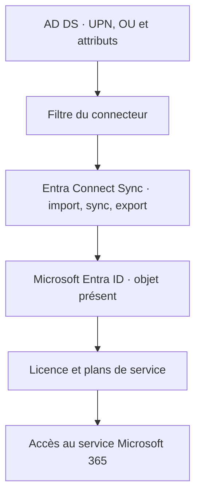

# Module 02 — Administration Microsoft 365

Dans Microsoft 365, créer une identité, lui attribuer une licence et lui donner des droits sont trois opérations distinctes. Ce module suit un compte depuis sa création ou sa synchronisation jusqu’à l’accès à sa boîte et aux ressources de son groupe.

## Objectifs

- Créer et gérer des utilisateurs, des groupes et des licences.
- Distinguer destinataires, permissions et règles de transport Exchange Online.
- Comprendre la configuration des clients et la gestion des appareils.
- Synchroniser l’annuaire local, contrôler le périmètre et déléguer l’administration.

## 1. Administrer les identités et les licences

Le centre d’administration Microsoft 365 présente un tableau de bord et permet de suivre comptes, groupes, abonnements et centres spécialisés. Le support compare des comptes créés dans le tenant et des comptes issus de l’AD local. Avant une modification, identifier où l’objet est géré. Pour un attribut d’un utilisateur synchronisé, vérifier l’annuaire source.

| Action | Ce qu’il faut relever |
| --- | --- |
| Créer une identité | UPN effectivement créé, nom affiché, fonction, service et lieu d’utilisation. |
| Vérifier la connexion | Compte activé, changement du mot de passe temporaire, authentification et politique d’accès. |
| Attribuer ou remplacer une licence | Licence disponible, lieu d’utilisation et plans de service activés. |
| Vérifier le service | Accès effectif à la boîte ou à l’application avec le compte utilisateur. |
| Supprimer puis restaurer | Identité dans la liste des utilisateurs supprimés, retour de l’objet, puis vérification des licences et accès. |

Le tableau historique compare Exchange Online Plan 1 et Plan 2, les offres Business et Microsoft 365 E3/E5. Il donne des exemples à **50 Go** et **100 Go** pour la boîte principale, avec des options d’archivage différentes. Les prix, capacités et libellés se lisent dans le contexte du document. Dans le laboratoire, vérifier les licences totales, consommées et disponibles et relever les plans du tenant avant de modifier un compte.

!!! note "Commandes historiques et outils d’administration"

    Le support et le corrigé utilisent notamment `MSOnline`, `Get-MsolUser`, `Set-MsolUserLicense` et un identifiant d’offre `AccountSkuId`. Ces commandes expliquent les captures historiques. Pour le travail d’identité et de licences dans un environnement actuel, suivre la migration vers Microsoft Graph PowerShell. Pour l’administration Exchange, utiliser l’interface d’administration Exchange ou une session Exchange Online PowerShell avec les rôles appropriés. [Migration MSOnline](https://learn.microsoft.com/en-us/powershell/microsoftgraph/migration-steps) · [Connexion Exchange Online PowerShell](https://learn.microsoft.com/powershell/exchange/connect-to-exchange-online-powershell)

## 2. Choisir un destinataire, un groupe et une délégation

| Objet | Usage |
| --- | --- |
| Boîte d’utilisateur | Courrier et calendrier propres à l’utilisateur. |
| Boîte partagée | Adresse commune dont des délégués gèrent le contenu ou l’envoi. |
| Boîte de ressource | Réservation d’une salle ou d’un équipement, avec règles d’invitation. |
| Utilisateur de messagerie ou contact | Adresse d’annuaire liée à une destination externe, selon le type d’objet. |
| Groupe de distribution | Distribue les messages aux membres selon ses réglages. |
| Groupe de sécurité | Attribue un accès. Un groupe à extension messagerie peut également recevoir du courrier. |
| Groupe Microsoft 365 | Regroupe les membres et propriétaires et fournit des ressources de collaboration, dont un site SharePoint pour le groupe. |

Dans une boîte, distinguer adresse SMTP principale et adresses secondaires, règles de transfert, quotas, archivage et conservation des éléments supprimés. Le support montre la lecture des propriétés de boîte avec `Get-Mailbox` et un exemple de conservation de **30 jours**. Examiner la politique et la portée de chaque réglage avant de le transposer.

| Délégation | Résultat à tester |
| --- | --- |
| Accès total | Ouvrir et administrer le contenu de la boîte. |
| Envoyer en tant que | Le destinataire voit la boîte comme expéditeur. |
| Envoyer de la part de | Le destinataire voit le délégué et l’identité représentée. |

Tester l’ouverture et l’envoi séparément, sous un compte délégué. Une ouverture réussie ne suffit pas pour prouver le droit d’envoi. [Délégations Exchange Online](https://learn.microsoft.com/en-us/exchange/recipients-in-exchange-online/manage-permissions-for-recipients)

## 3. Diagnostiquer le transport de courrier

Un **domaine accepté** décrit le traitement du courrier pour un domaine DNS. Dans le scénario faisant autorité, Exchange gère les destinataires du domaine. Dans un scénario de **relais interne**, une partie du courrier peut être acheminée vers un autre système. Le connecteur doit correspondre au chemin prévu.

Le **suivi des messages** permet de rechercher la trace d’un envoi à partir de l’expéditeur, du destinataire et de l’heure. Lire la remise, le rejet ou le chemin emprunté avant de modifier les règles.

| Composant | Question de diagnostic |
| --- | --- |
| Domaine accepté | Le système doit-il délivrer localement ou relayer pour ce domaine ? |
| Règle de transport | Les conditions, actions et exceptions s’appliquent-elles au message ? Quel est son ordre de traitement ? |
| Connecteur | Faut-il un chemin ou des règles TLS propres à un serveur interne, une application, un appareil ou un partenaire ? |
| Suivi | Le message a-t-il été accepté, redirigé, mis en attente, rejeté ou remis ? |

Les règles permettent, selon le besoin, d’appliquer des actions de conformité, de bloquer, de rediriger ou de journaliser. Vérifier les chevauchements et la priorité, la valeur 0 étant en haut de la liste dans le support. Pour un relais d’imprimantes ou d’applications, identifier les sources autorisées. La soumission SMTP authentifiée, le relais par connecteur et l’envoi direct correspondent à des configurations distinctes. [Options SMTP pour les appareils et applications](https://learn.microsoft.com/en-us/exchange/mail-flow-best-practices/how-to-set-up-a-multifunction-device-or-application-to-send-email-using-microsoft-365-or-office-365)

## 4. Configurer les clients et les appareils

| Usage | Repères du support et contrôle |
| --- | --- |
| Outlook | MAPI sur HTTPS, port 443. Autodiscover découvre les paramètres à partir de l’identité de messagerie et du DNS. |
| Accès mobile | Le support cite ActiveSync sur HTTPS 443. Identifier le client et les politiques de l’organisation. |
| Consultation POP ou IMAP | Le support compare POP 110/995 et IMAP 143/993. Vérifier l’accès autorisé, TLS et le mode d’authentification. |
| Soumission SMTP | Le support donne plusieurs ports historiques. Pour SMTP AUTH Microsoft 365, vérifier la prise en charge et la configuration du service, notamment TCP 587. |
| Transport entre serveurs | SMTP TCP 25 dans la maquette de transport. |

Pour Outlook, vérifier le compte, le CNAME ou le mécanisme DNS demandé, puis examiner le résultat de **Tester la configuration automatique de la messagerie** ou de l’analyseur de connectivité Microsoft. Une réponse DNS valide n’établit pas que le compte a une boîte accessible. [Soumission SMTP authentifiée](https://learn.microsoft.com/en-us/Exchange/clients-and-mobile-in-exchange-online/authenticated-client-smtp-submission)

Le support cite les fichiers `.pst` pour des données locales, `.ost` pour le cache hors connexion, `.nst` pour certains objets de groupe et `spscoll.dat` dans son exemple historique. Il montre `scanpst.exe` pour un PST et une régénération possible de l’OST. Avant de toucher au fichier, vérifier si les données sont également côté serveur et si des éléments locaux doivent être sauvegardés.

La gestion mobile couvre les appareils, les applications, le réseau et les données. Le **MDM** applique des politiques aux appareils, dans le cadre plus large de la gestion de mobilité présentée dans le support.

| Modèle | Propriété et choix |
| --- | --- |
| BYOD | Appareil personnel utilisé aussi pour le travail. |
| CYOD | Appareil choisi dans un catalogue défini par l’organisation. |
| COPE | Appareil fourni et géré par l’entreprise, avec usage personnel autorisé selon la politique. |

Prévoir l’inscription des appareils, le groupe ciblé, les règles de verrouillage, chiffrement et accès, puis les restrictions de partage ou de capture selon le besoin. Les noms de plateformes et écrans du support sont historiques. Tester avec un groupe pilote avant une règle à portée large ou un effacement.

## 5. Synchroniser l’AD local et déléguer l’administration

L’outil **Azure AD Connect** du support est nommé **Microsoft Entra Connect Sync**. Il importe les objets du périmètre local, applique les règles et exporte vers Entra ID. Préparer les OU, l’UPN et les attributs avant d’activer ou de modifier la synchronisation.

| Fonction | Effet à distinguer |
| --- | --- |
| Synchronisation des objets | Les utilisateurs, groupes et attributs retenus deviennent visibles côté cloud. |
| Password Hash Synchronization | Un hachage dérivé est transmis pour permettre l’authentification cloud. |
| Pass-through Authentication | Des agents locaux valident l’authentification selon le mode configuré. |
| Password writeback | Un changement ou une réinitialisation autorisés côté cloud peuvent être répercutés vers AD, selon les prérequis. |
| Filtrage | Sélectionne les objets ou OU. Sortir un objet du périmètre peut avoir un effet côté tenant. |

**Illustration IA / externe au cours — suivre l’identité jusqu’au service.**



Dans le support, la gestion s’effectue avec l’assistant, **Synchronization Service Manager** pour les traitements et **Synchronization Rules Editor** pour lire les règles. Une politique Delta prend en compte des modifications ordinaires. Le cycle Initial montré dans le support a une portée différente. [Méthodes d’authentification Entra Connect](https://learn.microsoft.com/en-us/azure/active-directory/connect/active-directory-aadconnect-user-signin) · [Filtrage des objets](https://learn.microsoft.com/en-us/entra/identity/hybrid/connect/how-to-connect-sync-configure-filtering)

Le **RBAC** attribue les privilèges par rôle. Le support compare notamment administrateur général, administration de facturation, administration de mots de passe, d’utilisateurs et de services. Le choix porte sur les actions réellement nécessaires. Un rôle personnalisé peut limiter la portée dans les services qui le permettent. Vérifier le rôle attribué, le périmètre, et le résultat avec le compte de test. [Référence des rôles Microsoft Entra](https://learn.microsoft.com/en-us/entra/identity/role-based-access-control/permissions-reference)

## 6. TP guidé — Utilisateurs, licences et groupes

1. Dans le tenant de formation, préparer les quatre comptes utilisateur du tableau du TP sans licence. Renseigner les lieux d’utilisation, fonctions et services. Créer les comptes demandés en PowerShell avec l’outil prévu par le laboratoire. Le compte administrateur demandé par l’exercice a une portée limitée à cette maquette.
2. Tester la première connexion du compte Sacha, relever l’UPN réellement créé et traiter le changement du mot de passe temporaire. Le corrigé alterne deux formes d’UPN. Comparer le résultat de connexion et celui d’accès à un service qui exige une licence.
3. Modifier la fonction d’Oussama. Supprimer puis restaurer les comptes Vishnou et Sacha selon les outils demandés. Vérifier leur état dans le tenant et les accès nécessaires après restauration.
4. Attribuer les licences et plans demandés. Le TP demande les licences complètes pour Oussama et Zachary, une licence sans Sway, Power BI et Azure Rights Management pour Sacha, puis un retrait et une réactivation d’Office Online pour Vishnou. Lire les noms de plans effectivement disponibles dans le tenant.
5. Créer les groupes Microsoft 365 de l’annexe et le groupe de sécurité de l’exercice. Contrôler le type, la description et les membres avant l’envoi au groupe Pédagogie. L’énoncé répète `GO_Commercial` et varie le libellé des administratifs. Préparer un groupe par besoin et documenter le nom retenu.
6. Déléguer la réinitialisation de mot de passe, vérifier le résultat sur un compte de test, puis traiter le rôle de licence demandé. Le corrigé rapproche « Administrateur de licence » et « Billing Administrator ». Examiner la définition des deux rôles et vérifier l’action attendue avec le rôle approprié.

Relever dans le compte rendu l’identité, le résultat de connexion, la licence et ses plans, le groupe ou rôle appliqué et la preuve d’accès. Garder les valeurs d’accès hors du rapport.

## 7. TP guidé — Synchroniser l’AD de laboratoire

1. Installer le contrôleur Windows Server 2019 du TP avec AD DS et DNS, **4 Go** de RAM, **60 Go** de disque et l’adressage NAT prévu. Créer l’arborescence d’OU pour utilisateurs, groupes, comptes de service et archives. Renseigner fonctions et services demandés dans l’annexe.
2. Préparer un suffixe UPN correspondant au domaine validé côté tenant. Affecter le suffixe aux comptes concernés et vérifier leurs attributs. L’identité d’administration du connecteur reste celle autorisée pour la maquette.
3. Installer Connect Sync. L’énoncé demande un départ en mode express, puis un filtrage. Le corrigé montre un parcours personnalisé qui choisit les OU pendant l’installation. Noter le parcours retenu et les droits requis selon le mode. [Comptes et droits du connecteur](https://learn.microsoft.com/en-us/entra/identity/hybrid/connect/reference-connect-accounts-permissions)
4. Contrôler les OU de groupes et d’utilisateurs prévues. Vérifier les objets ajoutés ou retirés avant de lancer un export. Contrôler le groupe de service et les comptes déjà synchronisés côté tenant.
5. Créer le nouvel utilisateur du TP. Sur le serveur Connect Sync, relever le planificateur et, si nécessaire dans ce scénario, déclencher un Delta.

```powershell
Import-Module ADSync
Get-ADSyncScheduler
Start-ADSyncSyncCycle -PolicyType Delta
```

6. Vérifier l’utilisateur côté tenant, puis renseigner l’alias dans `proxyAddresses`. Le préfixe `SMTP:` repère l’adresse principale et `smtp:` les alias. Relever l’attribut avant et après, le résultat du cycle et un essai de réception à l’alias lorsque la boîte est opérationnelle.

Un objet absent demande d’examiner le périmètre, l’import et l’export. Un objet visible dont l’accès au courrier échoue demande ensuite de contrôler licence, provisionnement de boîte, politique d’accès et adresse.

## À retenir

L’identité, la licence et la permission se vérifient séparément. L’administration Exchange distingue la boîte, le transport et le client. Une synchronisation se contrôle depuis le filtre et le journal jusqu’à l’objet cloud et son service.

## Mini-quiz — 5 questions {#mini-quiz}

1. Un compte est visible mais Exchange ne s’ouvre pas. Quels points distinguer ?
2. Quelle délégation envoie sous l’identité de la boîte ?
3. Quand vérifier le connecteur et l’ordre des règles ?
4. Quelle différence entre synchronisation des hachages et password writeback ?
5. Quel attribut vérifier pour prouver l’ajout d’un alias dans le TP ?

??? success "Réponses commentées"

    1. Vérifier l’authentification, le lieu d’utilisation, la licence, le plan Exchange, l’état de la boîte et la politique d’accès.
    2. Envoyer en tant que. Accès total concerne l’ouverture et la gestion du contenu.
    3. Quand la trace montre une remise inhabituelle ou un routage inattendu. Lire le domaine accepté, les conditions et exceptions, puis le connecteur utilisé.
    4. La synchronisation transmet un hachage dérivé vers le cloud. Le writeback permet sous conditions une répercussion du changement vers AD.
    5. `proxyAddresses`. Relever le préfixe `smtp:` de l’alias, vérifier sa présence côté cloud puis faire un test de réception.

## Pour pratiquer et réviser {#travaux-pratiques-et-revisions}

- [TP 1 — Utilisateurs et groupes](../../tp/14-messagerie-cloud/module-02/tp-01.md) et [correction](../../tp/14-messagerie-cloud/module-02/correction-tp-01.md)
- [TP 2 — Synchroniser l’AD](../../tp/14-messagerie-cloud/module-02/tp-02.md) et [correction](../../tp/14-messagerie-cloud/module-02/correction-tp-02.md)
- [Fiche de révision](../../revision/14-messagerie-cloud/module-02.md)
- [Kahoot existant](../../kahoot/14-messagerie-cloud-module-02.md)
- [Sommaire de Messagerie Cloud](index.md)

## Provenance pédagogique

Le support d’administration M02 et les quatre documents de TP fondent les notions et procédures. Les compléments référencés explicitent les versions, les rôles et les contrôles. Le schéma et les questions appliquent la distinction entre objet, accès et service.
