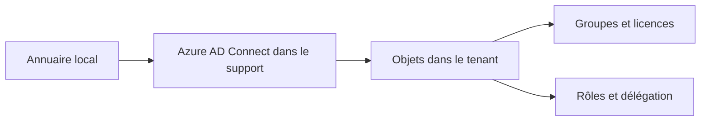

# Module 03 — Administration Microsoft 365 — reprise documentaire du Module 02

!!! warning "Provenance — duplication documentaire"
    Le dossier Module 3 reprend exactement les cinq PDF du Module 2, avec le titre interne « Module 02 — Administration Microsoft 365 ». Ce rattachement est conservé à la demande explicite de l’utilisateur. Il ne s’agit pas d’un support distinct du Module 3.

## Objectifs

Créer et gérer des objets dans Microsoft 365, gérer les licences, comprendre les connexions clientes et synchroniser un annuaire local vers le Cloud.

## Se repérer dans le support

| Pages PDF | Notions du support |
| --- | --- |
| 1–7 | Objectifs, console, comptes, rôles et exemples PowerShell |
| 8–10 | Licences et administration Exchange Online |
| 11–18 | Destinataires, boîtes aux lettres, contacts et permissions |
| 19–21 | Types de groupes |
| 22–25 | Domaines acceptés, règles de transport et connecteurs |
| 26–28 | Connexions clientes, Autodiscover et fichiers Outlook |
| 29–33 | Gestion des appareils mobiles et stratégies |
| 34–42 | Azure AD, synchronisation, writeback et diagnostic de synchronisation |
| 43–45 | RBAC, délégation et rôles personnalisés |

## Distinguer les objets

La présence d’un compte, l’attribution d’un rôle administratif et l’affectation d’une licence correspondent à des opérations distinctes dans le support. Les ateliers demandent de vérifier les objets après leur création et de comparer leur accès aux services.

Les différentes catégories de destinataires et de groupes n’ont pas le même usage. Lire les tableaux originaux avant de choisir entre une boîte aux lettres, un contact ou un groupe ; conserver la distinction entre destinataire de messages et délégation administrative.

## Suivre le transport et la connexion

Le cours présente les domaines acceptés, les règles et les connecteurs, puis la connectivité des clients. Les pages sur Autodiscover et les fichiers Outlook doivent être replacées dans cette progression. Les règles peuvent se chevaucher : le support demande de tenir compte des conditions et des exceptions.

## Relier l’annuaire local au Cloud

Les pages Azure AD présentent un annuaire Cloud distinct de l’annuaire local et la synchronisation avec Azure AD Connect. Le TP détaille la préparation de l’annuaire, le suffixe UPN, le périmètre des unités d’organisation et les vérifications de remontée des objets. Le support présente aussi le writeback et des commandes de synchronisation, à lire dans leur contexte historique.

Les noms Azure AD, MSOnline et les écrans reproduits sont ceux des documents de 2022. Cette fiche ne les transforme pas en une procédure actualisée : conserver les originaux et faire valider l’environnement de TP par le formateur avant toute exécution.

## Illustration IA / externe au cours — domaines à distinguer

## Pour réviser

Distinguer compte, licence, groupe et rôle ; identifier les destinataires ; expliquer l’intérêt des vérifications après synchronisation et retrouver le périmètre d’OU du laboratoire dans le TP original.

## Travaux pratiques du module

[Ateliers, énoncés et corrections](../../tp/14-messagerie-cloud/module-03/index.md).

## Provenance

Les documents originaux sont présentés séparément de cette aide IA / externe au cours. Les pages indiquées sont les pages PDF, et non les numéros de diapositives.

- [Module 02 - Support de cours.pdf](https://drive.google.com/file/d/1QXg3d1FfYiKv7fxyFAOEBtFgxcG4rQL3/view?usp=drivesdk) · SHA-256 `2d6cbe49ac253b8cfa14f54e1ca918452d3fbdb5c219daea589f4e13e14e04dd`
- [M2 - Solution du TP 1 - Utilisateurs et groupes.pdf](https://drive.google.com/file/d/1_CAYnYBOD0DQW9uNGykBtX_GAqNUtC-G/view?usp=drivesdk) · SHA-256 `5aa0bc1641f5fddd77dce03e2f8413db215da19c65290a2e4fccb29c8344f91e`
- [M2 - Solution du TP 2 - Azure AD Connect.pdf](https://drive.google.com/file/d/1WOhjAq0lhcbOq4fhj_H4hGBkkRyzrT7G/view?usp=drivesdk) · SHA-256 `b0ef5fef8cee558ef2c1c1e264cbba392065e8e2daf549956735c2145a137daf`
- [M2 - Enoncé du TP 2 - Azure AD Connect.pdf](https://drive.google.com/file/d/1me6SILxxJNgD0AiCdjStFN8-rUMBQuex/view?usp=drivesdk) · SHA-256 `67cd7d118de46260b75a3e4a78af5c3a615c3ed795a9d4e352900d24bdae74ce`
- [M2 - Enoncé du TP 1 - Utilisateurs et groupes.pdf](https://drive.google.com/file/d/1wU7nbtTzD6ImXy4wWZ2oezVQvQxR6QLW/view?usp=drivesdk) · SHA-256 `16589f599d6f5c8719b4d1a2e5944f27d2e18c1145fca76bff75276229d17984`
