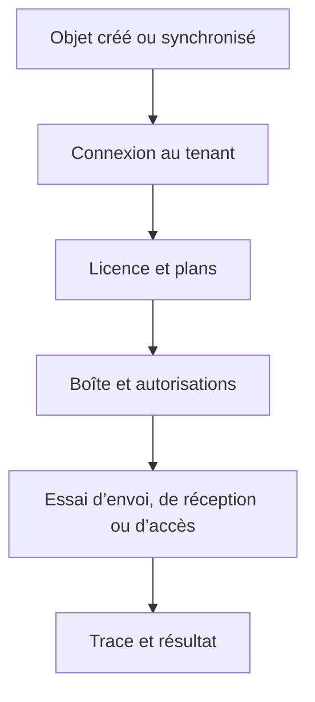

# Module 03 — Administration Microsoft 365 — reprise documentaire du module 2

Les cinq PDF rangés dans le dossier Module 3 ont la même empreinte que les cinq documents correspondants du module 2. Le support porte le titre interne « Module 02 – Administration Microsoft 365 ». L’onglet **Cours Original** présente les documents du dossier Module 3. Cette page propose une reprise guidée des mêmes notions et des deux TP. [Leçon détaillée du module 2](module-02.md)

## Objectifs

- Retrouver où vérifier une identité, une licence, une boîte et ses droits.
- Refaire les contrôles des deux TP en suivant les objets de la source jusqu’au résultat.
- Expliquer la différence entre panne d’authentification, de synchronisation ou d’accès au service.

## 1. Retrouver le bon niveau de contrôle

| Constat | Vérification | Objet attendu |
| --- | --- | --- |
| Un utilisateur ne se connecte pas | Identité, UPN utilisé, état du compte et politique d’accès | Compte actif et identifiant conforme |
| Le compte se connecte mais une application manque | Lieu d’utilisation, licence et plan activé | Service autorisé et provisionné |
| Un délégué ouvre une boîte mais ne peut pas envoyer | Droit d’envoi et identité affichée à la réception | Envoyer en tant que ou Envoyer de la part de selon la consigne |
| Un utilisateur n’est pas visible côté cloud | OU, filtre et résultats d’import, de synchronisation et d’export | Objet inclus et publié dans Entra ID |
| Un message n’arrive pas | Domaine accepté, adresse, suivi, règle et connecteur | Trace du trajet et résultat de remise |

Les comptes, groupes et rôles se règlent dans les services d’identité. Le centre Exchange permet de vérifier boîtes, destinataires, droits et transport. Le client utilise sa propre configuration, dont Autodiscover dans le scénario Outlook. Les réglages mobiles et d’accès peuvent introduire une condition supplémentaire.

**Illustration IA / externe au cours — établir une chaîne de preuves.**

## 2. TP guidé de reprise — Utilisateurs et groupes

Reprendre l’annexe et les comptes de test du premier atelier. Les noms d’utilisateur, lieux d’utilisation et fonctions servent à vérifier l’identité. Les différences de plans de service, de groupe et de rôle servent à vérifier les droits et l’accès.

1. Créer les comptes sans licence selon l’énoncé, puis suivre l’identifiant effectivement créé et la première connexion. La variante du compte Sacha dans le corrigé rappelle qu’il faut relever l’UPN avant de réutiliser une commande.
2. Relire la fonction modifiée, l’état des utilisateurs supprimés et restaurés, puis les licences et plans attribués. Pour le plan Office Online retiré puis réactivé dans le TP, constater l’état depuis le compte concerné.
3. Comparer groupes Microsoft 365 et groupe de sécurité. Vérifier les membres et tester la réception au groupe Pédagogie. La présence d’un groupe dans l’annuaire ne prouve pas la remise d’un message.
4. Reprendre le test de délégation de mot de passe. Distinguer le rôle qui gère des licences et celui qui gère la facturation. Décrire l’action essayée avec le rôle de laboratoire, sans inclure de valeur d’accès dans le compte rendu.

## 3. TP guidé de reprise — Synchronisation de l’annuaire

Repartir de l’AD local du second atelier et des OU d’utilisateurs et de groupes. L’énoncé et la solution décrivent respectivement un début en express et un parcours personnalisé. Relever le périmètre réellement choisi et l’effet possible d’un changement de filtre avant l’export.

1. Relever l’UPN, l’OU et les attributs de l’utilisateur avant synchronisation. Vérifier le domaine validé et l’inclusion dans le filtre.
2. Lire l’intervalle du planificateur et la trace de l’import et de l’export. Quand la modification du TP est prête, demander un cycle Delta sur le serveur de synchronisation prévu.
3. Comparer l’objet local à celui visible dans Entra ID. Après ajout d’un alias, relever `proxyAddresses` côté source et vérifier l’alias côté tenant.
4. Si la boîte est prête, tester la réception à l’alias. Si l’objet est synchronisé mais la boîte indisponible, poursuivre le contrôle sur la licence et le service Exchange.

## 4. Exercice de diagnostic

Un compte restauré se connecte. Il peut ouvrir une boîte partagée mais échoue quand il essaie d’envoyer sous son adresse. Un second compte synchronisé reçoit les messages à l’adresse principale, mais pas à l’alias ajouté dans l’AD.

??? success "Correction commentée"

    Pour le premier, confirmer l’identité du compte et l’adresse d’expéditeur choisie. L’ouverture valide Accès total. Vérifier séparément Envoyer en tant que et essayer depuis la session du délégué. Lire la trace du message si la soumission a été acceptée.

    Pour le second, relever l’alias dans `proxyAddresses`, le résultat du cycle et la valeur côté Exchange. Une fois l’adresse secondaire présente, tester de nouveau la réception puis contrôler le suivi. Examiner la source et le filtre avant de modifier l’objet cloud.

## À retenir

Une reprise s’appuie sur des observations séparées. Relever l’identité, le plan de service, le rôle, la propriété d’annuaire et le résultat du test qui prouve chaque étape.

## Mini-quiz — 5 questions {#mini-quiz}

1. Quels deux résultats distinguer après la restauration d’un utilisateur ?
2. Quel contrôle prouve la différence entre un groupe de sécurité et le groupe Pédagogie dans ce TP ?
3. Pourquoi une boîte partagée ouverte peut-elle refuser un envoi sous son identité ?
4. Quels trois traitements suivre lorsqu’un objet local n’apparaît pas côté cloud ?
5. À quel moment tester la réception sur un alias ajouté dans l’AD ?

??? success "Réponses commentées"

    1. Vérifier le retour du compte et sa capacité à se connecter, puis ses licences, plans et droits effectifs.
    2. Le groupe de sécurité sert à vérifier l’autorisation de ses membres. Le groupe Pédagogie sert notamment à vérifier la remise du courrier aux membres selon sa configuration.
    3. Accès total autorise l’ouverture. Envoyer en tant que est une délégation séparée.
    4. Import des objets inclus, synchronisation des attributs et export vers Entra ID.
    5. Après avoir vérifié l’attribut local, la fin du cycle, la présence de l’alias côté cloud et l’état de la boîte.

## Pour pratiquer et réviser {#travaux-pratiques-et-revisions}

- [TP 1 du dossier M03](../../tp/14-messagerie-cloud/module-03/tp-01.md) et [correction](../../tp/14-messagerie-cloud/module-03/correction-tp-01.md)
- [TP 2 du dossier M03](../../tp/14-messagerie-cloud/module-03/tp-02.md) et [correction](../../tp/14-messagerie-cloud/module-03/correction-tp-02.md)
- [Fiche de révision](../../revision/14-messagerie-cloud/module-03.md)
- [Kahoot existant](../../kahoot/14-messagerie-cloud-module-03.md)
- [Sommaire de Messagerie Cloud](index.md)

## Provenance pédagogique {#provenance}

Les cinq correspondances sont celles du support, des deux énoncés et des deux corrections du module 2. Les documents de chaque dossier restent consultables dans son onglet Original. Le schéma, l’exercice de diagnostic et les questions sont des aides de reprise du même contenu.
