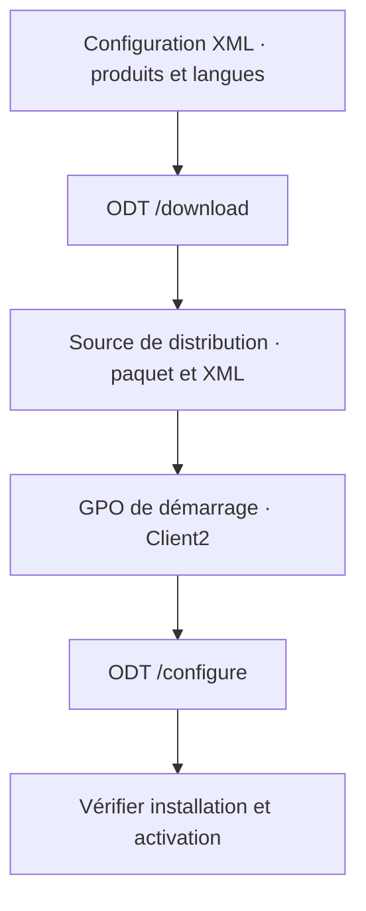

# Module 04 — Services complémentaires

Le module associe l’installation de Microsoft 365 Apps, l’administration des fichiers et les règles de collaboration. Le laboratoire commence par déployer les applications sur une machine pilote, puis vérifie les accès à une bibliothèque avec deux profils.

## Objectifs

- Comparer Office dans le navigateur, les applications installées et leur déploiement administré.
- Préparer le fichier XML d’Office Deployment Tool et vérifier l’application d’une GPO.
- Gérer la synchronisation et les partages OneDrive, puis organiser une bibliothèque SharePoint.
- Configurer la collaboration Teams et vérifier les droits effectifs dans la maquette.

## 1. Choisir le mode d’installation

Le support distingue l’utilisation des applications dans le navigateur, l’installation côté utilisateur et un déploiement piloté par l’administrateur. Il présente les fonctions ajoutées depuis Office 2016, puis Office 365 ProPlus, nom employé dans la source pour l’offre aujourd’hui appelée Microsoft 365 Apps pour les grandes entreprises.

| Mode | Usage | Contrôle |
| --- | --- | --- |
| Office dans le navigateur | Ouvrir et modifier des documents depuis le service web | Vérifier les fonctions nécessaires et l’accès au compte. |
| Installation par l’utilisateur | Installer depuis le portail lorsque la licence et la stratégie le permettent | Vérifier le produit, le compte d’activation et les paramètres de mise à jour. |
| Installation pilotée | Préparer les fichiers et options puis les appliquer aux postes choisis | Vérifier le périmètre, la version, le canal et le résultat sur un pilote. |

**Office Deployment Tool (ODT)** utilise un exécutable `setup.exe` et un fichier XML. Le XML fixe l’architecture, les produits inclus, les langues, le canal et le chemin de la source. L’assistant de personnalisation permet aussi de définir la mise à niveau, la gestion des licences, les options d’installation et les informations générales avant l’export. Les noms de canaux des captures appartiennent à leur version. [Vue d’ensemble d’Office Deployment Tool](https://learn.microsoft.com/en-us/deployoffice/overview-office-deployment-tool)

## 2. Suivre le chemin du paquet

**Illustration IA / externe au cours — préparation et installation sur le poste pilote.**



Le support télécharge les fichiers du CDN Microsoft et les expose sur un partage. Le mode `/download` prépare la source et le mode `/configure` applique la configuration sur le client. Le poste doit pouvoir lire la source dans le contexte où s’exécute le script.

```powershell
# Exemple neutralisé à adapter au partage de laboratoire.
.\setup.exe /download "\\serveur-labo\office\Configuration.xml"
.\setup.exe /configure "\\serveur-labo\office\Configuration.xml"
```

Dans l’annexe, la GPO est liée à l’OU des postes. Le script de démarrage pointe vers le programme et le XML sur la source préparée. Il faut contrôler les droits du partage, le ciblage et le moment où le poste traite la stratégie. Un téléchargement terminé sur le serveur ne prouve pas l’installation du client.

## 3. Administrer OneDrive et SharePoint

| Question | OneDrive | SharePoint |
| --- | --- | --- |
| Où conserver les fichiers ? | Espace de travail associé à l’utilisateur, partage ponctuel selon les règles | Site et bibliothèque pour des documents d’équipe, listes ou contenus communs |
| Qui peut partager ? | Lien par défaut, personnes autorisées et droits du lien | Politique d’organisation, stratégie du site et permissions effectives |
| Quel effet sur le réseau ? | La première synchronisation peut transférer beaucoup de données. Le support aborde ensuite la synchronisation différentielle. | Une bibliothèque volumineuse synchronisée par de nombreux appareils peut augmenter la charge et compliquer l’usage hors ligne. |

Le support décrit le stockage, les accès externes, les appareils et les plages d’accès. Pour chaque lien, relever à qui il est destiné et s’il donne lecture ou modification. Pour une bibliothèque, organiser les groupes et vérifier la portée des permissions avant d’ajouter des exceptions.

Le tableau du support distingue la capacité de l’organisation et celle d’un site. Il cite, selon les offres, un total de **1 To plus 10 Go par licence** ou **1 To**, et un maximum de **25 To par site** dans ses colonnes. Les nombres d’utilisateurs et de collections de sites se lisent dans la colonne correspondant au plan de la source. Pour une configuration réelle, vérifier la description du service et les limites applicables. [Limites de SharePoint](https://learn.microsoft.com/en-us/office365/servicedescriptions/sharepoint-online-service-description/sharepoint-online-limits)

!!! note "Bibliothèque de documents"

    Préparer l’usage, les groupes, le partage et la synchronisation avant de charger les fichiers. Les fichiers d’applications volumineux ou très sollicités demandent un essai représentatif. L’héritage des autorisations, le niveau du site et le niveau de l’organisation s’évaluent ensemble.

## 4. Encadrer la collaboration Teams

Une équipe s’appuie notamment sur des objets Microsoft 365 et du stockage SharePoint. Le support décrit la croissance historique de l’usage de Teams, puis les réglages de création d’équipe, de confidentialité, de canaux et de réunions.

| Réglage | Question d’administration |
| --- | --- |
| Création de groupes et d’équipes | Qui peut créer de nouveaux espaces et en assumer la gestion ? |
| Équipes et canaux | L’équipe est-elle publique ou privée ? Qui possède ou utilise chaque espace ? |
| Réunions | Qui participe et partage du contenu ? Quels réglages audio et vidéo s’appliquent ? |
| Invités et applications | Quelles fonctions de collaboration et quelles applications externes sont autorisées ? |

Le support illustre la restriction de création de groupes à des utilisateurs autorisés, avec un groupe de contrôle et une procédure Microsoft. Après changement, essayer avec un utilisateur autorisé et un utilisateur hors périmètre. Une règle sur les groupes peut agir sur les créations qui proviennent d’autres applications que Teams. [Planifier le partage et la collaboration](https://learn.microsoft.com/en-us/sharepoint/collaboration-options)

## 5. TP guidé — Déployer Microsoft 365 Apps sur Client2

1. Préparer `Client2`, le poste Windows 10 du TP, et le joindre au domaine Active Directory. Vérifier son compte machine et l’OU visée.
2. Dans le tenant de formation, configurer la restriction de téléchargement utilisateur prévue. Tester le portail avec le compte standard du scénario, en distinguant connexion au portail et bouton d’installation.
3. Générer le XML adapté à l’architecture, aux applications, aux langues et au canal retenus. Préparer ODT et télécharger le paquet dans la source de laboratoire.
4. Créer ou modifier la GPO de démarrage dans l’OU pilote. Pointer vers le programme et le XML sur le partage. Vérifier l’accès de la machine au contenu avant de redémarrer.
5. Sur `Client2`, actualiser les stratégies et redémarrer au moment prévu. Contrôler l’application de la GPO, puis relever la présence des applications, la version et le résultat de l’activation avec la licence de test.

```cmd
gpupdate /force
gpresult /r
```

Le premier contrôle déclenche une actualisation. Le second aide à lire les stratégies prises en compte. Le résultat attendu se vérifie ensuite dans le poste, y compris quand l’utilisateur standard n’a plus accès au téléchargement depuis son portail.

## 6. TP guidé — Administrer une bibliothèque SharePoint

1. Préparer un site de laboratoire et une bibliothèque. Le corrigé choisit **Centre de documents** et une bibliothèque **Fichiers de l’entreprise**. Relever le type de site réellement utilisé dans votre maquette.
2. Créer les groupes AD prévus, notamment `GDL_SP_Fichiers_RW` et `GDL_SP_Fichiers_RO`. Ajouter les membres de test selon leurs rôles et vérifier les objets réellement synchronisés.
3. Dans la maquette du corrigé, associer le groupe RW aux **Membres** et le groupe RO aux **Visiteurs**. Le corrigé ajoute `GG_ServiceIT` au chemin RW et retire une entrée d’accès large. Vérifier les droits effectifs avant et après ces changements, particulièrement si des groupes sont imbriqués.
4. Adapter la disponibilité hors connexion, les invitations, les demandes d’accès et le partage externe aux consignes du TP. La stratégie du site s’inscrit dans celle de l’organisation. [Paramètres de partage SharePoint et OneDrive](https://learn.microsoft.com/en-us/sharepoint/turn-external-sharing-on-or-off)
5. Ouvrir une session avec chaque profil. Tester la lecture, l’ajout ou la modification, puis une invitation externe selon le périmètre autorisé. Documenter les droits observés et les réglages qui les expliquent.

| Profil d’essai | Contrôle attendu |
| --- | --- |
| Membre en collaboration | Lire et modifier les documents selon les droits du groupe. |
| Visiteur en lecture | Consulter sans modifier. |
| Compte hors périmètre | Vérifier l’effet de la politique de partage et des invitations. |
| Utilisateur de synchronisation | Vérifier la conséquence du réglage hors connexion sur la bibliothèque ciblée. |

## À retenir

Le XML décrit le déploiement et la GPO l’applique aux postes ciblés. Les droits SharePoint et OneDrive se démontrent par des essais avec les comptes concernés. Les règles Teams se vérifient au niveau du tenant, de l’équipe et du profil.

## Mini-quiz — 5 questions {#mini-quiz}

1. Quel rôle jouent `/download` et `/configure` ?
2. Où lier la GPO pour ne tester que `Client2` ?
3. Pourquoi la première synchronisation peut-elle peser sur le réseau ?
4. Quelle différence de résultat entre les profils Membres et Visiteurs dans le TP ?
5. À quels niveaux vérifier un partage externe refusé ?

??? success "Réponses commentées"

    1. `/download` prépare les fichiers d’installation de la source. `/configure` applique le XML sur le poste cible.
    2. Sur l’OU pilote qui contient la machine, avec le ciblage adapté et un contrôle de stratégie appliquée.
    3. Le client doit obtenir les fichiers prévus avant de pouvoir limiter certaines synchronisations suivantes aux modifications.
    4. Le profil Membres peut modifier selon les droits de collaboration. Le profil Visiteurs doit rester en lecture.
    5. Lire les règles de l’organisation et du site, les autorisations de l’objet et le type de lien ou d’invitation.

## Pour pratiquer et réviser {#travaux-pratiques-et-revisions}

- [TP 1 — Déployer Microsoft 365 Apps](../../tp/14-messagerie-cloud/module-04/tp-01.md) et [correction](../../tp/14-messagerie-cloud/module-04/correction-tp-01.md)
- [TP 2 — Administrer SharePoint et OneDrive](../../tp/14-messagerie-cloud/module-04/tp-02.md) et [correction](../../tp/14-messagerie-cloud/module-04/correction-tp-02.md)
- [Fiche de révision](../../revision/14-messagerie-cloud/module-04.md)
- [Kahoot existant](../../kahoot/14-messagerie-cloud-module-04.md)
- [Sommaire de Messagerie Cloud](index.md)

## Provenance pédagogique

Le support M04 et les quatre documents des deux TP fournissent les réglages de la maquette et les illustrations historiques. Le diagramme, les tableaux de contrôle et les exemples neutralisés explicitent les étapes.
