# Module 04 — Services complémentaires

Les parties ci-dessous reprennent le cours original, dans le même ordre. Les encadrés et les schémas répètent ses formulations.

## Parcours de lecture

1. Support · Module 04 - Support de cours · 24 pages transcrites
2. Énoncé · M4 - Énoncé du TP 1 - Déploiement Office 365 · 1 pages transcrites
3. Énoncé · M4 - Énoncé du TP2 - Administration SharePoint et OneDrive · 1 pages transcrites
4. Correction · M4 - Solution du TP 1 - Déploiement Office 365 · 3 pages transcrites
5. Correction · M4 - Solution du TP2 - Administration SharePoint et OneDrive · 11 pages transcrites

**Visuel externe**

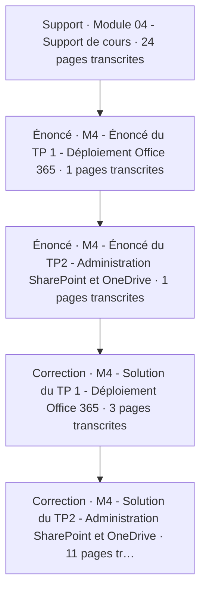

SOURCE DRIVE · TRANSCRIPTION DU SUPPORT

Le contenu des documents du dossier TSSR est transcrit ci-dessous, page par page. Les textes et tableaux sont intégrés à la page Web. Aucun fichier PDF, aucune diapositive entière ni aucune reproduction de page n’est affiché. Seuls des croquis ou visuels isolés et vérifiés peuvent accompagner la transcription. Les versions et les consignes restent celles des supports de formation. Les compléments IA sont conservés dans leur onglet distinct.

## Support · Module 04 - Support de cours · 24 pages transcrites

!!! note "À retenir"
    Les parcours et libellés historiques sont conservés.

Transcription du document source. Les parcours et libellés historiques sont conservés. Les mots de passe, codes de validation et coordonnées nominatives sont neutralisés. Les noms de domaine d’accès des exemples utilisent des domaines réservés à la documentation.

### Module 04 – Services complémentaires

### Objectifs

!!! note "À retenir"
    Déployer le pack Office aux postes clients Maîtriser les enjeux de configuration sur OneDrive Mettre en place des sites SharePoint sécurisés Cadrer l’usage de Teams

**Visuel externe**

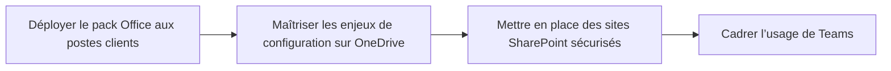

- Déployer le pack Office aux postes clients
- Maîtriser les enjeux de configuration sur OneDrive
- Mettre en place des sites SharePoint sécurisés
- Cadrer l’usage de Teams

### Déploiement du Pack Office

### Office Online

!!! note "À retenir"
    Microsoft Word Online Microsoft OneNote Online Microsoft PowerPoint Online Microsoft Excel Online

**Visuel externe**


- Microsoft Word Online
- Microsoft OneNote Online
- Microsoft PowerPoint Online
- Microsoft Excel Online

### Déploiement du Pack Office

### Office 365 client inclus

!!! note "À retenir"
    Microsoft Office 365 ProPlus Microsoft SharePoint Designer Microsoft Visio Microsoft Project Professionnel Microsoft Office Online Microsoft Office pour Mac Application Office pour iPad, iPhone et iPod touch Application Office pour Android

**Visuel externe**


- Microsoft Office 365 ProPlus
- Microsoft SharePoint Designer
- Microsoft Visio
- Microsoft Project Professionnel
- Microsoft Office Online
- Microsoft Office pour Mac
- Application Office pour iPad, iPhone et iPod touch
- Application Office pour Android

### Déploiement du Pack Office

### Les nouvelles fonctionnalités depuis Office 2016

!!! note "À retenir"
    Le co-authoring L'intégration OneDrive L'intégration Teams Le support multiplateforme La priorisation des mails dans Outlook

**Visuel externe**


- Le co-authoring
- L'intégration OneDrive
- L'intégration Teams
- Le support multiplateforme
- La priorisation des mails dans Outlook

### Déploiement du Pack Office

### Office 365 ProPlus

!!! note "À retenir"
    Gestion des mises à jour Mises à jour de sécurité Mises à jour des nouvelles fonctionnalités Trois options possibles Canal mensuel Mise à jour mensuelle Canal semi-annuel Tous les six mois (en janvier et juillet) Canal semi-annuel ciblé Tous les six mois (en mars et septembre) à des utilisateurs pilotes

- Gestion des mises à jour
- Mises à jour de sécurité
- Mises à jour des nouvelles fonctionnalités
- Trois options possibles
- Canal mensuel
- Mise à jour mensuelle
- Canal semi-annuel
- Tous les six mois (en janvier et juillet)
- Canal semi-annuel ciblé
- Tous les six mois (en mars et septembre) à des utilisateurs pilotes

### Déploiement du Pack Office

### Office 365 ProPlus

!!! note "À retenir"
    Gestion des installations par l’utilisateur

- Gestion des installations par l’utilisateur

### Déploiement du Pack Office

### Office 365 ProPlus

!!! note "À retenir"
    Gestion des installations par l’utilisateur

- Gestion des installations par l’utilisateur

### Dans les options de

### chaque utilisateur

### Dans Paramètres/services

### et compléments

Déploiement du Pack Office Installation d’Office 365 ProPlus avec sources locales

### Crêpes.local

### 213.186.33.20

### D:\data\O365

### CDN Microsoft

### Serveur AD Serveur DNS

https://config.office.com/

#### Exemple représenté

- Créer un partage sur un serveur membre, dans D:\data\O365, puis configurer le fichier XML pour paramétrer ce qui est téléchargé et installé.


Extrait du support du module 4, page 5


Extrait du support du module 4, page 5

Déploiement du Pack Office Installation d’Office 365 ProPlus avec sources locales

PS D:\data\office_365> .\setup.exe /download \\SM01\office_365\Configuration.xml

### Crêpes.local

### 213.186.33.20

### D:\data\O365

### D:\data\O365\ODT.exe

### CDN Microsoft

### Serveur AD Serveur DNS

Déploiement du Pack Office Installation d’Office 365 ProPlus avec sources locales

PS D:\data\office_365> .\setup.exe /configure \\SM01\office_365\Configuration.xml

### Crêpes.local

### 213.186.33.20

### D:\data\O365

### CDN Microsoft

### Serveur AD Serveur DNS

#### Exemple représenté

- Installer OfficeDeploymentTools sur le serveur membre puis télécharger les sources depuis les CDN Microsoft vers le partage.
- Exécuter l’installation en ligne de commande ou la lancer via une GPO.

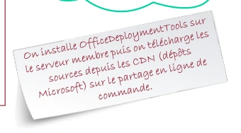

Extrait du support du module 4, page 6


Extrait du support du module 4, page 6

### Déploiement du Pack Office

### Annexe 1 : Déploiement Office 365 ProPlus par GPO

1. Créer un partage nommé : Office_365 sur votre contrôleur de domaine (pas à la racine de C:\). 2. Extraire officedeploymenttool.exe dans ce répertoire. Vous devez avoir ceci
2. Vous pouvez utiliser les modèles .xml ci-dessus ou utiliser le site :

https://config.office.com/

### Déploiement du Pack Office

### Annexe 1 : Déploiement Office 365 ProPlus par GPO

### 4. Choisir votre architecture

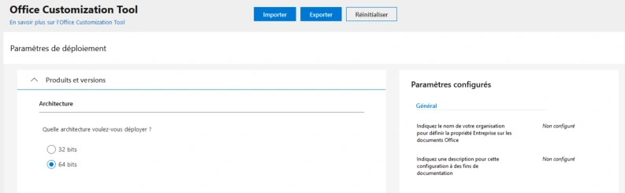

Architecture du déploiement Office

### Déploiement du Pack Office

### Annexe 1 : Déploiement Office 365 ProPlus par GPO

### 5. Choisir les logiciels que vous voulez déployer

### 6. Choisir le canal de mise à jour

### Déploiement du Pack Office

### Annexe 1 : Déploiement Office 365 ProPlus par GPO

### 7. Choisir les langues

### 8. Choisir les options d’installation supplémentaire

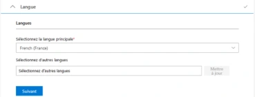

Choix de la langue


Options d’installation

### Déploiement du Pack Office

### Annexe 1 : Déploiement Office 365 ProPlus par GPO

### 9. Choisir les options de mise à niveau

### Déploiement du Pack Office

### Annexe 1 : Déploiement Office 365 ProPlus par GPO

### 10. Gérer les licences

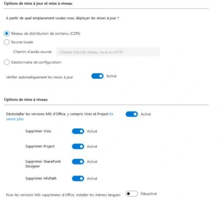

Options de mise à jour


Licences et activation

### Déploiement du Pack Office

### Annexe 1 : Déploiement Office 365 ProPlus par GPO

### 11. Informations générales

### Déploiement du Pack Office

### Annexe 1 : Déploiement Office 365 ProPlus par GPO

### 12. Exporter

### 13. Le .xml est généré

#### Configuration XML de la capture

```
<Configuration>
  <Info Description="déploiement office 365 pour l’organisation de laboratoire" />
  <Add OfficeClientEdition="64" Channel="Monthly" AllowCdnFallback="TRUE" ForceUpgrade="TRUE">
    <Product ID="O365ProPlusRetail">
      <Language ID="fr-fr" />
      <ExcludeApp ID="Groove" />
      <ExcludeApp ID="OneNote" />
      <ExcludeApp ID="Publisher" />
    </Product>
  </Add>
  <Property Name="SharedComputerLicensing" Value="0" />
  <Property Name="PinIconsToTaskbar" Value="TRUE" />
  <Property Name="SCLCacheOverride" Value="0" />
  <Updates Enabled="TRUE" />
  <RemoveMSI All="TRUE" />
  <AppSettings>
    <Setup Name="Company" Value="Organisation de laboratoire" />
  </AppSettings>
</Configuration>
```

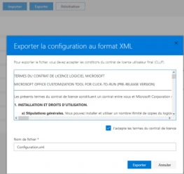

Export du fichier XML de configuration

### Déploiement du Pack Office

### Annexe 1 : Déploiement Office 365 ProPlus par GPO

1. Télécharger les fichiers d'installation d'office avec Office Deployment Tool

PS C:\users\administrator\office_365> .\setup.exe /download \\cd01\office_365\Configuration.xml

1. Une fois le téléchargement effectué, créer une OU pour la ou les machines sur lesquelles vous voulez déployer Office365 ProPlus

### Déploiement du Pack Office

### Annexe 1 : Déploiement Office 365 ProPlus par GPO

### 16. Créer une GPO sur l'OU qui contient vos machines

### Déploiement du Pack Office

### Annexe 1 : Déploiement Office 365 ProPlus par GPO

### 17. Éditez la GPO, allez dans Scripts puis ShowFiles

### Déploiement du Pack Office

### Annexe 1 : Déploiement Office 365 ProPlus par GPO

1. Créez un fichier avec Notepad et changez l'extension en .cmd
2. Cliquez sur Add et sélectionnez votre script 20. Connectez-vous sur la machine cliente (l'utilisateur doit être administrateur local)

### PS C:\users\administrator\office_365> gpupdate /force

1. Redémarrez la machine et vérifiez que ce processus est en route

#### Commande du script de démarrage

```
\\cd01\Office_365\setup.exe /configure \\cd01\Office_365\Configuration.xml
```


Script de démarrage de la GPO


Commande de déploiement dans un script de démarrage

### Administrer OneDrive

### L’administration OneDrive

- Le centre d'administration OneDrive permet de gérer les fonctionnalités :
- De partage
- De synchronisation
- De stockage

### Administrer OneDrive

### L’administration des partages OneDrive

- Administrez le type de lien par défaut
- Vérifiez les droits applicables au lien

### Administrer OneDrive

### Les partages externes OneDrive

- Une sécurité plus importante peut être mise en place pour les partages externes


Types de liens de partage


Périmètres de partage SharePoint et OneDrive


Paramètres avancés de partage

### Administrer OneDrive

### La synchronisation OneDrive

- La synchronisation de vos clients OneDrive peut occasionner des latences sur votre réseau
- La première synchronisation de vos clients est consommatrice de bande passante
- Le client utilise ensuite la synchronisation différentielle afin de ne synchroniser que la partie modifiée d'un document

### Administrer OneDrive

### Gestion des appareils OneDrive

- Vous pouvez spécifier des plages d'adresse IP ou des appareils qui auront accès à OneDrive


Paramètres de synchronisation

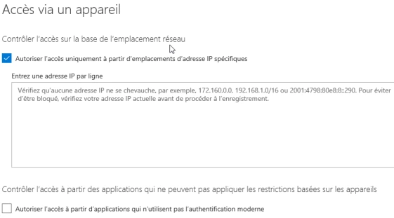

Restrictions d’accès par appareil ou emplacement

### Administrer SharePoint

### Administrer SharePoint OneDrive vs SharePoint

### 1 To

### Administrer SharePoint

### SharePoint

- L’utilisation de SharePoint Online entre désormais dans les standards des systèmes d’information
- Ses nombreux atouts comme la disponibilité, le multiplateforme, la coédition en font un outil à forte valeur ajoutée
- Inclus dans la majeure partie des abonnements
- Limite la gestion de serveurs et stockage en interne

### Administrer SharePoint

### SharePoint

- De multiples usages de SharePoint sont possibles :
- Création de bibliothèques de document
- Création de sites Web internes
- Créer des listes
- …
- SharePoint est le socle sur lequel repose Teams

### Administrer SharePoint

#### Les limites

| Fonctionnalité | Microsoft 365 Business Basic, Business Standard ou Business Premium | Microsoft 365 E3 ou E5, Office 365 E1, E3 ou E5, ou SharePoint Plan 1 ou 2 | Microsoft 365 F1 ou F3, Office 365 F3 |
| --- | --- | --- | --- |
| Stockage total par organisation | 1 To plus 10 Go par licence achetée<sup>3</sup> | 1 To plus 10 Go par licence achetée | 1 To |
| Stockage maximum par site (collection de sites)<sup>4</sup> | 25 To | 25 To | 25 To |
| Sites (collections de sites) par organisation | 2 millions | 2 millions | 2 millions |
| Nombre d’utilisateurs | Jusqu’à 300 | 1 - 500 000 | 1 - 500 000 |

Source : https://docs.microsoft.com/fr-fr/office365/servicedescriptions/sharepoint-online-service-description/sharepoint-online-limits

### Administrer SharePoint

#### Création d’un site

- Pour héberger vos applications ou documents, il faudra créer un site
- Ce site servira ensuite de conteneur pour l’ensemble de vos ressources

### Administrer SharePoint

### Création de bibliothèques de documents

- L’un des usages les plus fréquents est la création de bibliothèques de documents
- Permet de partager des documents avec des utilisateurs internes ou externes
- L’accès aux documents peut être sécurisé (permissions d’accès)
- Utilisable sur smartphones et tablettes via une application
- Laisser le droit à l’ensemble des utilisateurs de créer des sites peut être synonyme de perte de maîtrise des données de l’entreprise

### Administrer SharePoint

### Points de vigilance

- La synchronisation hors connexion sur l’ensemble d’une bibliothèque peut créer de lourds dysfonctionnements et des pertes de données lorsqu’elle est mal utilisée
- La gestion des permissions peut devenir complexe, préférez la simplicité et la segmentation
- Attention aux données qui seront à héberger sur Sharepoint Online, les fichiers d’application métier (type Photoshop) pourront avoir un effet néfaste sur le confort de travail

### Administrer Teams

### Un usage croissant

- Teams est devenu l’outil incontournable du travail collaboratif
- Microsoft a révélé avoir atteint 115 millions d’utilisateurs actifs quotidiens après une impressionnante croissance tout au long de l’année 2020
- Ce total a été porté en 2 mois en contexte de pandémie mondiale seulement
- Microsoft avait initialement envisagé cette croissance en deux ans
- Cette évolution massive a pu démontrer la puissance de l’éditeur et la robustesse de ses solutions, un atout supplémentaire

### Administrer Teams

### Gestion

- Les fonctionnalités phares comme les équipes et la possibilité de créer des réunions en quelques clics en font un outil puissant mais également dangereux
- À l’image de la création de sites SharePoint, la multiplication d’équipes et une éventuelle ouverture publique de celles-ci peuvent engendrer des fuites de données
- Un panneau d’administration est disponible et va permettre de limiter ces usages

### Administrer Teams

### Limiter la création des équipes

- Conserver la maîtrise de l’environnement Microsoft 365 est essentiel pour une entreprise
- Bon nombre d’administrateurs se rendent compte trop tard que des débordements ont eu lieu et il est difficile de revenir en arrière
- Former un groupe restreint d’utilisateurs et les responsabiliser
- Il est possible de limiter la création de groupes M365 et donc d’équipes en 3 étapes :

1. Création d’un groupe qui sera autorisé à créer des groupes M365 2. Application d’un script fourni par Microsoft 3. Vérification

### Administrer Teams

### Gestion des équipes

- Vous avez la main sur les différentes équipes créées au sein de votre tenant
- Paramétrez le niveau de confidentialité de l’équipe et les différents usages et fonctionnalités disponibles pour les membres

### Administrer Teams

### Gestion des équipes

- Ajoutez des canaux et maîtrisez les membres pour segmenter l’équipe et les accès aux différents canaux
- Paramétrez le niveau de confidentialité de l’équipe et les différents usages et fonctionnalités disponibles pour les membres


Gestion des canaux Teams

### Administrer Teams

### Gestion des réunions

- Pour cadrer l’usage de la fonctionnalité dans les réunions Teams, il est possible et recommandé de définir des stratégies
- Elles seront ensuite affectées à un groupe d’utilisateurs

### Administrer Teams

### Gestion des réunions

- Gestion des paramètres audio/vidéo
- Partage de contenu
- Gestion des participants


Stratégies de réunion Teams


Paramètres participants et invités

### Administrer Teams

### Paramétrage de l’organisation

- Les paramètres à l’échelle de l’organisation vous permettront de définir les fonctionnalités activées lors des appels, réunions ou utilisation de la messagerie pour les utilisateurs invités
- Vous pourrez également maîtriser l’utilisation d’applications tierces de partage de fichiers comme Dropbox ou Google Drive

Référence du document : 1GLjA5f2bv_wItuCtVq5gmJ00cfvMr4k_ · SHA-256 30380f017a48637a…

## Énoncé · M4 - Énoncé du TP 1 - Déploiement Office 365 · 1 pages transcrites

Transcription du document source. Les parcours et libellés historiques sont conservés. Les mots de passe, codes de validation et coordonnées nominatives sont neutralisés. Les noms de domaine d’accès des exemples utilisent des domaines réservés à la documentation.

### Déploiement Microsoft 365

TP 01 du Module 04 – Services complémentaires

Avant de démarrer ce TP, il convient d’avoir suivi les vidéos des modules 1 à 4 et d’avoir réalisé les TP proposés.

### Enoncé

### Objectifs

Déployer et gérer les installations Microsoft 365 Prérequis

Avoir une connexion internet Principales tâches à réaliser

- Installez une nouvelle machine cliente W10 nommé Client2.
- Intégrez-la à votre domaine Active Directory.
- Empêchez vos utilisateurs de télécharger Microsoft 365.
- Vérifiez en vous connectant sur le portal Microsoft 365avec John DOE.
- Mettez en place le déploiement de Microsoft 365par GPO sur la machine Client2.
- Faites une procédure.

Référence du document : 1Nh_4blT_klGJjhXhSJE754bpm5t90Ebx · SHA-256 a61f9b4317b5488d…

## Énoncé · M4 - Énoncé du TP2 - Administration SharePoint et OneDrive · 1 pages transcrites

Transcription du document source. Les parcours et libellés historiques sont conservés. Les mots de passe, codes de validation et coordonnées nominatives sont neutralisés. Les noms de domaine d’accès des exemples utilisent des domaines réservés à la documentation.

### Administration SharePoint et OneDrive

TP 02 du Module 04 – Services complémentaires

Avant de démarrer ce TP, il convient d’avoir suivi les vidéos des modules 1 à 4 et d’avoir réalisé les TP proposés.

### Enoncé

### Objectifs

Administrer SharePoint Online Prérequis

Avoir une connexion internet Principales tâches à réaliser

- Créez une bibliothèque de documents en respectant les bonnes pratiques exposées dans le cours.

```
o Création de Groupes de domaine locaux dans l’AD / Synchronisation AD
```

Connect

```
o Application des permissions adaptées et nettoyage des entrées inutiles
```

```
o Limitez le téléchargement hors connexion,  les partages externes et invitations
```

ainsi que les demandes d’accès.

Référence du document : 1A9Y6kqGcVxuZTFK7bD0UGUG9HPCu72g9 · SHA-256 f04b735edcb54e16…

## Correction · M4 - Solution du TP 1 - Déploiement Office 365 · 3 pages transcrites

Transcription du document source. Les parcours et libellés historiques sont conservés. Les mots de passe, codes de validation et coordonnées nominatives sont neutralisés. Les noms de domaine d’accès des exemples utilisent des domaines réservés à la documentation.

Correction originale : à consulter après avoir tenté l’exercice.

### Déploiement Microsoft 365

TP 01 du Module 04 – Services complémentaires

Avant de démarrer ce TP, il convient d’avoir suivi les vidéos des modules 1 à 4 et d’avoir réalisé les TP proposés.

### Solution

### Bloquer le téléchargement d’Office

- Rendez-vous dans les paramètres de téléchargement des logiciels Office et désactivez la possibilité pour les utilisateurs d’installer le pack Office.

### Déploiement du pack Office manuellement

- En allant sur le site https://www.microsoft.com/en-us/download/details.aspx?id=49117; vous pouvez télécharger l’outil de déploiement pour le pack Office 365.

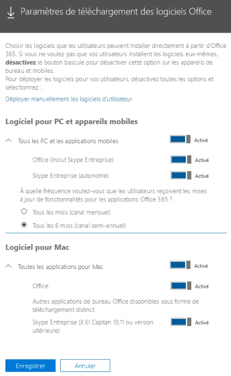

Extrait du solution du module 4, page 1

- Créez un partage sur votre serveur, de préférence dans une partition D:\ prévue à cet effet.
- Déposez le contenu du package téléchargé au préalable.

Vous pouvez au choix utiliser les fichiers XML présents par défaut, ou personnaliser le déploiement à l’aide du site https://config.office.com/.

- Lancez le téléchargement des sources grâce à la commande :

```
PS D:\office_365> .\setup.exe /download \\Serveur\partage créé\Configuration.xml
```

Vous pouvez maintenant installer le pack Office :

```
D:\office_365> .\setup.exe /configure \\Serveur\partage créé\Configuration.xml
```

- Créez ensuite la GPO :
- Créez un fichier Notepad, glissez la ligne de commande précédente et transformez l’extension du fichier en .cmd.
- Editez la GPO, allez dans Configuration ordinateur / Paramètres Windows / Scripts de démarrage / Arrêt et ajoutez le script créé précédemment.

NB : le partage dans lequel est placé le script doit être lisible des utilisateurs impactés par la GPO.

#### Commande de la capture du script de démarrage

```
\\cd01\Office_365\setup.exe /configure \\cd01\Office_365\Configuration.xml
```

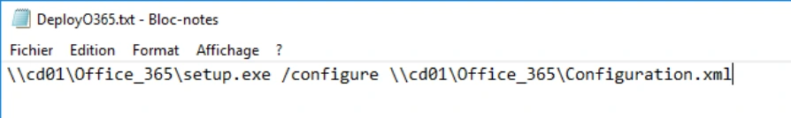

Extrait du solution du module 4, page 2

```
PS C:\users\administrator\office_365> gpupdate /force
```

- Redémarrez la machine et vérifiez que le pack Office est bien installé.

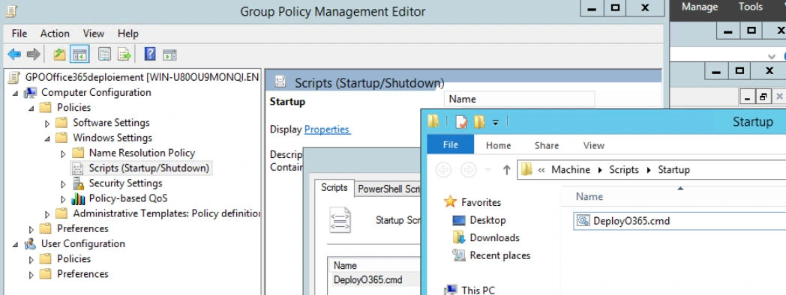

Extrait du solution du module 4, page 3

Référence du document : 11qy2tWr5VU5QdKrj8Ztldb3XcGN1NgnS · SHA-256 3ec56eac14b68e7b…

## Correction · M4 - Solution du TP2 - Administration SharePoint et OneDrive · 11 pages transcrites

Transcription du document source. Les parcours et libellés historiques sont conservés. Les mots de passe, codes de validation et coordonnées nominatives sont neutralisés. Les noms de domaine d’accès des exemples utilisent des domaines réservés à la documentation.

Correction originale : à consulter après avoir tenté l’exercice.

### Administration SharePoint et OneDrive

TP 02 du Module 04 – Services complémentaires

Avant de démarrer ce TP, il convient d’avoir suivi les vidéos des modules 1 à 4 et d’avoir réalisé les TP proposés.

### Solution

### Administration OneDrive

- Connectez-vous sur https://login.microsoftonline.com/ et utilisez vos identifiants de connexion créés dans l’étape précédente.

### Parcours de l’ensemble des options proposées

- Administration SharePoint – Création d’un site
- Allez dans le panneau d’administration SharePoint, cliquez sur Sites, Sites actifs puis Créer.
- Cliquez sur Autres options.

- Choisissez le modèle Centre de documents, nommez le site, ajoutez le propriétaire et sélectionnez la langue et le fuseau horaire.

- N’ajoutez pas de membres pour le moment et terminez la création du site. Revenez ensuite sur la liste des sites actifs et cliquez sur l’URL du site.
- A l’image des pratiques sur des serveurs de fichiers On Premise, nous allons utiliser AGDLP pour gérer les permissions d’accès à notre site. Créez deux groupes de domaine local dans l’unité d’organisation Groupes puis forcez la synchronisation.
- Ajoutez GG_ServiceIT dans le groupe GDL_SP_Fichiers_RW

- Sur le site SharePoint Fichiers de l’entreprise, cliquez sur la roue dentée puis Paramètres du site.

- Cliquez sur Autorisations de site.
- Cliquez sur Accorder des autorisations puis ajoutez le groupe GDL_SP_Fichiers_RW créé, affichez les options et sélectionnez collaboration.

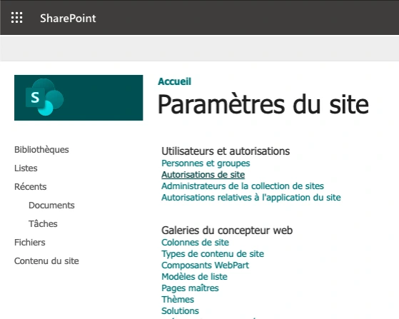

Extrait du solution du module 4, page 5

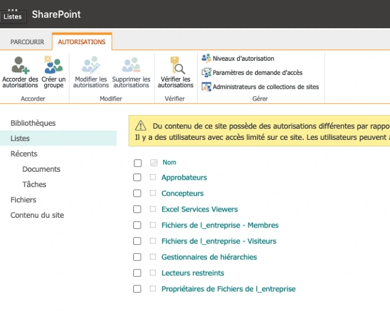

Extrait du solution du module 4, page 5

- Cliquez sur Accorder des autorisations puis ajoutez le groupe GDL_SP_Fichiers_RO créé, affichez les options et sélectionnez Visiteurs.

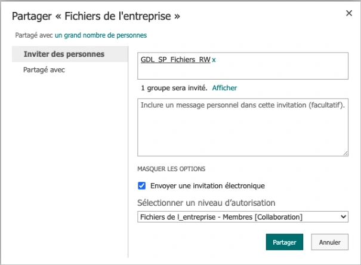

Ajout du groupe au niveau Collaboration

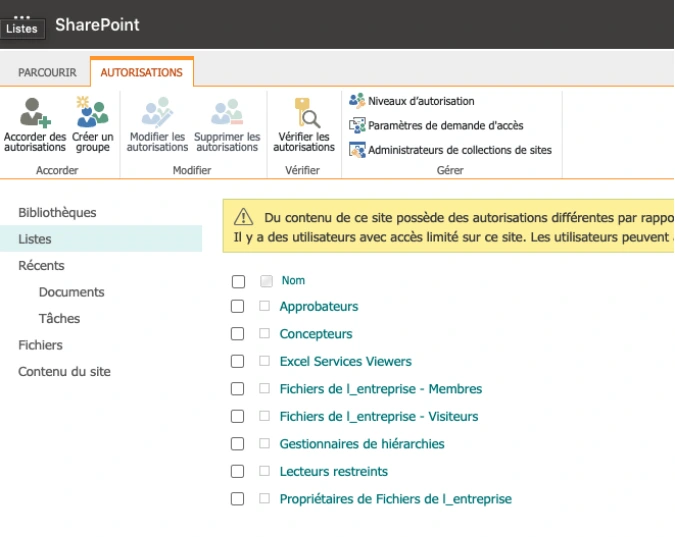

Extrait du solution du module 4, page 6

- Afin de clarifier la gestion dans le futur, vous pouvez supprimer les autorisations par défaut positionnées par SharePoint.
- Cliquez ensuite sur Visiteurs et supprimez l’entrée All company.

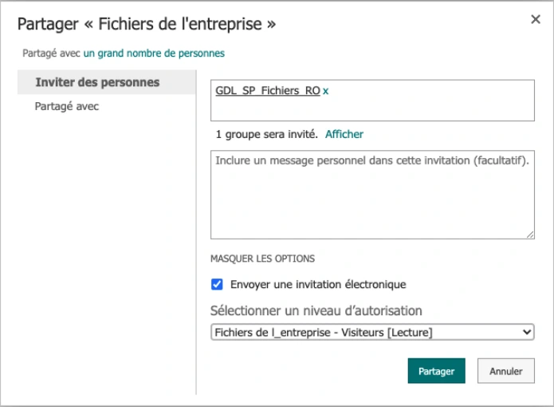

Ajout du groupe au niveau Lecture

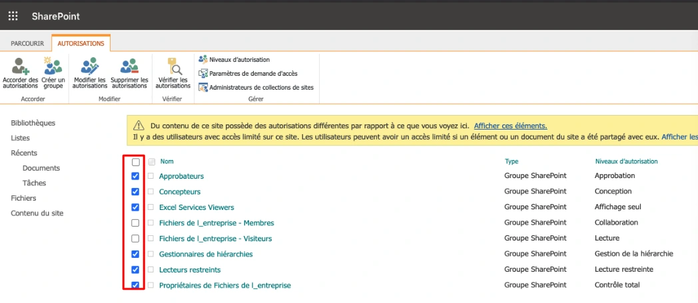

Extrait du solution du module 4, page 7

### Quelques bonnes pratiques

Il est possible de nettoyer l’affichage afin de clarifier l’ensemble des éléments affichés.

- Cliquez sur Modifier dans le volet à gauche pour masquer les éléments jugés inutiles.

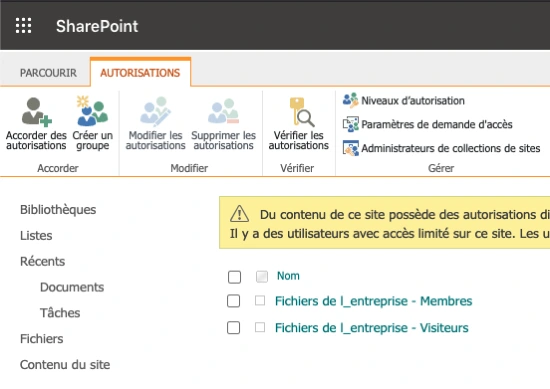

Extrait du solution du module 4, page 8

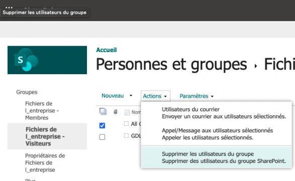

Extrait du solution du module 4, page 8

Vous pouvez désactiver la synchronisation hors connexion sur les sites et ainsi protéger les données d’éventuelles erreurs de synchronisation. Il est possible de le faire au niveau du site ou de chaque bibliothèque.

- Cliquez sur la roue dentée puis Paramètres du site.
- Dans la section Rechercher cliquez sur Disponibilité du mode Hors connexion.

#### Option affichée pour le mode hors connexion

- À la question « Voulez-vous autoriser le téléchargement des éléments de ce site sur les clients en mode hors connexion ? », choisir « Non ».

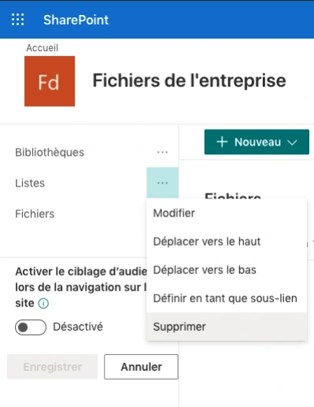

Extrait du solution du module 4, page 9

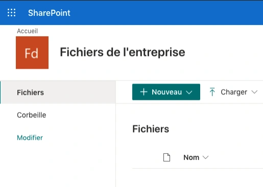

Extrait du solution du module 4, page 9

- Afin de limiter les fuites de données et les demandes d’accès intempestives, vous pouvez restreindre cela en allant dans les autorisations de site puis Paramètres de demande d’accès.

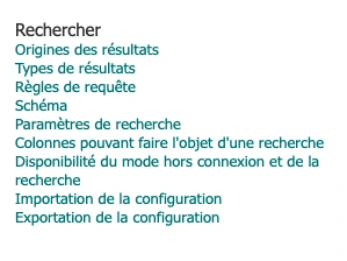

Extrait du solution du module 4, page 10

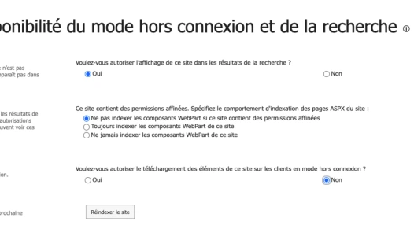

Extrait du solution du module 4, page 10

- Décochez les 3 cases présentées et cliquez sur OK.

#### Cases affichées dans la capture des paramètres de demandes d’accès

- Autoriser les membres et propriétaires à partager le site, des fichiers et des dossiers.
- Autoriser les membres à inviter d’autres personnes dans le groupe des membres du site.
- Autoriser les demandes d’accès.

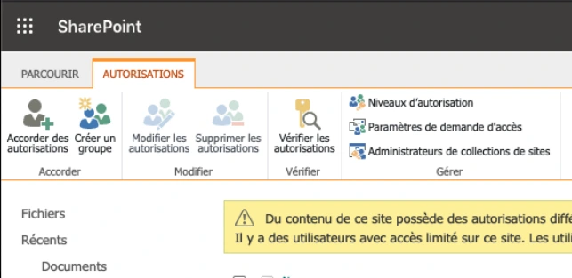

Extrait du solution du module 4, page 11

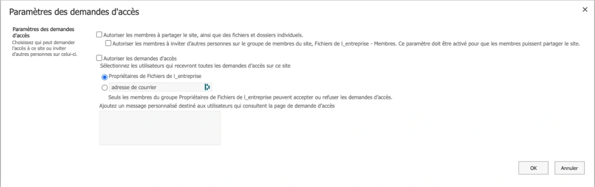

Options de partage et de demande d’accès

Référence du document : 1NFVLCn71-19tdQ1gyOGCdIZQ188D2HS9 · SHA-256 5cb1e4dbf1ad8029…

## Fiche de synthèse

Les lignes reprennent les titres du cours et la première phrase de chaque partie.

| Partie | Repère du cours |
| --- | --- |
| Support · Module 04 - Support de cours · 24 pages transcrites | Les parcours et libellés historiques sont conservés. |
| Énoncé · M4 - Énoncé du TP 1 - Déploiement Office 365 · 1 pages transcrites | Les parcours et libellés historiques sont conservés. |
| Énoncé · M4 - Énoncé du TP2 - Administration SharePoint et OneDrive · 1 pages transcrites | Les parcours et libellés historiques sont conservés. |
| Correction · M4 - Solution du TP 1 - Déploiement Office 365 · 3 pages transcrites | Les parcours et libellés historiques sont conservés. |
| Correction · M4 - Solution du TP2 - Administration SharePoint et OneDrive · 11 pages transcrites | Les parcours et libellés historiques sont conservés. |
